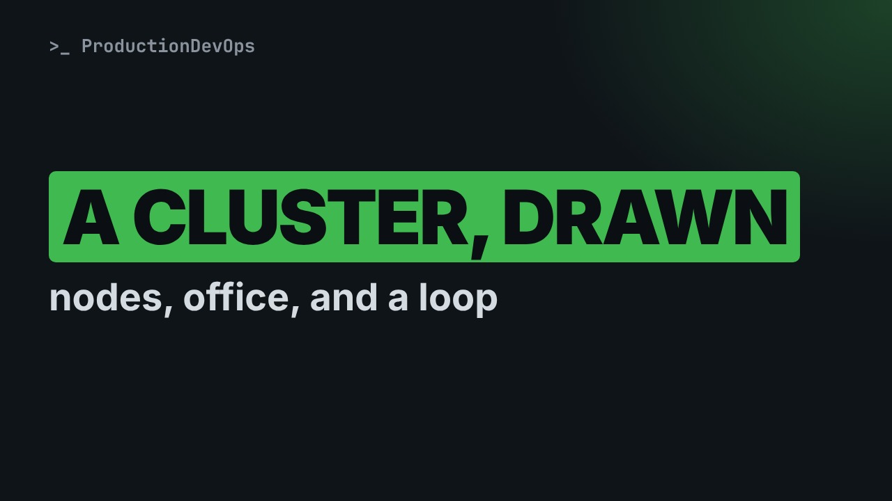
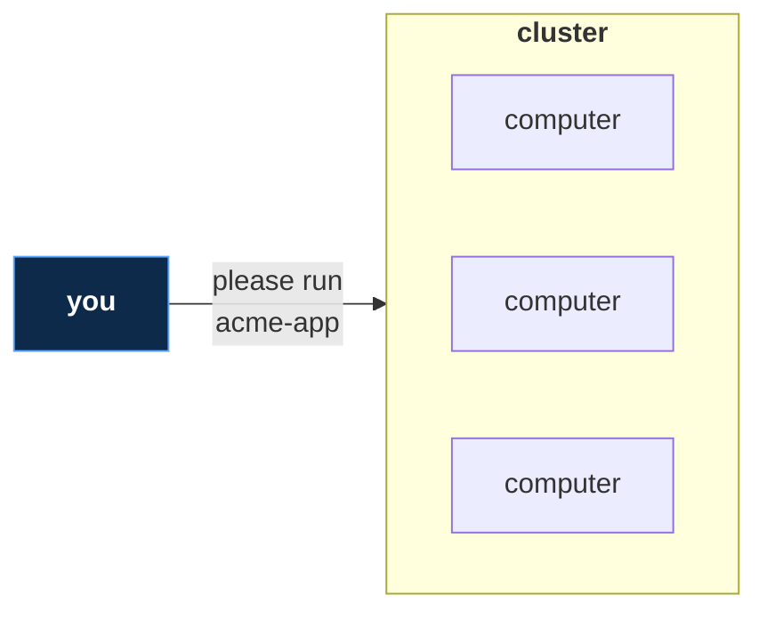
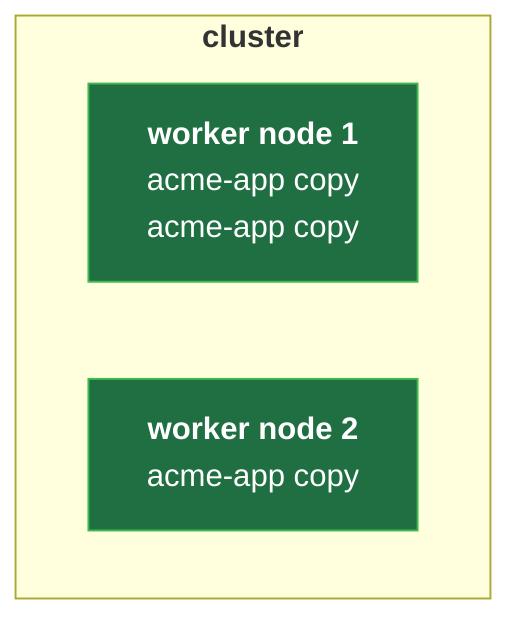
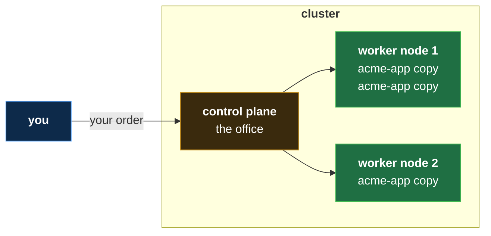
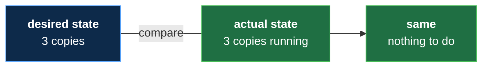
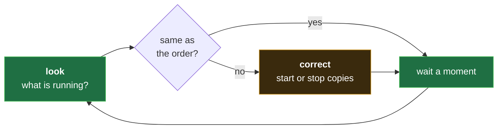
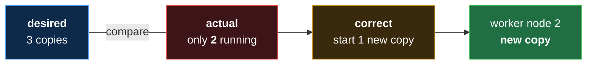

# A Kubernetes Cluster, Drawn: Nodes, Control Plane and Desired State

**Video:** coming soon on the [channel](https://www.youtube.com/@production-devops).

Everyone says Kubernetes runs on a "cluster", but what does one look like? This lesson of Kubernetes from Zero draws a cluster piece by piece: nodes, the worker nodes where your apps run, the control plane that decides and watches, and the simple loop that keeps your app the way you asked, like a thermostat. No terminal, nothing to install, no experience needed. Every new word is explained on screen. The challenge and its solution are in the demos repo.

## Files in this folder

- [`challenge-solution.md`](challenge-solution.md) (solution of the challenge: try it yourself first)

## What you need

A Linux shell (a VM, WSL or a container is fine). Everything runs inside this folder.

## The lesson, step by step

The same explanations as the video, with every command. Read it, then run it yourself.

Kubernetes runs on something called a cluster. Today we draw one, piece by piece. At the end, you will know why it can fix itself.

For this lesson you need nothing. Just watch. No terminal today, only pictures. About five minutes.

### The plan

This is lesson three of Kubernetes from Zero. First, what a cluster is. Then the kitchens, where your apps run. Then the office, where decisions are made. And finally the loop that keeps everything right.

### The cluster

- `cluster`: A group of computers that work together as one (like a restaurant group: many kitchens, one manager)
First word: cluster. A cluster is a group of computers that work together as one. Think of a restaurant group: many kitchens, one manager.

**A cluster, from far away**

From far away, a cluster looks like one big computer. You ask it to run acme app. You do not pick the computer.

- `node`: One computer inside the cluster (like one kitchen of the restaurant group)
Each computer in a cluster is called a node. One node is one kitchen of the restaurant group.

### The kitchens

- `worker node`: A node where your containers run (like a kitchen where the cooking really happens)
Most nodes are worker nodes. This is where your containers run. It is the kitchen where the cooking really happens.

**Worker nodes run the containers**

Here are two worker nodes. They run three copies of acme app. Remember from lesson one: each copy is a container, a meal kit being cooked.

### The office

- `control plane`: The part of Kubernetes that decides and watches (like the manager's office: it takes orders, it does not cook)
Now the most important word: control plane. It is the part of Kubernetes that decides and watches. Think of the manager's office.

**One office, two kitchens**

Here is the whole picture. You talk only to the office, and the office talks to the kitchens. Next lesson, you will see a real cluster with this shape.

The office takes your order. For example: three copies of acme app. It picks a kitchen for each copy, one with room. It watches every kitchen, all the time. Usually it does not cook. Your apps run on the worker nodes.

### So far

So far: a cluster is a group of computers working as one. Worker nodes run the apps. The control plane decides and watches. Next: how the office keeps your order true, even when something breaks.

### The loop

- `desired state`: What you asked for, written down (like the order on the board: 3 plates of acme-app)
New word: desired state. It is what you asked for, written down. Like the order on the board: three plates of acme app.

- `actual state`: What is really running, right now (like the plates that are really cooking)
And its partner: actual state. It is what is really running, right now. The plates that are really cooking.

**Desired and actual: they match**

The office compares the two: three copies wanted, three running. They are the same, so there is nothing to do.

- `control loop`: Compare what you want with what is, fix the difference, repeat (like a thermostat: you set 21 degrees, it heats until the room gets there)
This checking never stops: it is called a control loop. Think of a thermostat. You set twenty one degrees, and it heats until the room gets there.

**The loop: compare, then correct**

Here is the loop: look at what is running, and compare it with the order. If they differ, correct it. Then look again, forever.

**A copy stops: the loop fixes it**

Now a copy stops: three wanted, only two running. They differ, so the office starts one new copy on a worker with room.

This is the answer from the start. You never say: restart copy two. You only say what you want: three copies. The loop does the rest, day and night. Even if a whole node stops, its copies start again on the other nodes. This takes a few minutes.

### Recap

Recap: a cluster is made of nodes. Workers run the apps. The control plane decides. Desired state is your order. Actual state is what really runs. The control loop compares them and corrects the difference, again and again. Your challenge: you want three copies, but five are running. What does the loop do? The answer is in the demo repo.

### Where next

Where next? Lesson four: a real cluster, on your own computer. You will type your first command, and ask the cluster what it has. And you will see this drawing for real: one office, two kitchens.

Next lesson: your first look at a real cluster. Subscribe so you do not miss it.

## Challenge

Your challenge: you want three copies, but five are running. What does the loop do? The answer is in the demo repo.

When you have tried: [`challenge-solution.md`](challenge-solution.md).

---

From the [ProductionDevOps](https://www.youtube.com/@production-devops) channel: real-world DevOps and SRE, explained with real commands.
