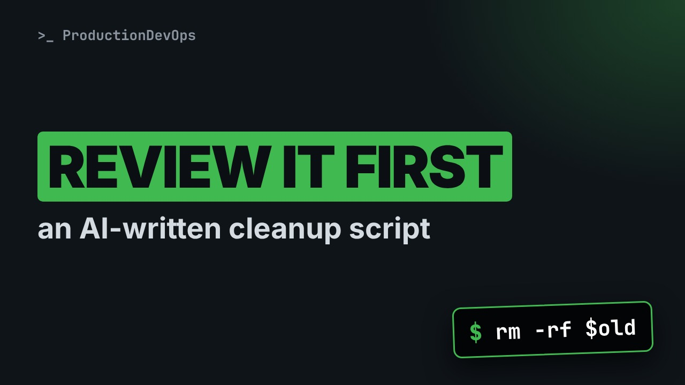
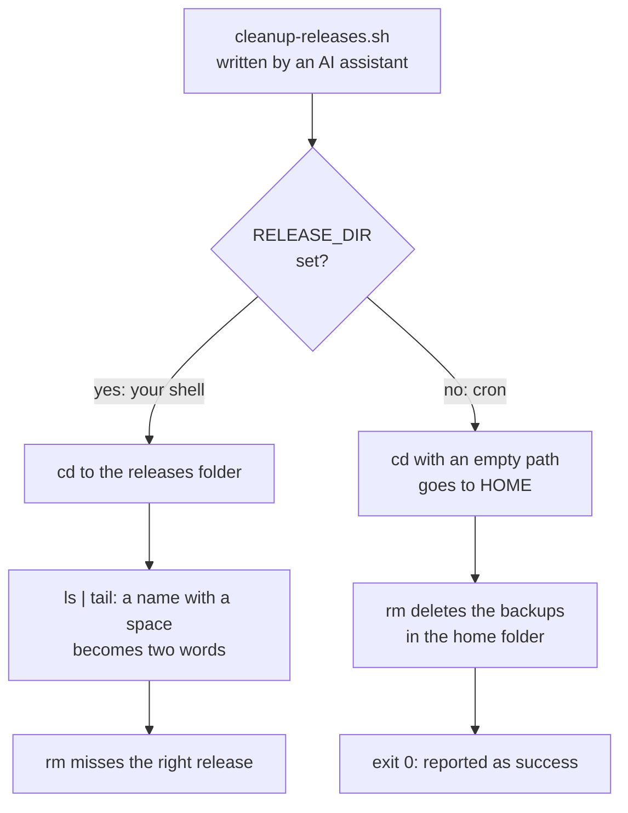
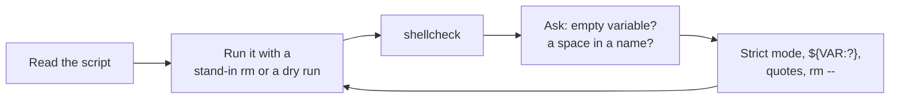

# An AI Wrote My Bash Script. Review It Before You Run It



**Video:** coming soon on the [channel](https://www.youtube.com/@production-devops).

An AI assistant writes a cleanup script for old releases in seconds, and it reads well. We test it safely, with a stand-in rm that only prints, and find two bugs: a release name with a space becomes two words, and under cron an empty variable sends the script to the home directory, where it deletes the backups and still reports success. Then what shellcheck catches, what it cannot know, the fixed script, and a review checklist for AI-written Bash.

## Files in this folder

- [`backups/acme-app-db.sql.gz`](backups/acme-app-db.sql.gz)
- [`cleanup-fixed.sh`](cleanup-fixed.sh)
- [`cleanup.sh`](cleanup.sh)
- [`releases/2026-09-30 hotfix/VERSION`](releases/2026-09-30 hotfix/VERSION)
- [`releases/2026-10-01/VERSION`](releases/2026-10-01/VERSION)
- [`releases/2026-10-02/VERSION`](releases/2026-10-02/VERSION)
- [`releases/2026-10-03/VERSION`](releases/2026-10-03/VERSION)
- [`releases/2026-10-04/VERSION`](releases/2026-10-04/VERSION)
- [`safe-bin/rm`](safe-bin/rm)
- [`challenge-solution.sh`](challenge-solution.sh) (solution of the challenge: try it yourself first)

## What you need

A Linux shell (a VM, WSL or a container is fine). Everything runs inside this folder.

## Before you start

The video runs these commands first, off screen:

```bash
chmod +x safe-bin/rm; export PATH="$PWD/safe-bin:$PATH"
[ "$(command -v rm)" = "$PWD/safe-bin/rm" ] || exit 98
touch -d '2026-09-30 10:00' 'releases/2026-09-30 hotfix'; for d in 01 02 03 04; do touch -d "2026-10-$d 10:00" releases/2026-10-$d; done
touch -d '2026-10-05 09:00' releases; touch -d '2026-10-04 09:00' safe-bin; touch -d '2026-10-03 09:00' cleanup.sh; touch -d '2026-10-02 09:00' cleanup-fixed.sh; touch -d '2026-09-01 09:00' backups
```

## The big picture

The same AI-written cleanup script behaves very differently depending on where it runs: in your shell the variable is set, under cron it is empty.



The review loop that catches both bugs before cron does.



## The lesson, step by step

The same explanations as the video, with every command. Read it, then run it yourself.

An AI assistant wrote this cleanup script in seconds, and it reads well. Run it from cron, and it deletes your backups, then reports success. Here is how to review AI Bash before it touches a server.

### The plan

This is part three of AI-Assisted DevOps. Here is the plan. First, we read the script the AI wrote. Then we test it safely, with a stand-in for rm that deletes nothing. We see what shellcheck finds, and what it cannot know. And we end with the fixed script, and a short review checklist.

### The AI's script

```
#!/bin/bash
# acme-app: keep the 3 newest releases, delete the rest
KEEP=3
cd $RELEASE_DIR
for old in $(ls -t | tail -n +$((KEEP + 1))); do
  echo "Removing $old"
  rm -rf $old
done
echo "Done: kept the $KEEP newest releases"
```

We asked for a script that keeps the three newest releases of our app, and deletes the older ones. It moves into the release folder. The deploy job sets this variable. ls dash t lists by age, newest first. tail skips the first three lines, so only the old ones remain. For each old release, it prints a line and deletes it. Short, readable, plausible.

### A safe test bench

Rule one: never run an untrusted script for real. On this machine, rm is a stand-in. Here it is.

```console
$ cat safe-bin/rm
```

It is first on the path, so every rm in this video only prints what it would delete.

```console
$ command -v rm
```

Our releases folder has five releases, newest first. One name contains a space: a hotfix.

```console
$ ls -1t releases
```

### Test 1: the deploy job

First, like the deploy job: the variable points to the releases folder.

```console
$ RELEASE_DIR=releases bash cleanup.sh
```

The two oldest should go. Look at the hotfix: the loop split its name at the space. It tries to delete two folders that do not exist. This is word splitting. An unquoted list from ls breaks on every space.

### Test 2: cron

Now like cron. Cron starts with an almost empty environment, so the variable is not set.

```console
$ bash cleanup.sh
```

With an empty variable, the line becomes cd alone. And cd alone goes to your home directory. The script deletes there, including the backups. And the exit code?

```console
$ echo "exit code: $?"
```

Zero. Nobody gets an alert. The backups are simply gone.

### shellcheck

shellcheck reads a script without running it. Dash f gcc prints one line per finding.

```console
$ shellcheck -f gcc cleanup.sh
```

Line four: cd can fail, and nothing checks it. Then two warnings about missing quotes. And line five: do not parse the output of ls.

shellcheck caught the space bug. Not the cron one. It found the unquoted variables, the unchecked cd, and the ls parsing. It cannot know that this variable is empty in cron. For shellcheck, it comes from the environment. And nothing makes the script fail. It always exits with zero.

### The fix

```
#!/bin/bash
# acme-app: keep the 3 newest releases, delete the rest
set -euo pipefail
shopt -s nullglob
KEEP=3
cd -- "${RELEASE_DIR:?is not set}"
```

Strict mode. Dash e stops at the first failing command, dash u stops on unset variables, and pipefail checks every command in a pipe. nullglob: if a pattern matches nothing, it expands to nothing, not to the pattern itself. The colon question mark form: if the variable is unset or empty, the script stops with this message. The double dash ends the options of cd.

```
releases=(*/)
count=${#releases[@]}
(( count > KEEP )) || exit 0
for old in "${releases[@]:0:count-KEEP}"; do
  echo "Removing $old"
  rm -rf -- "$old"
done
```

A glob instead of ls. It fills an array with the folders, and each name stays whole, spaces included. Our folders are named by date, so the glob's sorted order is also the age order. The loop takes all but the last three. If there are three releases or fewer, there is nothing to do, and it exits cleanly. Quotes around the variable, and double dash before it, so a name can never be read as an option.

Cron again, with no variable.

```console
$ bash cleanup-fixed.sh
```

It stops before touching anything, and the exit code is not zero, so cron can raise an alert.

```console
$ echo "exit code: $?"
```

Now with the variable set.

```console
$ RELEASE_DIR=releases bash cleanup-fixed.sh
```

The two oldest, and the hotfix name is intact. And shellcheck has nothing left to say.

```console
$ shellcheck cleanup-fixed.sh && echo "shellcheck: no findings"
```

### Gotchas

Three traps with AI-written scripts. It works in your shell. Cron and CI start with different variables, often almost none. A clean shellcheck is not proof that the script is safe. It cannot know your environment. The AI's examples use nice names. Test with spaces, and with empty values.

### Recap

Before an AI script touches a server: Run it first with a stand-in for rm, or in a dry run. Run shellcheck. Then ask two questions: what if this variable is empty, and what if a name has a space? Use strict mode, required variables, quotes, and double dash before every rm target. Your challenge: add a dry run switch to the fixed script, so it only prints what it would delete. The solution is in the demo repository.

AI writes the first draft fast. Reviewing it is still your job, and now you have a checklist. Subscribe for more AI-assisted DevOps, done safely.

## All the commands, to copy

Run them from inside this folder, in this order (some are expected to fail: that is the point of the demo).

```bash
cat safe-bin/rm
command -v rm
ls -1t releases
RELEASE_DIR=releases bash cleanup.sh
bash cleanup.sh
echo "exit code: $?"
shellcheck -f gcc cleanup.sh
bash cleanup-fixed.sh
RELEASE_DIR=releases bash cleanup-fixed.sh
shellcheck cleanup-fixed.sh && echo "shellcheck: no findings"
```

## Challenge

Your challenge: add a dry run switch to the fixed script, so it only prints what it would delete. The solution is in the demo repository.

When you have tried: [`challenge-solution.sh`](challenge-solution.sh).

---

From the [ProductionDevOps](https://www.youtube.com/@production-devops) channel: real-world DevOps and SRE, explained with real commands.
