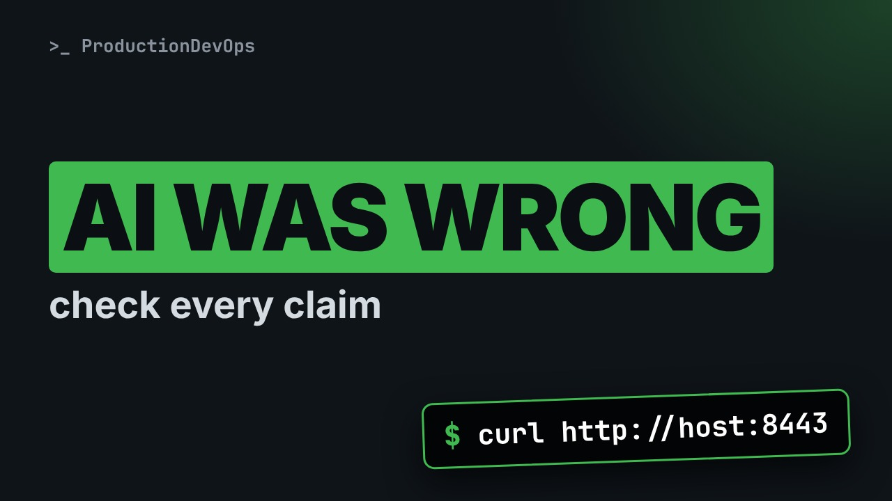
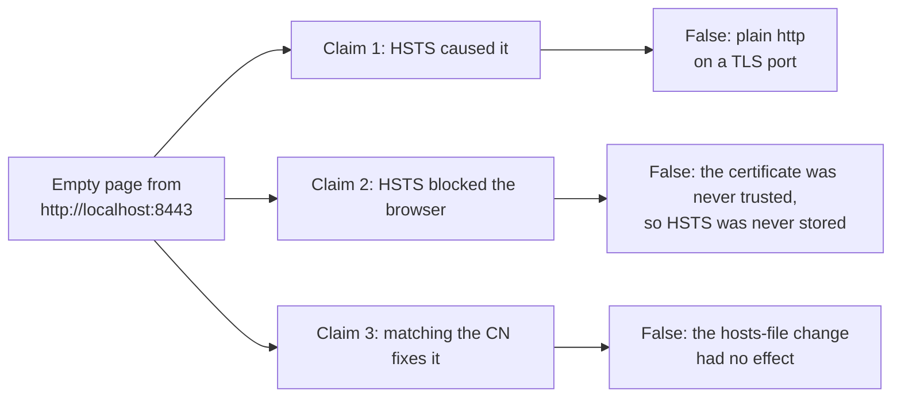
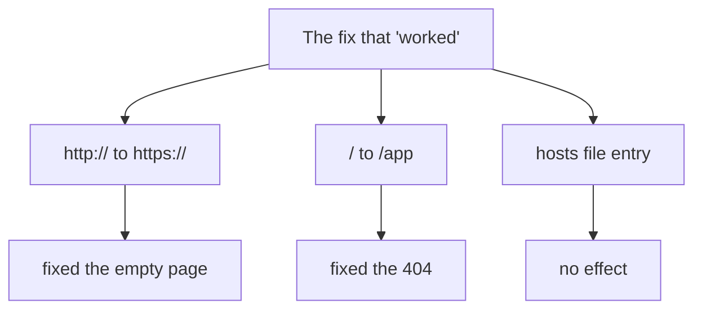

# The AI Blamed HSTS. The Real Bug Was http:// on a TLS Port



**Video:** https://youtu.be/tEtOMVB1q9Y

An AI assistant diagnosed an empty page from a containerized web console: certificate name mismatch plus HSTS. Its fix seemed to work. We check every claim with one real command and find that the empty page came from plain http on a TLS port, that browsers never stored HSTS, and that the hosts-file change did nothing. Plus a short checklist for verifying AI troubleshooting.

## Files in this folder

- [`serve.sh`](serve.sh)
- [`tls-server.py`](tls-server.py)

## What you need

A Linux shell (a VM, WSL or a container is fine). Everything runs inside this folder.

## Before you start

The video runs these commands first, off screen:

```bash
[ -f app.pem ] || openssl req -x509 -newkey rsa:2048 -nodes -keyout app.key -out app.pem -days 365 -subj /CN=app-server 2>/dev/null
./serve.sh app.pem app.key >/dev/null
```

## The big picture

The AI's three claims, and what one real command showed for each of them.



Three changes were made at once: only two of them fixed something.



## The lesson, step by step

The same explanations as the video, with every command. Read it, then run it yourself.

An AI assistant fixed a broken web console. But when we checked its explanation, most of it was wrong. The fix worked by accident. Here is how to check an AI diagnosis, one claim at a time.

### The plan

Here is the plan. First, the case, and the diagnosis the AI gave. Then we check each claim with one real command. We find out what really fixed it. And a short checklist for AI troubleshooting.

### The case

The case is a common one. A web console runs in a container. Port eighty four forty three is published. The browser opens localhost on that port, and says the page did not send any data. The engineer pastes the outputs into an AI assistant, and asks for help.

### The AI's diagnosis

```
Diagnosis
1. The certificate CN is app-server, not localhost.
2. The server sends HSTS.
3. CN mismatch + HSTS: the browser drops the
   connection without showing any warning.
Fix
4. Add "127.0.0.1 app-server" to the hosts file.
5. Open https://app-server:8443/app
```

Here is the diagnosis, paraphrased. The certificate is issued for app server, not localhost. And the server sends H S T S. Together, it says, they make the browser drop the connection, without a warning. The fix: map app server to the local address in the hosts file, and open that name with https. The engineer does it, and the console opens. Case closed?

First, to be fair. The AI did several things right. It checked layer by layer: TCP, TLS, HTTP, and then the logs. It proposed small, reversible steps. No restarts, and nothing deleted. But nobody verified the explanation. Let's do it now, claim by claim.

### Claim: the empty page

Our test server reproduces the setup. First, exactly what the browser did: plain http.

```console
$ curl -sS http://127.0.0.1:8443/
```

Connection reset, no data. That is the empty page. The server speaks TLS, it received plain text, and it hung up. And notice: if H S T S were active, the browser would have switched to https by itself. This plain http request would never have been sent.

### Claim: HSTS

Could H S T S have been stored from an earlier visit? The standard says no. Browsers must ignore the header when the connection has a certificate error. That is in the standard, R F C sixty seven ninety seven. And this certificate was never trusted by the browser. Let's prove it.

open S S L shows the verification result.

```console
$ openssl s_client -connect 127.0.0.1:8443 -servername app-server -brief </dev/null
```

Self signed, never trusted. So the browser could never store H S T S for it. Claim two is wrong too.

### Claim: the hosts file

The fix relied on the common name. But browsers only check the S A N list. Does this certificate have one?

```console
$ openssl x509 -in app.pem -noout -ext subjectAltName
```

No S A N at all. So even with the hosts file, the browser still rejects the name, and the certificate is still untrusted. The engineer simply clicked through the warning. And that click was possible only because H S T S was not active. The opposite of what the AI said.

### What really fixed it

With https, the server answers. On the root path, it sends a four oh four with a redirect script.

```console
$ curl -k -sS https://127.0.0.1:8443/
```

On slash app, a redirect to the login page.

```console
$ curl -k -sS -o /dev/null -w '%{http_code} -> %{redirect_url}\n' https://127.0.0.1:8443/app
```

The fix changed three things at the same time. Only two of them mattered. From http to https. This fixed the empty page. From the root to slash app. This fixed the four oh four. The hosts file entry. No effect at all. But it got the credit.

### Checklist

Here is the checklist we use now. Ask for the evidence behind each claim. Which output shows it? Reproduce each claim with one command, like we just did. Change one thing at a time, and retest after each change. And distrust fixes that change the environment, like hosts files or disabled checks, instead of the cause.

### Recap

Let's recap. The empty page was plain http on a TLS port. H S T S was never stored, because the certificate was never trusted. And a fix that works is not proof that the explanation is right.

AI assistants are great at proposing checks. Verifying the conclusions is still our job. Subscribe for more practical DevOps, with every claim tested.

## All the commands, to copy

Run them from inside this folder, in this order (some are expected to fail: that is the point of the demo).

```bash
curl -sS http://127.0.0.1:8443/
openssl s_client -connect 127.0.0.1:8443 -servername app-server -brief </dev/null
openssl x509 -in app.pem -noout -ext subjectAltName
curl -k -sS https://127.0.0.1:8443/
curl -k -sS -o /dev/null -w '%{http_code} -> %{redirect_url}\n' https://127.0.0.1:8443/app
```

---

From the [ProductionDevOps](https://www.youtube.com/@production-devops) channel: real-world DevOps and SRE, explained with real commands.
