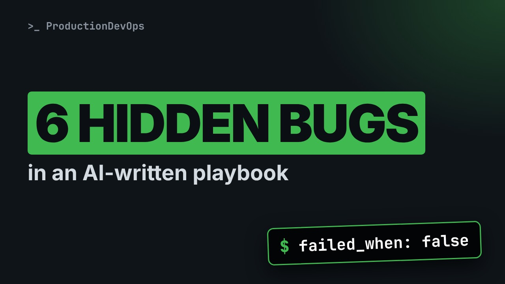
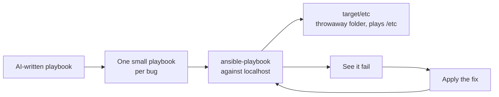
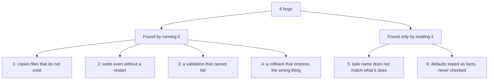

# I Asked an AI for an Ansible Playbook. 6 Bugs a Senior Engineer Would Catch



**Video:** https://youtu.be/lwxMEYYR5uk

An AI assistant generated a complete Ansible playbook for a logging change: backups, validation, rollback, even emojis in the summary. It looked production ready. We run it for real and review it like a senior engineer would, bug by bug, with the fix for each one. Everything runs locally against localhost, in a throwaway directory.

## Files in this folder

- [`ansible.cfg`](ansible.cfg)
- [`backups/run-1700000000/logrotate.d.backup/app`](backups/run-1700000000/logrotate.d.backup/app)
- [`backups/run-1700000000/logrotate.d.backup/web`](backups/run-1700000000/logrotate.d.backup/web)
- [`deploy-ai.yml`](deploy-ai.yml)
- [`deploy-fixed.yml`](deploy-fixed.yml)
- [`files/app.logrotate`](files/app.logrotate)
- [`handler-ai.yml`](handler-ai.yml)
- [`inventory.ini`](inventory.ini)
- [`rollback-ai.yml`](rollback-ai.yml)
- [`rollback-safe.yml`](rollback-safe.yml)
- [`target/etc/logrotate.d/app`](target/etc/logrotate.d/app)
- [`target/etc/logrotate.d/web`](target/etc/logrotate.d/web)
- [`validate-ai.yml`](validate-ai.yml)
- [`validate-fixed.yml`](validate-fixed.yml)

## What you need

A Linux shell (a VM, WSL or a container is fine). Everything runs inside this folder.

## The big picture

How the AI-written playbook is tested safely: localhost only, a throwaway folder that plays the role of /etc, one small playbook per bug.



The six bugs, split by how you find them.



## The lesson, step by step

The same explanations as the video, with every command. Read it, then run it yourself.

I asked an AI assistant for an Ansible playbook to change logging on a group of servers. It came back with backups, validation, a rollback, and a summary full of green check marks. It looked ready to ship. Let's run it, and review it the way a senior engineer would.

### The setup

Here is the plan. We run each part of the playbook for real, in a safe place. We find six bugs, one at a time. For each bug, we first see it fail, then we look at the fix. And we finish with a short checklist for any AI generated playbook.

How do we run it safely? Everything runs only against this machine, localhost, inside a throwaway folder. A folder called target slash etc plays the role of the real etc folder. Nothing on the machine is touched. And I split the generated playbook into small pieces, one per bug, so each problem is easy to see.

### Bug 1: a test used as a filter

```
- name: Deploy logrotate configs
  ansible.builtin.copy:
    src: "{{ item.src }}"
    dest: "{{ item.dest }}"
    mode: "0644"
  loop: "{{ logrotate_configs }}"
  when: item.src | exists
```

This task copies config files, from a source to a destination. loop repeats the task once for each file in the list. And when sets a condition: copy only if the source file exists. The idea is good. But look at how it is written: exists, after a pipe.

Let's run it.

```console
$ ansible-playbook deploy-ai.yml
```

It stops right away. In Ansible, a pipe is for filters, which transform a value. But exists is a test, which answers yes or no. So the condition cannot even be read. This playbook never worked, not even once.

```
- name: Deploy logrotate configs
  ansible.builtin.copy:
    src: "{{ item.src }}"
    dest: "{{ item.dest }}"
    mode: "0644"
  loop: "{{ logrotate_configs }}"
  when: item.src is file
```

Tests use the word is. So the fix is: item dot src is file. One more detail. This test runs on the machine where Ansible runs, not on the target server. Here that is correct, because the source file lives on our machine too. To check a file on the target server, you would use the stat module.

With is file, the task runs, and the config is copied.

```console
$ ansible-playbook deploy-fixed.yml
```

### Bug 2: a condition that is never true

```
- name: Wait for journald to restart
  ansible.builtin.debug:
    msg: waiting for the journald socket
  when: "'restart systemd-journald' in ansible_play_batch"
```

Bug two. After restarting journald, the playbook should wait a moment. But only if a restart really happened. To decide, it checks if the text restart systemd journald is inside a variable called ansible play batch. What is in that variable? Let's print it.

This playbook prints the variable, then runs the same wait task.

```console
$ ansible-playbook handler-ai.yml
```

Ansible play batch is the list of hosts in the current run. Here, just localhost. A task name will never be in a list of hosts. So the wait is always skipped, even after a real restart. The right tool is a handler, a task that runs only when another task notifies it of a change.

### Bug 3: failures switched off

```
- name: Validate logrotate syntax
  ansible.builtin.command: grep -q rotate target/etc/logrotate.d/nginx
  changed_when: false
  failed_when: false

- name: Summary
  ansible.builtin.debug:
    msg: All tests passed
```

Bug three. This task validates a config file, with grep. But failed when false means: this task is never failed. Whatever grep returns. And the summary always prints: all tests passed.

Here is the catch: there is no nginx config at all. Let's run the validation.

```console
$ ansible-playbook validate-ai.yml
```

Green, and all tests passed. Now the same check, with failed when false removed.

```console
$ ansible-playbook validate-fixed.yml
```

This is the honest result. If a failure is really acceptable, save the result, and decide explicitly. Never switch failures off.

### Bug 4: a rollback that deletes first

```
- name: Restore logrotate configs
  ansible.builtin.shell: |
    rm -rf target/etc/logrotate.d/
    cp -a {{ backup_dir }}/logrotate.d.backup/ target/etc/logrotate.d/
```

Bug four is the most dangerous one. The rollback first deletes the live config folder. Then it copies the backup in. And the backup folder comes from a variable that someone types by hand.

Here are the live configs: app and web.

```console
$ ls target/etc/logrotate.d
```

Now we run the rollback, with one digit missing in the backup path. Easy to do at three in the morning.

```console
$ ansible-playbook rollback-ai.yml -e backup_dir=backups/run-170000000
```

The copy failed, so the task failed. But was anything deleted?

```console
$ ls target/etc/logrotate.d
```

Yes. The configs are gone. The rollback made things worse. We put them back, and look at a safe version.

```console
$ cp -a backups/run-1700000000/logrotate.d.backup target/etc/logrotate.d
```

```
- name: Check the backup before touching anything
  ansible.builtin.stat:
    path: "{{ backup_dir }}/logrotate.d.backup"
  register: backup
- name: Stop if the backup is missing
  ansible.builtin.assert:
    that: backup.stat.isdir | default(false)
    fail_msg: "Backup not found - nothing was changed"
```

The safe version starts by looking at the backup folder, with stat. It changes nothing. If the backup is missing, it stops, with a clear message.

```
- name: Move current configs aside instead of deleting them
  ansible.builtin.command: mv target/etc/logrotate.d target/etc/logrotate.d.pre-rollback
  args:
    removes: target/etc/logrotate.d
- name: Restore from the backup
  ansible.builtin.command: cp -a {{ backup_dir }}/logrotate.d.backup target/etc/logrotate.d
  args:
    creates: target/etc/logrotate.d
```

Then it moves the current configs aside, instead of deleting them. And only then, it copies the backup in.

Same typo as before.

```console
$ ansible-playbook rollback-safe.yml -e backup_dir=backups/run-170000000
```

It stops at the check. And the live configs?

```console
$ ls target/etc/logrotate.d
```

Untouched. Now with the correct path.

```console
$ ansible-playbook rollback-safe.yml -e backup_dir=backups/run-1700000000 && ls target/etc
```

### Bugs 5 and 6: names and facts

The last two bugs do not crash anything. You only catch them by reading carefully. Bug five. A task called verify persistent storage runs journal control dash dash verify. That command checks that journal files are not corrupted. It says nothing about logs surviving a reboot. Bug six. The AI listed journald default values with total confidence. Some were simply wrong for this system. Before you trust a default, ask the system. Systemd analyze cat config shows the configuration really in use.

### The review checklist

Here is the checklist I now use for any AI generated playbook. One. Run it against a throwaway target first. Two of these bugs failed on the very first run. Two. Search for failed when false and ignore errors, and justify every single one. Three. Test the rollback on purpose, with a wrong input. Four. Read every task name, and check it matches what the task really does.

AI assistants are great at producing the shape of a playbook. The judgment is still your job. Review generated automation like a pull request from a new colleague. Subscribe for more real world DevOps.

## All the commands, to copy

Run them from inside this folder, in this order (some are expected to fail: that is the point of the demo).

```bash
ansible-playbook deploy-ai.yml
ansible-playbook deploy-fixed.yml
ansible-playbook handler-ai.yml
ansible-playbook validate-ai.yml
ansible-playbook validate-fixed.yml
ls target/etc/logrotate.d
ansible-playbook rollback-ai.yml -e backup_dir=backups/run-170000000
cp -a backups/run-1700000000/logrotate.d.backup target/etc/logrotate.d
ansible-playbook rollback-safe.yml -e backup_dir=backups/run-170000000
ansible-playbook rollback-safe.yml -e backup_dir=backups/run-1700000000 && ls target/etc
```

---

From the [ProductionDevOps](https://www.youtube.com/@production-devops) channel: real-world DevOps and SRE, explained with real commands.
