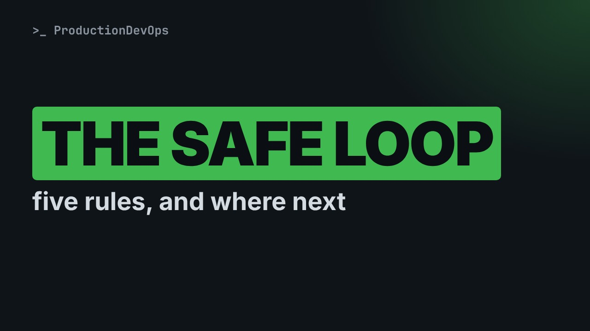
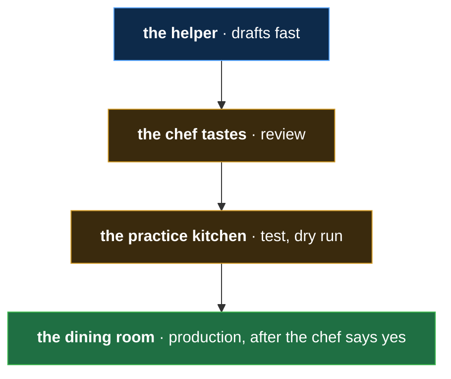
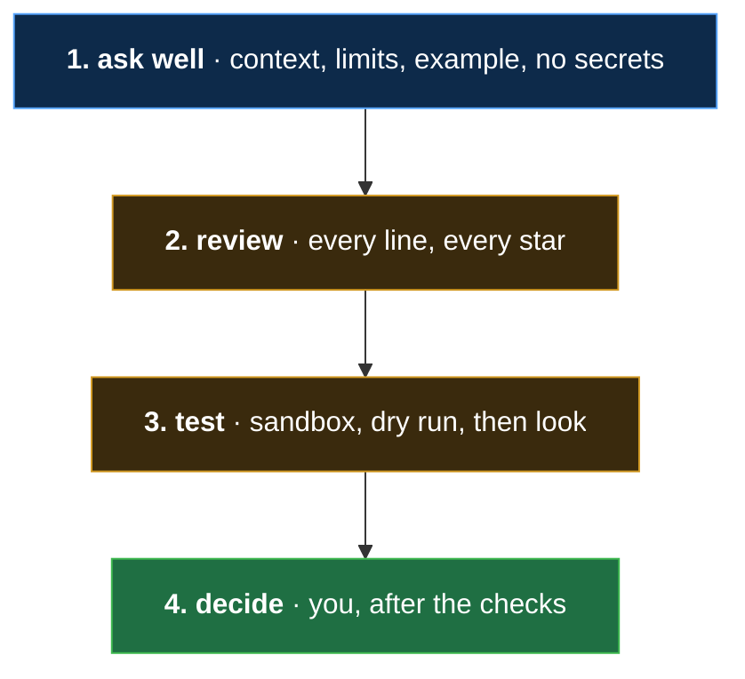
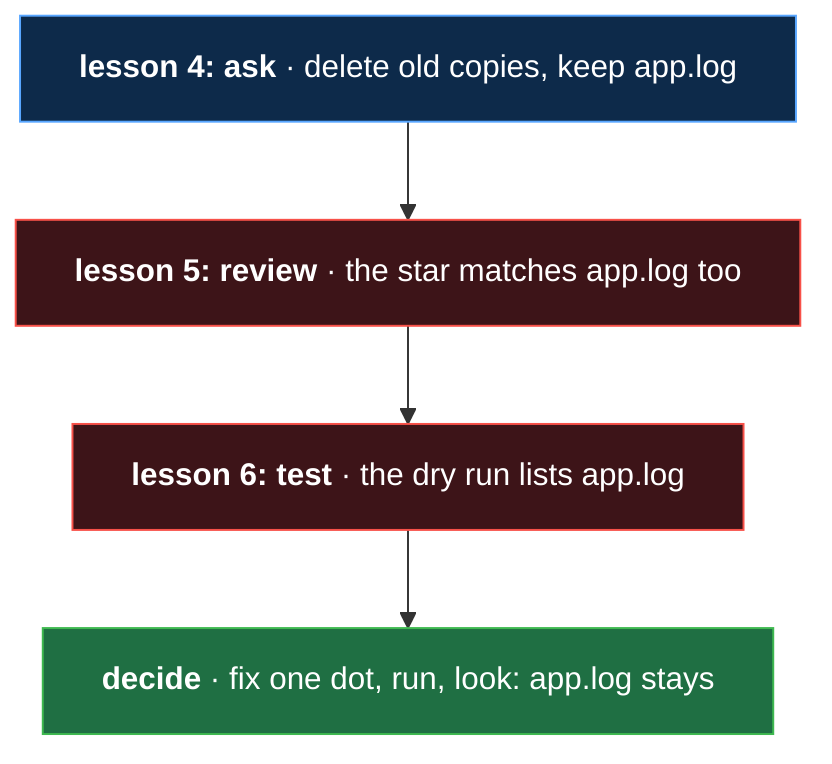
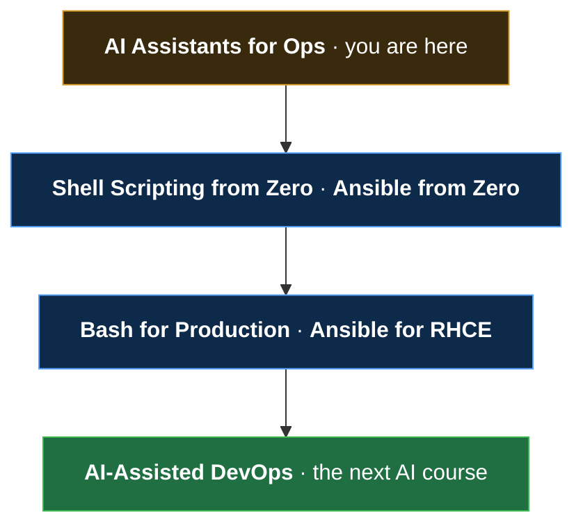

# The Safe Loop, and Where Next (AI for Ops: the Safe Basics)

**Video:** coming soon on the [channel](https://www.youtube.com/@production-devops).

Seven lessons, one habit: the assistant drafts, you check and decide. This last lesson of AI Assistants for Ops: the Safe Basics puts the whole course on one page: the words you learned, the safe loop (ask well, review, test, decide), five rules to keep next to your screen, and the cleanup example from start to end. Then where to go next: AI-Assisted DevOps: Using AI Without Breaking Production, and the courses to take before it. No product names, nothing to install. The challenge and its solution are in the demos repo.

## Files in this folder

- [`challenge-solution.md`](challenge-solution.md) (solution of the challenge: try it yourself first)

## What you need

A Linux shell (a VM, WSL or a container is fine). Everything runs inside this folder.

## The lesson, step by step

The same explanations as the video, with every command. Read it, then run it yourself.

Seven lessons, one habit. In five minutes: the whole course as one safe loop, five rules to keep, and where to go next.

You will need lessons one to seven. Or watch this one as a summary. Nothing to install. Only pictures.

### The plan

This is the last lesson of AI Assistants for Ops. First, the words of this course. Then, the safe loop, and five rules. One example, from start to end. And where to go next.

### The words

The words of this course. You type a prompt, and a language model writes likely text. The context is all it can see. A confident wrong answer sounds sure, but is made up. Secrets are never pasted. Placeholders replace them. A code review reads every line. A sandbox and a dry run test it safely.

**The kitchen, one last time**

In the kitchen: the helper drafts fast. The chef tastes, then tries it in the practice kitchen. Only then does it reach the dining room.

### The safe loop

**The safe loop**

The same thing as a loop: ask well, with no secrets, and review every line. Test it in a sandbox. Then you decide.

Five rules. One: likely is not true, and a calm tone is not a proof. Two: never paste secrets, or data about people. Three: give context, limits, and an example. Four: review every line, and test in a copy, dry run first. Five: let it explain. You check, and you decide.

### So far

So far: one loop. Ask, review, test, decide. And five rules, small enough for one card. Next: the loop on one example, and where to go next. If this is helping, subscribe. The next course uses these rules on real automation.

### One example

**One example, start to end**

Our cleanup, start to end: we asked well, and the review found the star. The dry run showed it. One dot fixed it, and we looked.

And for errors, lesson seven. The assistant explained the error, and that was right. It guessed the cause, and that was wrong. One l s found a typo. No restart was needed.

### Your first week

Your first week with an assistant. Start low risk: let it explain errors, and summarise logs. Then small drafts. Review them, and test them in a copy. And nothing near production, until the loop is a habit.

Good to know. The tools change fast. The loop stays. The same loop works for a colleague's code, and for your own. In doubt? Ask a person, before you act.

### Not covered

What this course did not cover. Assistants that run commands for you, by themselves. Your company's rules and approved tools. Ask your team about them. And long scripts and playbooks. That is the next course.

### Where next

Where next? AI-Assisted DevOps: Using AI Without Breaking Production. It reviews real cases: a playbook written by an AI, and a cleanup script. And an AI diagnosis that blamed the wrong thing.

**The road to it**

That course is intermediate. Before it, take Shell Scripting and Ansible from Zero. Then Bash for Production and Ansible for R H C E.

### Recap

Recap. The loop: ask, review, test, decide. The helper drafts, and you stay the chef. Your challenge: write the five rules on one card, in your own words. Keep it next to your screen. An example card is in the demo repo.

That is the end of this course. Subscribe, and the next course, AI-Assisted DevOps, finds you.

## Challenge

Your challenge: write the five rules on one card, in your own words. Keep it next to your screen.

When you have tried: [`challenge-solution.md`](challenge-solution.md).

---

From the [ProductionDevOps](https://www.youtube.com/@production-devops) channel: real-world DevOps and SRE, explained with real commands.
