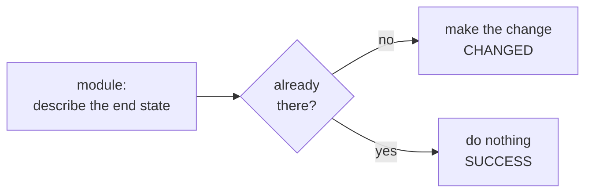

# Ansible Ad Hoc Commands: command, shell, raw and One-Line Changes


**Video:** coming soon on the [channel](https://www.youtube.com/@production-devops).

Lesson 6 of Ansible for RHCE. Ad hoc commands run one module on many hosts, with no playbook. We take the command apart (pattern, dash m, dash a, dash b), then see the real difference between the command, shell and raw modules: pipes and redirection only work in shell, and raw needs no Python. Then copy, file and user as one-line changes with become, a dry run with --check, idempotency (changed, then ok), and a small shell script that wraps ad hoc commands, an EX294 objective. Challenge and solution in the demos repo.

## Files in this folder

- [`ansible.cfg`](ansible.cfg)
- [`inventory.ini`](inventory.ini)
- [`lab/up.sh`](lab/up.sh)
- [`setup-acme.sh`](setup-acme.sh)
- [`challenge-solution.sh`](challenge-solution.sh) (solution of the challenge: try it yourself first)

## What you need

A Linux shell (a VM, WSL or a container is fine). Everything runs inside this folder.

## Before you start

The video runs these commands first, off screen:

```bash
if [ -f .lab-reset ]; then bash lab/up.sh; else bash lab/up.sh reset && touch .lab-reset; fi >/dev/null 2>&1
```

## The lesson, step by step

The same explanations as the video, with every command. Read it, then run it yourself.

You need one answer, or one small change, on every server, right now. A playbook is too much for that. An ad hoc command does it in one line, and at the end we wrap it in a script you can run twice.

### The plan

This is lesson 6 of Ansible for RHCE. Here is the plan. First, we read an ad hoc command, piece by piece. Then the command, shell and raw modules, and their real differences. Then one-line changes with copy and user, and a dry run. And a shell script that runs ad hoc commands. That is an exam objective.

### Anatomy

```console
$ ansible web -b -m copy -a "dest=/etc/motd content='Managed by Ansible\n'"
```

An ad hoc command runs one module, on the hosts you pick, with no playbook. Here is a typical one.

- `web`: the host pattern
First, the host pattern: a group, a host, or any pattern from the inventory lesson.

- `-b`: become root
Dash b means become. The module runs as root, through sudo on the node.

- `-m copy`: the module
Dash m picks the module. Here, copy. Without dash m, Ansible uses the command module.

- `-a "dest=/etc/motd content='Managed by Ansible\n'"`: the module arguments
Dash a holds the module arguments, as key equals value pairs. Double quotes outside, single quotes inside.

Which user does Ansible run as on the nodes? We ask whoami, with no dash m, so the command module runs it.

```console
$ ansible web -a 'whoami'
```

Look at the line under each node: ops, the user Ansible logs in as. And with dash b?

```console
$ ansible web -b -a 'whoami'
```

Now root. Ansible still logs in as ops, then uses sudo.

### command, shell, raw

Three modules run commands. They are not the same. command runs the program directly. There is no shell, so no pipes and no redirection. shell runs the line through slash bin slash sh. Pipes and redirection work. raw sends the line over plain SSH. No module, and no Python needed on the node. Prefer command: it is safer. Use shell only when you need shell features.

Does a redirection work with the command module? We try to write hello into a file.

```console
$ ansible node01 -m command -a 'echo hello > /tmp/out.txt'
```

Look at the output line. echo printed the arrow and the file name, as plain words. No file was written.

The same line, with the shell module, on both nodes.

```console
$ ansible web -m shell -a 'echo hello from shell > /tmp/hello.txt'
```

No output: it went into the file. Is the file there? We read it back.

```console
$ ansible web -a 'cat /tmp/hello.txt'
```

Both nodes answer hello from shell. The shell on each node did the redirection.

A quick checkpoint. An ad hoc command is a pattern, a module, its arguments, and dash b for root. command has no shell, and shell does. Next: real changes, a dry run, and the script you can run twice without fear.

### One-line changes

Now a real change: copy writes slash etc slash motd. First, without dash b.

```console
$ ansible node01 -m copy -a "dest=/etc/motd content='Managed by Ansible\n'"
```

Where is the reason? In the first line, and in msg: destination slash etc not writable.

Now with dash b. The answer is a long JSON, so grep keeps one line per host: the line with the arrow.

```console
$ ansible web -b -m copy -a "dest=/etc/motd content='Managed by Ansible\n'" | grep '=>'
```

CHANGED on both nodes: the file was written. Now the same command again.

```console
$ ansible web -b -m copy -a "dest=/etc/motd content='Managed by Ansible\n'" | grep '=>'
```

SUCCESS: the file already matched, so copy did nothing. Changed once, then ok. This is idempotency.

### --check

What would happen if we created a user called auditor? Dash dash check asks the module, and changes nothing.

```console
$ ansible web -b -m user -a 'name=auditor' --check | grep '=>'
```

It says CHANGED: the user would be created. Is it there? We ask node zero one with ssh.

```console
$ ssh node01 id auditor
```

**Why a script of modules is safe**



Every module compares the end state with the host: if it is missing, it makes the change, and if it is already there, it does nothing. So a script made of modules is safe to run twice.

### A script

```
#!/usr/bin/env bash
# setup-acme.sh: prepare acme-app on managed nodes, with ad hoc commands
set -euo pipefail
target=${1:-web}

step() {
  echo "== $1"; shift
  ansible "$target" "$@" | grep '=>'     # one status line per host
}
```

Strict mode, and the host pattern as the first argument. The default is web. step prints a title, then runs one ad hoc command with our grep. If a host fails, strict mode stops the script.

```
step "app directory" -b -m file -a "path=/srv/acme-app state=directory owner=ops mode=0755"
step "version file"  -b -m copy -a "dest=/srv/acme-app/VERSION content='1.0\n' owner=ops"
step "app user"      -b -m user -a "name=acme shell=/sbin/nologin"
```

Three steps: the directory, a version file, and a user with no login shell.

We run the script on web. Look at the status of each step.

```console
$ ./setup-acme.sh web
```

CHANGED everywhere: the directory, the version file and the user were all missing.

And again.

```console
$ ./setup-acme.sh web
```

SUCCESS everywhere. Every step uses an idempotent module, so the script is safe to run again and again.

### Gotchas

Four mistakes that cost time. A pipe or a redirection with the command module gives no error. It just does the wrong thing. command and shell always report changed. Add creates or removes, or use a real module. Quoting: double quotes around the whole dash a string, single quotes inside it. If you forget dash b, you get not writable or permission denied.

### Recap

Let's recap. An ad hoc command is a pattern, a module, its arguments, and dash b for root. command is the default. shell for pipes and redirection. raw only when the node has no Python. Modules are idempotent, and dash dash check shows a change before you make it. Your challenge: make the script take the version as a second argument. Only the version file must change. The solution is in the demo repository.

Ad hoc commands are for quick answers and small changes. Next lesson: modules and their documentation, with ansible doc. Subscribe so you do not miss it.

## All the commands, to copy

Run them from inside this folder, in this order (some are expected to fail: that is the point of the demo).

```bash
ansible web -b -m copy -a "dest=/etc/motd content='Managed by Ansible\n'"
ansible web -a 'whoami'
ansible web -b -a 'whoami'
ansible node01 -m command -a 'echo hello > /tmp/out.txt'
ansible web -m shell -a 'echo hello from shell > /tmp/hello.txt'
ansible web -a 'cat /tmp/hello.txt'
ansible node01 -m copy -a "dest=/etc/motd content='Managed by Ansible\n'"
ansible web -b -m copy -a "dest=/etc/motd content='Managed by Ansible\n'" | grep '=>'
ansible web -b -m user -a 'name=auditor' --check | grep '=>'
ssh node01 id auditor
./setup-acme.sh web
```

## Challenge

Your challenge: make the script take the version as a second argument. Only the version file must change. The solution is in the demo repository.

When you have tried: [`challenge-solution.sh`](challenge-solution.sh).

---

From the [ProductionDevOps](https://www.youtube.com/@production-devops) channel: real-world DevOps and SRE, explained with real commands.
