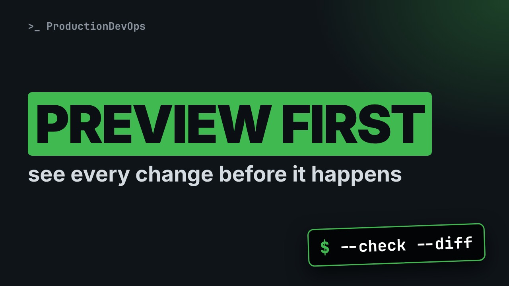
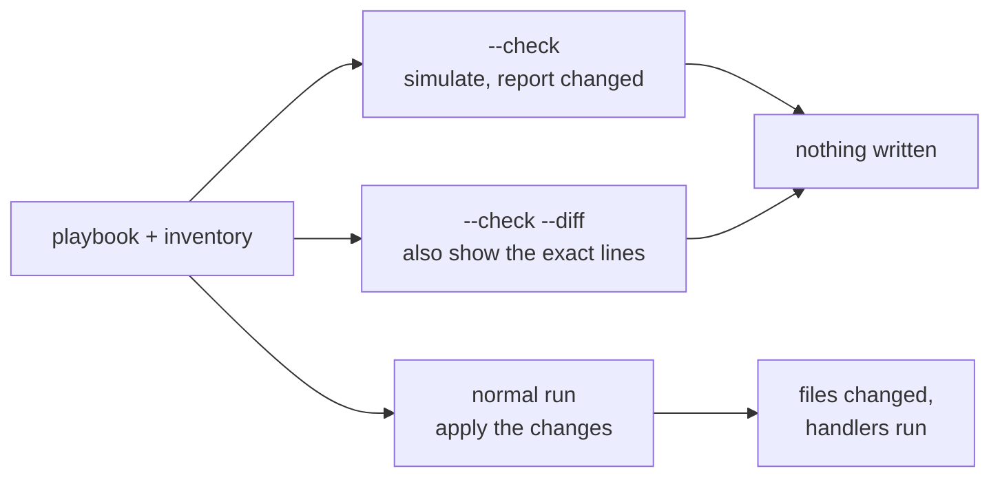
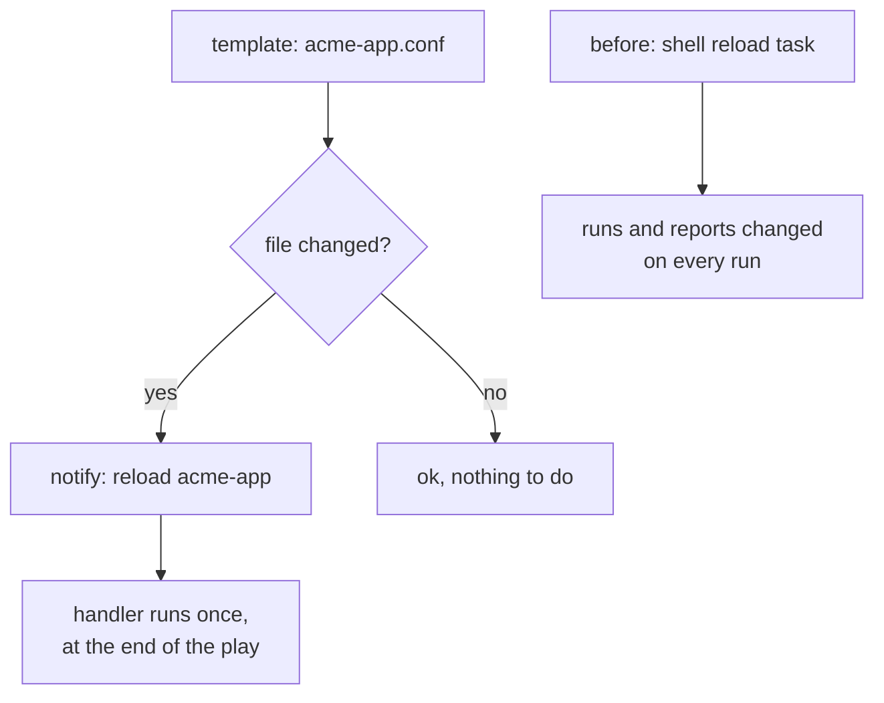

# Preview Every Ansible Change Before It Happens: --check and --diff



**Video:** coming soon on the [channel](https://www.youtube.com/@production-devops).

A playbook run should never be a surprise. We change one variable and ask Ansible what it would do, without touching anything: --check simulates the run, --diff shows the exact lines that would change. Then the tasks that lie: a shell command that check mode skips, and that reports changed on every real run. We fix them with a read-only command that runs in check mode, and a handler that reloads only when something really changed.

## Files in this folder

- [`VERSION`](VERSION)
- [`ansible.cfg`](ansible.cfg)
- [`group_vars/web.yml`](group_vars/web.yml)
- [`inventory.ini`](inventory.ini)
- [`site-fixed.yml`](site-fixed.yml)
- [`site.yml`](site.yml)
- [`templates/acme.conf.j2`](templates/acme.conf.j2)
- [`challenge-solution.yml`](challenge-solution.yml) (solution of the challenge: try it yourself first)

## What you need

A Linux shell (a VM, WSL or a container is fine). Everything runs inside this folder.

## Before you start

The video runs these commands first, off screen:

```bash
mkdir -p target/node01 target/node02
```

## The big picture

Three ways to run the same playbook: only the last one changes the servers.



Why the reload "lies" and how the handler fixes it: the reload runs only when the config really changed.



## The lesson, step by step

The same explanations as the video, with every command. Read it, then run it yourself.

You change one variable and run the playbook on every server. What exactly will it change? Ansible can tell you, line by line, before it touches anything.

### The plan

This is part three of Ansible in the Real World. Here is the plan. First, dash dash check: a simulated run that changes nothing. Then dash dash diff, to see the exact lines that would change. Then the tasks that lie: shell and command. And how to fix them, with read-only commands and handlers.

### The playbook

```
- name: Configure acme-app
  hosts: web
  gather_facts: false
  tasks:
    - name: Write the config
      ansible.builtin.template:
        src: acme.conf.j2
        dest: "target/{{ inventory_hostname }}/acme.conf"

    - name: Reload acme-app
      ansible.builtin.shell: "echo reload >> target/{{ inventory_hostname }}/reload.log"
```

One play for the web group. Two servers, node zero one and node zero two, both simulated on this machine. The first task renders a template into the app's config file. The number of workers comes from a variable. The second task reloads the app. In this lab, the reload just writes a line in a log file, so we can count reloads.

We run the playbook once, for real.

```console
$ ansible-playbook site.yml
```

Both tasks report changed, on both hosts. The config file exists, and the app was reloaded once.

### Check mode

Right now, the config on node zero one has four workers.

```console
$ grep workers target/node01/acme.conf
```

Now a change: we raise the workers from four to eight, in the group variables.

```console
$ sed -i 's/workers: 4/workers: 8/' group_vars/web.yml
```

Before applying it, dash dash check. Ansible runs every task in simulation.

```console
$ ansible-playbook site.yml --check
```

The config task says changed: it would change. The reload says skipping: check mode did not run it.

Check mode is a simulation, and it has limits. Each module compares the wanted state with the real one, and reports what it would change. Nothing is written on the servers. But shell and command cannot know what a command would do. So they are skipped.

### Diff mode

First, proof that nothing was written. The file on disk still says four.

```console
$ grep workers target/node01/acme.conf
```

Changed is not enough. We want to see the change. We add dash dash diff, and dash dash limit to look at one host.

```console
$ ansible-playbook site.yml --check --diff --limit node01
```

This is a unified diff. The line with a minus is the current file. The line with a plus is what Ansible would write. One line changes: workers, from four to eight. This is the review you can do before every run.

### Tasks that lie

Happy with the preview, we apply it for real.

```console
$ ansible-playbook site.yml
```

The config changed, and the app was reloaded. So far, so good.

Now we run the same playbook again. Nothing has changed since the last run.

```console
$ ansible-playbook site.yml
```

The config is ok. But the reload says changed, again. A shell task always reports changed, because Ansible cannot know what it did.

And it really ran. We count the reloads on node zero one.

```console
$ cat target/node01/reload.log
```

Three reloads, for two real changes. On a real server, that is a restart nobody needed.

### The fix

```
- name: Read the deployed version
  ansible.builtin.command: cat VERSION
  register: version
  check_mode: false
  changed_when: false
```

Some commands only read. This one reads the deployed version, and keeps it in a variable. check mode false: run it even in check mode. It is safe, and later tasks may need its result. changed when false: it never reports changed, because reading changes nothing.

```
- name: Write the config
  ansible.builtin.template:
    src: acme.conf.j2
    dest: "target/{{ inventory_hostname }}/acme.conf"
  notify: Reload acme-app

handlers:
  - name: Reload acme-app
    ansible.builtin.shell: "echo reload >> target/{{ inventory_hostname }}/reload.log"
```

The template task now notifies a handler. The notification is sent only when the task really changed something. The reload moves into the handlers section. A handler runs at the end of the play, and only if it was notified.

A new change: six workers.

```console
$ sed -i 's/workers: 8/workers: 6/' group_vars/web.yml
```

The preview, with the fixed playbook.

```console
$ ansible-playbook site-fixed.yml --check --diff --limit node01
```

The version task ran in check mode, and reported ok. The diff shows the change. And the handler appears: check mode now tells us a reload would happen.

We apply it.

```console
$ ansible-playbook site-fixed.yml
```

The config changed, so the handler ran, and reloaded the app.

And a second run, with nothing to change.

```console
$ ansible-playbook site-fixed.yml
```

Changed zero, and no reload. Now changed means something really changed.

### Gotchas

Three things check mode will not do for you. Check mode is a simulation. A task that needs an earlier change, like a package that was never installed, can fail or lie. Dash dash diff prints file contents. For files with secrets, set diff to false on that task, or use no log. Command and shell with creates or removes become check aware. Use them for one-time actions.

### Recap

Let's recap. Before every run: check, diff, and limit to one host first. Read-only commands get check mode false, and changed when false. Side effects, like reloads, go in handlers, so they run only after a real change. Your challenge: print the version that the read-only task found, and keep changed zero on a second run. The solution is in the demo repository.

Preview with check and diff, and make changed mean something. Subscribe for more Ansible in the real world.

## All the commands, to copy

Run them from inside this folder, in this order (some are expected to fail: that is the point of the demo).

```bash
ansible-playbook site.yml
grep workers target/node01/acme.conf
sed -i 's/workers: 4/workers: 8/' group_vars/web.yml
ansible-playbook site.yml --check
ansible-playbook site.yml --check --diff --limit node01
cat target/node01/reload.log
sed -i 's/workers: 8/workers: 6/' group_vars/web.yml
ansible-playbook site-fixed.yml --check --diff --limit node01
ansible-playbook site-fixed.yml
```

## Challenge

Your challenge: print the version that the read-only task found, and keep changed zero on a second run. The solution is in the demo repository.

When you have tried: [`challenge-solution.yml`](challenge-solution.yml).

---

From the [ProductionDevOps](https://www.youtube.com/@production-devops) channel: real-world DevOps and SRE, explained with real commands.
