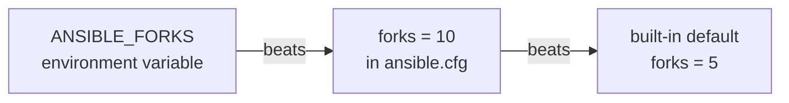

# Which ansible.cfg Is Ansible Really Using? Control Node Setup


**Video:** coming soon on the [channel](https://www.youtube.com/@production-devops).

Lesson 3 of Ansible for RHCE. The same command works in one folder and fails in another: same Ansible, different config file. We install and check ansible-core, then prove the ansible.cfg search order for real (ANSIBLE_CONFIG, ./ansible.cfg, ~/.ansible.cfg, /etc/ansible/ansible.cfg), read the effective settings with ansible-config dump --only-changed and ansible-config view, and walk through the settings that matter: inventory, remote_user, forks, host_key_checking and become. Plus the world-writable folder that silently ignores your config.

## Files in this folder

- [`ansible.cfg`](ansible.cfg)
- [`elsewhere/notes.txt`](elsewhere/notes.txt)
- [`inventory.ini`](inventory.ini)
- [`lab/up.sh`](lab/up.sh)
- [`other.cfg`](other.cfg)
- [`challenge-solution.sh`](challenge-solution.sh) (solution of the challenge: try it yourself first)

## What you need

A Linux shell (a VM, WSL or a container is fine). Everything runs inside this folder.

## Before you start

The video runs these commands first, off screen:

```bash
if [ -f .lab-reset ]; then bash lab/up.sh; else bash lab/up.sh reset && touch .lab-reset; fi >/dev/null 2>&1
ansible-config() { command ansible-config "$@" | cat; }
```

## The lesson, step by step

The same explanations as the video, with every command. Read it, then run it yourself.

The same command works in one folder, and fails in another. Today: which ansible dot cfg is really used, and the settings that matter. And at the end, one chmod that makes Ansible quietly ignore your config file.

### The plan

This is lesson 3 of Ansible for RHCE. Here is the plan. First, install ansible core, and check it. Then where Ansible looks for its config file, and in which order. Then we read the real settings, with ansible config. And the key settings: inventory, remote user, forks and become.

### Install

Only the control node needs Ansible. On RHEL nine, it is a package: dnf install ansible core, from the AppStream repository. On any Linux, you can install it with pip, for your user only. On the managed nodes there is nothing to install. They only need Python.

In our lab, ansible core was installed with pip. pip show tells us the package and its version.

```console
$ python3 -m pip show ansible-core | head -2
```

ansible dash dash version confirms it. The second line is the one this lesson is about: the config file.

```console
$ ansible --version | head -2
```

### Search order

Ansible uses one config file. It looks for it in this order. First, the ANSIBLE underscore CONFIG environment variable, if it is set. Second, ansible dot cfg in the current directory. Third, dot ansible dot cfg in your home directory. Fourth, slash etc slash ansible slash ansible dot cfg. The first file found wins. The others are ignored: files are never merged.

Our project folder contains an ansible dot cfg.

```console
$ ls
```

So that is the file Ansible uses.

```console
$ ansible --version | grep 'config file'
```

The folder called elsewhere has no config file.

```console
$ ls elsewhere
```

We run Ansible from there. The parentheses make a subshell, so the cd applies to this one command only. The answer is None.

```console
$ (cd elsewhere && ansible --version | grep 'config file')
```

No variable, no file there, none in home, none in slash etc. So Ansible does not know our inventory, and the same command finds no hosts.

```console
$ (cd elsewhere && ansible all -m ping)
```

Now we put a copy in the home directory, named dot ansible dot cfg.

```console
$ cp ansible.cfg ~/.ansible.cfg
```

From the folder with no config, Ansible now finds the one in home.

```console
$ (cd elsewhere && ansible --version | grep 'config file')
```

And the environment variable beats everything, even the ansible dot cfg in the current directory.

```console
$ ANSIBLE_CONFIG=other.cfg ansible --version | grep 'config file'
```

We remove the home copy, so it does not confuse us later.

```console
$ rm ~/.ansible.cfg
```

A quick checkpoint. Ansible uses one config file: the variable, then the current folder, then home, then slash etc. If it finds none, it has no inventory, and no hosts. Next: the real settings, and the chmod that hides your config.

### ansible-config

Which settings does our config really change? ansible config dump, dash dash only changed.

```console
$ ansible-config dump --only-changed
```

Each line has the setting name, the file it came from in brackets, and the value. Look at the inventory: the relative path became a full path, next to the config file.

ansible config view prints the config file in use, as it is.

```console
$ ansible-config view | head -4
```

Where is every setting, with its default? ansible config init, dash dash disabled. The last line is a setting, commented out with a semicolon.

```console
$ ansible-config init --disabled | head -4
```

The full template is long, so the arrow writes it into a file.

```console
$ ansible-config init --disabled > full.cfg
```

On the exam there is no internet. What is the exact name of forks? grep finds it, with its default: five.

```console
$ grep ';forks=' full.cfg
```

### Key settings

```
[defaults]
inventory = inventory.ini
remote_user = ops
forks = 10
host_key_checking = True
interpreter_python = /usr/bin/python3

[privilege_escalation]
become = True
become_method = sudo
become_user = root
become_ask_pass = False
```

inventory: the default inventory, so you do not type dash i every time. remote user: the user Ansible logs in as on the managed nodes. Here, ops. forks: how many hosts Ansible works on at once. The default is five. host key checking verifies the SSH host key of each node. Keep it on. Become true: every task runs as root, through sudo. Ask pass is false, because sudo needs no password for ops.

We log in as ops. So who runs the command on the node?

```console
$ ansible all -m command -a whoami
```

Root, on both nodes: become in the config runs every task through sudo.

**Where one setting comes from**



For one single setting, there is an order too. An environment variable beats the config file, and the config file beats the built-in default.

Every setting also has an environment variable. Here, ANSIBLE underscore FORKS, for one command only.

```console
$ ANSIBLE_FORKS=20 ansible-config dump --only-changed | grep FORKS
```

The source is now the environment variable. It overrides only that setting, and the rest still comes from the file.

### Gotchas

Now a trap. We make the project folder writable by everyone.

```console
$ chmod o+w .
```

Ansible ignores the ansible dot cfg in a world writable folder, for security. It only prints a warning.

```console
$ ansible --version | grep 'config file'
```

The fix: remove write permission for others.

```console
$ chmod o-w .
```

Three more things to remember. Config files are never merged. A config in your home directory hides the one in slash etc completely. Shared folders, like Vagrant or W S L mounts, are often world writable. Check the warning. Host key checking false is convenient in a lab, but it disables a security check.

### Recap

Let's recap. Install ansible core on the control node only. The config file: ANSIBLE CONFIG, then the current directory, then home, then slash etc. The first one wins. Check it with ansible dash dash version, and ansible config dump only changed. Your challenge: from the elsewhere folder, ping all the nodes without copying any file. The solution is in the demo repository.

Always know which config file you are using. Next lesson: inventories, with groups, ranges, and patterns to pick exactly the hosts you want. Subscribe so you do not miss it.

## All the commands, to copy

Run them from inside this folder, in this order (some are expected to fail: that is the point of the demo).

```bash
python3 -m pip show ansible-core | head -2
ansible --version | head -2
ls
ansible --version | grep 'config file'
ls elsewhere
(cd elsewhere && ansible --version | grep 'config file')
(cd elsewhere && ansible all -m ping)
cp ansible.cfg ~/.ansible.cfg
ANSIBLE_CONFIG=other.cfg ansible --version | grep 'config file'
rm ~/.ansible.cfg
ansible-config dump --only-changed
ansible-config view | head -4
ansible-config init --disabled | head -4
ansible-config init --disabled > full.cfg
grep ';forks=' full.cfg
ansible all -m command -a whoami
ANSIBLE_FORKS=20 ansible-config dump --only-changed | grep FORKS
chmod o+w .
chmod o-w .
```

## Challenge

Your challenge: from the elsewhere folder, ping all the nodes without copying any file. The solution is in the demo repository.

When you have tried: [`challenge-solution.sh`](challenge-solution.sh).

---

From the [ProductionDevOps](https://www.youtube.com/@production-devops) channel: real-world DevOps and SRE, explained with real commands.
