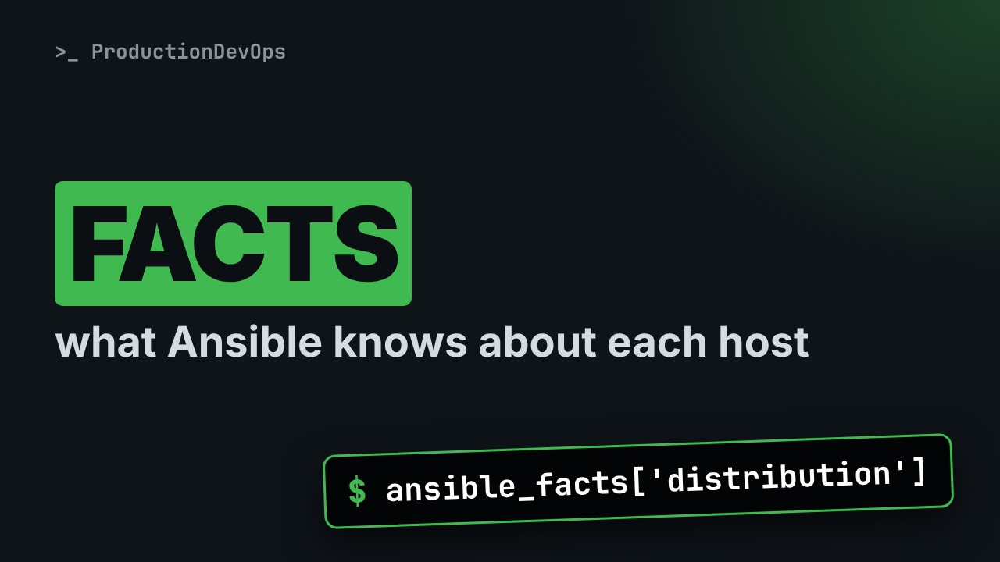
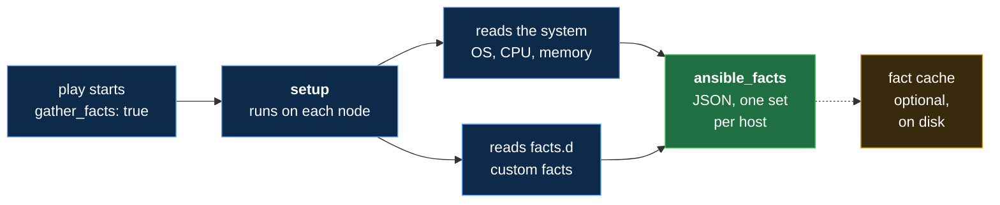

# Ansible Facts: setup, ansible_facts, Custom Facts, Fact Cache and Magic Variables



**Video:** coming soon on the [channel](https://www.youtube.com/@production-devops).

Before every play, Ansible runs a task you never wrote: Gathering Facts. We open it up: the setup module collects about a thousand lines per host, a filter keeps the few you need, and ansible_facts puts them in your playbooks. Then custom facts from /etc/ansible/facts.d, a fact cache on disk, and the magic variables inventory_hostname, groups and hostvars, to read node02's facts from a play that never connects to it. Challenge and solution in the demos repo.

## Files in this folder

- [`acme.fact`](acme.fact)
- [`ansible.cfg`](ansible.cfg)
- [`facts.yml`](facts.yml)
- [`inventory.ini`](inventory.ini)
- [`lab/up.sh`](lab/up.sh)
- [`magic.yml`](magic.yml)
- [`challenge-solution.sh`](challenge-solution.sh) (solution of the challenge: try it yourself first)

## What you need

A Linux shell (a VM, WSL or a container is fine). Everything runs inside this folder.

## Before you start

The video runs these commands first, off screen:

```bash
if [ -f .lab-reset ]; then bash lab/up.sh; else bash lab/up.sh reset && touch .lab-reset; fi >/dev/null 2>&1
```

## The lesson, step by step

The same explanations as the video, with every command. Read it, then run it yourself.

Before every play, Ansible runs a task you never wrote: Gathering Facts. Today we open it. And at the end, a play reads node zero two's facts without connecting to it.

### The plan

Lesson 13 of Ansible for RHCE. The plan. The setup module, and what facts are. Facts in a playbook. Custom facts. And a fact cache, with the magic variables.

### Where facts come from

**Where facts come from**



When a play starts, the setup module runs on each node, and reads the system and any custom facts. It sends JSON back: ansible facts, one set per host. A cache can keep it on disk.

### The setup module

```console
$ ansible node01 -m setup | wc -l
```

How much does setup collect? We count the lines.

- `ansible node01 -m setup`: the module behind Gathering Facts
The setup module, ad hoc, on node zero one.

- `| wc -l`: count the lines
The pipe sends its output to wc dash l, which counts lines.

We run it.

```console
$ ansible node01 -m setup | wc -l
```

About a thousand lines, for one host. Nobody reads that. We filter.

Which system does node zero one run? setup takes a filter, with a star as a wildcard.

```console
$ ansible node01 -m setup -a 'filter=ansible_distribution*'
```

Only the matching facts. Our lab nodes run Ubuntu. On a RHEL exam machine, you would read RedHat.

### Facts in a playbook

```
- name: Read the facts
  hosts: web
  gather_facts: true
  tasks:
    - name: Show two facts
      ansible.builtin.debug:
        msg: "{{ ansible_facts['hostname'] }} runs {{ ansible_facts['distribution'] }}"
```

Now facts in a playbook. Part one, the play, with gather facts on. Part two, one task that prints two facts.

```
- name: Read the facts
  hosts: web
  gather_facts: true
  tasks:
    - name: Show two facts
      ansible.builtin.debug:
        msg: "{{ ansible_facts['hostname'] }} runs {{ ansible_facts['distribution'] }}"
```

A play for the group web. Gather facts true is the default. We write it to make it visible. One task, with the debug module from lesson 12. Its message reads two facts from ansible facts.

```console
$ msg: "{{ ansible_facts['hostname'] }} runs {{ ansible_facts['distribution'] }}"
```

One fact, piece by piece.

- `ansible_facts`: all the facts of this host
ansible facts holds all the facts of the current host.

- `['hostname']`: one key, without ansible_
Square brackets pick one key. Inside ansible facts, the names drop the ansible underscore prefix.

All together: gather the facts, then print two of them for each host.

```
- name: Read the facts
  hosts: web
  gather_facts: true
  tasks:
    - name: Show two facts
      ansible.builtin.debug:
        msg: "{{ ansible_facts['hostname'] }} runs {{ ansible_facts['distribution'] }}"
```

We run it. Look for a task we never wrote.

```console
$ ansible-playbook facts.yml
```

Gathering Facts ran first. Then each host printed its own facts.

So far: setup collects the facts, and a filter picks a few. In a play, we read them from ansible facts. Next: our own facts, then the promise: node zero two, without connecting.

### Custom facts

```
[app]
version=2.4.1
team=appadmins
```

A custom fact is a file on the node, in slash etc slash ansible slash facts dot d. This one is INI: a section in brackets. Then key equals value lines: what only we know about this host.

```console
$ ansible web -b -m copy -a "src=acme.fact dest=/etc/ansible/facts.d/" | grep CHANGED
```

We install it with one ad hoc command.

- `-b`: become root: /etc needs it
Dash b, become: slash etc belongs to root.

- `-m copy`: copy a file to the nodes
The copy module sends the file to each node.

- `dest=/etc/ansible/facts.d/`: trailing slash: folder created
The trailing slash means a folder. Copy creates it.

- `| grep CHANGED`: one line per host
And grep keeps one line per host.

We install the file on both nodes.

```console
$ ansible web -b -m copy -a "src=acme.fact dest=/etc/ansible/facts.d/" | grep CHANGED
```

Now we filter for ansible local, where custom facts land.

```console
$ ansible node01 -m setup -a filter=ansible_local
```

### Fact cache

```
[defaults]
inventory = inventory.ini
interpreter_python = /usr/bin/python3
fact_caching = jsonfile
fact_caching_connection = facts-cache
```

Facts normally live only in memory, for one run. Our config had two more lines from the start. fact caching, jsonfile: keep the facts in JSON files. And this is the folder. Facts stay valid for 24 hours by default.

What is in the folder?

```console
$ ls facts-cache
```

One file per host, filled by our earlier runs. The prefix is the cache format version.

### Magic variables

```
- name: Magic variables
  hosts: node01
  gather_facts: false
  tasks:
    - name: Ask about the others
      ansible.builtin.debug:
        msg:
          - "I am {{ inventory_hostname }}"
          - "web: {{ groups['web'] }}"
          - "node02 runs {{ hostvars['node02']['ansible_facts']['distribution'] }}"
```

The payoff. Part one: a play for node zero one only, with no facts. Part two: one task, three messages.

```
- name: Magic variables
  hosts: node01
  gather_facts: false
  tasks:
    - name: Ask about the others
      ansible.builtin.debug:
        msg:
          - "I am {{ inventory_hostname }}"
          - "web: {{ groups['web'] }}"
          - "node02 runs {{ hostvars['node02']['ansible_facts']['distribution'] }}"
```

Only node zero one, and no Gathering Facts. Ansible never talks to node zero two. msg can be a list: debug prints each line. Magic variables are set by Ansible itself. inventory hostname is this host's name in the inventory. groups maps each group to its hosts. And hostvars holds the variables and facts of every host.

```console
$ - "node02 runs {{ hostvars['node02']['ansible_facts']['distribution'] }}"
```

That last line, piece by piece.

- `hostvars`: all hosts
hostvars: all the hosts.

- `['node02']`: pick one host
Pick one host, node zero two.

- `['ansible_facts']`: its facts
Then its facts.

- `['distribution']`: one fact
And one fact.

All together: a play on node zero one asks about node zero two.

```
- name: Magic variables
  hosts: node01
  gather_facts: false
  tasks:
    - name: Ask about the others
      ansible.builtin.debug:
        msg:
          - "I am {{ inventory_hostname }}"
          - "web: {{ groups['web'] }}"
          - "node02 runs {{ hostvars['node02']['ansible_facts']['distribution'] }}"
```

We run it.

```console
$ ansible-playbook magic.yml
```

node zero two's fact came from the cache. Without a cache, it would be undefined, and the task would fail.

### Gotchas

Facts are a snapshot, taken when the play starts. The old spelling, ansible underscore hostname, still works, but recent versions warn. No root for facts dot d? setup has a fact path option.

### Recap

To recap: setup gathers facts, a filter reads a few. Read them from ansible facts. Custom facts land in ansible local. A cache and hostvars give you other hosts' facts. Challenge: print node zero two's app version, from a play on node zero one. The solution is in the demo repository.

Facts tell you what each host is, and a cache remembers it. Next lesson: registered variables and Jinja2 filters. Subscribe so you do not miss it.

## All the commands, to copy

Run them from inside this folder, in this order (some are expected to fail: that is the point of the demo).

```bash
ansible node01 -m setup | wc -l
ansible node01 -m setup -a 'filter=ansible_distribution*'
ansible-playbook facts.yml
ansible web -b -m copy -a "src=acme.fact dest=/etc/ansible/facts.d/" | grep CHANGED
ansible node01 -m setup -a filter=ansible_local
ls facts-cache
- "node02 runs {{ hostvars['node02']['ansible_facts']['distribution'] }}"
ansible-playbook magic.yml
```

## Challenge

Challenge: print node zero two's app version, from a play on node zero one. The solution is in the demo repository.

When you have tried: [`challenge-solution.sh`](challenge-solution.sh).

---

From the [ProductionDevOps](https://www.youtube.com/@production-devops) channel: real-world DevOps and SRE, explained with real commands.
