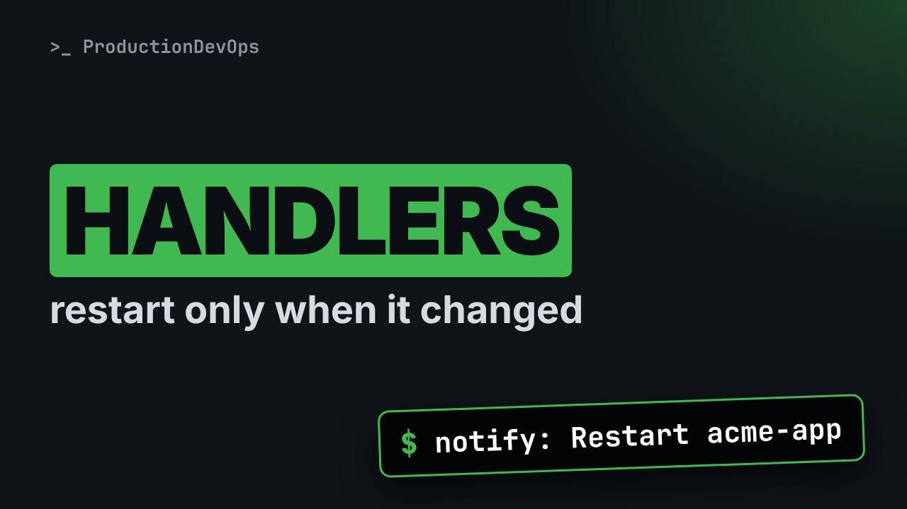
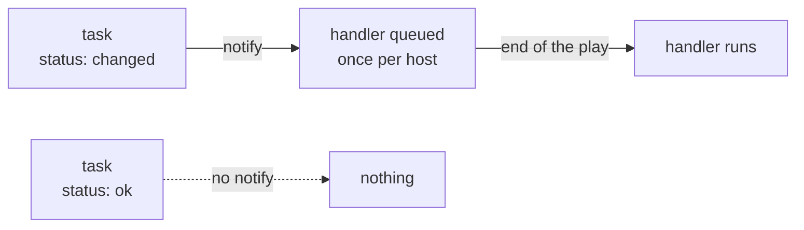

# Ansible Handlers: Restart Only When Something Changed (notify, flush, listen)



**Video:** coming soon on the [channel](https://www.youtube.com/@production-devops).

Lesson 10 of Ansible for RHCE. A config file changes, the service must restart: only if the file really changed, and only once. We notify a handler from two tasks and prove it runs once, at the end of the play, only on the host that changed. Then meta flush_handlers to restart in the middle of a play, listen to trigger several handlers with one notify, why handler names must match, and the trap: when a later task fails, the restart is lost, unless you use --force-handlers. Challenge and solution in the demos repo.

## Files in this folder

- [`ansible.cfg`](ansible.cfg)
- [`fail.yml`](fail.yml)
- [`flush.yml`](flush.yml)
- [`handlers.yml`](handlers.yml)
- [`inventory.ini`](inventory.ini)
- [`lab/up.sh`](lab/up.sh)
- [`listen.yml`](listen.yml)
- [`challenge-solution.yml`](challenge-solution.yml) (solution of the challenge: try it yourself first)

## What you need

A Linux shell (a VM, WSL or a container is fine). Everything runs inside this folder.

## Before you start

The video runs these commands first, off screen:

```bash
if [ -f .lab-reset ]; then bash lab/up.sh; else bash lab/up.sh reset && touch .lab-reset; fi >/dev/null 2>&1
```

## The lesson, step by step

The same explanations as the video, with every command. Read it, then run it yourself.

You change a config file, and the service must restart. But only if the file really changed, and only once, even if five tasks touched its settings. That is the job of handlers.

### The plan

This is lesson 10 of Ansible for RHCE. Here is the plan. First, we notify a handler, and prove when it runs. Once, at the end, and only after a change. Then flush handlers, and listen. And the trap: a later task fails, and the restart is lost.

### notify

**How a handler is triggered**



A task with notify only queues the handler, and only when the task reports changed. An ok task notifies nothing. Queued handlers run once per host, after all the tasks of the play.

```
---
- name: Configure acme-app
  hosts: web
  become: true
  gather_facts: false
  tasks:
    - name: Write the app config
      ansible.builtin.copy:
        dest: /etc/acme-app.conf
        content: "port=8080\n"
      notify: Restart acme-app
```

A normal copy task: the config file of acme app. notify names a handler: Restart acme app. If this task changes the file, that handler is queued.

```
    - name: Write the logging config
      ansible.builtin.copy:
        dest: /etc/acme-app-logging.conf
        content: "level=info\n"
      notify: Restart acme-app

  handlers:
    - name: Restart acme-app
      ansible.builtin.shell: echo "acme-app restarted" >> /tmp/acme-app-restarts.log
```

A second task notifies the same handler. handlers is a section next to tasks. notify finds a handler by its name. Our lab has no systemd, so the handler simulates a restart: it adds a line to a log. On a real server, it would be the service module.

### Once, at the end

```console
$ ansible-playbook handlers.yml | grep -v '^$'
```

Playbook output has many empty lines. We drop them, so every run fits.

- `ansible-playbook handlers.yml`: run the playbook
First, we run the playbook, as usual.

- `| grep -v`: keep lines that do NOT match
The pipe sends the output to grep. Dash v inverts it: keep only the lines that do not match.

- `'^$'`: an empty line
Caret is the start of a line, dollar the end: nothing in between is an empty line.

When does the handler run? We run the playbook and look for RUNNING HANDLER.

```console
$ ansible-playbook handlers.yml | grep -v '^$'
```

Both tasks changed, so both notified. But RUNNING HANDLER appears once, after the tasks, with one line per host.

How many restarts did node zero one get? The log on the node tells us.

```console
$ ssh node01 cat /tmp/acme-app-restarts.log
```

One line. Two notifies, one restart. A handler is queued once, however many tasks notify it.

### Only if changed

Now the same playbook again. grep dash v drops the empty lines.

```console
$ ansible-playbook handlers.yml | grep -v '^$'
```

Every task is ok, so nothing notified the handler. No restart, because nothing changed.

Now we simulate drift: someone edits the config on node zero one, by hand.

```console
$ ssh node01 "echo port=9090 | sudo tee /etc/acme-app.conf"
```

And we run the playbook again.

```console
$ ansible-playbook handlers.yml | grep -v '^$'
```

The config task changed node zero one only. So the handler ran on node zero one only. node zero two was left alone.

Here are the rules, in one place. A handler runs only if a task that notifies it reports changed. It runs once per host, however many times it was notified. At the end of the play, in the order they are written, not the order of the notifies. And notify must match the handler name exactly.

### flush_handlers

```
      notify: Restart acme-app

    - name: Restart now, not at the end
      ansible.builtin.meta: flush_handlers

    - name: Check the restart log
      ansible.builtin.stat:
        path: /tmp/acme-app-restarts.log
```

What if a later task needs the restart first, like a health check? The config task notifies as usual. meta flush handlers runs every queued handler right now, in the middle of the play. So this check runs after the restart, not before it.

We run it, on node zero one.

```console
$ ansible-playbook flush.yml | grep -v '^$'
```

Look at the order: the config task, then RUNNING HANDLER, then the check. The restart happened where we flushed.

### listen

```
      notify: web stack changed

  handlers:
    - name: Restart acme-app
      ansible.builtin.shell: echo "acme-app restarted" >> /tmp/acme-app-restarts.log
      listen: web stack changed

    - name: Reload the proxy
      ansible.builtin.shell: echo "proxy reloaded" >> /tmp/acme-app-restarts.log
      listen: web stack changed
```

This task notifies a topic: web stack changed. No handler has that name. But two handlers listen to that topic. One notify triggers both.

We run it.

```console
$ ansible-playbook listen.yml | grep -v '^$'
```

Both handlers ran, in the order they are written. Roles use this, so other code can notify a topic without knowing handler names.

A quick checkpoint. Handlers run once, at the end of the play, and only after a change. Flush handlers runs them now, and listen lets one notify reach several handlers. Next, the trap from the start: the restart that gets lost when a later task fails.

### When a task fails

```
    - name: Write the app config
      ansible.builtin.copy:
        dest: /etc/acme-app.conf
        content: "port=7070\n"
      notify: Restart acme-app

    - name: Run the database migration
      ansible.builtin.fail:
        msg: "migration failed"
```

The config changes, and notifies the restart. Then a later task fails. The fail module stands in for a migration that breaks.

Does the restart still happen? tail shows the end of the output: the fatal line and the recap.

```console
$ ansible-playbook fail.yml | tail -5
```

No handler between fatal and the recap. The config changed, so the new config is on disk, but the app was never restarted.

Worse: we fix nothing and run again.

```console
$ ansible-playbook fail.yml | tail -5
```

changed is zero: the file is already right, so nothing notifies the handler. The restart is lost for good.

### --force-handlers

Let's change the file again on node zero one, to get a new notify.

```console
$ ssh node01 "echo port=6060 | sudo tee /etc/acme-app.conf"
```

This time with dash dash force handlers.

```console
$ ansible-playbook fail.yml --force-handlers | tail -8
```

The task still fails, but the queued handler runs anyway. You can also set force handlers true in the play, or in ansible dot cfg.

### Gotchas

Three mistakes that cost time. A typo in notify, even in upper or lower case, and the play fails: handler not found. A failure after the notify loses the restart. Use force handlers. command and shell always report changed, so a task like that always notifies, on every run.

### Recap

Let's recap. notify queues a handler, only when the task reports changed. Handlers run once, at the end. Flush handlers runs them now. listen shares a topic, and force handlers saves the restart when a task fails. Your challenge: make both tasks notify one topic, and restart before a final check. The solution is in the demo repository.

Handlers turn changed into action, once and at the right time. Next lesson: check and diff mode, to see a change before you make it. Subscribe so you do not miss it.

## All the commands, to copy

Run them from inside this folder, in this order (some are expected to fail: that is the point of the demo).

```bash
ansible-playbook handlers.yml | grep -v '^$'
ssh node01 cat /tmp/acme-app-restarts.log
ssh node01 "echo port=9090 | sudo tee /etc/acme-app.conf"
ansible-playbook flush.yml | grep -v '^$'
ansible-playbook listen.yml | grep -v '^$'
ansible-playbook fail.yml | tail -5
ssh node01 "echo port=6060 | sudo tee /etc/acme-app.conf"
ansible-playbook fail.yml --force-handlers | tail -8
```

## Challenge

Your challenge: make both tasks notify one topic, and restart before a final check. The solution is in the demo repository.

When you have tried: [`challenge-solution.yml`](challenge-solution.yml).

---

From the [ProductionDevOps](https://www.youtube.com/@production-devops) channel: real-world DevOps and SRE, explained with real commands.
