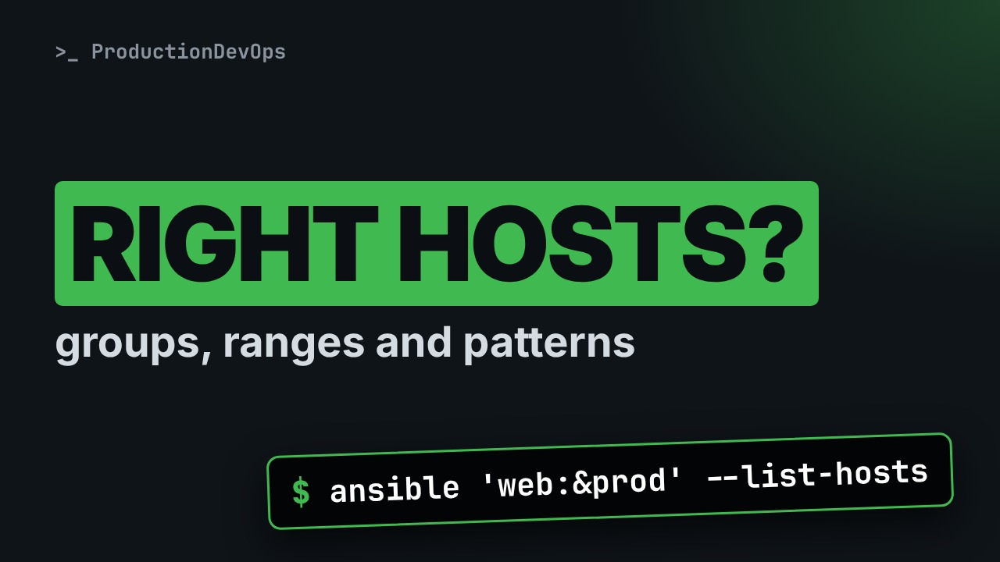

# Ansible Inventories: Groups, Ranges and Patterns That Hit the Right Hosts



**Video:** coming soon on the [channel](https://www.youtube.com/@production-devops).

Lesson 4 of Ansible for RHCE. The inventory decides what every command touches. We write one inventory in INI and then in YAML: hosts, groups, a host in many groups, ranges like db[01:02], groups of groups with :children, the built-in all and ungrouped groups, and a first look at group variables. We check it with ansible-inventory --graph, --host and --list, then select hosts with patterns (web:db, web:&prod, all:!db) and --limit, listing the targets before anything runs.

## Files in this folder

- [`ansible.cfg`](ansible.cfg)
- [`inventory.ini`](inventory.ini)
- [`inventory.yml`](inventory.yml)
- [`lab/up.sh`](lab/up.sh)
- [`challenge-solution.ini`](challenge-solution.ini) (solution of the challenge: try it yourself first)

## What you need

A Linux shell (a VM, WSL or a container is fine). Everything runs inside this folder.

## Before you start

The video runs these commands first, off screen:

```bash
if [ -f .lab-reset ]; then bash lab/up.sh; else bash lab/up.sh reset && touch .lab-reset; fi >/dev/null 2>&1
```

## The lesson, step by step

The same explanations as the video, with every command. Read it, then run it yourself.

You meant to target two web servers, and your pattern matched the databases too. The inventory decides what every command touches. Today: groups, ranges, and patterns that pick exactly the hosts you want.

### The plan

This is lesson 4 of Ansible for RHCE. Here is the plan. First, an INI inventory: hosts, groups and ranges. Then groups of groups, and the two groups Ansible creates for you: all and ungrouped. Then the same inventory in YAML, checked with ansible inventory. And patterns, to select exactly the hosts you want.

### INI inventory

```
monitor01

[web]
node01 ansible_host=127.0.0.1 ansible_port=2201
node02 ansible_host=127.0.0.1 ansible_port=2202

[db]
db[01:02]
```

A host before any group header belongs to no group. Ansible puts it in a built-in group called ungrouped. A group, in square brackets: web, with our two lab nodes. The name is what you target. ansible host and ansible port say where to connect. And a range: db zero one to db zero two, in one line. The leading zero is kept. These database hosts exist only on paper: we list them, we never connect.

```
[prod]
node01
db01

[acme:children]
web
db

[web:vars]
app_port=8080
```

A host can be in many groups. prod groups hosts by environment: node zero one and db zero one. Colon children makes a group of groups. acme contains every host of web, and every host of db. Colon vars sets a variable for every host of a group. This is only a preview: variables get their own lesson.

### ansible-inventory

ansible inventory dash dash graph prints the inventory as a tree. It reads the file, and connects to nothing.

```console
$ ansible-inventory --graph
```

At the top, all: every host is always in it. Then ungrouped, with monitor zero one. And acme contains the groups web and db, with their hosts. Node zero one appears twice: in prod, and in web.

dash dash host shows the variables of one host.

```console
$ ansible-inventory --host node01
```

The connection variables, and app port, which node zero one gets from the web group.

A quick checkpoint. An INI inventory holds hosts, groups, ranges, groups of groups and group variables. ansible inventory reads the file, and connects to nothing. Next: JSON and YAML, then the patterns that keep the databases out of your command.

What does Ansible build from our file? dash dash list prints it all, as JSON. It is long, so the arrow writes it into a file.

```console
$ ansible-inventory --list > inventory.json
```

head dash eight shows the first lines of that file.

```console
$ head -8 inventory.json
```

First, underscore meta, with the variables of every host.

And at the end? tail dash seven shows the last lines: one entry per group with its hosts, here web. Other tools read this format.

```console
$ tail -7 inventory.json
```

### YAML inventory

```
all:
  hosts:
    monitor01:
  children:
    acme:
      children:
        web:
          hosts:
            node01: {ansible_host: 127.0.0.1, ansible_port: 2201}
            node02: {ansible_host: 127.0.0.1, ansible_port: 2202}
          vars: {app_port: 8080}
```

In YAML, everything starts from the group all. Its hosts key holds the host with no group. children nests groups: all contains acme, and acme contains web. The nesting replaces colon children. Under web, its hosts with their variables, and vars for the whole group.

```
      db:
        hosts:
          db[01:02]:
  prod:
    hosts:
      node01:
      db01:
```

The db group uses the same range syntax. Each host ends with a colon, even with no variables. prod sits at the top level and lists hosts defined above. Their variables are not repeated.

dash i picks another inventory, for one command. Here, the YAML file.

```console
$ ansible-inventory -i inventory.yml --graph
```

The same groups and the same hosts. INI or YAML, Ansible builds the same inventory.

### Patterns

A pattern selects hosts from the inventory. These are the ones you need. A group name, or a host name. web colon db: the union. Hosts in web, or in db. web colon ampersand prod: the intersection. Hosts in web, and also in prod. all colon exclamation mark db: the exclusion. All the hosts, except the ones in db.

dash dash list hosts prints who would be targeted. Nothing runs. First, the union.

```console
$ ansible 'web:db' --list-hosts
```

The intersection: in web and in prod. Only node zero one.

```console
$ ansible 'web:&prod' --list-hosts
```

The exclusion: everything except the databases.

```console
$ ansible 'all:!db' --list-hosts
```

Which hosts are in web, but limited to prod? dash dash limit narrows any pattern at run time.

```console
$ ansible web --limit prod --list-hosts
```

Only node zero one. Now a real ping, with dash m ping, and the same limit.

```console
$ ansible web -m ping --limit prod
```

Only node zero one answered. This is how you try a change on one host first, without editing anything.

### Gotchas

Three mistakes that cost time. Always put patterns in single quotes. The exclamation mark and the ampersand mean something to the shell. Group names should use letters, digits and underscores. A dash gives you a warning, and trouble later. A typo under colon children: in recent versions, the whole inventory fails to parse, and Ansible falls back to localhost only.

### Recap

Let's recap. INI or YAML: hosts, groups, ranges, groups of groups, and group variables. Every host is in all. Hosts with no group are also in ungrouped. Check the inventory with ansible inventory graph and host, and your patterns with list hosts. Your challenge: add a group dev, with node zero two and db zero two. Then select the web hosts that are not in dev. The solution is in the demo repository.

List your targets before you run anything. Next lesson: preparing managed nodes, with SSH keys, the automation user, and become. Subscribe so you do not miss it.

## All the commands, to copy

Run them from inside this folder, in this order (some are expected to fail: that is the point of the demo).

```bash
ansible-inventory --graph
ansible-inventory --host node01
ansible-inventory --list > inventory.json
head -8 inventory.json
tail -7 inventory.json
ansible-inventory -i inventory.yml --graph
ansible 'web:db' --list-hosts
ansible 'web:&prod' --list-hosts
ansible 'all:!db' --list-hosts
ansible web --limit prod --list-hosts
ansible web -m ping --limit prod
```

## Challenge

Your challenge: add a group dev, with node zero two and db zero two. Then select the web hosts that are not in dev. The solution is in the demo repository.

When you have tried: [`challenge-solution.ini`](challenge-solution.ini).

---

From the [ProductionDevOps](https://www.youtube.com/@production-devops) channel: real-world DevOps and SRE, explained with real commands.
