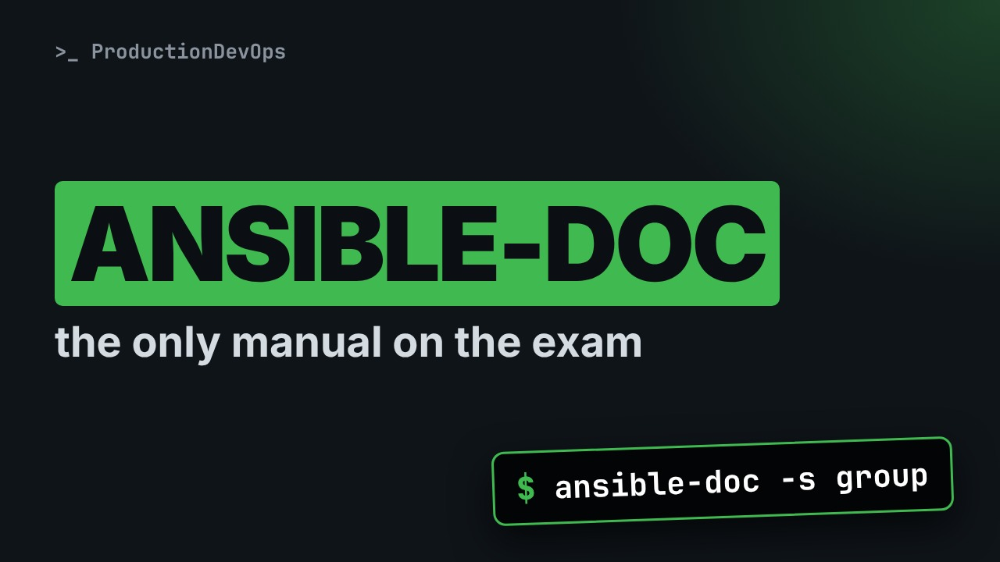
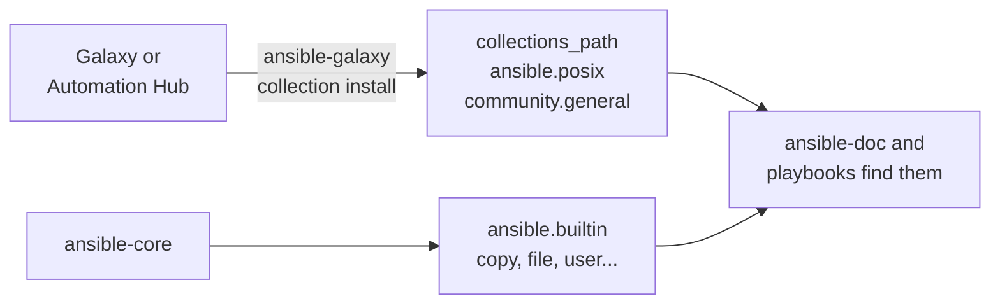

# ansible-doc: Find Any Ansible Module and Read Its Docs Offline



**Video:** coming soon on the [channel](https://www.youtube.com/@production-devops).

Lesson 7 of Ansible for RHCE. On the exam there is no internet: ansible-doc is your only manual. We search modules with ansible-doc -l and grep, print a ready-to-paste snippet with -s, and read a module page the fast way: required options, defaults and choices, aliases, examples and return values. Then fully qualified collection names like ansible.builtin.copy, where modules live on disk, and what a collection is, with ansible-galaxy collection list. Challenge and solution in the demos repo.

## Files in this folder

- [`ansible.cfg`](ansible.cfg)
- [`inventory.ini`](inventory.ini)
- [`lab/up.sh`](lab/up.sh)
- [`challenge-solution.sh`](challenge-solution.sh) (solution of the challenge: try it yourself first)

## What you need

A Linux shell (a VM, WSL or a container is fine). Everything runs inside this folder.

## Before you start

The video runs these commands first, off screen:

```bash
if [ -f .lab-reset ]; then bash lab/up.sh; else bash lab/up.sh reset && touch .lab-reset; fi >/dev/null 2>&1
ansible-doc() { command ansible-doc "$@" | cat; }
```

## The lesson, step by step

The same explanations as the video, with every command. Read it, then run it yourself.

On the exam, you forget the name of an option, and there is no internet. The answer is already on the machine, in ansible doc. Today you learn to read it fast, and to see its return values come back for real.

### The plan

This is lesson 7 of Ansible for RHCE. Here is the plan. First, how to find a module, with ansible doc dash l and grep. Then a ready to paste snippet, with dash s. Then we read a module page: options, examples and return values. And full module names, and where modules live: in collections.

### Module names

Every module has a full name, called the fully qualified collection name, or F Q C N. Ansible dot builtin dot copy. The namespace is ansible, the collection is builtin, the module is copy. ansible dot builtin holds the modules that ship with ansible core itself. The short name copy still works. But the full name can never point to the wrong module.

### Find a module

Which module manages groups? ansible doc dash l lists the modules of a collection. The list is long, so grep keeps the lines with the word group.

```console
$ ansible-doc -l ansible.builtin | grep group
```

Each line is a full module name and a short description. To manage groups, we want ansible builtin group. And for users? The same search, with another word.

```console
$ ansible-doc -l ansible.builtin | grep user
```

### Snippet

What does a task with this module look like? Dash s prints a snippet: a task name, the module, and every option as a comment. head shows the first lines.

```console
$ ansible-doc -s group | head -5
```

Which options must we set? grep for the word required.

```console
$ ansible-doc -s group | grep required
```

### A module page

Without dash l or dash s, ansible doc prints the full page of one module. Its options section starts with a legend.

```console
$ ansible-doc group | grep 'OPTIONS'
```

What type is the name option? grep dash capital A one prints the matching line, and one line after it.

```console
$ ansible-doc group | grep -A1 'Name of the group'
```

And what if we leave out state? We grep for the start of its description, and four lines after it.

```console
$ ansible-doc group | grep -A4 'Whether the group should be present'
```

Two choices, and the default is present. So if you omit state, the group is created.

Some options have other names. Look at path, in the file module.

```console
$ ansible-doc file | grep -A2 'Path to the file being managed'
```

path is red, so it is required. And it can also be written dest or name. You will meet all three in other people's playbooks.

A quick checkpoint. We find a module with dash l and grep, and recall its options with dash s. On the page, red means required, and each option shows its default, choices and aliases. Next: examples, return values, and the same values coming back from a real run.

Near the end of the page, examples: real tasks, with full module names.

```console
$ ansible-doc group | grep -A10 'EXAMPLES'
```

Last, the return values: what the module reports back after it runs.

```console
$ ansible-doc group | grep -A10 'RETURN VALUES'
```

The group I D, the name, and more. You will use them later, with register.

### FQCN in action

```console
$ ansible node01 -b -m ansible.builtin.group -a 'name=appadmins'
```

Now we run the group module, ad hoc, as in the last lesson.

- `node01`: one host
One host: node zero one.

- `-b`: as root
Dash b, because creating a group needs root.

- `-m ansible.builtin.group`: the module, full name
Dash m, with the full module name.

- `-a 'name=appadmins'`: the required option
And dash a, with the only required option: name. state is left out, so it is present.

Which fields will it report? We run it, and compare with the return values.

```console
$ ansible node01 -b -m ansible.builtin.group -a 'name=appadmins'
```

Changed: the group was created. And the JSON has the fields from the return values: g i d, name, state and system.

Does the short name reach the same module? grep keeps the status line, the one with the arrow.

```console
$ ansible node01 -b -m group -a 'name=appadmins' | grep '=>'
```

SUCCESS: the group is already there. Same module, same result. In playbooks, we will always write the full name.

### Collections

**Where modules live**



ansible core ships one collection, ansible builtin. Others, like ansible posix, come from Galaxy or Automation Hub, into the collections path, where ansible doc and playbooks find them.

To see the shape of one, we create an empty collection, acme dot tools, in the default path.

```console
$ ansible-galaxy collection init acme.tools --init-path ~/.ansible/collections/ansible_collections
```

Which collections are installed? The list shows ours, in the collections folder under the home directory. ansible builtin is part of core, so it is never listed.

```console
$ ansible-galaxy collection list
```

A collection is just a directory: namespace, then collection name. Its modules go in plugins slash modules, and their full names start with acme dot tools.

```console
$ ls ~/.ansible/collections/ansible_collections/acme/tools
```

### Gotchas

Three things to remember. ansible doc only knows what is installed, at that version. On the exam, the docs match the system. An option in red is required. If there is no default line, there is no default. Watch for aliases. In the file module, dest and name both mean path.

### Recap

Let's recap. To find a module: ansible doc dash l, and grep for a word. To recall its options: dash s. To read the full page: ansible doc and the module name. On the page: the options with required, default, choices and aliases, then the examples and the return values. Your challenge: with ansible doc only, find the module that manages one line in a file, and add acme env equals lab to slash etc slash environment on web. The second run must say ok. The solution is in the demo repository.

ansible doc is the manual you will have on the exam. Next lesson: your first playbook, from YAML to the play recap. Subscribe so you do not miss it.

## All the commands, to copy

Run them from inside this folder, in this order (some are expected to fail: that is the point of the demo).

```bash
ansible-doc -l ansible.builtin | grep group
ansible-doc -l ansible.builtin | grep user
ansible-doc -s group | head -5
ansible-doc -s group | grep required
ansible-doc group | grep 'OPTIONS'
ansible-doc group | grep -A1 'Name of the group'
ansible-doc group | grep -A4 'Whether the group should be present'
ansible-doc file | grep -A2 'Path to the file being managed'
ansible-doc group | grep -A10 'EXAMPLES'
ansible-doc group | grep -A10 'RETURN VALUES'
ansible node01 -b -m ansible.builtin.group -a 'name=appadmins'
ansible node01 -b -m group -a 'name=appadmins' | grep '=>'
ansible-galaxy collection init acme.tools --init-path ~/.ansible/collections/ansible_collections
ansible-galaxy collection list
ls ~/.ansible/collections/ansible_collections/acme/tools
```

## Challenge

Your challenge: with ansible doc only, find the module that manages one line in a file, and add acme env equals lab to slash etc slash environment on web. The second run must say ok. The solution is in the demo repository.

When you have tried: [`challenge-solution.sh`](challenge-solution.sh).

---

From the [ProductionDevOps](https://www.youtube.com/@production-devops) channel: real-world DevOps and SRE, explained with real commands.
