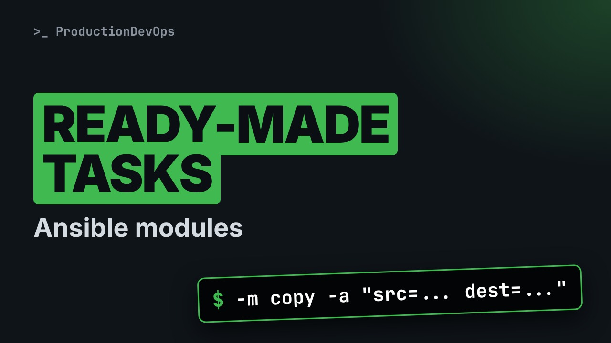
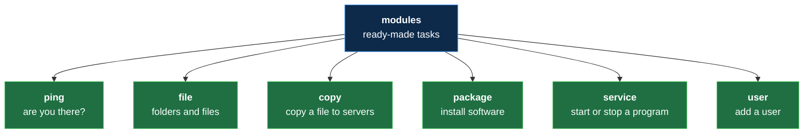
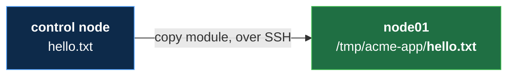

# Ansible Modules: Ready-Made Tasks, file and copy (No Experience Needed)



**Video:** https://youtu.be/UluSlQqApNg

So far Ansible has only asked questions. In this lesson of Ansible from Zero it changes a server for the first time. Modules are ready-made tasks: we look at the ones you will use most, learn how to give a module its details with dash a, and then make a folder with the file module and copy a file with the copy module, one line each, on a real practice server. The answer turns yellow: CHANGED. No experience needed: every new word is explained on screen. The files, the challenge and its solution are in the demos repo.

## Files in this folder

- [`ansible.cfg`](ansible.cfg)
- [`hello.txt`](hello.txt)
- [`inventory.ini`](inventory.ini)
- [`lab/up.sh`](lab/up.sh)
- [`challenge-solution.sh`](challenge-solution.sh) (solution of the challenge: try it yourself first)

## What you need

A Linux shell (a VM, WSL or a container is fine). Everything runs inside this folder.

## Before you start

The video runs these commands first, off screen:

```bash
if [ -f .lab-reset ]; then bash lab/up.sh; else bash lab/up.sh reset && touch .lab-reset; fi >/dev/null 2>&1
```

## The lesson, step by step

The same explanations as the video, with every command. Read it, then run it yourself.

So far, Ansible has only asked questions. Today it changes a server for the first time. And the answer turns yellow.

To watch this lesson, you need nothing. To follow along, start the two practice servers. The setup guide of lesson four shows how. And the small file hello dot text, from the demo repo.

### The plan

This is lesson six of Ansible from Zero. First, modules: a shelf of ready-made tasks. Then, how to give a module its details. Then we make a folder on a server. And we copy a file into it.

### Modules

- `module`: A small program that does one job on a server (like a standard step every cook knows: "put the sign on the door")
You met this word in lesson two. A module is a small program that does one job on a server. A standard step every cook knows.

**A shelf of ready-made tasks**



Ansible comes with about seventy modules, and you can add thousands more. Here are six you will use a lot. Ping, from lesson five, is one of them.

### Details

- `argument`: A detail a module needs, written as key=value (like the words to write on the sign)
A module needs details: which folder, which file. Each detail is called an argument. Like the words to write on the sign.

### A folder

```console
$ ansible node01 -m file -a "path=/tmp/acme-app state=directory"
```

Here is our command. It has the shape you know, plus one new piece: dash a.

- `node01`: one server
One server, node zero one. Then the answer fits on the screen.

- `-m file`: the file module
Dash m file: the module for folders and files.

- `-a`: the arguments follow
Dash a means: here come the arguments, inside the quotes.

- `path=/tmp/acme-app`: where: this folder
Path says where: a folder acme app, inside slash tmp, the folder for temporary files.

- `state=directory`: what we want: a folder
State says what we want there: a directory. That is another word for a folder.

We type it, and Ansible does the job on node zero one.

```console
$ ansible node01 -m file -a "path=/tmp/acme-app state=directory"
```

Look at the top. CHANGED, in yellow. The server was changed: the folder did not exist before. Below, changed is true. And path and state repeat what we asked for. The other lines are details about the new folder, like its owner, ops.

### So far

So far: modules are ready-made tasks, like file. Dash a gives the details, as key equals value, with spaces between them. Next: we copy a file into the new folder.

### A file

```
Welcome to acme-app
```

On the control node, next to our settings, there is a small file. It holds one line of text.

```console
$ ansible node01 -m copy -a "src=hello.txt dest=/tmp/acme-app/hello.txt"
```

Now the copy module. Same shape, other details.

- `-m copy`: the copy module
Dash m copy: the module that copies a file to the servers.

- `src=hello.txt`: from: the file here
Src is short for source: the file here, on the control node.

- `dest=/tmp/acme-app/hello.txt`: to: where on the server
Dest is short for destination: where it goes on the server, in our new folder.

We type it.

```console
$ ansible node01 -m copy -a "src=hello.txt dest=/tmp/acme-app/hello.txt"
```

CHANGED again, in yellow. The file is now on node zero one. Look for dest. It shows where the file went.

**What just happened**



The copy module took hello dot text from the control node. It put it on node zero one, inside the new folder.

Every ad hoc command has the same shape. Servers, then the module, then the details. The module says which job. The arguments give the details of that job. And yellow CHANGED means: the server was changed.

### Good to know

Each module also has a full name, like ansible dot builtin dot copy. Lesson seven uses it. The Ansible documentation lists every module, and all of its arguments. On two servers, these answers get long. A playbook, in lesson seven, keeps them short.

### Recap

Recap: a module is a ready-made task, and its arguments are the details. File made a folder. Copy put a file on a server. Yellow CHANGED means that something on the server changed. Your challenge: run the folder command again, on node zero one. Yellow or green? The answer is in the demo repo.

### Where next

Where next? Lesson seven: your first playbook. These same two tasks, written down in a file, for both servers at once.

Next lesson: your first playbook. Subscribe so you do not miss it.

## All the commands, to copy

Run them from inside this folder, in this order (some are expected to fail: that is the point of the demo).

```bash
ansible node01 -m file -a "path=/tmp/acme-app state=directory"
ansible node01 -m copy -a "src=hello.txt dest=/tmp/acme-app/hello.txt"
```

## Challenge

Your challenge: run the folder command again, on node zero one. Yellow or green? The answer is in the demo repo.

When you have tried: [`challenge-solution.sh`](challenge-solution.sh).

---

From the [ProductionDevOps](https://www.youtube.com/@production-devops) channel: real-world DevOps and SRE, explained with real commands.
