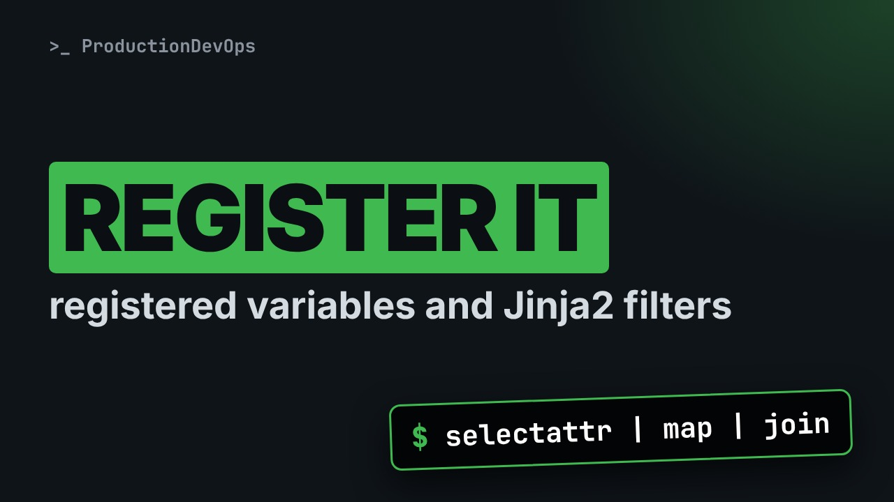
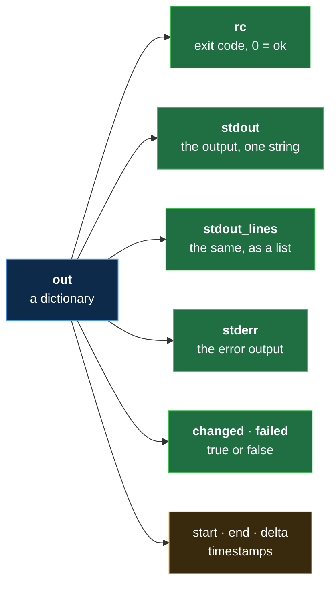
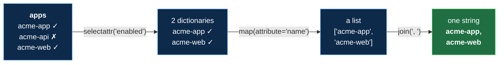

# Ansible register and Jinja2 Filters: Catch a Task's Result, Then Shape It



**Video:** coming soon on the [channel](https://www.youtube.com/@production-devops).

A task runs a command on your node, Ansible prints "changed", and the output is gone. We catch it with register and open the result: rc, stdout, stdout_lines, changed, failed. Then tests like "is failed" and "is defined", a when condition on a registered result, and the filters you use every day: default, selectattr, map and join, chained in one line that turns a list of dictionaries into exactly the names you need. Challenge and solution in the demos repo.

## Files in this folder

- [`ansible.cfg`](ansible.cfg)
- [`apps.yml`](apps.yml)
- [`check.yml`](check.yml)
- [`filters.yml`](filters.yml)
- [`inventory.ini`](inventory.ini)
- [`lab/up.sh`](lab/up.sh)
- [`register.yml`](register.yml)
- [`challenge-solution.sh`](challenge-solution.sh) (solution of the challenge: try it yourself first)

## What you need

A Linux shell (a VM, WSL or a container is fine). Everything runs inside this folder.

## Before you start

The video runs these commands first, off screen:

```bash
if [ -f .lab-reset ]; then bash lab/up.sh; else bash lab/up.sh reset && touch .lab-reset; fi >/dev/null 2>&1
```

## The lesson, step by step

The same explanations as the video, with every command. Read it, then run it yourself.

Ansible runs a command on your node, prints changed, and the output is gone. Today we catch it with register. At the end, one line of filters picks exactly the names you need.

### The plan

Lesson 14 of Ansible for RHCE. The plan. Register: keep a task's result. What is inside a result. Tests, and a when condition on a result. And filters, chained in one line.

### register

```
- name: Register a result
  hosts: node01
  gather_facts: false
  tasks:
    - name: Run a command
      ansible.builtin.command: hostname
      register: out
    - name: Show what came back
      ansible.builtin.debug:
        var: out
```

Part one: a play for node zero one, with no facts. Part two: two tasks. One runs a command, one shows what came back.

```
- name: Register a result
  hosts: node01
  gather_facts: false
  tasks:
    - name: Run a command
      ansible.builtin.command: hostname
      register: out
    - name: Show what came back
      ansible.builtin.debug:
        var: out
```

Only node zero one, and gather facts false: we do not need facts today. Task one runs the hostname command on the node, with the command module. register out: keep this task's result in a new variable, called out. Task two prints it. debug var takes a variable name, with no curly braces.

All together: run a command, keep its result, print it.

```
- name: Register a result
  hosts: node01
  gather_facts: false
  tasks:
    - name: Run a command
      ansible.builtin.command: hostname
      register: out
    - name: Show what came back
      ansible.builtin.debug:
        var: out
```

### Inside a result

**What a result holds**



What will out hold? A dictionary: the exit code rc, the output as one string and as a list, the error output, changed and failed, and three timestamps.

We run it. The output is long: task two printed the whole result.

```console
$ ansible-playbook register.yml
```

Task two shows the whole result. rc is zero. stdout is node zero one, and stdout lines is the same, as a list. start, end and delta are timestamps. They are different on every run.

### Tests and when

```console
$ ansible node01 -m file -a "path=/tmp/acme-app state=directory"
```

Now two nodes that differ. An ad hoc command, as in lesson 6.

- `ansible node01`: only node01
Only node zero one.

- `-m file`: the file module
The file module.

- `"path=/tmp/acme-app state=directory"`: this folder must exist
Its arguments: this path must be a directory.

We run it.

```console
$ ansible node01 -m file -a "path=/tmp/acme-app state=directory"
```

Changed: the folder now exists on node zero one, and only there.

```
- name: Is acme-app there?
  hosts: web
  gather_facts: false
  tasks:
    - name: Look for the app folder
      ansible.builtin.command: test -d /tmp/acme-app
      register: app
      ignore_errors: true
    - name: Report the missing ones
      ansible.builtin.debug:
        msg: "acme-app missing, rc={{ app.rc }}"
      when: app is failed
```

A second playbook. Part one: a play for both nodes. Part two: look for the folder, and register the result. Part three: report, only where the folder is missing.

```
- name: Is acme-app there?
  hosts: web
  gather_facts: false
  tasks:
    - name: Look for the app folder
      ansible.builtin.command: test -d /tmp/acme-app
      register: app
      ignore_errors: true
    - name: Report the missing ones
      ansible.builtin.debug:
        msg: "acme-app missing, rc={{ app.rc }}"
      when: app is failed
```

The group web: node zero one and node zero two. test dash d asks: is this a directory? It exits zero if yes, one if not. The result goes into a variable called app. ignore errors true: when the task fails, the play goes on. Lesson 19 covers errors. Task two prints a message. app dot rc reads one key of the result. And when decides if the task runs at all.

```console
$ when: app is failed
```

That last line, piece by piece.

- `when:`: run only if this is true
when takes a condition. It is already an expression, so no curly braces.

- `app`: the registered result
app is the result from task one.

- `is failed`: a test: true or false
is failed is a test. It answers true or false: did that task fail?

All together: look on both nodes, then report only where it failed.

```
- name: Is acme-app there?
  hosts: web
  gather_facts: false
  tasks:
    - name: Look for the app folder
      ansible.builtin.command: test -d /tmp/acme-app
      register: app
      ignore_errors: true
    - name: Report the missing ones
      ansible.builtin.debug:
        msg: "acme-app missing, rc={{ app.rc }}"
      when: app is failed
```

We run it.

```console
$ ansible-playbook check.yml
```

node zero two failed, and Ansible ignored it. Then task two skipped node zero one, and printed rc one for node zero two.

So far: register keeps a result, with rc, stdout and failed. A test answers yes or no, and when acts on it. Next: filters, and the promise: one line that picks exactly the names we need.

### Filters

A filter comes after a pipe. It turns a value into a new value. A test comes after is. It answers true or false. For results, the tests you need are is failed, is succeeded and is changed.

```
apps:
  - {name: acme-app, enabled: true}
  - {name: acme-api, enabled: false}
  - {name: acme-web, enabled: true}
```

Some data to shape: a vars file with one variable, apps, a list. Each item is a dictionary written on one line, in curly braces: a name, and enabled true or false.

```
- name: Shape data with filters
  hosts: node01
  gather_facts: false
  vars_files: apps.yml
  tasks:
    - name: A default, a test, a chain
      ansible.builtin.debug:
        msg:
          - "owner: {{ app_owner | default('ops') }}"
          - "owner set? {{ app_owner is defined }}"
          - "enabled: {{ apps | selectattr('enabled') | map(attribute='name') | join(', ') }}"
```

Part one: a play that loads apps dot yml. Part two: one task, three messages.

```
- name: Shape data with filters
  hosts: node01
  gather_facts: false
  vars_files: apps.yml
  tasks:
    - name: A default, a test, a chain
      ansible.builtin.debug:
        msg:
          - "owner: {{ app_owner | default('ops') }}"
          - "owner set? {{ app_owner is defined }}"
          - "enabled: {{ apps | selectattr('enabled') | map(attribute='name') | join(', ') }}"
```

vars files loads apps dot yml, as in lesson 12. One debug task, with a list of messages. app owner is not defined anywhere. The default filter gives ops instead of an error. is defined is a test. This line prints true or false. The last line chains three filters. We take it apart.

```console
$ - "enabled: {{ apps | selectattr('enabled') | map(attribute='name') | join(', ') }}"
```

Read it left to right, like a shell pipeline.

- `apps`: start: three dictionaries
We start from apps: three dictionaries.

- `selectattr('enabled')`: keep items where enabled is true
selectattr keeps the items whose enabled key is true. Two are left.

- `map(attribute='name')`: from each item, take name
map with attribute name takes the name from each item. Now it is a list of two strings.

- `join(', ')`: list → one string
join glues the list into one string, with a comma and a space.

**The data, filter by filter**



The data, filter by filter: three dictionaries, then two, then two names, then one string. Each filter hands its result to the next.

All together: a default, a test and a chain.

```
- name: Shape data with filters
  hosts: node01
  gather_facts: false
  vars_files: apps.yml
  tasks:
    - name: A default, a test, a chain
      ansible.builtin.debug:
        msg:
          - "owner: {{ app_owner | default('ops') }}"
          - "owner set? {{ app_owner is defined }}"
          - "enabled: {{ apps | selectattr('enabled') | map(attribute='name') | join(', ') }}"
```

We run it.

```console
$ ansible-playbook filters.yml
```

owner is ops, from the default. owner set is False. And the chain printed exactly the two enabled apps. Now we set app owner with dash e, from lesson 12.

```console
$ ansible-playbook filters.yml -e app_owner=appadmins
```

The default steps aside, and the test says True.

### Gotchas

when is already Jinja2. Curly braces there bring a deprecation warning, and will stop working. A skipped task still registers its variable, with skipped true, and no stdout. command always reports changed. Lesson 18 shows changed when.

### Recap

To recap: register saves a result, with rc, stdout and failed. Tests answer true or false, and when acts on them. Filters shape data: default, selectattr, map and join. Challenge: print the disabled apps. Hint: selectattr has an opposite. The solution is in the demo repository.

register catches what a task did, and filters shape it. Next lesson: Ansible Vault, to keep secrets out of plain text. Subscribe so you do not miss it.

## All the commands, to copy

Run them from inside this folder, in this order (some are expected to fail: that is the point of the demo).

```bash
ansible-playbook register.yml
ansible node01 -m file -a "path=/tmp/acme-app state=directory"
ansible-playbook check.yml
- "enabled: {{ apps | selectattr('enabled') | map(attribute='name') | join(', ') }}"
ansible-playbook filters.yml
ansible-playbook filters.yml -e app_owner=appadmins
```

## Challenge

Challenge: print the disabled apps. Hint: selectattr has an opposite. The solution is in the demo repository.

When you have tried: [`challenge-solution.sh`](challenge-solution.sh).

---

From the [ProductionDevOps](https://www.youtube.com/@production-devops) channel: real-world DevOps and SRE, explained with real commands.
