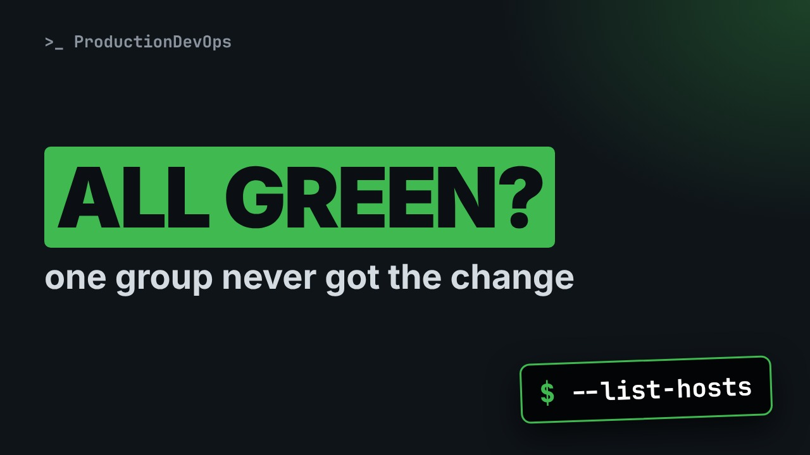
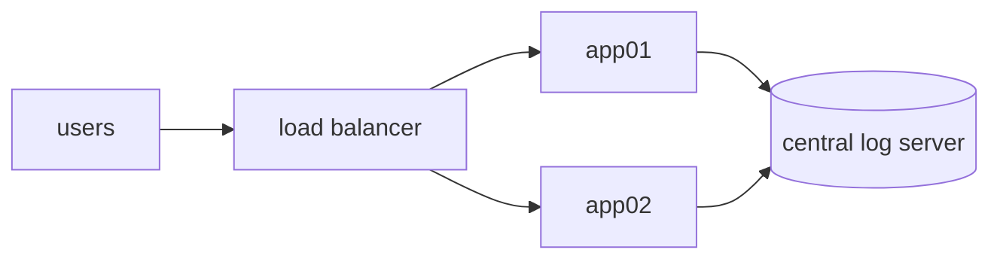

# Your Ansible Tests Pass. One Group of Servers Is Still Broken.



**Video:** https://youtu.be/S9vxvmT0Alw

Architecture diagrams simplify, and tests written from a diagram only cover the hosts it shows. We run a real role and a real test against a small inventory: everything is green, and one group of servers never got the change. Then we find the cause with ansible-inventory --graph and --list-hosts, fix a silent when condition, and roll the fix out with a canary.

## Files in this folder

- [`ansible.cfg`](ansible.cfg)
- [`group_vars/app.yml`](group_vars/app.yml)
- [`group_vars/worker.yml`](group_vars/worker.yml)
- [`inventory.ini`](inventory.ini)
- [`roles/app_logrotate/tasks/main.yml`](roles/app_logrotate/tasks/main.yml)
- [`site.yml`](site.yml)
- [`test-all.yml`](test-all.yml)
- [`test.yml`](test.yml)

## What you need

A Linux shell (a VM, WSL or a container is fine). Everything runs inside this folder.

## The lesson, step by step

The same explanations as the video, with every command. Read it, then run it yourself.

Your Ansible role has a test. The test is green. And one whole group of servers never got the change. Let's reproduce it, for real, and fix it, step by step.

### The plan

Here is the plan. First, we compare the architecture diagram with the real inventory. We run the role, and its test. Everything is green. Then we find the group of servers that was skipped, and why. And we fix it, and roll it out carefully, on one server first.

### Diagram vs inventory

**What the diagram shows**



Here is the diagram everyone knows. Two app servers send their logs to a central log server. So the person who wrote the test for our log rotation role tested the two app servers. But a diagram leaves things out, on purpose. The inventory does not.

First, the playbook. Which group of hosts gets the role?

```console
$ cat site.yml
```

A group called logging clients. What is inside it? ansible inventory dash dash graph draws the group as a tree.

```console
$ ansible-inventory --graph logging_clients
```

Two sub groups: app, with two servers, and worker, with one more server. The worker is not on the diagram. But it gets the role.

dash dash list hosts shows which hosts a playbook would run on, without running anything. First the role.

```console
$ ansible-playbook site.yml --list-hosts
```

Three hosts. Now the test.

```console
$ ansible-playbook test.yml --list-hosts
```

Only two. The test can never notice anything on worker zero one.

### Green, but wrong

Let's apply the role.

```console
$ ansible-playbook site.yml
```

Look at the second task, install the logrotate rule. It says skipping, worker zero one. In a long run, that line is easy to miss.

Now the test.

```console
$ ansible-playbook test.yml
```

Green. And what is really on disk? We list the rule files the role created.

```console
$ find target -type f | sort
```

Rules for app zero one and app zero two. Nothing for the worker. The role ran, the test passed, and one group is not covered.

### Test every group

The fix for the test: target the same group as the role, logging clients. That is the only difference in test all.

```console
$ ansible-playbook test-all.yml
```

Now it fails, exactly on the broken host. A test that fails honestly is worth more than a green one. So why was the worker skipped? We search the role for conditions.

```console
$ grep -rn 'when:' roles/
```

### The silent condition

```
- name: Install the logrotate rule
  ansible.builtin.copy:
    dest: "target/{{ inventory_hostname }}/acme.logrotate"
    content: |
      /var/log/acme/*.log {
          daily
          rotate {{ rotate_days }}
          copytruncate
      }
    mode: "0644"
  when: "'app' in group_names"
```

This is the task that was skipped. It writes the logrotate rule. And this is the reason. when: app in group names. group names is the list of groups of the current host. worker zero one is in the worker group, not app. So the task is skipped. It was copied from an older play, when the role only ran on app servers. It does not fail, and it does not warn. It just skips.

### Fix with a canary

We delete the line with the condition.

```console
$ sed -i '/when:/d' roles/app_logrotate/tasks/main.yml
```

Before changing anything, a dry run on one host only. dash dash check changes nothing. dash dash diff shows the changes. dash dash limit restricts the run to worker zero one.

```console
$ ansible-playbook site.yml --check --diff --limit worker01
```

The diff shows the exact file it would create, with the worker's own value: fourteen days. That is what we expect.

Now for real, still only on that host.

```console
$ ansible-playbook site.yml --limit worker01
```

And the test that covers every group.

```console
$ ansible-playbook test-all.yml
```

Green. And this time, green means all three hosts.

### Recap

Let's recap with four checks. One. Ask the inventory who really gets the role, with dash dash graph. Two. Compare list hosts for the role and for the test. They must match. Three. Review every when condition. Each one decides which hosts are skipped. Four. Roll out with check, diff and limit, on one host first.

A test only proves something about the hosts it runs on. Point it at the same groups as the role. Subscribe for more Ansible in the real world.

## All the commands, to copy

Run them from inside this folder, in this order (some are expected to fail: that is the point of the demo).

```bash
cat site.yml
ansible-inventory --graph logging_clients
ansible-playbook site.yml --list-hosts
ansible-playbook test.yml --list-hosts
ansible-playbook site.yml
ansible-playbook test.yml
find target -type f | sort
ansible-playbook test-all.yml
grep -rn 'when:' roles/
sed -i '/when:/d' roles/app_logrotate/tasks/main.yml
ansible-playbook site.yml --check --diff --limit worker01
ansible-playbook site.yml --limit worker01
```

---

From the [ProductionDevOps](https://www.youtube.com/@production-devops) channel: real-world DevOps and SRE, explained with real commands.
