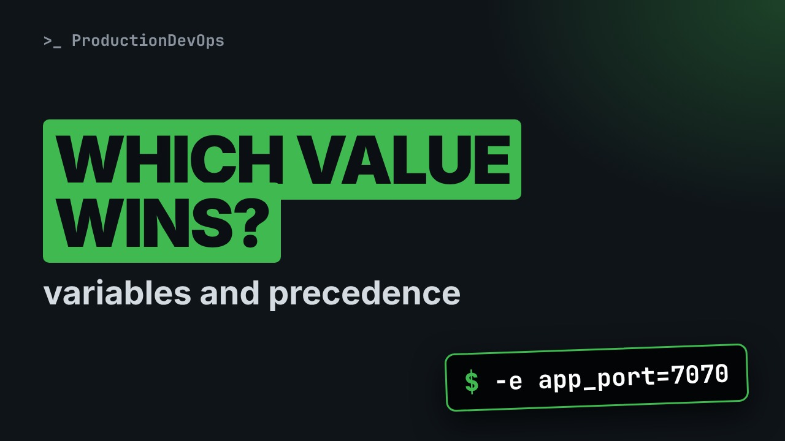
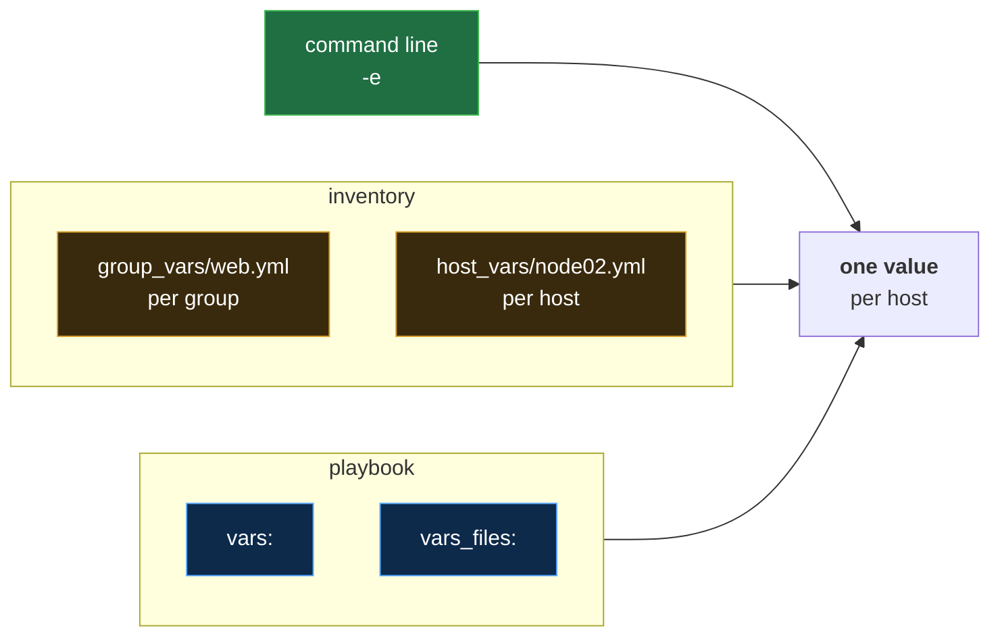
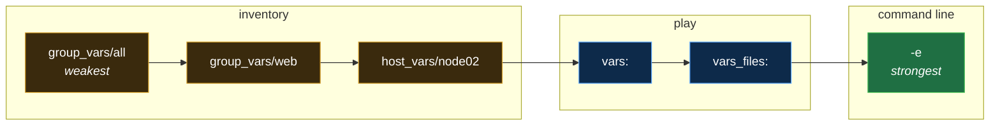

# Ansible Variables and Precedence: Which Value Wins? (vars, group_vars, host_vars, -e)



**Video:** coming soon on the [channel](https://www.youtube.com/@production-devops).

node02 must listen on its own port, until a colleague adds a "default" to the playbook and node02 silently moves. We put variables where Ansible looks for them: group_vars and host_vars next to the inventory, vars and vars_files in the play, -e on the command line, and print the winner with the debug module. Then the trap, the precedence ladder and the five rules that matter in daily work, and the fix: defaults belong in group_vars/all. Challenge and solution in the demos repo.

## Files in this folder

- [`ansible.cfg`](ansible.cfg)
- [`app.yml`](app.yml)
- [`group_vars/web.yml`](group_vars/web.yml)
- [`host_vars/node02.yml`](host_vars/node02.yml)
- [`inventory.ini`](inventory.ini)
- [`lab/up.sh`](lab/up.sh)
- [`vars/acme.yml`](vars/acme.yml)
- [`challenge-solution.sh`](challenge-solution.sh) (solution of the challenge: try it yourself first)

## What you need

A Linux shell (a VM, WSL or a container is fine). Everything runs inside this folder.

## Before you start

The video runs these commands first, off screen:

```bash
if [ -f .lab-reset ]; then bash lab/up.sh; else bash lab/up.sh reset && touch .lab-reset; fi >/dev/null 2>&1
```

## The lesson, step by step

The same explanations as the video, with every command. Read it, then run it yourself.

node zero two must listen on port 8081. Then a colleague adds a default port, and node zero two quietly moves. Today: where variables live, and which value wins.

### The plan

Lesson 12 of Ansible for RHCE. The plan. Variables in the inventory. Variables in the play, printed with debug. The trap: a default that beats host vars. And dash e, with the five rules that matter.

### Where variables live

**Where a variable can live**



A variable can live in three places: the inventory, the playbook, or the command line. For each host, Ansible ends up with one value.

```
ansible.cfg
inventory.ini
group_vars/web.yml
host_vars/node02.yml
vars/acme.yml
app.yml
```

Our files, as a map. Config and inventory as before: one group, web, with two nodes. Next to the inventory, two folders: group vars and host vars. Ansible reads them by itself. Then the playbook, and a vars file it loads.

```
app_port: 8080
```

In group vars, the file is named after the group: web. Inside, plain YAML, key colon value. Every host in web gets app port 8080.

```
app_port: 8081
```

In host vars, the file is named after one host. The same variable, but only node zero two gets 8081.

```console
$ ansible web -m debug -a var=app_port
```

Which value does each host see? We ask.

- `ansible web`: ad hoc, on the group web
An ad hoc command, on the group web.

- `-m debug`: debug: print, change nothing
The debug module prints, and changes nothing.

- `-a var=app_port`: which variable
var names the variable to print.

We run it, and read one value per host.

```console
$ ansible web -m debug -a var=app_port
```

node zero one got the group value. node zero two got its host value: the more specific file wins.

### Variables in the play

```
- name: Configure acme-app
  hosts: web
  gather_facts: false
  vars:
    app_name: acme-app
  vars_files:
    - vars/acme.yml
  tasks:
    - name: Show the settings
      ansible.builtin.debug:
        msg: "{{ app_name }} ({{ app_env }}) on port {{ app_port }}"
```

Now the playbook, as a map. First, the play header, as in lesson 8. Then two new keywords: vars, and vars files. And one task that prints a message.

```
- name: Configure acme-app
  hosts: web
  gather_facts: false
  vars:
    app_name: acme-app
  vars_files:
    - vars/acme.yml
```

A play for web. Facts are the next lesson, so we skip them. vars holds variables written in the play itself: app name. vars files lists files to load variables from.

```
app_env: staging
```

That file is plain key and value pairs, like group vars. app env is staging.

```
  tasks:
    - name: Show the settings
      ansible.builtin.debug:
        msg: "{{ app_name }} ({{ app_env }}) on port {{ app_port }}"
```

The tasks, and one task. The debug module again, now in a playbook. Its option msg is the text to print, with three variables inside.

```console
$ msg: "{{ app_name }} ({{ app_env }}) on port {{ app_port }}"
```

That line, piece by piece.

- `"`: quotes: required here
The quotes are required: a value that starts with curly braces must be quoted.

- `{{ app_name }}`: replaced by the value
Double curly braces insert a variable. This is Jinja2.

- `on port`: plain text stays as it is
Plain text is printed as it is.

All together: a name from the play, an environment from the vars file, and a port from the inventory.

```
- name: Configure acme-app
  hosts: web
  gather_facts: false
  vars:
    app_name: acme-app
  vars_files:
    - vars/acme.yml
  tasks:
    - name: Show the settings
      ansible.builtin.debug:
        msg: "{{ app_name }} ({{ app_env }}) on port {{ app_port }}"
```

We run the playbook, and read one message per host.

```console
$ ansible-playbook app.yml
```

Three sources merged into one message. And node zero two still has its own port.

So far: group vars and host vars in the inventory. vars and vars files in the play. Next, the trap: a default that beats host vars.

### The trap

A colleague wants a default port for every host. They add one line to the vars file.

```console
$ echo 'app_port: 9000' >> vars/acme.yml
```

We check the file.

```console
$ cat vars/acme.yml
```

Same playbook, nothing else changed. Which port does node zero two get now?

```console
$ ansible-playbook app.yml
```

9000 on both. The default beat host vars, and nothing failed or warned.

### The ladder

**Who wins: the precedence ladder**



Here is the ladder, from the weakest on the left to the strongest on the right. The whole play sits above the whole inventory. That is why the colleague's default won.

The official list has 22 levels. Five cover daily work. One: host beats group, and any group beats all. Two: the play beats the whole inventory. Three: in the play, vars files beats vars. Four: dash e beats everything. Five: defaults go at the bottom, in group vars all.

### -e extra vars

Rule four. Port 7070 everywhere, now, without editing a file.

```console
$ ansible-playbook app.yml -e app_port=7070
```

Dash e, an extra var, beat every file.

### The fix

Rule five is the fix. First, we rewrite the vars file without the port.

```console
$ echo 'app_env: staging' > vars/acme.yml
```

Then we put the default where defaults belong: group vars slash all.

```console
$ echo 'app_port: 9000' > group_vars/all.yml
```

We run the playbook again.

```console
$ ansible-playbook app.yml
```

Each host keeps its own port. The default only fills in where nothing else sets a value.

### Gotchas

Dash e with key equals value always gives a string. Variable names: letters, digits, underscores. No dashes. Unsure who wins? debug shows you.

### Recap

To recap: group vars and host vars, next to the inventory. vars and vars files in the play, dash e on the command line. And the ladder, weakest to strongest. Challenge: node zero two says production, node zero one staging, without dash e. The solution is in the demo repository.

Defaults at the bottom, and debug shows the winner. Next lesson: facts, what Ansible learns about every host. Subscribe so you do not miss it.

## All the commands, to copy

Run them from inside this folder, in this order (some are expected to fail: that is the point of the demo).

```bash
ansible web -m debug -a var=app_port
ansible-playbook app.yml
echo 'app_port: 9000' >> vars/acme.yml
cat vars/acme.yml
ansible-playbook app.yml -e app_port=7070
echo 'app_env: staging' > vars/acme.yml
echo 'app_port: 9000' > group_vars/all.yml
```

## Challenge

Challenge: node zero two says production, node zero one staging, without dash e. The solution is in the demo repository.

When you have tried: [`challenge-solution.sh`](challenge-solution.sh).

---

From the [ProductionDevOps](https://www.youtube.com/@production-devops) channel: real-world DevOps and SRE, explained with real commands.
