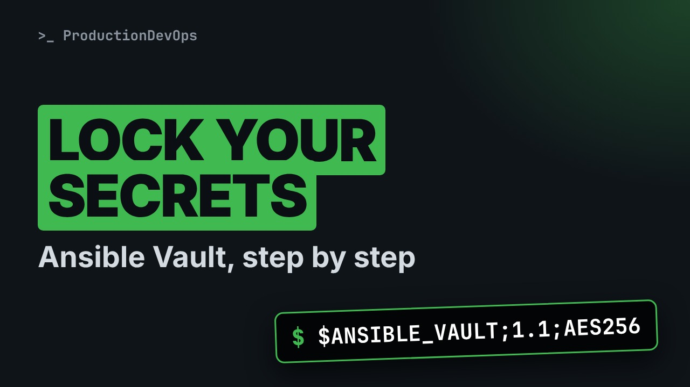
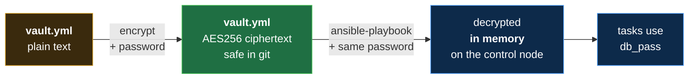
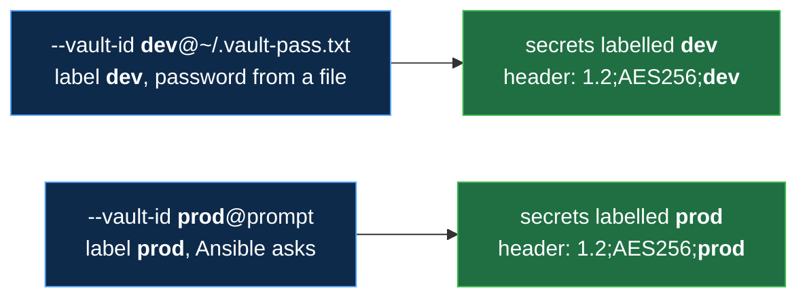

# Ansible Vault: Encrypt Secrets, Password Files, Vault IDs and encrypt_string



**Video:** coming soon on the [channel](https://www.youtube.com/@production-devops).

A password in a vars file is readable by anyone who can read your repository. Ansible Vault encrypts it: we encrypt a group_vars file, look at the ciphertext, read it back with view, and run a playbook that decrypts it in memory. Then --ask-vault-pass versus a password file, create, edit, decrypt and rekey, vault IDs with labels, and encrypt_string for one secret inside a normal YAML file. Challenge and solution in the demos repo.

## Files in this folder

- [`ansible.cfg`](ansible.cfg)
- [`app.yml`](app.yml)
- [`group_vars/web/vault.yml`](group_vars/web/vault.yml)
- [`inventory.ini`](inventory.ini)
- [`lab/up.sh`](lab/up.sh)
- [`challenge-solution.sh`](challenge-solution.sh) (solution of the challenge: try it yourself first)

## What you need

A Linux shell (a VM, WSL or a container is fine). Everything runs inside this folder.

## Before you start

The video runs these commands first, off screen:

```bash
if [ -f .lab-reset ]; then bash lab/up.sh; else bash lab/up.sh reset && touch .lab-reset; fi >/dev/null 2>&1
```

## The lesson, step by step

The same explanations as the video, with every command. Read it, then run it yourself.

A password in a vars file can be read by anyone who can read your repository. Ansible Vault encrypts it. And at the end, one secret inside a normal YAML file, with a label that says which password opens it.

### The plan

Lesson 15 of Ansible for RHCE. The plan. Encrypt a vars file, then read it back. Run a playbook with the vault password. A prompt, or a password file. And vault IDs, with encrypt string.

### The problem

Our lab has a group vars folder for web, with one secret in it. We look at it.

```console
$ cat group_vars/web/vault.yml
```

group vars slash web can be a folder. Ansible loads every file inside it, for the group web.

### How Vault works

**How Vault works**



Vault encrypts the file with AES 256 and a password you choose. The encrypted file is safe in git. When a playbook runs with the same password, Ansible decrypts it in memory, and the tasks use the value.

### Encrypt a file

First, the vault password. We keep it in a file in our home, outside the project, so it never reaches git.

```console
$ echo lab-only-vault > ~/.vault-pass.txt
```

And only we may read it.

```console
$ chmod 600 ~/.vault-pass.txt
```

```console
$ ansible-vault encrypt --vault-password-file ~/.vault-pass.txt group_vars/web/vault.yml
```

Now we encrypt the vars file.

- `ansible-vault`: the Vault tool
ansible vault is the tool.

- `encrypt`: encrypt a file, in place
encrypt replaces the file with its encrypted version.

- `--vault-password-file ~/.vault-pass.txt`: the password, from this file
dash dash vault password file: read the password from our file.

- `group_vars/web/vault.yml`: the file to encrypt
And the file to encrypt.

We run it.

```console
$ ansible-vault encrypt --vault-password-file ~/.vault-pass.txt group_vars/web/vault.yml
```

What is in the file now? head dash 3 shows the first three lines.

```console
$ head -3 group_vars/web/vault.yml
```

Under the header, hex. Encrypt again, and the hex is different: a random salt, every time.

Can we still read it? view decrypts it on screen.

```console
$ ansible-vault view --vault-password-file ~/.vault-pass.txt group_vars/web/vault.yml
```

The file on disk stays encrypted.

Four more subcommands. Two of them open an editor, so here they are on a slide. create makes a new encrypted file. It opens your editor first. edit decrypts to a temporary file, opens the editor, and encrypts again when you save. decrypt turns the file back into plain text, on disk. And rekey changes the vault password of a file.

So far: we encrypted the file, and read it back with view. The password lives in a file, mode six hundred, outside the repository. Next: a playbook that uses it. Then the promise: a label in the header.

### Run with Vault

```
- name: Use the secret
  hosts: web
  gather_facts: false
  tasks:
    - name: Prove we can read it
      ansible.builtin.debug:
        msg: "db_pass has {{ db_pass | length }} characters"
```

A playbook that uses the secret. Part one, the play. Part two, one task.

```
- name: Use the secret
  hosts: web
  gather_facts: false
  tasks:
    - name: Prove we can read it
      ansible.builtin.debug:
        msg: "db_pass has {{ db_pass | length }} characters"
```

The group web, so our group vars file applies. One debug task. It prints the length of db pass, with the length filter. We prove we can read the secret, without printing it.

All together: both nodes, one task that measures the secret.

```
- name: Use the secret
  hosts: web
  gather_facts: false
  tasks:
    - name: Prove we can read it
      ansible.builtin.debug:
        msg: "db_pass has {{ db_pass | length }} characters"
```

First we run it with no password.

```console
$ ansible-playbook app.yml
```

Ansible stops: it found encrypted data, and no password. Now we give it the password file.

```console
$ ansible-playbook app.yml --vault-password-file ~/.vault-pass.txt
```

With dash dash ask vault pass, Ansible prints Vault password, and waits for you to type it. That is good for a person at a keyboard. A password file is for automation, where nobody is there to type. You can also set it once, in ansible dot cfg.

### Vault IDs

**Vault IDs: a label for each password**



A vault ID is a label, an at sign, and where the password comes from: a file, or the word prompt. One run can take several, and the label in each header tells Ansible which password to try first.

```console
$ ansible-vault encrypt_string --vault-id dev@~/.vault-pass.txt 'acme-lab-demo' --name db_pass
```

Now the promise: one secret, encrypted with a label.

- `encrypt_string`: encrypt one value, not a file
encrypt string encrypts one value, not a whole file.

- `--vault-id dev@~/.vault-pass.txt`: label dev, password from the file
The vault ID: label dev, and the password from our file.

- `'acme-lab-demo'`: the value to encrypt
The value to encrypt.

- `--name db_pass`: the variable name
And dash dash name: the variable it belongs to.

We run it.

```console
$ ansible-vault encrypt_string --vault-id dev@~/.vault-pass.txt 'acme-lab-demo' --name db_pass
```

The output is YAML: db pass, the vault tag, then the ciphertext. The header says 1.2, with the label dev. Paste it into any vars file. Only this value is encrypted, and the rest of the file stays readable.

### Gotchas

The password file: mode six hundred, and never in git. A value typed on the command line lands in your shell history. encrypt string has a prompt option. Verbose output can print secrets. Use no log true on the tasks that handle them.

### Recap

To recap: one tool, ansible vault, for encrypt, view, create, edit, decrypt and rekey. Run a playbook with a prompt, or with a password file. Vault IDs label passwords, and encrypt string encrypts one value. Challenge: replace our vault file with an encrypt string db pass, and run app dot yml with a vault ID. The solution is in the demo repository.

Vault keeps secrets encrypted in git, and opens them only at run time. Next lesson: dynamic inventory and targeting. Subscribe so you do not miss it.

## All the commands, to copy

Run them from inside this folder, in this order (some are expected to fail: that is the point of the demo).

```bash
cat group_vars/web/vault.yml
echo lab-only-vault > ~/.vault-pass.txt
chmod 600 ~/.vault-pass.txt
ansible-vault encrypt --vault-password-file ~/.vault-pass.txt group_vars/web/vault.yml
head -3 group_vars/web/vault.yml
ansible-vault view --vault-password-file ~/.vault-pass.txt group_vars/web/vault.yml
ansible-playbook app.yml
ansible-playbook app.yml --vault-password-file ~/.vault-pass.txt
ansible-vault encrypt_string --vault-id dev@~/.vault-pass.txt 'acme-lab-demo' --name db_pass
```

## Challenge

Challenge: replace our vault file with an encrypt string db pass, and run app dot yml with a vault ID. The solution is in the demo repository.

When you have tried: [`challenge-solution.sh`](challenge-solution.sh).

---

From the [ProductionDevOps](https://www.youtube.com/@production-devops) channel: real-world DevOps and SRE, explained with real commands.
