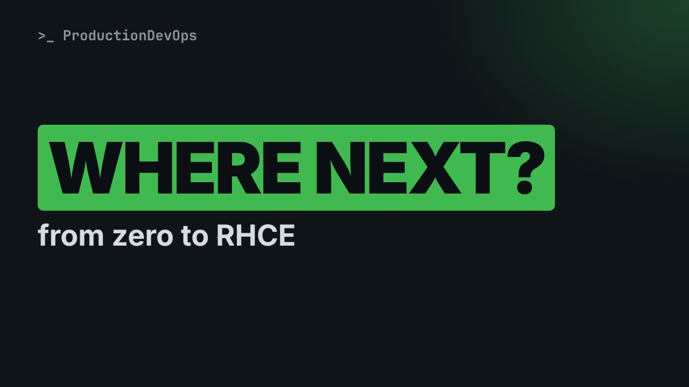
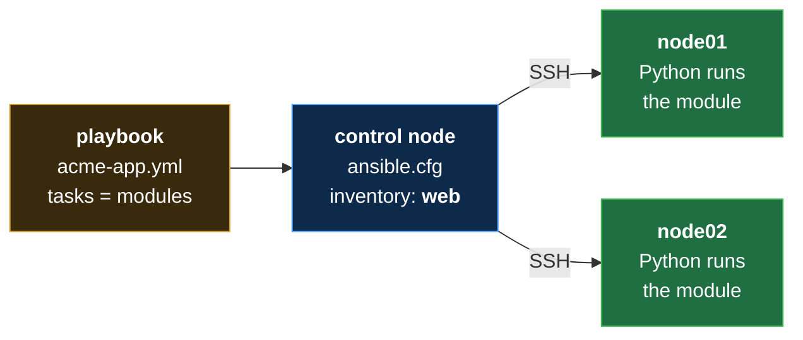
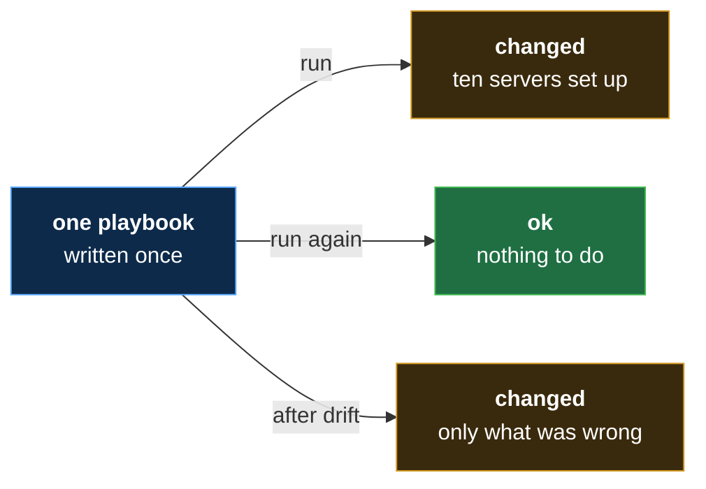
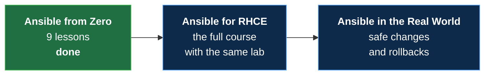

# Ansible from Zero, Where Next: What You Can Do Now, and the RHCE Course

**Video:** coming soon on the [channel](https://www.youtube.com/@production-devops).

Eight lessons ago, one change on ten servers meant fifty steps by hand. This last lesson of Ansible from Zero puts the whole course in one picture: the control node, the inventory, modules, ad hoc commands, a playbook, and why running it twice breaks nothing. Then where to go next: what the Ansible for RHCE course adds, from variables and admin rights to loops, templates, roles and Vault, and how to keep practicing on your two practice servers. No experience needed. The final challenge and its solution are in the demos repo.

## Files in this folder

- [`challenge-solution.sh`](challenge-solution.sh) (solution of the challenge: try it yourself first)
- [`data.yml`](data.yml)

## What you need

A Linux shell (a VM, WSL or a container is fine). Everything runs inside this folder.

## The lesson, step by step

The same explanations as the video, with every command. Read it, then run it yourself.

Eight lessons ago, one change on ten servers meant fifty steps by hand. Look at what you can do now. Then, where to go next.

For this lesson you need nothing. Just watch. No terminal today, only pictures. About five minutes.

### The plan

This is lesson nine, the last one of Ansible from Zero. First, the whole course, in one picture. Then, what you can do now. Then, what the next course adds. And how to keep practicing.

### One picture

**The whole course, in one picture**

Here is everything, in one picture: a playbook on the control node. The inventory says which servers. Over SSH, Python on each server runs the modules.

Five words you know now. The inventory: the list of servers. A module: a ready-made task. An ad hoc command: one quick instruction, typed once. A playbook: the tasks, written down. And idempotent: once or ten times, the same result.

And three commands. Ansible dash inventory, to draw the list. Ansible all dash m ping, to ask every server: are you there? And ansible dash playbook, to check a playbook, and run it.

**The ten servers, again**

Now the ten servers of lesson one: one playbook, written once, sets them all up. Run it again, and nothing breaks. After drift, it fixes only what is wrong.

What can you already automate? You can check that every server answers. You can make the same folder on every server. You can copy the same settings file to every server. And you can bring a drifted server back in line, by running the playbook again.

### So far

So far: you can list servers, ask them a question, and change them. You can write the job down, and run it safely again. Next: what you cannot do yet, and where to learn it.

### The RHCE course

- `RHCE`: A Red Hat exam: you automate real tasks, with Ansible, on real servers (like a cooking exam in a real kitchen, not a quiz on paper)
New word: RHCE, a Red Hat exam. You automate real tasks with Ansible, on real servers. Like a cooking exam in a real kitchen.

The next course adds variables and facts: values that change from server to server. Become: admin rights, for places like slash opt. Loops and conditions: repeat a task, or skip it. Templates and roles: files with blanks to fill, and jobs you can reuse. And Vault, to keep secrets locked.

**Your path**

Here is your path: this course is done. Next comes Ansible for RHCE, with the same two practice servers. After that, Ansible in the Real World.

### Keep practicing

Keep your two practice servers. The lab script of lesson four starts them again. Change one thing at a time, and then run the playbook twice. Read the colors. Green is ok, yellow is changed, and red is failed. And redo the challenges. Their solutions are in the demo repo.

### Good to know

The RHCE course goes faster. These nine lessons are your base. Linux basics help a lot: files, folders and users. And you do not need the exam to use Ansible at work.

### Recap

Recap: a playbook on the control node, SSH, and modules on every server. Write the end state, and run it as often as you like. Your final challenge: from memory, write a playbook for a folder called data, on all servers. Check it, and run it twice. Yellow, then green? The solution is in the demo repo.

### Where next

Where next? Ansible for RHCE. Lesson one is about the exam, and your lab. Lesson two shows how Ansible works, in depth. You find it in the channel's playlists.

Thank you for following Ansible from Zero. Next, the Ansible for RHCE course. Subscribe so you do not miss a lesson.

## Challenge

And redo the challenges. Their solutions are in the demo repo.

When you have tried: [`challenge-solution.sh`](challenge-solution.sh).

---

From the [ProductionDevOps](https://www.youtube.com/@production-devops) channel: real-world DevOps and SRE, explained with real commands.
