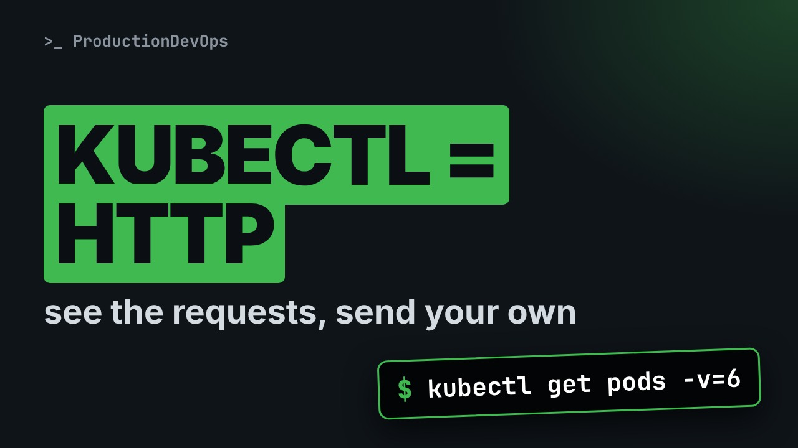
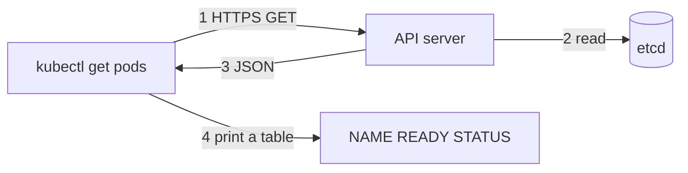

# The API Behind kubectl: See the Requests, Then Send Your Own



**Video:** https://youtu.be/ZMJbws9InMs

kubectl is not magic: every command is an HTTPS request to the Kubernetes API server. We turn on verbose logging to see the real requests, read the map of groups, versions and resources with api-resources, use kubectl explain as offline documentation, and finally talk to the API ourselves with kubectl proxy and curl: list Pods, read a Deployment, and create one with a JSON body. Part 6 of the Kubernetes Path.

## Files in this folder

- [`deploy.json`](deploy.json)
- [`challenge-solution.sh`](challenge-solution.sh) (solution of the challenge: try it yourself first)

## What you need

A Kubernetes cluster you can break: a local [kind](https://kind.sigs.k8s.io/) cluster with one control plane and two workers is what the video uses, plus `kubectl`. Never run these commands against a cluster that matters.

The outputs below were captured for real on the lab cluster. On yours, names, ages, IPs and ports will differ; everything else should match.

## The lesson, step by step

The same explanations as the video, with every command and its real output. Read it, then run it yourself.

kubectl looks like magic, so API errors, versions and resource names feel random. They are not. Every kubectl command is an HTTP request, and today we read those requests, then send our own.

### The plan

This is part six of the Kubernetes Path. Here is the plan. First, we look at the real HTTP request behind a kubectl command. Then we read the map of the API: groups, versions and resources. We use kubectl explain, the documentation built into the cluster. And finally we talk to the API ourselves, with kubectl proxy and curl.

### One request

**What kubectl really does**



kubectl reads your kubeconfig, then sends an HTTPS request to the API server. The API server reads the objects from etcd and answers with JSON. kubectl turns that JSON into the table you know.

In a namespace called api demo, a Deployment called web runs two Pods. A normal get pods first.

```console
$ kubectl get pods -n api-demo
NAME                   READY   STATUS    RESTARTS   AGE
web-69c6f74b8b-774g7   1/1     Running   0          2s
web-69c6f74b8b-zs8g6   1/1     Running   0          2s
```

Dash v six raises the log level, and kubectl prints each HTTP request. grep keeps the request line, and cut removes the log prefix.

```console
$ kubectl get pods -n api-demo -v=6 2>&1 >/dev/null | grep -m1 'api-demo/pods' | cut -d']' -f2-
 "Response" verb="GET" url="https://127.0.0.1:35239/api/v1/namespaces/api-demo/pods?limit=500" status="200 OK" milliseconds=10
```

Read the line: the method, GET, the full URL, and the status, two hundred OK. The path tells the whole story: api slash v1, then the namespace, then the resource, pods. Limit five hundred means kubectl asks for the list in pages.

Now the same trick for deployments.

```console
$ kubectl get deployments -n api-demo -v=6 2>&1 >/dev/null | grep -m1 'api-demo/deployments' | cut -d']' -f2-
 "Response" verb="GET" url="https://127.0.0.1:35239/apis/apps/v1/namespaces/api-demo/deployments?limit=500" status="200 OK" milliseconds=11
```

This path starts with apis, plural, then apps slash v1. Deployments are not in the core group: they belong to the apps group.

### Groups and versions

Every resource lives in a group, at a version. The core group, the oldest one, lives under api slash v1: Pods, Services, ConfigMaps. Every newer group lives under apis, with its own name and version, like apps slash v1. Versions mature from alpha, to beta, to a stable v1. And a resource is either namespaced, or cluster-wide, like nodes and namespaces themselves.

### The map

kubectl api-resources lists every resource the server knows. Dash dash api group filters one group.

```console
$ kubectl api-resources --api-group=apps
NAME                  SHORTNAMES   APIVERSION   NAMESPACED   KIND
controllerrevisions                apps/v1      true         ControllerRevision
daemonsets            ds           apps/v1      true         DaemonSet
deployments           deploy       apps/v1      true         Deployment
replicasets           rs           apps/v1      true         ReplicaSet
statefulsets          sts          apps/v1      true         StatefulSet
```

Look at deployments: short name deploy, version apps slash v1, namespaced true, kind Deployment. Dash dash namespaced false shows the cluster-wide resources. We keep three of them.

```console
$ kubectl api-resources --namespaced=false | grep -E '^(NAME|namespaces|nodes|persistentvolumes) '
NAME                                SHORTNAMES   APIVERSION                        NAMESPACED   KIND
namespaces                          ns           v1                                false        Namespace
nodes                               no           v1                                false        Node
persistentvolumes                   pv           v1                                false        PersistentVolume
```

And api-versions lists every group and version this server serves. Apps and batch are at v1, stable.

```console
$ kubectl api-versions | grep -E '^(apps|batch)/'
apps/v1
batch/v1
```

### Built-in docs

kubectl explain prints the documentation of any field, straight from the API server. Here, the strategy of a Deployment.

```console
$ kubectl explain deployment.spec.strategy
GROUP:      apps
KIND:       Deployment
VERSION:    v1

FIELD: strategy <DeploymentStrategy>


DESCRIPTION:
    The deployment strategy to use to replace existing pods with new ones.
    DeploymentStrategy describes how to replace existing pods with new ones.
    
FIELDS:
  rollingUpdate	<RollingUpdateDeployment>
    Rolling update config params. Present only if DeploymentStrategyType =
    RollingUpdate.

  type	<string>
  enum: Recreate, RollingUpdate
    Type of deployment. Can be "Recreate" or "RollingUpdate". Default is
    RollingUpdate.
    
    Possible enum values:
     - `"Recreate"` Kill all existing pods before creating new ones.
     - `"RollingUpdate"` Replace the old ReplicaSets by new one using rolling
    update i.e gradually scale down the old ReplicaSets and scale up the new
    one.
```

Dash dash recursive prints the whole tree of fields below it. sed keeps only the fields part.

```console
$ kubectl explain deployment.spec.strategy --recursive | sed -n '/^FIELDS/,$p'
FIELDS:
  rollingUpdate	<RollingUpdateDeployment>
    maxSurge	<IntOrString>
    maxUnavailable	<IntOrString>
  type	<string>
  enum: Recreate, RollingUpdate
```

### Talk to the API

To send our own requests, we need the certificates and the token. kubectl proxy handles them for us. kubectl proxy listens on localhost, port eight thousand and one. It forwards each request to the API server, adding TLS and your credentials. So a plain curl on localhost just works, with the same rights as your kubectl.

We start the proxy in the background, with the ampersand. Dollar bang is the process ID of that command: we save it, to stop the proxy later.

```console
$ kubectl proxy --port=8001 >/dev/null 2>&1 & echo $! > proxy.pid
```

Now the same URL kubectl used, with curl. The answer is JSON, and jq prints just the Pod names.

```console
$ curl -s localhost:8001/api/v1/namespaces/api-demo/pods | jq -r '.items[].metadata.name'
web-69c6f74b8b-774g7
web-69c6f74b8b-zs8g6
```

One object by name: the web Deployment, in the apps group. We print its kind, its version and its replicas.

```console
$ curl -s localhost:8001/apis/apps/v1/namespaces/api-demo/deployments/web | jq -c '{kind, apiVersion, replicas: .spec.replicas}'
{"kind":"Deployment","apiVersion":"apps/v1","replicas":2}
```

### Create with curl

```
{
  "apiVersion": "apps/v1",
  "kind": "Deployment",
  "metadata": {"name": "api-made"},
  "spec": {
    "replicas": 1,
    "selector": {"matchLabels": {"app": "api-made"}},
    "template": {
      "metadata": {"labels": {"app": "api-made"}},
      "spec": {"containers": [{"name": "nginx", "image": "nginx:1.27"}]}}}}
```

The same fields as a YAML manifest, written as JSON: version, kind, and the name, api made. One replica, a selector, and a Pod template with one nginx container.

To create an object, we POST it to the collection URL. Dash dash data with an at sign sends the file.

```console
$ curl -s -X POST -H 'Content-Type: application/json' --data @deploy.json localhost:8001/apis/apps/v1/namespaces/api-demo/deployments | jq -r '.kind + " " + .metadata.name'
Deployment api-made
```

kubectl sees it at once. It is the same API, so there is no difference between the two.

```console
$ kubectl get deployment api-made -n api-demo
NAME       READY   UP-TO-DATE   AVAILABLE   AGE
api-made   1/1     1            1           2s
```

We stop the proxy with the saved process ID.

```console
$ kill $(cat proxy.pid)
```

And we delete the namespace, with everything inside it.

```console
$ kubectl delete namespace api-demo
namespace "api-demo" deleted
```

### Gotchas

Two traps worth knowing. From level eight up, kubectl prints request bodies and headers, with secrets inside. Never paste them in a ticket or a chat. YAML from an old blog post may use a version that was removed. Check api-versions before you apply it. And the proxy carries your rights. Keep it on localhost, and stop it when you are done.

### Recap

Let's recap. Every kubectl command is an HTTP request. Dash v six shows it. The core group lives under api slash v1. Named groups live under apis, group, version. api-resources and api-versions are the map, and explain is the documentation. Your challenge: through kubectl proxy, scale the web Deployment to three replicas using only curl. Hint: look for the scale subresource. The solution is in the demo repository.

kubectl is a friendly client for an HTTP API, and now you can read its requests. Next on the Kubernetes Path: the three gates every request crosses, authentication, authorization and admission. Subscribe to follow the whole path.

## All the commands, to copy

Run them from inside this folder, in this order.

```bash
kubectl get pods -n api-demo
kubectl get pods -n api-demo -v=6 2>&1 >/dev/null | grep -m1 'api-demo/pods' | cut -d']' -f2-
kubectl get deployments -n api-demo -v=6 2>&1 >/dev/null | grep -m1 'api-demo/deployments' | cut -d']' -f2-
kubectl api-resources --api-group=apps
kubectl api-resources --namespaced=false | grep -E '^(NAME|namespaces|nodes|persistentvolumes) '
kubectl api-versions | grep -E '^(apps|batch)/'
kubectl explain deployment.spec.strategy
kubectl explain deployment.spec.strategy --recursive | sed -n '/^FIELDS/,$p'
kubectl proxy --port=8001 >/dev/null 2>&1 & echo $! > proxy.pid
curl -s localhost:8001/api/v1/namespaces/api-demo/pods | jq -r '.items[].metadata.name'
curl -s localhost:8001/apis/apps/v1/namespaces/api-demo/deployments/web | jq -c '{kind, apiVersion, replicas: .spec.replicas}'
curl -s -X POST -H 'Content-Type: application/json' --data @deploy.json localhost:8001/apis/apps/v1/namespaces/api-demo/deployments | jq -r '.kind + " " + .metadata.name'
kubectl get deployment api-made -n api-demo
kill $(cat proxy.pid)
kubectl delete namespace api-demo
```

## Challenge

Your challenge: through kubectl proxy, scale the web Deployment to three replicas using only curl. Hint: look for the scale subresource. The solution is in the demo repository.

When you have tried: [`challenge-solution.sh`](challenge-solution.sh).

---

From the [ProductionDevOps](https://www.youtube.com/@production-devops) channel: real-world DevOps and SRE, explained with real commands.
