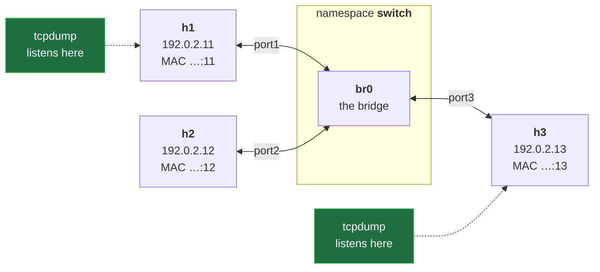
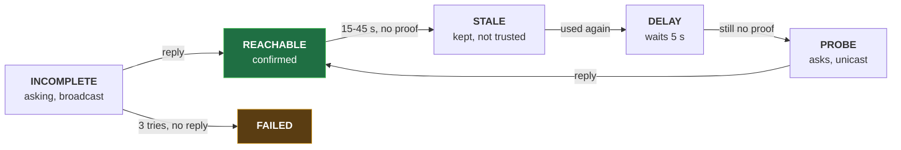

# ARP Explained: Who Has This IP? Request, Reply and the Neighbour Cache, in Real Captures


**Video:** coming soon on the [channel](https://www.youtube.com/@production-devops).

Your host knows the IP address, but an Ethernet frame needs a MAC: ARP finds it. We capture one ARP exchange on a Linux bridge with three hosts in network namespaces, and prove that the request is a broadcast everyone hears while the reply is unicast. Then the ARP message field by field (28 bytes, 42 with Ethernet), the neighbour cache with ip neigh and its states (REACHABLE, STALE, DELAY, FAILED), a host that does not exist and its Destination Host Unreachable, proxy ARP and gratuitous ARP. Lab script, capture script and challenge solution in the demos repo.

## Files in this folder

- [`arp.sh`](arp.sh)
- [`lab/net.sh`](lab/net.sh)
- [`challenge-solution.sh`](challenge-solution.sh) (solution of the challenge: try it yourself first)

## What you need

A Linux shell (a VM, WSL or a container is fine). Everything runs inside this folder.

## Before you start

The video runs these commands first, off screen:

```bash
bash lab/net.sh up lan >/dev/null 2>&1
```

## The lesson, step by step

The same explanations as the video, with every command. Read it, then run it yourself.

Your host knows the IP address, but a frame needs a MAC. Who tells it? Today we catch the question, the answer, and a host that never answers.

### The plan

This is lesson 7 of Networking Fundamentals. Why a host needs a MAC. The request and the reply, captured. The ARP message, field by field. The cache, and a missing host.

### The idea

h1 sends to 192.0.2.12: same subnet, direct delivery. The packet rides in a frame. A frame needs the next hop's MAC: here h2; for another subnet, a router. ARP, the address resolution protocol, asks: who has this IP? The reply is a MAC.

### The lab

**Our lab: three hosts on one switch**



The LAN from lesson 5: three hosts on one bridge. This time we listen in two places: on h1, who asks, and on h3, the bystander.

h1 does not know h2's MAC yet.

- `h1 → h2`: Request: who-has 192.0.2.12?
The request goes to the broadcast MAC, all f's: who has 192.0.2.12?

- `h1 → h3`: the same broadcast
The switch floods it, so h3 hears it too, and ignores it.

- `h2 → h1`: Reply: 192.0.2.12 is-at …:12
h2 answers straight to h1's MAC: a unicast. h3 should not see it.

### The script

The experiment, in one script. Three blocks.

```
#!/usr/bin/env bash
# Who sees ARP? Capture on h1 and on h3 while h1 pings h2 for the first time
bash lab/net.sh reset lan
ip netns exec h1 tcpdump -n -i eth0 -w h1.pcap -Z root arp 2>/dev/null &
ip netns exec h3 tcpdump -n -i eth0 -w h3.pcap -Z root arp 2>/dev/null &
sleep 1
ip netns exec h1 ping -c 1 192.0.2.12 >/dev/null
sleep 1
kill %1 %2
wait
echo "captures saved: h1.pcap h3.pcap"
```

A fresh LAN. Two captures. One ping, and cleanup.

```
#!/usr/bin/env bash
# Who sees ARP? Capture on h1 and on h3 while h1 pings h2 for the first time
bash lab/net.sh reset lan
```

Run with bash; the hash line is a comment. reset lan rebuilds the three hosts: every ARP cache starts empty.

```
ip netns exec h1 tcpdump -n -i eth0 -w h1.pcap -Z root arp 2>/dev/null &
ip netns exec h3 tcpdump -n -i eth0 -w h3.pcap -Z root arp 2>/dev/null &
sleep 1
```

A capture on h1, the host that asks, saved to a file, in the background. The same on h3, the bystander. A second for both to start.

```console
$ ip netns exec h1 tcpdump -n -i eth0 -w h1.pcap -Z root arp 2>/dev/null &
```

- `ip netns exec h1`: on h1
On h1,

- `-n -i eth0`: numbers; its card, eth0
numbers only, on its card,

- `-w h1.pcap -Z root`: into a file, as root
into a file, as root, as in lesson 5.

- `arp`: filter: ARP frames only
The new piece: the filter arp keeps only ARP frames.

- `2>/dev/null &`: quiet, in the background
Quietly, in the background.

```
ip netns exec h1 ping -c 1 192.0.2.12 >/dev/null
sleep 1
kill %1 %2
wait
echo "captures saved: h1.pcap h3.pcap"
```

One ping to h2. Before it can leave, h1 must find h2's MAC. A second for the last frames, then kill stops jobs one and two. wait lets them finish, and echo names the files.

The whole script. One ping: how many ARP frames will h3 see?

```
#!/usr/bin/env bash
# Who sees ARP? Capture on h1 and on h3 while h1 pings h2 for the first time
bash lab/net.sh reset lan
ip netns exec h1 tcpdump -n -i eth0 -w h1.pcap -Z root arp 2>/dev/null &
ip netns exec h3 tcpdump -n -i eth0 -w h3.pcap -Z root arp 2>/dev/null &
sleep 1
ip netns exec h1 ping -c 1 192.0.2.12 >/dev/null
sleep 1
kill %1 %2
wait
echo "captures saved: h1.pcap h3.pcap"
```

### Run it

```console
$ tcpdump -n -t -e -r h1.pcap
```

- `-t`: no timestamps
To read it: dash t, no timestamps,

- `-e`: show the MACs (lesson 4)
dash e, the MACs,

- `-r h1.pcap`: read the saved file
dash r, read the file.

We run it.

```console
$ bash arp.sh
```

First h1, the host that asked.

```console
$ tcpdump -n -t -e -r h1.pcap
```

Now h3, the bystander.

```console
$ tcpdump -n -t -e -r h3.pcap
```

- `h1 → h2`: Request, broadcast
Line one, on h1: the request, ethertype 0806, ARP.

- `h1 → h3`: the same request
Line three, on h3: the very same frame. The switch flooded it.

- `h2 → h1`: Reply, unicast
Line two: the reply, h2 to h1 only. is-at carries the answer.

### The message

The request: 28 bytes; with the Ethernet header, 42.

- `hardware type`: 1 = Ethernet
Hardware type one: Ethernet.

- `protocol type`: 0x0800 = IPv4
Protocol type 0800: IPv4 addresses, the same number as the EtherType.

- `hlen`: 6
Hardware length six: a MAC is six bytes.

- `plen`: 4
Protocol length four: an IPv4 address.

- `operation`: 1 = request
Operation: one is a request, two a reply.

- `sender MAC (SHA)`: 02:00:00:00:00:11 (h1)
The sender's MAC: h1.

- `sender IP (SPA)`: 192.0.2.11 (h1)
And its IP. With these two, h2 learns h1 for free.

- `target MAC (THA)`: 00:00:00:00:00:00 = ?
The target MAC: all zeros. That is the question.

- `target IP (TPA)`: 192.0.2.12: who has it?
The target IP. In the reply, sender and target swap, and h2 fills in its MAC.

### So far

So far: the request is a broadcast, every host hears it. The reply is unicast: only the asker gets it. Next: where the answer is kept, and what happens when nobody answers.

### The cache

**The neighbour cache: one state per entry**



Each answer goes into the neighbour cache, with a state: INCOMPLETE while asking, REACHABLE once answered. After 15 to 45 seconds without proof it turns STALE: kept, but not trusted. Used again, it waits in DELAY, then PROBE asks again, unicast.

First, shorter timers, to see the states change in seconds. sysctl dash q w writes a kernel setting, quietly: REACHABLE now lasts two to six seconds.

```console
$ ip netns exec h1 sysctl -qw net/ipv4/neigh/eth0/base_reachable_time_ms=4000
```

And DELAY now waits one second, not five.

```console
$ ip netns exec h1 sysctl -qw net/ipv4/neigh/eth0/delay_first_probe_time=1
```

h1 pings h2. Double ampersand: if it worked, ip neigh prints h1's cache.

```console
$ ip netns exec h1 ping -c 1 192.0.2.12 >/dev/null && ip -n h1 neigh
```

Five more seconds of silence, then the cache again. Nobody confirmed the entry: STALE.

```console
$ sleep 5 && ip -n h1 neigh
```

We use it again. A STALE entry still sends the frame, then asks for proof: DELAY.

```console
$ ip netns exec h1 ping -c 1 192.0.2.12 >/dev/null && ip -n h1 neigh
```

### Nobody home

h1 pings 192.0.2.99: nobody has it.

- `h1 → 192.0.2.99?`: who-has 192.0.2.99?
The first request, broadcast. The entry is INCOMPLETE.

- `h1 → 192.0.2.99?`: again, 1 s later
No answer. One second later, again.

- `h1 → 192.0.2.99?`: a third time
A third time. Then h1 gives up: FAILED.

h1 pings it, once. After three seconds: Destination Host Unreachable. Look who reports it: from 192.0.2.11, h1 itself.

```console
$ ip netns exec h1 ping -c 1 192.0.2.99
```

And the cache remembers the failure.

```console
$ ip -n h1 neigh
```

### Special cases

Proxy ARP: a router answers for addresses behind it, with its own MAC. Gratuitous ARP: a host announces its own address, unasked, say after a failover. Duplicate address detection: before using an address, ask who has it. Any reply means a conflict.

Is proxy ARP on, on h1's eth0? sysctl dash n prints the value: zero, off by default.

```console
$ ip netns exec h1 sysctl -n net/ipv4/conf/eth0/proxy_arp
```

### Gotchas

ARP never leaves one link: for another subnet, the router's MAC. Unreachable from your own IP means no ARP reply: the host is down, or not on your link.

### Recap

Recap: direct delivery needs a MAC; ARP finds it. Request broadcast, reply unicast. Nobody answers: FAILED. Challenge: from h3, arping dash capital D each address. Which is free? Solution in the demo repo.

Next lesson: the IPv4 header, field by field. Subscribe so you do not miss it.

## All the commands, to copy

Run them from inside this folder, in this order (some are expected to fail: that is the point of the demo).

```bash
ip netns exec h1 tcpdump -n -i eth0 -w h1.pcap -Z root arp 2>/dev/null &
tcpdump -n -t -e -r h1.pcap
bash arp.sh
tcpdump -n -t -e -r h3.pcap
ip netns exec h1 sysctl -qw net/ipv4/neigh/eth0/base_reachable_time_ms=4000
ip netns exec h1 sysctl -qw net/ipv4/neigh/eth0/delay_first_probe_time=1
ip netns exec h1 ping -c 1 192.0.2.12 >/dev/null && ip -n h1 neigh
sleep 5 && ip -n h1 neigh
ip netns exec h1 ping -c 1 192.0.2.99
ip -n h1 neigh
ip netns exec h1 sysctl -n net/ipv4/conf/eth0/proxy_arp
```

## Challenge

Challenge: from h3, arping dash capital D each address. Which is free? Solution in the demo repo.

When you have tried: [`challenge-solution.sh`](challenge-solution.sh).

---

From the [ProductionDevOps](https://www.youtube.com/@production-devops) channel: real-world DevOps and SRE, explained with real commands.
