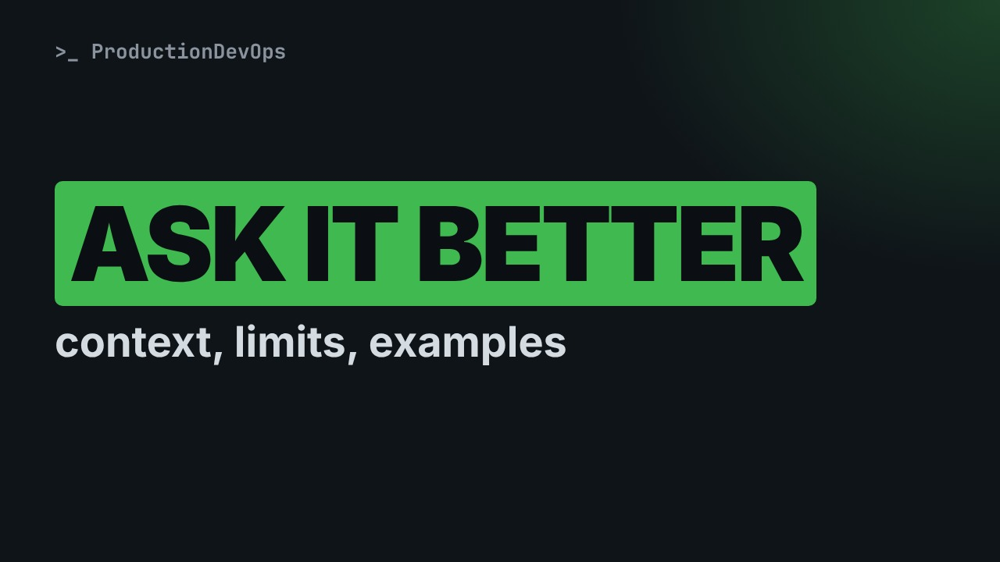
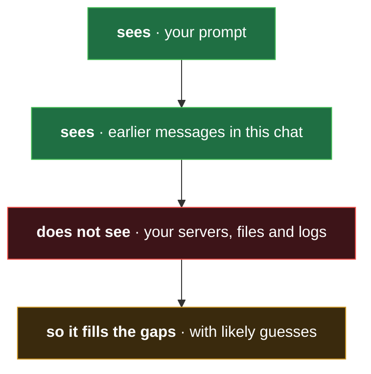
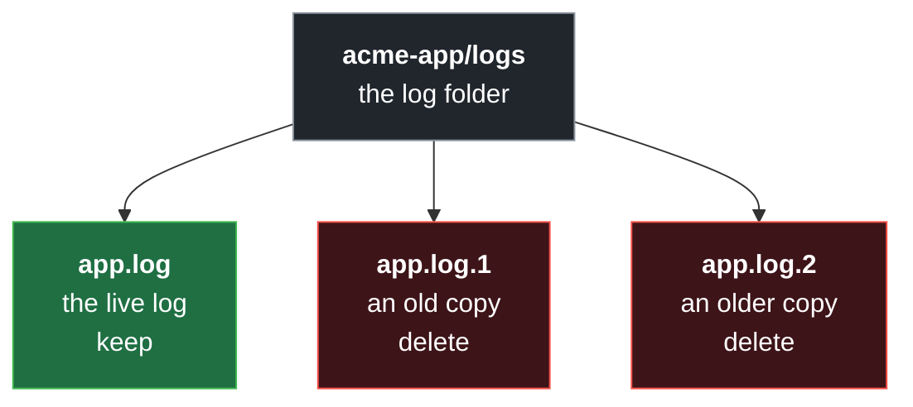
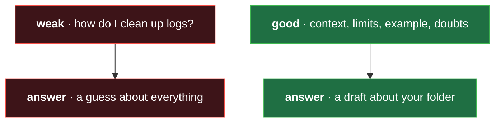

# Asking Well: Context, Limits, Examples (AI for Ops: the Safe Basics)



**Video:** coming soon on the [channel](https://www.youtube.com/@production-devops).

A vague question gets a vague answer. This lesson of AI Assistants for Ops: the Safe Basics shows why: the assistant only sees what you put in your message. We take one weak question about cleaning up the logs of a fictional app, add three things (context, limits, an example) and one request (tell me what you are not sure about), and compare the two prompts side by side. Valid for any assistant, no product names, nothing to install. Every new word is explained on screen. The challenge and its solution are in the demos repo.

## Files in this folder

- [`challenge-solution.md`](challenge-solution.md) (solution of the challenge: try it yourself first)

## What you need

A Linux shell (a VM, WSL or a container is fine). Everything runs inside this folder.

## The lesson, step by step

The same explanations as the video, with every command. Read it, then run it yourself.

A vague question gets a vague answer. In five minutes: context, limits and an example. Then the same question, asked twice, side by side.

You will need lessons one to three: the prompt, likely text, and secrets. Nothing to install. Only pictures and cards.

### The plan

This is lesson four of AI Assistants for Ops. First, a weak question, and its answer. Then, what the assistant can see. Three additions: context, limits, and an example. And the two prompts, side by side.

### A weak question

Our job: the logs of acme app take too much space. Here is a first, quick question.

```
You:
  how do I clean up logs?

AI assistant:
  It depends on your system. Logs are often in /var/log.
  You can delete the old files there.
```

Five words. Clean up logs. But which logs, and where? The answer starts with: it depends. Then a likely folder, from other systems. Delete the old files. But which ones, and what must stay? It cannot know.

### What it sees

- `context — Everything the assistant can see while it answers (like the helper's counter: the ticket, and nothing else)`: 
New word: context. It is everything the assistant can see while it answers. Think of the helper's counter: the ticket, and nothing else.

**What it can see**



It sees your prompt, and the earlier messages in the same chat. It does not see your servers, files or logs. So it fills the gaps with likely guesses.

### Three additions

So we add three things. Context: what system, where, and what the files look like. Limits: what must not happen, and which tools to use. And an example: one small case, of right and wrong. And of course, no secrets in the context. Lesson three.

**Our folder, drawn**



First, we look at our own folder. App dot log is the live log, and it must stay. App dot log dot one and dot two are old copies.

### So far

So far: the assistant only sees its context, your prompt and the chat. Missing details become guesses. Next: the same question, written well. If this is helping, subscribe. The next lesson finds the one line that would delete the wrong file.

### Asked well

Here is the same question, with the three additions.

```
I run acme-app on a Linux server. Its logs are in
acme-app/logs: app.log is the live log, app.log.1
and app.log.2 are old copies.
Write a small bash script that deletes the old copies.
Limits: never touch app.log. Bash only, no extra tools.
Example: app.log.1 is old, delete it. app.log: keep.
Tell me what you are not sure about.
```

Context: the system, the folder, and what each file is. The job, in one clear sentence. Limits: never touch app dot log. Bash only, no extra tools. An example: one old file to delete, and the live one to keep. And one request: tell me what you are not sure about.

Why ask for its doubts? It may name a guess it would not mention otherwise. You can also ask it to show the steps. Short lines are easier to check. But its doubts are hints, not a guarantee. You still check.

### Side by side

**Side by side**



Side by side. The weak question gets a guess about everything. The good one gets a draft about your folder, with your rules.

### Good to know

Good to know. A good prompt gives a better draft. It is still a draft. Say what matters. Longer is not always better. And in the next lesson, we review the answer to this very prompt.

### Recap

Recap. The context is all the assistant can see. Add context, limits and an example. And ask: what are you not sure about? Your challenge: rewrite the prompt, fix my script, it does not work. A solution is in the demo repo.

### Where next

Where next? Lesson five: we review the answer, line by line.

Next lesson: reviewing AI output, like a code review. Subscribe, and that lesson finds you.

## Challenge

Your challenge: rewrite the prompt, fix my script, it does not work. A solution is in the demo repo.

When you have tried: [`challenge-solution.md`](challenge-solution.md).

---

From the [ProductionDevOps](https://www.youtube.com/@production-devops) channel: real-world DevOps and SRE, explained with real commands.
