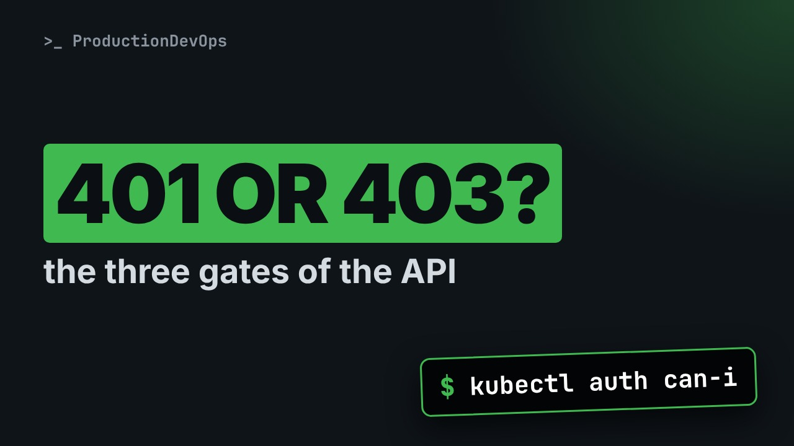
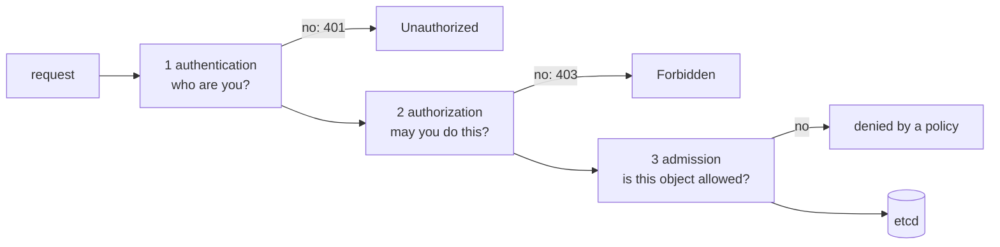

# 401 or 403? The Three Gates of Every Kubernetes API Request



**Video:** https://youtu.be/sEjGaLVMpu8

Unauthorized, Forbidden, denied by a policy: three different gates said no, for three different reasons. We follow real requests to the Kubernetes API with curl and a ServiceAccount token. Authentication rejects an unknown token, authorization rejects a known identity without permission, and admission rejects a privileged Pod even for the cluster admin. Then how to tell, from the error alone, which gate to fix. Part 7 of the Kubernetes Path.

## Files in this folder

- [`privileged.yaml`](privileged.yaml)
- [`challenge-solution.yaml`](challenge-solution.yaml) (solution of the challenge: try it yourself first)

## What you need

A Kubernetes cluster you can break: a local [kind](https://kind.sigs.k8s.io/) cluster with one control plane and two workers is what the video uses, plus `kubectl`. Never run these commands against a cluster that matters.

The outputs below were captured for real on the lab cluster. On yours, names, ages, IPs and ports will differ; everything else should match.

## Before you start

The video runs these commands first, off screen:

```bash
export API=$(kubectl config view --minify -o jsonpath='{.clusters[0].cluster.server}')
kubectl config view --minify --raw -o jsonpath='{.clusters[0].cluster.certificate-authority-data}' | base64 -d | tee ca.crt
```

## The lesson, step by step

The same explanations as the video, with every command and its real output. Read it, then run it yourself.

Unauthorized. Forbidden. Denied by a policy. Three errors that look alike, from three different gates. If you know which gate said no, you know what to fix.

### The plan

This is part seven of the Kubernetes Path. Here is the plan. First, the three gates that every request to the API must pass. Then we create an identity of our own, to test with. We make each gate say no, with real requests. And we learn to read the error, to know which gate to fix.

### Three gates

**Every request passes three gates**



Authentication asks: who are you? Authorization asks: may you do this? Admission looks at the object itself: is it allowed here? Only a request that passes all three is stored in etcd.

### An identity

We work in a namespace of our own, called demo.

```console
$ kubectl create namespace demo
namespace/demo created
```

A ServiceAccount is an identity for programs. Ours is called reader.

```console
$ kubectl create serviceaccount reader -n demo
serviceaccount/reader created
```

kubectl create token gives it a short-lived token. We save it to a file, and we never print it.

```console
$ kubectl create token reader -n demo --duration=10m > token
```

A token is a password. So we only count its characters.

```console
$ wc -c < token
920
```

### Gate 1

We call the API with curl, like kubectl does. API holds the server address, ca dot crt is the cluster certificate authority, and dash dash oauth2 bearer sends a token, wrong on purpose.

```console
$ curl -s --cacert ca.crt --oauth2-bearer wrong-token $API/api/v1/namespaces/demo/pods | grep -E '"(message|code)"'
  "message": "Unauthorized",
  "code": 401
```

The first gate does not know this token. It never even looks at what we asked for.

### Gate 2

Now the real token. Dollar, cat token, puts the content of the file into the command, without printing it.

```console
$ curl -s --cacert ca.crt --oauth2-bearer "$(cat token)" $API/api/v1/namespaces/demo/pods | grep -E '"(message|code)"'
  "message": "pods is forbidden: User \"system:serviceaccount:demo:reader\" cannot list resource \"pods\" in API group \"\" in the namespace \"demo\"",
  "code": 403
```

This time the API knows who we are: the message names our ServiceAccount. But nothing allows it to list Pods. kubectl auth can-i asks gate two the same question, without curl. Dash dash as tells it to answer for someone else.

```console
$ kubectl auth can-i list pods -n demo --as=system:serviceaccount:demo:reader
no
```

A Role lists what is allowed: here, get and list on Pods, in namespace demo.

```console
$ kubectl create role pod-reader --verb=get,list --resource=pods -n demo
role.rbac.authorization.k8s.io/pod-reader created
```

A RoleBinding gives that Role to our ServiceAccount.

```console
$ kubectl create rolebinding reader-reads-pods --role=pod-reader --serviceaccount=demo:reader -n demo
rolebinding.rbac.authorization.k8s.io/reader-reads-pods created
```

We ask again.

```console
$ kubectl auth can-i list pods -n demo --as=system:serviceaccount:demo:reader
yes
```

And the same curl request. Dash w prints only the HTTP status code.

```console
$ curl -s -o /dev/null -w '%{http_code}\n' --cacert ca.crt --oauth2-bearer "$(cat token)" $API/api/v1/namespaces/demo/pods
200
```

### Gate 3

```
apiVersion: v1
kind: Pod
metadata:
  name: root-shell
spec:
  containers:
    - name: shell
      image: busybox:1.36
      securityContext:
        privileged: true
```

A Pod called root shell. Privileged true gives the container almost full access to the node it runs on.

Pod Security Admission is a built in admission check. This label tells it: in namespace demo, only Pods that follow the restricted rules.

```console
$ kubectl label namespace demo pod-security.kubernetes.io/enforce=restricted
namespace/demo labeled
```

We apply the privileged Pod, as cluster admin. The error is long, so tr splits it at each comma, and head keeps the first lines.

```console
$ kubectl apply -f privileged.yaml -n demo 2>&1 | tr ',' '\n' | head -3
Error from server (Forbidden): error when creating "privileged.yaml": pods "root-shell" is forbidden: violates PodSecurity "restricted:latest": privileged (container "shell" must not set securityContext.privileged=true)
 allowPrivilegeEscalation != false (container "shell" must set securityContext.allowPrivilegeEscalation=false)
 unrestricted capabilities (container "shell" must set securityContext.capabilities.drop=["ALL"])
```

The message lists each rule the Pod breaks: privileged, privilege escalation, capabilities. We passed gate one and gate two: we are the admin. Gate three refused the object itself. We clean up: the namespace, with everything in it.

```console
$ kubectl delete namespace demo
namespace "demo" deleted
```

And the token file.

```console
$ rm token
```

### Which gate?

The error tells you which gate to fix. Four zero one, Unauthorized: authentication. The token is wrong, or it expired. Four zero three, cannot do something on a resource: authorization. You need a Role and a binding. Violates Pod Security, or denied the request: admission. Change the object, not the permissions.

### Gotchas

Three habits that avoid trouble. Prefer short-lived tokens from kubectl create token. Token Secrets made by hand never expire, and are rarely rotated. Test permissions with dash dash as. Your own admin user can do everything, so it proves nothing. Never show a token on screen, in a ticket or in a chat. Print its length, at most.

### Recap

Let's recap. Every request passes authentication, then authorization, then admission, and only then reaches etcd. Four zero one: who are you. Four zero three: may you. A policy denial: is this object allowed. kubectl auth can-i, with dash dash as, asks gate two directly. Your challenge: let a ServiceAccount list Deployments in one namespace only, and prove with can-i that it cannot in another. The solution is in the demo repository.

When the API says no, find the gate first, then fix that gate. Next on the Kubernetes Path: reading kubectl output like a pro. Subscribe to follow the whole path.

## All the commands, to copy

Run them from inside this folder, in this order.

```bash
kubectl create namespace demo
kubectl create serviceaccount reader -n demo
kubectl create token reader -n demo --duration=10m > token
wc -c < token
curl -s --cacert ca.crt --oauth2-bearer wrong-token $API/api/v1/namespaces/demo/pods | grep -E '"(message|code)"'
curl -s --cacert ca.crt --oauth2-bearer "$(cat token)" $API/api/v1/namespaces/demo/pods | grep -E '"(message|code)"'
kubectl auth can-i list pods -n demo --as=system:serviceaccount:demo:reader
kubectl create role pod-reader --verb=get,list --resource=pods -n demo
kubectl create rolebinding reader-reads-pods --role=pod-reader --serviceaccount=demo:reader -n demo
curl -s -o /dev/null -w '%{http_code}\n' --cacert ca.crt --oauth2-bearer "$(cat token)" $API/api/v1/namespaces/demo/pods
kubectl label namespace demo pod-security.kubernetes.io/enforce=restricted
kubectl apply -f privileged.yaml -n demo 2>&1 | tr ',' '\n' | head -3
kubectl delete namespace demo
rm token
```

## Challenge

Your challenge: let a ServiceAccount list Deployments in one namespace only, and prove with can-i that it cannot in another. The solution is in the demo repository.

When you have tried: [`challenge-solution.yaml`](challenge-solution.yaml).

---

From the [ProductionDevOps](https://www.youtube.com/@production-devops) channel: real-world DevOps and SRE, explained with real commands.
