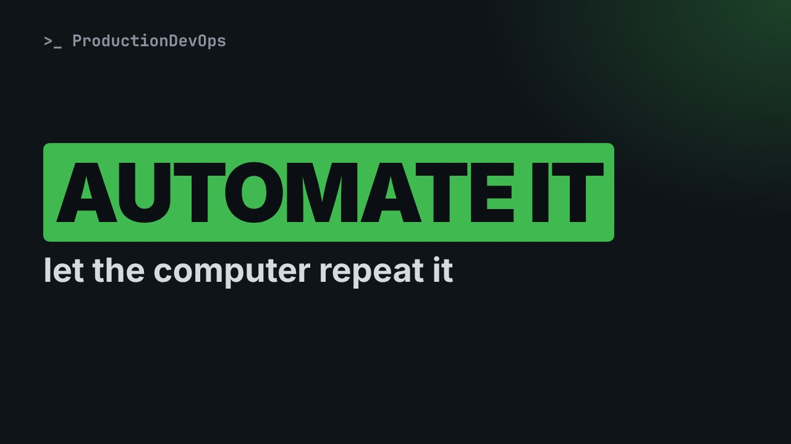
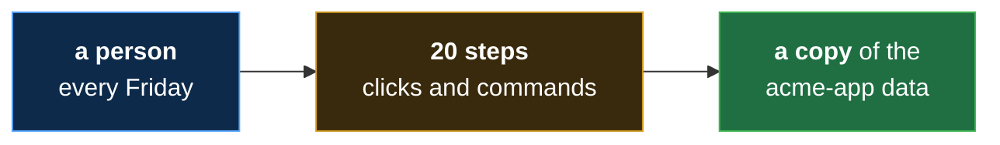
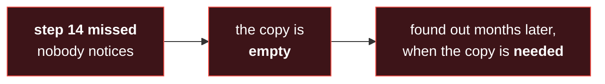
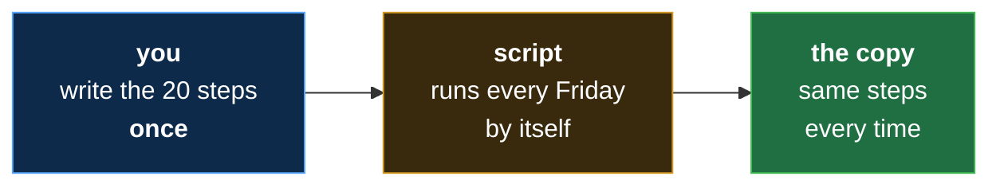
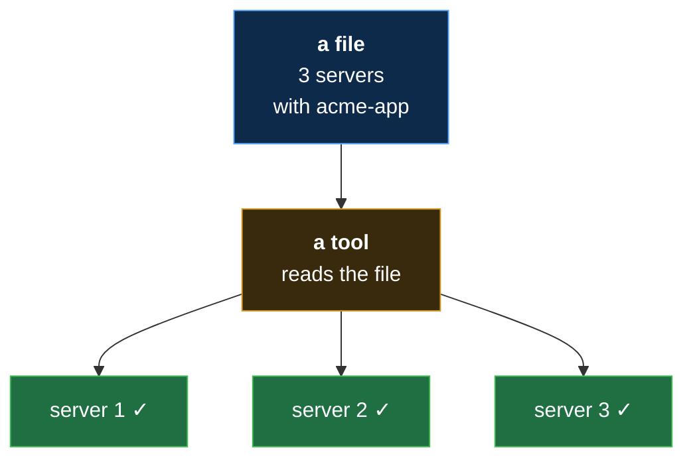

# Automation: Let the Computer Repeat It (DevOps from Zero, No Experience Needed)

**Video:** https://youtu.be/r-csTuLUyBs

Every Friday, someone does the same twenty clicks. One Friday, they miss one. This lesson of DevOps from Zero shows, with pictures and a restaurant comparison, why people slip on repeated jobs, what a script is, what DevOps teams automate, and what "infrastructure as code" means. At the end: three questions that tell you if a job should be automated, and when it should not. No terminal, nothing to install, no experience needed. Every new word is explained on screen. The challenge and its solution are in the demos repo.

## Files in this folder

- [`challenge-solution.md`](challenge-solution.md) (solution of the challenge: try it yourself first)

## What you need

A Linux shell (a VM, WSL or a container is fine). Everything runs inside this folder.

## The lesson, step by step

The same explanations as the video, with every command. Read it, then run it yourself.

Every Friday, someone does the same twenty clicks. One Friday, they miss one. At the end: three questions that tell you what to automate.

For this lesson you need nothing. Just watch. No terminal and no code. Only pictures. About five minutes.

### The plan

This is lesson four of DevOps from Zero. First, a job done by hand, every week. Then, why people slip. Then automation, and servers written as files. And three questions, to decide what to automate.

### By hand

**Every Friday, by hand**

Here is a job. Every Friday, a person makes a safety copy of the acme app data. It takes twenty steps, by hand.

Why do people slip? The job is boring, so attention drifts. The phone rings at step twelve. Where was I? It is late, and people are tired. And each person does it a little differently.

**One Friday, one missed step**

One Friday, step fourteen is missed. Nobody notices. Months later, someone needs that copy, and it is empty.

### Automation

- `automation — Letting a computer repeat a job for you, the same way every time (like a kitchen machine: set it once, every batch comes out the same)`: 
The fix is automation. A computer repeats the job for you, the same way every time. Like a kitchen machine: every batch comes out the same.

- `script — A file of steps that a computer follows, from top to bottom (like a recipe card followed word by word, never skipping a line)`: 
The steps go in a script. A script is a file of steps that a computer follows, from top to bottom. It never skips a line.

**Write it once, run it every Friday**

You write the twenty steps once, in a script. Every Friday, the computer runs it by itself. Same steps, every time.

### So far

So far: by hand, repeated jobs slip, and often nobody notices. With automation, you write the steps once, and the computer repeats them. Next: we automate whole servers. Then, the three questions.

### In DevOps

What do DevOps teams automate? The build, the tests and the deploy: the pipeline of lesson two. Safety copies of data. Health checks, every minute. We see them in lesson six. And the setup of the servers themselves.

- `infrastructure as code — Describing your servers in files, so a tool can build them (like a written floor plan: any builder makes the same kitchen)`: 
That last one has a name: infrastructure as code. You describe your servers in files, and a tool builds them. Like a floor plan for a kitchen.

**Servers, written as a file**

The file says: three servers, with acme app. A tool reads it, and sets up all three the same way. Ansible is one such tool.

- `drift — Servers that should match, slowly becoming different (like ten kitchens that each change the recipe a little)`: 
This also fixes drift. Drift is when servers that should match slowly become different. Run the tool again, and they match again.

### Three questions

Now, the three questions. One: do I do it often? Two: is it the same steps every time? Three: does a mistake hurt? Two or three yes answers? Automate it.

And when not to automate? A job you do only once. Steps you do not understand yet. Do them by hand first, and write them down. And be honest: automation takes time to write and to look after.

### Recap

Recap: repeated jobs done by hand slip. A script holds the steps. The computer repeats them. Infrastructure as code means your servers are described in files. Your challenge: a weekly twenty step report, moving your desk, a check every minute. Which do you automate? The answer is in the demo repo.

### Where next

Where next? Lesson five: saving every version of these files. Lesson six: is production healthy? And to automate for real, there is the course Ansible from Zero.

Next lesson: saving every version, version control in one picture. Subscribe so you do not miss it.

## Challenge

Your challenge: a weekly twenty step report, moving your desk, a check every minute. Which do you automate? The answer is in the demo repo.

When you have tried: [`challenge-solution.md`](challenge-solution.md).

---

From the [ProductionDevOps](https://www.youtube.com/@production-devops) channel: real-world DevOps and SRE, explained with real commands.
