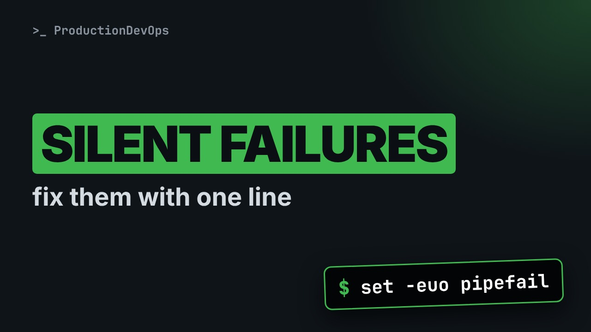
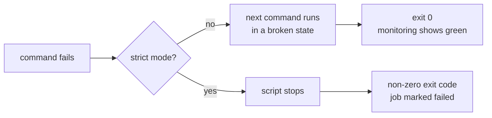

# Your Bash Scripts Fail Silently. Fix It With One Line (set -euo pipefail)



**Video:** https://youtu.be/7fyJngojTyQ

Most production incidents caused by shell scripts are not crashes - they are scripts that kept running after something went wrong. Step by step, we break a real-looking backup script, then fix it with Bash strict mode: what each of the three options does, shown with a real failure, and the gotchas to know before adding it everywhere.

## Files in this folder

- [`backup-strict.sh`](backup-strict.sh)
- [`backup.sh`](backup.sh)
- [`cleanup-strict.sh`](cleanup-strict.sh)
- [`cleanup.sh`](cleanup.sh)
- [`defaults.sh`](defaults.sh)

## What you need

A Linux shell (a VM, WSL or a container is fine). Everything runs inside this folder.

## The lesson, step by step

The same explanations as the video, with every command. Read it, then run it yourself.

Here is a scary fact. By default, when a command in a Bash script fails, Bash just keeps going. Let's watch that break a backup script, and then fix it with one single line.

### The plan

Here is the plan. First, we break a real looking backup script. Then we fix it with one line. That line has three options. We see each one catch a different failure. And we finish with the gotchas to know before you add it everywhere.

### The silent failure

Here is a backup script that looks reasonable. Let's read it.

```
#!/usr/bin/env bash
# Nightly backup - naive version
SRC_DIR=/data/app
cd "$SRC_DIR"
echo "Cleaning old files in: $(basename "$PWD")/  (rm -rf ./*)"
echo "Backup completed successfully"
```

It goes into the data folder, slash data slash app. Then it cleans the old files in the current folder. In our demo, it only prints the delete command, and the name of the folder it would run in. Nothing is really deleted. And it reports success.

On this server, slash data slash app does not exist. Let's run the script.

```console
$ bash backup.sh
```

Look at the first line: cd failed. But the script kept going. It would have deleted everything in demo, the folder we happened to be in. Not the data folder. And what exit code did it return?

```console
$ echo "exit code: $?"
```

### The fix: one line

The fix is called Bash strict mode. One line, three options. Let's read them one by one. Dash e: stop the script as soon as a command fails. Dash u: using a variable that was never set is an error, instead of an empty string. And dash o pipefail: a pipeline fails if any command in it fails, not only the last one.

### Option -e

Here is the same script, with one extra line at the top. Nothing else changed.

```
#!/usr/bin/env bash
set -euo pipefail
# Nightly backup - strict version
SRC_DIR=/data/app
cd "$SRC_DIR"
echo "Cleaning old files in: $(basename "$PWD")/  (rm -rf ./*)"
echo "Backup completed successfully"
```

Same broken server. Let's run it.

```console
$ bash backup-strict.sh
```

This time the script stops right at the failed cd. No cleaning, no success message. And the exit code?

```console
$ echo "exit code: $?"
```

One. Now your scheduler, or your CI pipeline, knows the backup failed.

### Option -u

Now option dash u. Look at this cleanup script. There is a typo: B U L I D instead of B U I L D.

```console
$ cat cleanup.sh
```

Without strict mode, the misspelled variable is just empty. So the path becomes slash cache, at the root of the disk.

```console
$ bash cleanup.sh
```

This version has set dash u. Same typo.

```console
$ bash cleanup-strict.sh
```

Bash refuses to continue, and tells you exactly which variable is not set.

### Option pipefail

Last option: pipefail. There is no file called app dot log here, so grep fails. But we pipe it into sort and head. Let's see the exit code of the whole pipeline.

```console
$ grep ERROR app.log | sort | head -3; echo "exit code: $?"
```

Zero. By default, a pipeline returns the exit code of its last command, head, and head was fine. Now with pipefail turned on. Exact same pipeline.

```console
$ set -o pipefail; grep ERROR app.log | sort | head -3; echo "exit code: $?"
```

### Recap and gotchas

**What happens when a command fails**



So the difference is simple. Without strict mode, a failure turns into a broken state, and a fake success. With strict mode, the failure stops the script, and becomes visible.

Strict mode is not magic. Keep these three gotchas in mind. One. A command used as a condition, in an if, or with and and or, does not stop the script when it fails. That is on purpose. Two. When a failure is expected, write or true after it. Readers then know it is on purpose. Three. With dash u, give a default value to variables that may be missing. Let's see that one.

This script uses set dash u, and prints a log level, with info as the default.

```console
$ cat defaults.sh
```

LOG_LEVEL is not set, and the script still works. It uses the default.

```console
$ bash defaults.sh
```

And if we set it, our value wins.

```console
$ LOG_LEVEL=debug bash defaults.sh
```

One line at the top of every production script turns silent failures into loud ones. The demo scripts are linked in the description. Subscribe for more Bash for production.

## All the commands, to copy

Run them from inside this folder, in this order (some are expected to fail: that is the point of the demo).

```bash
bash backup.sh
echo "exit code: $?"
bash backup-strict.sh
cat cleanup.sh
bash cleanup.sh
bash cleanup-strict.sh
grep ERROR app.log | sort | head -3; echo "exit code: $?"
set -o pipefail; grep ERROR app.log | sort | head -3; echo "exit code: $?"
cat defaults.sh
bash defaults.sh
LOG_LEVEL=debug bash defaults.sh
```

---

From the [ProductionDevOps](https://www.youtube.com/@production-devops) channel: real-world DevOps and SRE, explained with real commands.
