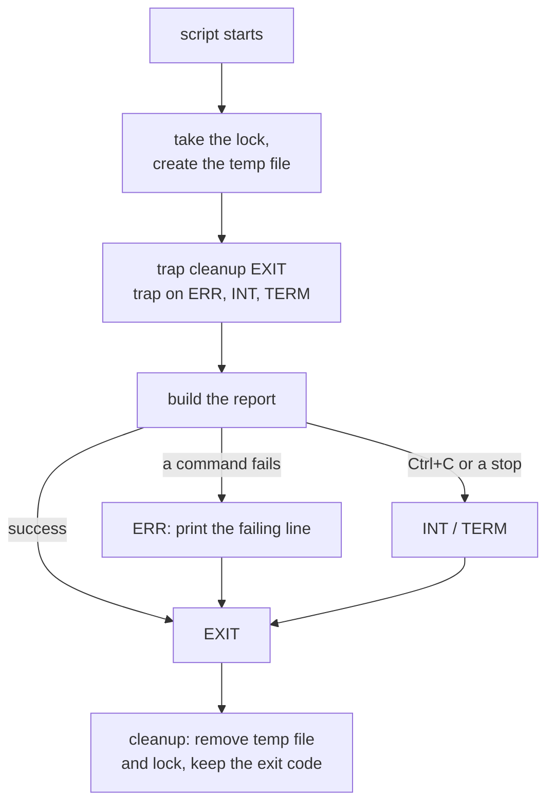
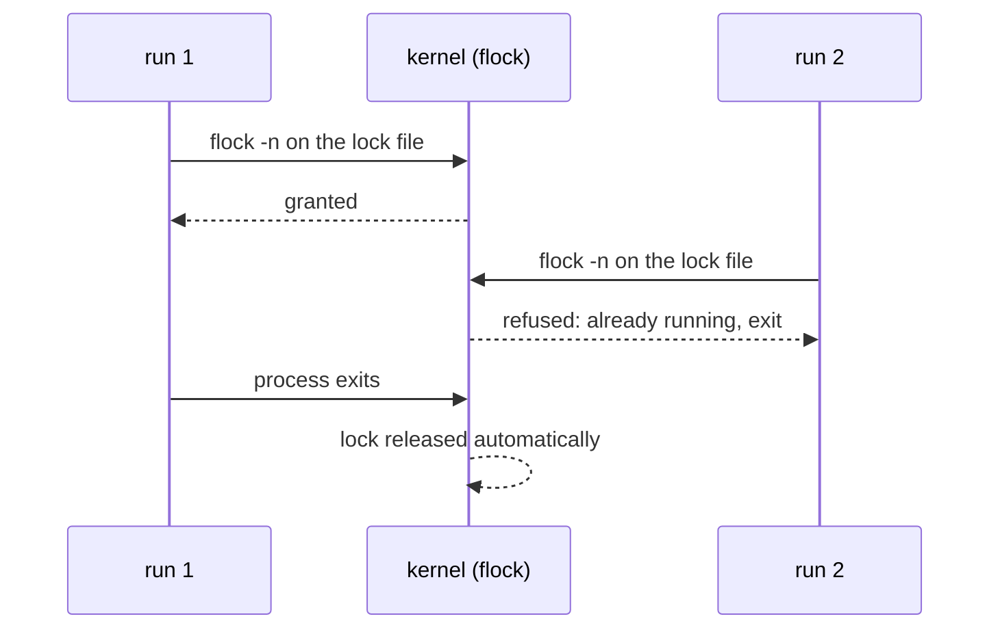

# Bash trap: Clean Up Temp Files and Locks, Even When Your Script Fails


**Video:** https://youtu.be/GlXI4k3eUhM

A nightly job fails halfway, and leaves a temp file and a lock behind. The next run refuses to start. Step by step, we break a real-looking report script, then fix it with trap: one cleanup function that runs on success, on failure and on Ctrl+C, an error message with the failing line, the right exit code, and a lock that the kernel releases for you with flock. Part 3 of Bash for Production.

## Files in this folder

- [`outbox/.keep`](outbox/.keep)
- [`report-flock.sh`](report-flock.sh)
- [`report-naive.sh`](report-naive.sh)
- [`report.sh`](report.sh)
- [`two-runs.sh`](two-runs.sh)
- [`challenge-solution.sh`](challenge-solution.sh) (solution of the challenge: try it yourself first)

## What you need

A Linux shell (a VM, WSL or a container is fine). Everything runs inside this folder.

## The big picture

With a trap set right after the lock and the temp file, every way out of the script goes through the same cleanup.



Two runs at the same time with flock: the kernel holds the lock and releases it even if the process dies.



## The lesson, step by step

The same explanations as the video, with every command. Read it, then run it yourself.

A nightly job fails halfway. It leaves a temp file and a lock behind, and the next night it refuses to start. Let's break a script exactly like that, and fix it with trap.

### The plan

This is part three of Bash for Production. Here is the plan. First, we break a nightly report job, and look at what it leaves behind. Then we add trap: a cleanup that runs on every exit, success or failure. We test it with a failure and with an interrupt, and check the exit code. Finally, a better lock with flock, and the gotchas.

### The leftovers

Here is a report job that looks careful. It even uses strict mode, from part one.

```
#!/usr/bin/env bash
# Nightly report - naive version
set -euo pipefail
mkdir acme-report.lock 2>/dev/null || { echo "Another run is in progress"; exit 1; }
TMP=$(mktemp tmp.report.XXXX)
echo "Collecting data into $TMP"
cp "$TMP" "${REPORT_DIR:-outbox}/"
rm -f "$TMP"
rmdir acme-report.lock
echo "Report sent"
```

First it takes a lock: a directory. mkdir fails if the directory already exists, so only one run at a time can go on. Then mktemp creates a temp file with a random name, to collect the data. It copies the report to the outbox folder, or to the folder in REPORT_DIR. And at the end it removes the temp file and the lock. Only at the end.

A normal run works.

```console
$ bash report-naive.sh
```

Now the report folder points to a path that does not exist. The copy fails.

```console
$ REPORT_DIR=/opt/app/reports bash report-naive.sh
```

Strict mode stopped the script, as it should. But look at what is left in the folder.

```console
$ ls
```

The lock directory and the temp file are still there. Now the next night, the job runs again.

```console
$ bash report-naive.sh
```

It refuses to start. And it will refuse every night, until someone removes the lock by hand. So we clean up by hand, one last time. This is the job trap will do for us.

```console
$ rmdir acme-report.lock && rm tmp.report.*
```

### trap

trap tells Bash: when this happens, run that. Here are the four cases we need. trap cleanup EXIT runs the cleanup function on every exit, success or failure. ERR runs when a command fails. We use it to print where. INT is Control C. TERM is the polite stop signal, sent by kill or by a scheduler that stops the job. And kill dash nine can never be trapped. Nothing runs. Keep that in mind for the end.

### The fix

```
#!/usr/bin/env bash
# Nightly report - with trap
set -euo pipefail
cleanup() {
  rc=$?
  rm -f "${TMP:-}"
  rmdir acme-report.lock
  echo "Cleanup done, exit code $rc"
}
on_error() { echo "Failed at line $1: $2"; }
```

The cleanup function first saves the exit code, dollar question mark. It must be the very first line, before any other command changes it. Then it removes the temp file and the lock. The default value, dash, empty, covers a failure before the temp file even exists. And it prints the code, so we can see it in the demo. Bash keeps that exit code for the whole script. A second small function prints a line number and a command. We use it for errors.

```
mkdir acme-report.lock 2>/dev/null || { echo "Another run is in progress"; exit 1; }
trap cleanup EXIT
trap 'on_error $LINENO "$BASH_COMMAND"' ERR
trap 'exit 130' INT
trap 'exit 143' TERM
TMP=$(mktemp tmp.report.XXXX)
echo "Collecting data into $TMP"
sleep "${WORK_SECONDS:-0}"
cp "$TMP" "${REPORT_DIR:-outbox}/"
echo "Report sent"
```

We take the lock, and set the EXIT trap on the very next line. From now on, the lock is always removed. The ERR trap passes the line number and the failing command, in single quotes, so they are read when the error happens. INT and TERM turn a signal into a normal exit. 130 and 143 are the usual codes: 128, plus the signal number. And a pause, only for the demo, so we have time to interrupt the job.

The same broken report folder.

```console
$ REPORT_DIR=/opt/app/reports bash report.sh
```

The ERR trap tells us the line in the file, and the exact command. Then cleanup ran, and the exit code is still one. And the folder?

```console
$ ls
```

Nothing left behind. The next run will start normally.

```console
$ bash report.sh
```

### Signals

Now we interrupt the job. timeout sends a Control C, the INT signal, after one second, while the job is still working.

```console
$ WORK_SECONDS=5 timeout --preserve-status -s INT 1 bash report.sh
```

Cleanup ran, and reports 130. Dash dash preserve status makes timeout return the job's own exit code.

```console
$ echo "exit code: $?"
```

Nothing left behind this time either.

```console
$ ls
```

### A better lock

```
#!/usr/bin/env bash
# Nightly report - lock with flock
set -euo pipefail
exec 9>acme-report.flock
flock -n 9 || { echo "Another run is in progress"; exit 1; }
echo "Working, lock held"
sleep "${WORK_SECONDS:-1}"
echo "Report sent"
```

exec nine opens a lock file on file descriptor nine, for the whole script. flock dash n takes the lock, or fails at once if another run holds it. There is no cleanup for the lock. When the process ends, for any reason, the kernel closes the file and releases the lock.

This helper starts the job twice, half a second apart.

```console
$ cat two-runs.sh
```

Let's run it.

```console
$ bash two-runs.sh
```

The second run is refused, while the first one holds the lock. Then the first one finishes. No stale lock is possible.

### Gotchas

Four mistakes that make trap useless. One. Set the trap right after you create the resource. A trap at the end of the script protects nothing. Two. Use single quotes. With double quotes, variables are read when you set the trap, not when it runs. Three. Never exit zero inside the cleanup. It turns every failure into a success. Four. After kill dash nine no trap runs, and a mkdir lock stays. A flock lock is released by the kernel.

### Recap

Let's recap. trap cleanup EXIT, set right after you create the resource. In the cleanup, save the exit code first, and keep it. ERR tells you where it failed. INT and TERM make interrupts clean. And flock gives you a lock that cannot go stale. Your challenge: a script that creates a temporary directory with mktemp dash d. Prove it is removed on success, on failure and on Control C, with the right exit code. The solution is in the demo repository.

One trap, set at the right moment, and your jobs clean up after themselves, even when they fail. The demo scripts are linked in the description. Subscribe for more Bash for production.

## All the commands, to copy

Run them from inside this folder, in this order (some are expected to fail: that is the point of the demo).

```bash
bash report-naive.sh
REPORT_DIR=/opt/app/reports bash report-naive.sh
ls
rmdir acme-report.lock && rm tmp.report.*
REPORT_DIR=/opt/app/reports bash report.sh
bash report.sh
WORK_SECONDS=5 timeout --preserve-status -s INT 1 bash report.sh
echo "exit code: $?"
cat two-runs.sh
bash two-runs.sh
```

## Challenge

Your challenge: a script that creates a temporary directory with mktemp dash d. Prove it is removed on success, on failure and on Control C, with the right exit code. The solution is in the demo repository.

When you have tried: [`challenge-solution.sh`](challenge-solution.sh).

---

From the [ProductionDevOps](https://www.youtube.com/@production-devops) channel: real-world DevOps and SRE, explained with real commands.
