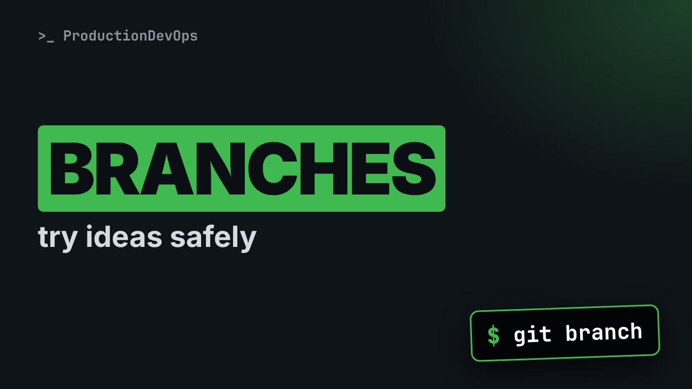
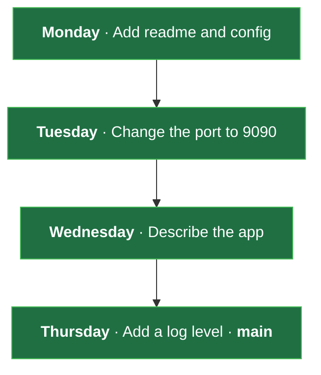
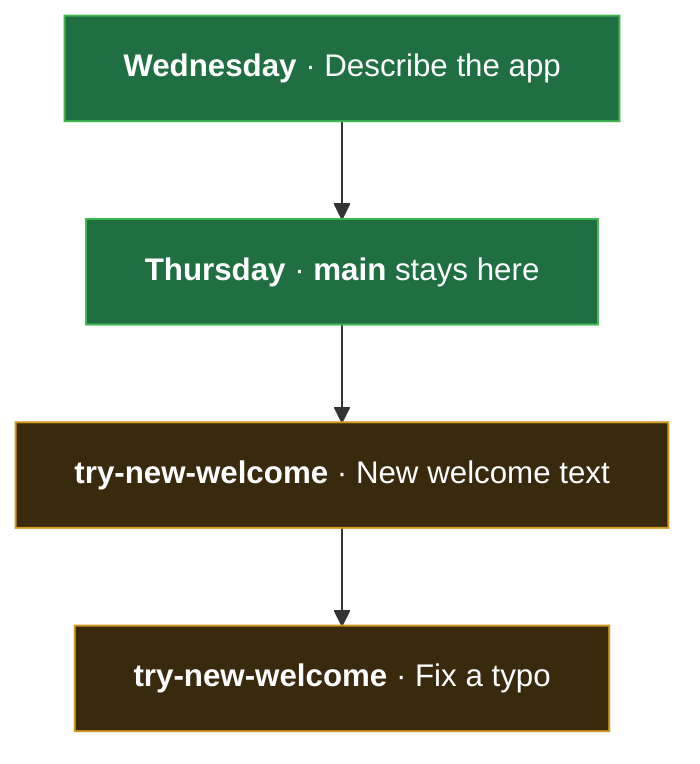
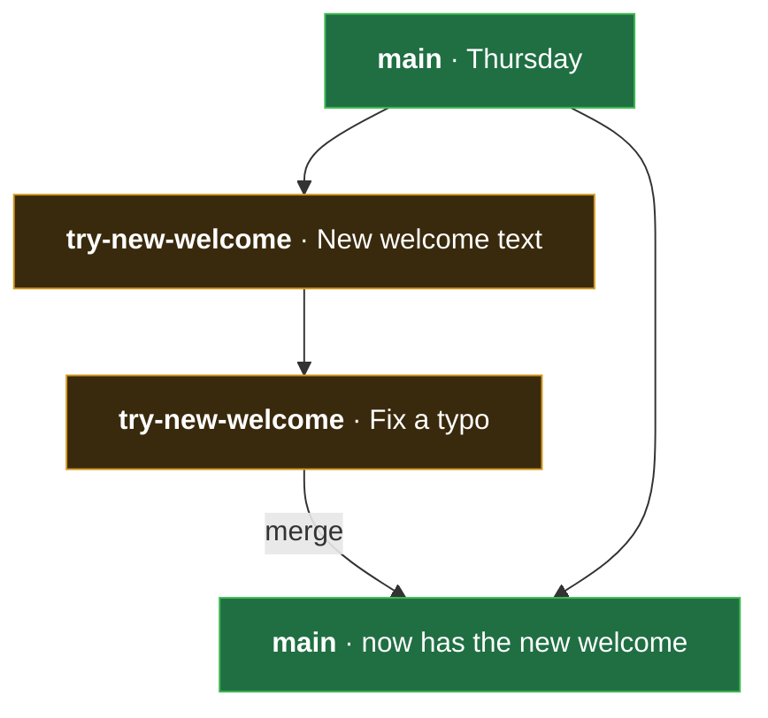
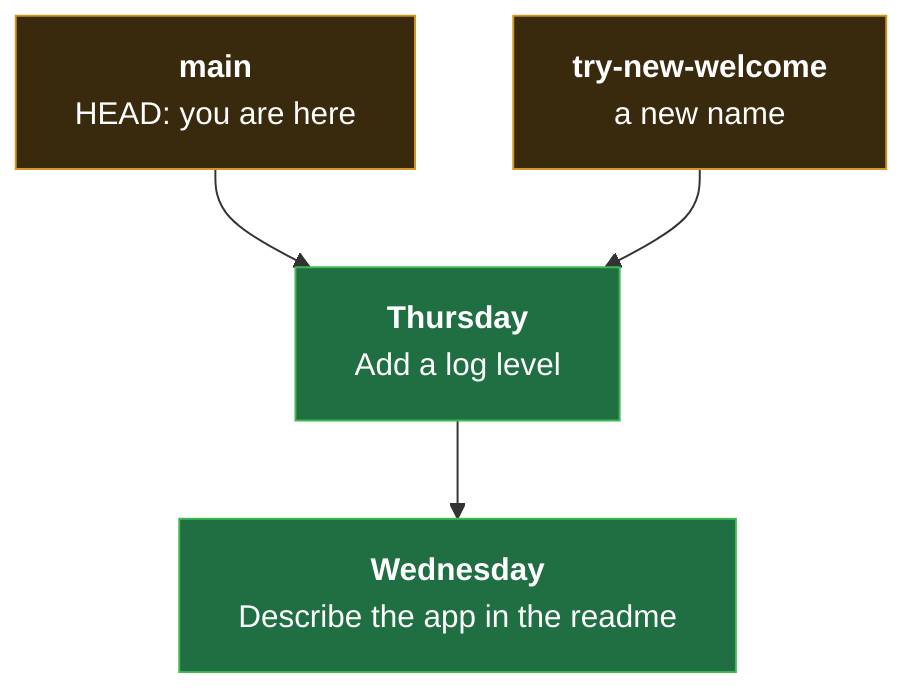

# Branches, Drawn (Git from Zero, No Experience Needed)



**Video:** coming soon on the [channel](https://www.youtube.com/@production-devops).

You want to try a new idea, but the main version must stay safe. This lesson of Git and GitHub from Zero draws branches with one recipe-book comparison: main is the trusted book, a branch is a copy where you try a new recipe, a merge brings the good recipe back. At the end you make a branch for real with git branch, and see where it starts. No experience needed: every new word is explained on screen, and every command runs for real. The challenge and its solution are in the demos repo.

## Files in this folder

- [`acme-app/config.txt`](acme-app/config.txt)
- [`acme-app/readme.txt`](acme-app/readme.txt)
- [`challenge-solution.sh`](challenge-solution.sh) (solution of the challenge: try it yourself first)

## What you need

A Linux shell (a VM, WSL or a container is fine). Everything runs inside this folder.

## Before you start

The video runs these commands first, off screen:

```bash
if [ ! -e .tt-lab ]; then rm -rf /lab/git7 && mkdir -p /lab/git7 && cp -a . /lab/git7/ && rm -f /lab/git7/.tt-runner.sh && touch .tt-lab; fi
export HOME=/lab/git7 && cd /lab/git7/acme-app
git config --global user.name ops && git config --global user.email ops@example.com && git config --global init.defaultBranch main && git config --global core.pager cat
c() { GIT_AUTHOR_DATE="$1" GIT_COMMITTER_DATE="$1" git commit -qm "$2"; }
[ -d .git ] || { git init -q && git add . && c 2026-11-02T09:00:00Z "Add readme and config" && sed -i s/port=8080/port=9090/ config.txt && git add . && c 2026-11-03T10:30:00Z "Change the port to 9090" && echo "It says hello on port 9090." >> readme.txt && git add . && c 2026-11-04T15:45:00Z "Describe the app in the readme" && echo log_level=info >> config.txt && git add . && c 2026-11-05T11:20:00Z "Add a log level"; }
PROMPT_COMMAND='HOME=/lab/git7; PS1="\[\e[1;32m\]sre@lab\[\e[0m\]:\[\e[1;34m\]\w\[\e[0m\]$ "'
```

## The lesson, step by step

The same explanations as the video, with every command. Read it, then run it yourself.

You want to try a new idea, but the main version must stay safe. At the end, you make a branch for real, in one command.

For the pictures, you need nothing. Just watch. For the last part, your terminal and your practice repo, if you want to try.

### The plan

This is lesson seven of Git and GitHub from Zero. First, the main line, called main. Then, a branch: a copy to try things. Then, merging it back. And one for real, with git branch. We check it with git log, from lesson six.

### The main line

**One line of pages**



So far, every page went on one line. It has a name: main.

- `main — The name of the main line, the version everybody trusts (like the main recipe book, on the kitchen shelf)`: 
New word: main. It is the name of the main line, the version everybody trusts. The main recipe book, on the shelf.

### A branch

- `branch — A separate line of commits, to try something safely (like a copy of the recipe book, to test a new recipe)`: 
New word: branch. A branch is a separate line of commits, to try something safely. A copy of the book, to test a new recipe.

**A branch, drawn**



Here is a branch, starting from Thursday's page. New pages go on the branch, and main does not move.

Why a branch? Main stays safe while you try. Many people can work on many branches, at the same time. And a bad idea? Just drop the branch. Main never saw it.

### So far

So far: main is the line everybody trusts. A branch is a copy, to try a new recipe. Next: bringing a good idea back into main.

### Merge

- `merge — Bringing the commits of a branch into another line, like main (like copying the tested recipe into the main book)`: 
New word: merge. A merge brings the commits of a branch into another line, like main. The tested recipe goes into the main book.

**Merging back**



The new welcome works. So we merge the branch into main. Now main has the new welcome, and its history.

One more idea. You always work on one line at a time. New commits go to that line only. Head, the bookmark from lesson six, shows which one.

### For real

Here is the one new command: git branch. Alone, it lists the branches. With a name after it, it makes a new branch. In the list, a star marks the one you are on.

Which branches exist? We type git branch.

```console
$ git branch
```

Just one: main. The star says we are on it. Now we make a branch called try new welcome.

```console
$ git branch try-new-welcome
```

No message. As usual, that means it worked. We list them again, with git branch.

```console
$ git branch
```

Two branches now. The star is still on main: making a branch does not move you.

Where does the new branch start? Git log dash dash one line, from lesson six.

```console
$ git log --oneline
```

Look at the top line. In brackets: head, main, and try new welcome. Both names are on the same page. The copy is identical, for now.

**What we just made**



Here is what we made: two names on Thursday's page. New pages would go to the branch you are on.

### Good to know

Good to know. To move onto a branch, you use git switch. A later course practises it. Branch names are short, with dashes, and no spaces. And many teams never commit straight to main. Lesson nine shows why.

### Recap

Recap: main is the trusted line. A branch is a copy, to try things. A merge brings the good idea back. Git branch lists the branches, or makes one with a name. The star means you are here. Your challenge: in your practice repo, make a branch called test idea. Where is the star? The solution is in the demo repo.

### Where next

Where next? Lesson eight: GitHub, your repository online. Share the book with your team.

Next lesson: GitHub, your repository online. Subscribe so you do not miss it.

## All the commands, to copy

Run them from inside this folder, in this order (some are expected to fail: that is the point of the demo).

```bash
git branch
git branch try-new-welcome
git log --oneline
```

## Challenge

Your challenge: in your practice repo, make a branch called test idea. Where is the star? The solution is in the demo repo.

When you have tried: [`challenge-solution.sh`](challenge-solution.sh).

---

From the [ProductionDevOps](https://www.youtube.com/@production-devops) channel: real-world DevOps and SRE, explained with real commands.
