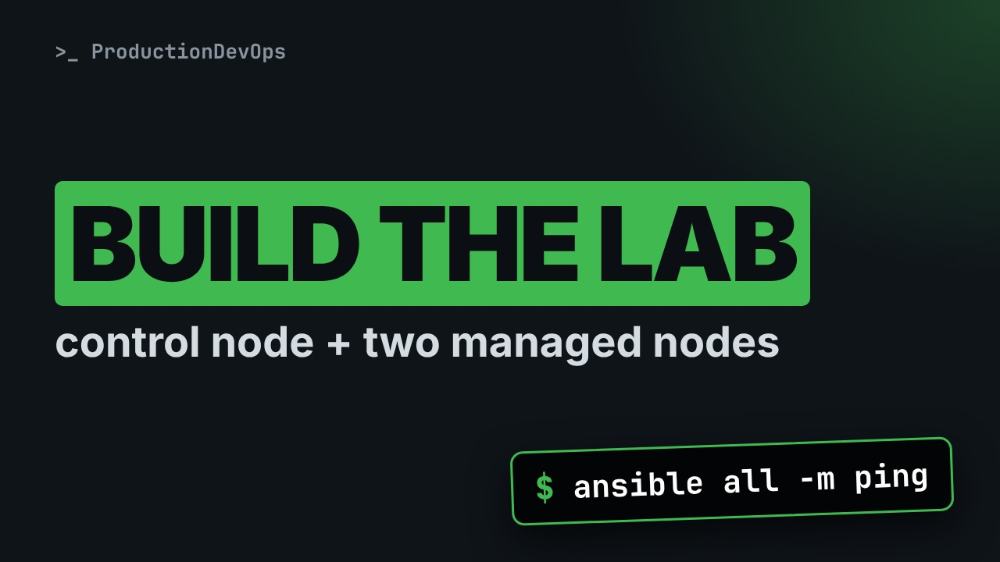
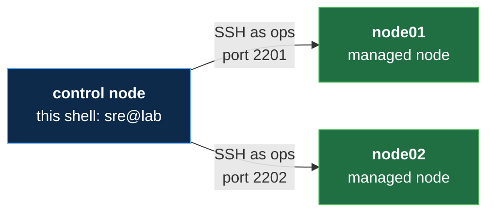
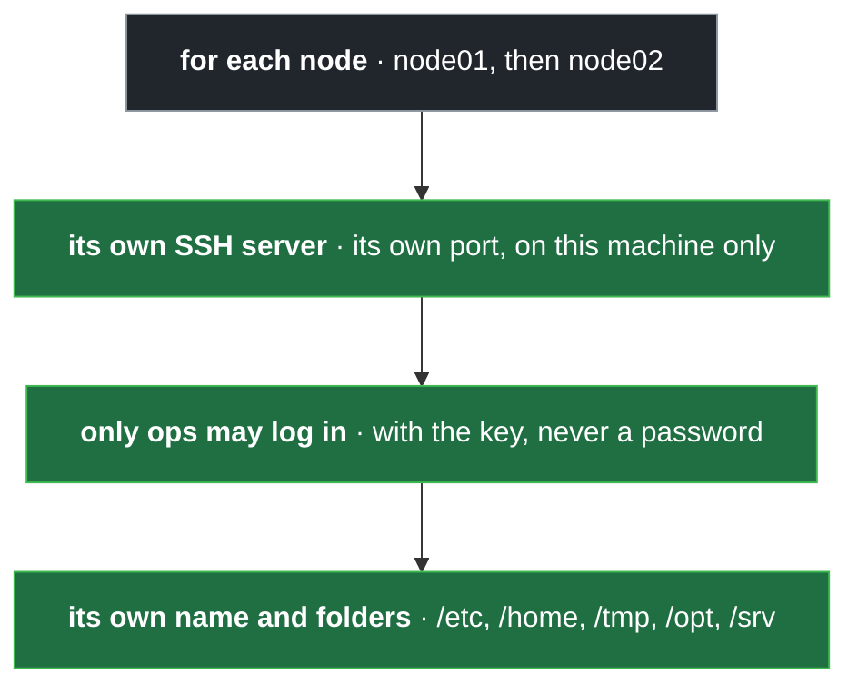
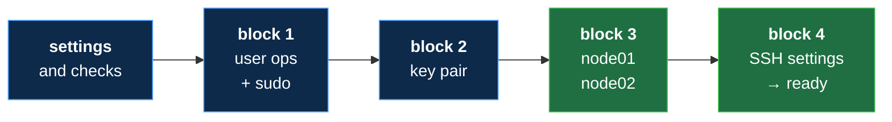

# Build Your RHCE Practice Lab, Step by Step (Control Node + Two Managed Nodes)



**Video:** https://youtu.be/kgIILpgiMD0

Build a practice lab for the RHCE exam (EX294) on one Linux machine: a control node and two managed nodes, node01 and node02, with an automation user, SSH keys and passwordless sudo. We read the lab script first, block by block and in plain words, then run it, then prove the lab works with three commands, each taken apart before it runs: bash, ssh and an Ansible ping that is not a network ping. Every new word is explained on screen and every command runs for real. The lab script and the challenge solution are in the demos repo. Then continue with the Ansible for RHCE playlist.
Start here if the exam itself is new: https://youtu.be/csftUO5-KLg

## Files in this folder

- [`ansible.cfg`](ansible.cfg)
- [`inventory.ini`](inventory.ini)
- [`lab/up.sh`](lab/up.sh)
- [`challenge-solution.sh`](challenge-solution.sh) (solution of the challenge: try it yourself first)

## What you need

A Linux shell (a VM, WSL or a container is fine). Everything runs inside this folder.

## Before you start

The video runs these commands first, off screen:

```bash
if [ -f .lab-reset ]; then bash lab/up.sh; else bash lab/up.sh reset && touch .lab-reset; fi >/dev/null 2>&1
```

## The lesson, step by step

The same explanations as the video, with every command. Read it, then run it yourself.

Today we build an RHCE practice lab, on one Linux machine. We read the lab script first, then we run it. And at the end, Ansible's first ping, which is not a network ping.

You will need a Linux machine, or a virtual machine, that you can throw away. With root, and with Ansible and OpenSSH installed. And the basics from Linux from Zero, and Shell Scripting from Zero.

### The plan

First, we picture the lab. We read the lab script, block by block. We run it. And we prove it works.

### The lab

- `control node — The machine where Ansible runs, and where you type (like the head chef's desk)`: 
Two quick reminders. The control node is the machine where Ansible runs, and where you type. The head chef's desk.

- `managed node — A server that Ansible sets up, over SSH (like a kitchen that receives the recipe cards)`: 
A managed node is a server that Ansible sets up, over SSH. A kitchen that receives the recipe cards.

**Our lab: one machine, three roles**



Our lab copies the exam's shape, on one machine. This shell is the control node. Each managed node is its own SSH server, on its own port.

- `SSH key — A pair of files that logs you in, with no password (like a key you keep, and a lock on each kitchen door)`: 
New word: SSH key. A pair of files that logs you in, with no password. A key you keep, and a lock on each door.

- `sudo — Run one command as root, the administrator (like the manager's master key, lent for one job)`: 
New word: sudo. It runs one command as root, the administrator. The manager's master key, lent for one job.

### The script

The script has eighty-four lines. After the settings, four blocks. Block one: the user ops, and sudo. Block two: the SSH key pair. Block three starts the two nodes. Block four writes the SSH settings, then prints ready.

```
# 1. The automation user: ops, SSH keys only, passwordless sudo
id ops >/dev/null 2>&1 || useradd -m -s /bin/bash ops
usermod -p '*' ops
printf '%s\n' 'Defaults:ops !authenticate' 'ops ALL=(ALL) ALL' > /etc/sudoers.d/ops
chmod 0440 /etc/sudoers.d/ops
```

Line nineteen creates the user ops. Ansible will log in as ops. Line twenty sets a star as the password. No password matches it, so only keys work. The next two lines give ops sudo, with no password.

```console
$ id ops >/dev/null 2>&1 || useradd -m -s /bin/bash ops
```

Line nineteen, piece by piece.

- `id ops`: is there a user called ops?
I d ops asks: is there a user called ops?

- `>/dev/null 2>&1`: throw the answer away
This part throws the answer away.

- `||`: only if that failed...
The two bars mean: only if that failed...

- `useradd -m -s /bin/bash ops`: ...create ops: a home, and bash
...create ops, with a home folder and the bash shell.

- `idempotent — Run it once or ten times: the same result (like "the oven must be at 200", not "turn it up by 20")`: 
That pattern makes the script idempotent. Run it once or ten times: the same result. It only adds what is missing.

**Block 3, in plain words**



Block three, in plain words. Each node gets its own SSH server, where only ops may log in, with the key. And its own name and folders.

**lab/up.sh, all together**



All together: the user, the key, the nodes, the SSH settings. We know what it does. Now we run it.

### Run it

```console
$ bash lab/up.sh
```

We want the lab up.

- `bash`: the shell: run the lines of a file
Bash runs the lines of a file, one by one.

- `lab/up.sh`: the file: our lab script
And this is the file: our lab script.

We type it, as root, in a machine we can throw away.

```console
$ bash lab/up.sh
```

One line per node. The first: node zero one, port twenty-two zero one, user ops. What just happened? One machine now plays three roles.

### So far

So far: we read the script, then ran it. Next: ssh into the nodes, then Ansible's ping. If this is helping, subscribe. The next lesson shows how Ansible really works.

### Prove it: ssh

```console
$ ssh node01 hostname
```

Why: can we reach node zero one, as ops, with the key?

- `ssh`: log in to another machine
S S H logs in to another machine.

- `node01`: which one: a name from block 4
Node zero one: a name from block four's settings.

- `hostname`: run this there: print the name
Hostname runs there, and prints the machine's name.

We type it.

```console
$ ssh node01 hostname
```

It answers node zero one. No password asked: the key did the work. The same question to node zero two.

```console
$ ssh node02 hostname
```

And sudo? Through sudo, we ask node zero one: who am I?

```console
$ ssh node01 sudo whoami
```

Root, with no password. The key and sudo work: what Ansible needs.

### Prove it: Ansible

- `inventory — The list of servers that Ansible looks after (like the list of kitchens, on the head chef's wall)`: 
Now Ansible. Reminder: the inventory is the list of servers that Ansible looks after.

```
[web]
node01 ansible_host=127.0.0.1 ansible_port=2201
node02 ansible_host=127.0.0.1 ansible_port=2202
```

A group called web. The file ansible dot cfg says: use this list, log in as ops. Then each node: an address, and a port.

- `ping module — Checks that Ansible can log in, and run Python there (like calling a kitchen: are you there, and ready to cook?)`: 
New word: the ping module. It checks that Ansible can log in, and run Python there.

```console
$ ansible all -m ping
```

Why: can Ansible manage both nodes?

- `ansible`: run one quick task
Ansible, on its own, runs one quick task.

- `all`: on every host in the inventory
All: on every host in the inventory.

- `-m ping`: the module: ping
Dash m picks the module: ping.

We type it. Ansible reaches both nodes at once.

```console
$ ansible all -m ping
```

Read the first answer: node zero one, success, and ping, pong. Node zero two answers the same. What just happened? Ansible logged in over SSH, ran a little Python, and got pong.

### Recap

Recap. Read a script first, then run it. S S H proved the key and sudo. Pong means: a login, and Python on the node. Your challenge: add node zero three, and get three pongs. Hint: the NODES setting. The solution is in the demo repo.

### Where next

Where next? The Ansible for RHCE playlist. Lesson two: how Ansible really works.

Your lab is ready. Subscribe, and the next lesson, how Ansible really works, finds you.

## All the commands, to copy

Run them from inside this folder, in this order (some are expected to fail: that is the point of the demo).

```bash
id ops >/dev/null 2>&1 || useradd -m -s /bin/bash ops
bash lab/up.sh
ssh node01 hostname
ssh node02 hostname
ssh node01 sudo whoami
ansible all -m ping
```

## Challenge

Your challenge: add node zero three, and get three pongs. Hint: the NODES setting. The solution is in the demo repo.

When you have tried: [`challenge-solution.sh`](challenge-solution.sh).

---

From the [ProductionDevOps](https://www.youtube.com/@production-devops) channel: real-world DevOps and SRE, explained with real commands.
