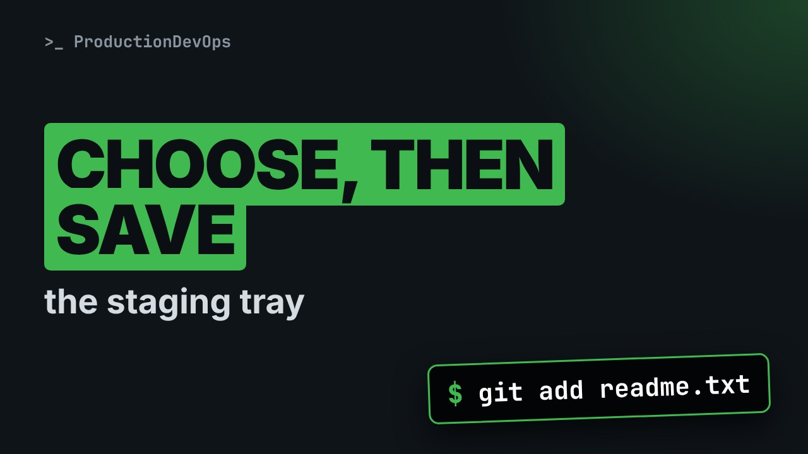
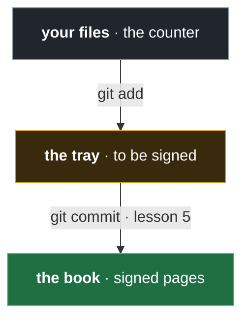
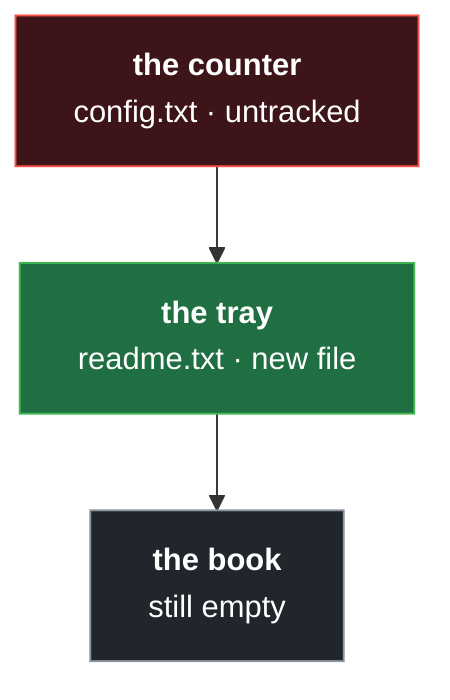

# Choosing What to Save: git add (Git from Zero, No Experience Needed)



**Video:** coming soon on the [channel](https://www.youtube.com/@production-devops).

Git saves nothing by itself: you choose what goes into the next version. This lesson of Git and GitHub from Zero asks Git what it sees with git status, then puts files on the "to be signed" tray with git add, one at a time, and reads the colours: red for untracked, green for ready to save. At the end, why Git makes you choose. No experience needed: every new word is explained on screen, and every command runs for real. The challenge and its solution are in the demos repo.

## Files in this folder

- [`acme-app/config.txt`](acme-app/config.txt)
- [`acme-app/readme.txt`](acme-app/readme.txt)
- [`challenge-solution.sh`](challenge-solution.sh) (solution of the challenge: try it yourself first)

## What you need

A Linux shell (a VM, WSL or a container is fine). Everything runs inside this folder.

## Before you start

The video runs these commands first, off screen:

```bash
if [ ! -e .tt-lab ]; then rm -rf /lab/git4 && mkdir -p /lab/git4 && cp -a . /lab/git4/ && rm -f /lab/git4/.tt-runner.sh && touch .tt-lab; fi
export HOME=/lab/git4 && cd /lab/git4/acme-app
git config --global user.name ops && git config --global user.email ops@example.com && git config --global init.defaultBranch main && git config --global core.pager cat
[ -d .git ] || git init -q
PROMPT_COMMAND='HOME=/lab/git4; PS1="\[\e[1;32m\]sre@lab\[\e[0m\]:\[\e[1;34m\]\w\[\e[0m\]$ "'
```

## The lesson, step by step

The same explanations as the video, with every command. Read it, then run it yourself.

Your repository is ready, but its book is empty. Today you choose what goes in. And at the end: why does Git make you choose?

To follow along, you need a terminal with Git, like in lesson three. Or just watch. Every step is on screen.

### The plan

This is lesson four of Git and GitHub from Zero. First, three places: your files, the tray, and the book. Then, we ask Git what it sees, with git status. Then, the new command: git add. And why a tray at all?

### Three places

**Three places**



A change lives in three places: your files, on the counter, and the tray, waiting to be signed. Then the book, with the signed pages.

- `staging area — The changes you chose for the next commit (like the "to be signed" tray on the chef's desk)`: 
New word: staging area. It holds the changes you chose for the next commit. Think of the to be signed tray on the chef's desk.

### git status

Before we change anything, we ask a question. Git status: what do you see? It only looks. It changes nothing. Ask it often, before and after every step.

We are in acme app. We type git status.

```console
$ git status
```

First: on branch main. Branches come in lesson seven. No commits yet. The book is still empty. Then untracked files: config and readme, in red. Git sees them, but has never saved them.

- `untracked — A file Git can see, but has never saved (like a loose page on the counter, not in the book)`: 
New word: untracked. An untracked file is one Git can see, but has never saved. A loose page on the counter.

### git add

Here is the one new command: git add readme dot t x t. Add means: put it on the tray. Then the file name: which file goes on the tray.

We type git add readme dot t x t.

```console
$ git add readme.txt
```

No message at all. In a terminal, that usually means it worked. Let's ask again, with git status.

```console
$ git status
```

Readme is now under changes to be committed, in green. It is on the tray. Config is still red, under untracked files. We did not choose it.

**After one git add**



Here is where we are: config on the counter, readme on the tray. And the book is still empty.

### So far

So far: git status looks. Red is untracked, green is on the tray. Git add puts a file on the tray. Next: the second file. And why a tray at all?

### Again

Now config. We type git add config dot t x t.

```console
$ git add config.txt
```

And we ask again, with git status.

```console
$ git status
```

Both files are green now, under changes to be committed. But nothing is saved in the book yet. It still says: no commits yet.

### Why a tray

So why a tray? Changes that belong together go into one page. A half done file can wait on the counter. So every page in the book makes sense on its own.

### Good to know

Good to know. Git add dot puts everything in the folder on the tray. Look with status first. Changed a file after adding it? Add it again. And status shows hints in brackets. Read them, they help.

### Recap

Recap: git status shows what Git sees. It changes nothing. Untracked, in red, means never saved. Git add puts a file on the tray: green, ready to sign. Your challenge: make a new file, to do dot t x t. Run status, add, and status again: what changes colour? The solution is in the demo repo.

### Where next

Where next? Lesson five: saving a version, with git commit. The tray gets signed into the book.

Next lesson: saving a version, with git commit. Subscribe so you do not miss it.

## All the commands, to copy

Run them from inside this folder, in this order (some are expected to fail: that is the point of the demo).

```bash
git status
git add readme.txt
git add config.txt
```

## Challenge

Your challenge: make a new file, to do dot t x t. Run status, add, and status again: what changes colour? The solution is in the demo repo.

When you have tried: [`challenge-solution.sh`](challenge-solution.sh).

---

From the [ProductionDevOps](https://www.youtube.com/@production-devops) channel: real-world DevOps and SRE, explained with real commands.
