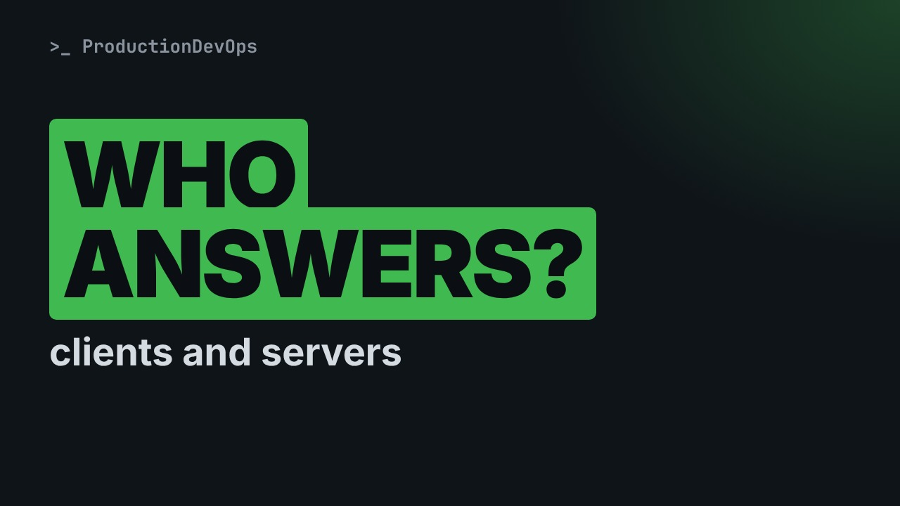
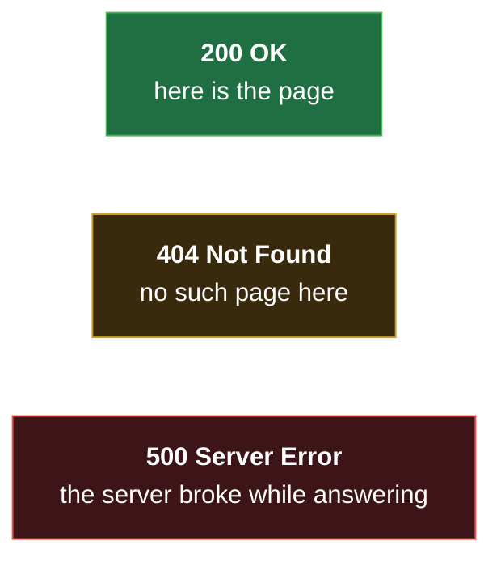
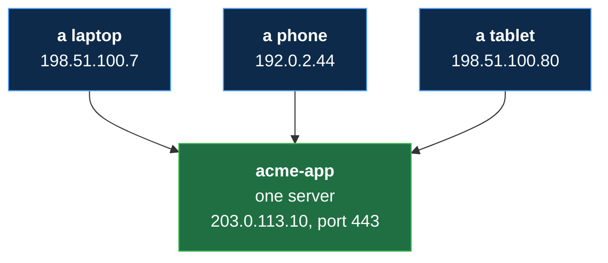
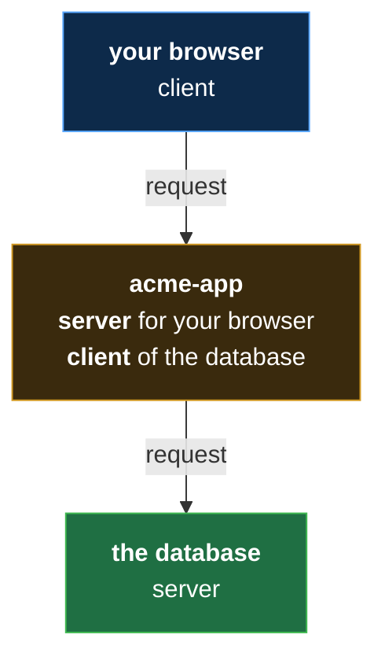

# Clients and Servers: Who Asks, Who Answers (How the Internet Works, No Experience Needed)

**Video:** coming soon on the [channel](https://www.youtube.com/@production-devops).

Your browser asks, the shop answers. But is a server a special kind of computer? This lesson of How the Internet Works, Simply explains clients and servers with the postal service: the person who writes the request letter, and the office that answers it. Who speaks first, what a request and a response carry, what 200 and 404 mean, why one server can answer many clients, and why the same computer can be a client and a server at once. No terminal, nothing to install, no experience needed. Every new word is explained on screen. The challenge and its solution are in the demos repo.

## Files in this folder

- [`challenge-solution.md`](challenge-solution.md) (solution of the challenge: try it yourself first)

## What you need

A Linux shell (a VM, WSL or a container is fine). Everything runs inside this folder.

## The lesson, step by step

The same explanations as the video, with every command. Read it, then run it yourself.

Your browser asks, and the shop answers. But is a server a special computer? At the end: why one computer can be both.

For this lesson you need nothing. Just watch. No terminal and no code. Only pictures. About five minutes.

### The plan

This is lesson seven of How the Internet Works, Simply. First, who asks, and who answers. Then, one request and one response. Then, one server with many clients. And how one computer can be both.

### Two roles

- `client — The program that starts a conversation by asking for something (like the person who writes the request letter)`: 
New word: client. A client is the program that starts a conversation by asking. Think of the person who writes the request letter.

- `server — The program that waits for requests, and answers them (like an office that answers every letter it receives)`: 
Remember server, from lesson one. More precisely: the program that waits for requests, and answers them. Like an office that answers letters.

- `request · response — The question a client sends, and the answer the server sends back (like your letter, and the reply that comes back to your mailbox)`: 
Two more words. A request is the question a client sends. A response is the answer the server sends back.

### One request

Time flows down. Each arrow is one message.

- `your browser (client) → acme-app (server)`: request: please send /products
The browser is the client. It sends a request: please send the products page.

- `acme-app (server) → your browser (client)`: response: 200 OK, here it is
Acme app is the server. It sends a response: OK, here it is.

Who speaks first? The client, always. The server waits. It listens on a known port, like four four three. The client gets a random port. The reply comes back to it, as in lesson four.

What does a web request say? First, which page it wants. Then, which site, because one server can hold several. And a little about the client, like its language. The rules for writing it are called H T T P. You met the name in lesson four.

**The response starts with a status**

Every response starts with a status number. Two hundred: here it is. Four oh four, no such page, and five hundred, the server broke.

### So far

So far: the client asks. The server waits, and answers. A request goes out, and a response comes back, with a status. Next: many clients at once, and one computer with both roles.

### Many clients

**One server, many clients**

One server answers many clients. Each client has its own address and port. So every response finds its way back.

Each answer takes the server a little time. With too many requests at once, answers get slow. Some even fail. That is why big sites run many copies of the same server.

### Two meanings

Careful: people use the word server in two ways. First, the program that answers. Second, the computer that program runs on. Both are right. The context tells you which one.

### Both at once

- `database — A program that stores data, and answers questions about it (like the office's archive room, full of files)`: 
One more word: database. It is a program that stores data, and answers questions about it. Like the office's archive room.

**Client and server at the same time**

To build the products page, acme app asks the database for the prices. For you it is a server. For the database, it is a client.

So client and server are roles. Whoever asks is the client, in this conversation. Whoever answers is the server. And one computer can play both roles, at the same time.

### Good to know

Good to know: clients are browsers, phone apps, and often other programs. Servers usually run all day, in data centers. In a video call, both sides ask and answer.

### Recap

Recap: the client asks first. The server waits, and answers. A request brings back a response, with a status number. Client and server are roles. One computer can be both. Your challenge: you pay, and the shop asks a payment service. Who is the client, who is the server? The answer is in the demo repo.

### Where next

Where next? Lesson eight: try it yourself. Your first real command asks: is that computer there? For that one, you will need a terminal.

Next lesson: try it, with ping. Subscribe so you do not miss it.

## Challenge

Your challenge: you pay, and the shop asks a payment service. Who is the client, who is the server? The answer is in the demo repo.

When you have tried: [`challenge-solution.md`](challenge-solution.md).

---

From the [ProductionDevOps](https://www.youtube.com/@production-devops) channel: real-world DevOps and SRE, explained with real commands.
