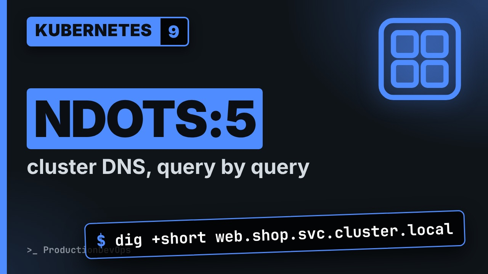
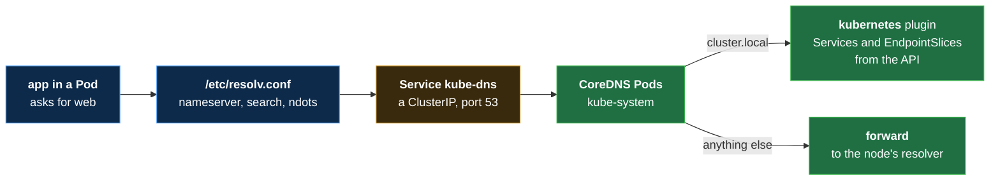

# Kubernetes Cluster DNS: CoreDNS, Search Domains and the ndots Trap



**Video:** https://youtu.be/MpY4h2UqGC0

Inside a Pod the name web just works; from another namespace it fails, and every outside name quietly costs several extra lookups. On a real cluster we read CoreDNS and its Corefile, query Service, SRV, headless and Pod records with dig, open a Pod's resolv.conf to see the search domains and ndots 5, follow a lookup through the search list, reach a Service in another namespace, tune a Pod with dnsPolicy and dnsConfig, and finish with a DNS debugging checklist. Lesson 9 of Kubernetes Deep Dive.

## Files in this folder

- [`shop.yaml`](shop.yaml)
- [`tuned.yaml`](tuned.yaml)
- [`challenge-solution.sh`](challenge-solution.sh) (solution of the challenge: try it yourself first)
- [`cleanup.sh`](cleanup.sh)
- [`setup.sh`](setup.sh)

## What you need

A Kubernetes cluster you can break: a local [kind](https://kind.sigs.k8s.io/) cluster with one control plane and two workers is what the video uses, plus `kubectl`. Never run these commands against a cluster that matters.

The outputs below were captured for real on the lab cluster. On yours, names, ages, IPs and ports will differ; everything else should match.

## The lesson, step by step

The same explanations as the video, with every command and its real output. Read it, then run it yourself.

Inside a Pod, the name web just works. From another namespace, it fails. Today: cluster DNS, and the five dots that multiply your lookups.

### The plan

Lesson nine of Kubernetes Deep Dive. Core DNS, and its config. The records it serves. Search domains and N dots. DNS policy, DNS config, and debugging.

**The path of a lookup**



The app reads resolve dot conf, which points to the Service kube DNS. Core DNS answers cluster names from the API, and forwards the rest.

### CoreDNS

The cluster's DNS Service, in kube system, still has its old name: kube DNS.

```console
$ kubectl get service kube-dns -n kube-system
NAME       TYPE        CLUSTER-IP   EXTERNAL-IP   PORT(S)                  AGE
kube-dns   ClusterIP   192.0.2.10   <none>        53/UDP,53/TCP,9153/TCP   7m41s
```

Behind it, Pods labelled k8s app equals kube DNS. They run Core DNS.

```console
$ kubectl get pods -n kube-system -l k8s-app=kube-dns
NAME                       READY   STATUS    RESTARTS   AGE
coredns-559f6c778d-gt9w6   1/1     Running   0          7m34s
coredns-559f6c778d-np8mr   1/1     Running   0          7m34s
```

```console
$ kubectl get configmap coredns -n kube-system -o yaml | grep -A 3 kubernetes
```

Core DNS reads its config, the Corefile, from a config map.

- `kubectl get configmap coredns -n kube-system`: the config map coredns
The config map coredns,

- `-o yaml`: printed whole, as YAML
printed as YAML.

- `| grep -A 3 kubernetes`: the kubernetes line, and 3 after
Grep dash capital A three: the kubernetes line, and the three after it.

We run it.

```console
$ kubectl get configmap coredns -n kube-system -o yaml | grep -A 3 kubernetes
        kubernetes cluster.local in-addr.arpa ip6.arpa {
           pods insecure
           fallthrough in-addr.arpa ip6.arpa
           ttl 30
```

The kubernetes plugin answers the zone cluster dot local. Pods insecure: we meet it soon. And names outside that zone?

```console
$ kubectl get configmap coredns -n kube-system -o yaml | grep forward
        forward . /etc/resolv.conf {
```

### Records

Our lab, created before recording. In shop, a Deployment web, two Pods. A Pod dns, with dig and get ent. In billing, a Service pay.

Now two Services in front of the same Pods.

```
apiVersion: v1
kind: Service
metadata:
  name: web
  namespace: shop
spec:
  selector: {app: web}
  ports: [{name: http, port: 80, targetPort: 8080}]
---
apiVersion: v1
kind: Service
metadata:
  name: web-pods
  namespace: shop
spec:
  clusterIP: None
  selector: {app: web}
  ports: [{name: http, port: 80, targetPort: 8080}]
```

An ordinary one. And a headless one.

```
apiVersion: v1
kind: Service
metadata:
  name: web
  namespace: shop
spec:
  selector: {app: web}
  ports: [{name: http, port: 80, targetPort: 8080}]
```

Service web, in shop. It selects the web Pods. One port, named http. The name matters to DNS too.

```
apiVersion: v1
kind: Service
metadata:
  name: web-pods
  namespace: shop
spec:
  clusterIP: None
  selector: {app: web}
  ports: [{name: http, port: 80, targetPort: 8080}]
```

A second Service, web pods. Cluster IP None: headless. No virtual address and no kube proxy rules. DNS returns the Pods themselves. The same Pods, the same port.

All together: one Service with an address, one without.

```
apiVersion: v1
kind: Service
metadata:
  name: web
  namespace: shop
spec:
  selector: {app: web}
  ports: [{name: http, port: 80, targetPort: 8080}]
---
apiVersion: v1
kind: Service
metadata:
  name: web-pods
  namespace: shop
spec:
  clusterIP: None
  selector: {app: web}
  ports: [{name: http, port: 80, targetPort: 8080}]
```

We apply them.

```console
$ kubectl apply -f shop.yaml
service/web created
service/web-pods created
```

And list the Services in shop.

```console
$ kubectl get services -n shop
NAME       TYPE        CLUSTER-IP      EXTERNAL-IP   PORT(S)   AGE
web        ClusterIP   192.0.2.11   <none>        80/TCP    3s
web-pods   ClusterIP   None            <none>        80/TCP    3s
```

```console
$ kubectl exec dns -n shop -- dig +short web.shop.svc.cluster.local
```

We ask from the Pod dns. The full name has four parts.

- `kubectl exec dns -n shop --`: run it in the Pod dns
In the Pod dns,

- `dig +short`: ask DNS, print only the answer
dig asks DNS. Plus short prints only the answer.

- `web.`: the Service
Web: the Service,

- `shop.`: its namespace
shop: its namespace,

- `svc.cluster.local`: Services, in the cluster's domain
s v c for Services, and the cluster domain.

We run it.

```console
$ kubectl exec dns -n shop -- dig +short web.shop.svc.cluster.local
192.0.2.11
```

A named port gets an SRV record: underscore http, underscore tcp, then the name.

```console
$ kubectl exec dns -n shop -- dig +short SRV _http._tcp.web.shop.svc.cluster.local
0 100 80 web.shop.svc.cluster.local.
```

The headless Service returns every ready Pod instead.

```console
$ kubectl exec dns -n shop -- dig +short web-pods.shop.svc.cluster.local
192.0.2.12
192.0.2.13
```

Pod records: the IP with dashes, the namespace, then pod. Pods insecure means no check: no Pod has this address.

```console
$ kubectl exec dns -n shop -- dig +short 203-0-113-7.shop.pod.cluster.local
203.0.113.7
```

### So far

So far: Core DNS answers cluster dot local. A Service name gives its address, or its Pods. Next: short names, and what five dots cost.

### Search and ndots

```console
$ kubectl exec dns -n shop -- cat /etc/resolv.conf | cut -d' ' -f1-4
```

Short names depend on one file in the Pod.

- `cat /etc/resolv.conf`: the Pod's resolver settings
Resolve dot conf, written by the kubelet.

- `| cut -d' '`: split each line at spaces
Cut splits each line at spaces,

- `-f1-4`: keep the first four words
and keeps four words. A node may append its own search domains: we cut them.

We run it.

```console
$ kubectl exec dns -n shop -- cat /etc/resolv.conf | cut -d' ' -f1-4
search shop.svc.cluster.local svc.cluster.local cluster.local
nameserver 192.0.2.10
options ndots:5
```

The name server is the cluster IP of kube DNS. Search: three domains, the Pod's own namespace first. N dots five: a name with fewer than five dots tries the search domains first.

Get ent resolves like an app does, with the search list. First, just web.

```console
$ kubectl exec dns -n shop -- getent hosts web
192.0.2.11   web.shop.svc.cluster.local
```

Now pay. It lives in billing, not in shop.

```console
$ kubectl exec dns -n shop -- getent hosts pay
command terminated with exit code 2
```

Pay dot billing: name, then namespace.

```console
$ kubectl exec dns -n shop -- getent hosts pay.billing
192.0.2.14     pay.billing.svc.cluster.local
```

The trap: a Pod calls api dot example dot com. Two dots, fewer than five.

- `Pod in shop → CoreDNS`: api.example.com.shop.svc.cluster.local ?
First try: with shop's domain.

- `CoreDNS → Pod in shop`: NXDOMAIN
No such name.

- `Pod in shop → CoreDNS`: api.example.com.svc.cluster.local ?
Then svc dot cluster dot local.

- `Pod in shop → CoreDNS`: api.example.com.cluster.local ?
Another miss, then cluster dot local.

- `Pod in shop → CoreDNS`: api.example.com ?
Only then, the real name.

- `CoreDNS → Pod in shop`: answer
Three wasted round trips, doubled when the app also asks for IPv6.

How do you avoid the trap? A trailing dot makes the name absolute: no search. Lower N dots for that Pod, with DNS config. Or cut the cost with caching.

### dnsPolicy

Each Pod has a DNS policy. Cluster first, the default: what we saw. Default means the node's resolver. It is not the default. A host network Pod would use the node's resolver. This one keeps cluster DNS. None: only what DNS config says.

### dnsConfig

DNS config adds settings on top of the policy.

```
apiVersion: v1
kind: Pod
metadata:
  name: tuned
  namespace: shop
spec:
  dnsPolicy: ClusterFirst
  dnsConfig:
    searches: [billing.svc.cluster.local]
    options: [{name: ndots, value: "2"}]
  containers:
    - name: dig
      image: registry.k8s.io/e2e-test-images/jessie-dnsutils:1.3
      command: ["sleep", "3600"]
```

A Pod tuned, in shop. Its DNS settings, and the same tools as dns.

```
spec:
  dnsPolicy: ClusterFirst
  dnsConfig:
    searches: [billing.svc.cluster.local]
    options: [{name: ndots, value: "2"}]
  containers:
    - name: dig
      image: registry.k8s.io/e2e-test-images/jessie-dnsutils:1.3
      command: ["sleep", "3600"]
```

Policy cluster first, the default, written out. Searches appends billing's domain to the search list. Options sets N dots to two, replacing five. The same image as the Pod dns.

All together: cluster DNS, one extra search domain, two dots.

```
apiVersion: v1
kind: Pod
metadata:
  name: tuned
  namespace: shop
spec:
  dnsPolicy: ClusterFirst
  dnsConfig:
    searches: [billing.svc.cluster.local]
    options: [{name: ndots, value: "2"}]
  containers:
    - name: dig
      image: registry.k8s.io/e2e-test-images/jessie-dnsutils:1.3
      command: ["sleep", "3600"]
```

We apply it.

```console
$ kubectl apply -f tuned.yaml
pod/tuned created
```

Its options line.

```console
$ kubectl exec tuned -n shop -- grep options /etc/resolv.conf
options ndots:2
```

And plain pay, which failed before.

```console
$ kubectl exec tuned -n shop -- getent hosts pay
192.0.2.14     pay.billing.svc.cluster.local
```

### Debugging

When a name fails, check in this order. Query from a Pod, full name and short. Read the Pod's resolve dot conf. Core DNS has ready endpoints? Its logs. The log plugin shows each query.

The endpoint check, as in lesson eight.

```console
$ kubectl get endpointslices -n kube-system -l kubernetes.io/service-name=kube-dns
NAME             ADDRESSTYPE   PORTS        ENDPOINTS               AGE
kube-dns-zdpqf   IPv4          53,53,9153   192.0.2.15,192.0.2.16   12m
```

We delete both namespaces, and everything in them.

```console
$ kubectl delete namespace shop billing
namespace "shop" deleted
namespace "billing" deleted
```

### Recap

Let's recap. Service, namespace, s v c, cluster domain. Headless gives Pods. Named ports give SRV. N dots five: short names work, outside names cost. Challenge: from billing, reach web by the shortest name, then make just web work. Solution in the demo repository.

Next, module four: how the scheduler decides where a Pod runs. Subscribe to follow the course.

## All the commands, to copy

Run them from inside this folder, in this order.

```bash
kubectl get service kube-dns -n kube-system
kubectl get pods -n kube-system -l k8s-app=kube-dns
kubectl get configmap coredns -n kube-system -o yaml | grep -A 3 kubernetes
kubectl get configmap coredns -n kube-system -o yaml | grep forward
kubectl apply -f shop.yaml
kubectl get services -n shop
kubectl exec dns -n shop -- dig +short web.shop.svc.cluster.local
kubectl exec dns -n shop -- dig +short SRV _http._tcp.web.shop.svc.cluster.local
kubectl exec dns -n shop -- dig +short web-pods.shop.svc.cluster.local
kubectl exec dns -n shop -- dig +short 203-0-113-7.shop.pod.cluster.local
kubectl exec dns -n shop -- cat /etc/resolv.conf | cut -d' ' -f1-4
kubectl exec dns -n shop -- getent hosts web
kubectl exec dns -n shop -- getent hosts pay
kubectl exec dns -n shop -- getent hosts pay.billing
kubectl apply -f tuned.yaml
kubectl exec tuned -n shop -- grep options /etc/resolv.conf
kubectl exec tuned -n shop -- getent hosts pay
kubectl get endpointslices -n kube-system -l kubernetes.io/service-name=kube-dns
kubectl delete namespace shop billing
```

## Challenge

Challenge: from billing, reach web by the shortest name, then make just web work. Solution in the demo repository.

When you have tried: [`challenge-solution.sh`](challenge-solution.sh).

---

From the [ProductionDevOps](https://www.youtube.com/@production-devops) channel: real-world DevOps and SRE, explained with real commands.
