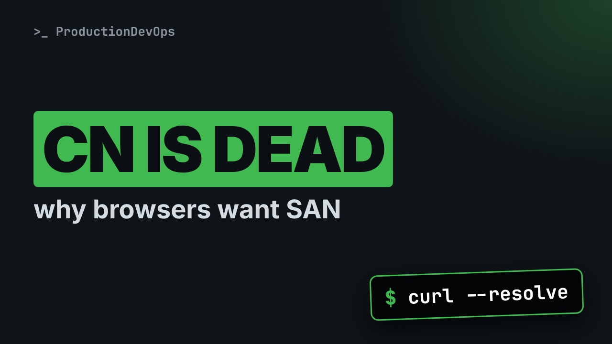
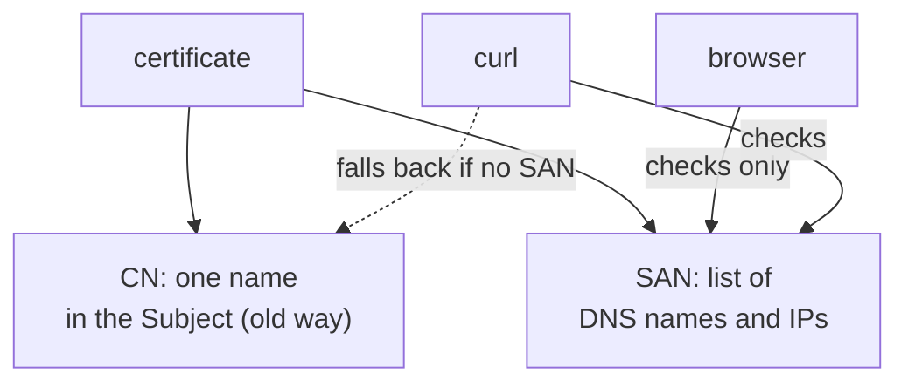
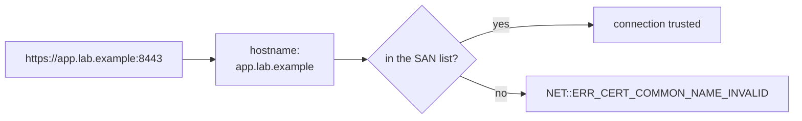

# CN Is Dead, SAN Rules: Why Your Browser Rejects a "Valid" Certificate



**Video:** https://youtu.be/4VyL2i0PN-w

curl accepts the certificate, the browser says NET::ERR_CERT_COMMON_NAME_INVALID. Both are right. Browsers check only the Subject Alternative Name list, while curl still falls back to the old Common Name. We read the names inside a certificate with openssl, test names safely with curl --resolve, create a development certificate with a proper SAN, and avoid the classic hosts-file workaround.

## Files in this folder

- [`make-san-cert.sh`](make-san-cert.sh)
- [`serve.sh`](serve.sh)
- [`tls-server.py`](tls-server.py)

## What you need

A Linux shell (a VM, WSL or a container is fine). Everything runs inside this folder.

## Before you start

The video runs these commands first, off screen:

```bash
[ -f app.pem ] || openssl req -x509 -newkey rsa:2048 -nodes -keyout app.key -out app.pem -days 365 -subj /CN=app.lab.example 2>/dev/null
[ -f san.pem ] && ./serve.sh san.pem san.key >/dev/null || ./serve.sh app.pem app.key >/dev/null
```

## The big picture

A certificate stores names in two places, and clients check them differently.



How a client decides: the hostname in the URL must be in the SAN list.



## The lesson, step by step

The same explanations as the video, with every command. Read it, then run it yourself.

curl says this certificate is fine. Chrome says: net error, cert common name invalid. They are both right. Here is why, and how to make a certificate that every client accepts.

### The plan

Here is the plan. First, the two places where a certificate stores names. We read them with open S S L, and test them with curl. Then we create a development certificate with a proper S A N list. And three gotchas that waste hours.

### Two places for names

A certificate can carry names in two places. The common name, or C N. One single name, inside the subject. This is the old way. The subject alternative name, or S A N. A list of names and IP addresses. Browsers check only the S A N list. For name matching, the C N is ignored.

### Read the names

Our server uses the file app dot pem. open S S L x five oh nine reads a certificate. Dash subject prints the subject.

```console
$ openssl x509 -in app.pem -noout -subject
```

The common name is app dot lab dot example. Now the S A N list, with dash ext.

```console
$ openssl x509 -in app.pem -noout -ext subjectAltName
```

No extensions at all. So this certificate has only a common name. No S A N.

```console
$ curl --cacert app.pem --resolve app.lab.example:8443:127.0.0.1 https://app.lab.example:8443/app/login
```

To test a certificate name, we need to call the server by that name. This curl command does it without changing DNS or any hosts file.

- `--cacert app.pem`: trust this certificate
Dash dash ca cert: trust this certificate for this request only. No dash k, so curl really checks it.

- `--resolve app.lab.example:8443:127.0.0.1`: name → IP, for curl only
Dash dash resolve: for this name and port, connect to this IP. No DNS, no hosts file, nothing to clean up.

- `https://app.lab.example:8443`: the name curl verifies
And the name in the URL is the name curl verifies against the certificate.

Let's run it, printing only the status code.

```console
$ curl -sS --cacert app.pem --resolve app.lab.example:8443:127.0.0.1 -o /dev/null -w '%{http_code}\n' https://app.lab.example:8443/app/login
```

Two hundred. curl accepts it. When a certificate has no S A N at all, curl still falls back to the common name.

### Browsers

Browsers stopped doing that years ago. Chrome and Edge since twenty seventeen. The error is: cert common name invalid. Safari since twenty nineteen, and Firefox since twenty twenty two: S A N only. So the rule is simple. Every name and every IP that clients use must be in the S A N list.

### A proper dev certificate

```
#!/usr/bin/env bash
# Self-signed development certificate with a Subject Alternative Name (SAN) list.
set -euo pipefail
openssl req -x509 -newkey rsa:2048 -nodes -days 365 \
  -keyout san.key -out san.pem \
  -subj "/CN=app.lab.example" \
  -addext "subjectAltName=DNS:app.lab.example,DNS:localhost,IP:127.0.0.1" 2>/dev/null
echo "created san.pem (certificate) and san.key (private key)"
```

open S S L req, dash x five oh nine: create a self signed certificate, with a new RSA key, no password, valid one year. The private key goes to san dot key, the certificate to san dot pem. We still set a common name. Older tools display it, but browsers will not use it. And this is the line that matters: dash add ext, with the S A N list. Two DNS names, and the IP one two seven dot zero dot zero dot one.

We run the script.

```console
$ ./make-san-cert.sh
```

And read the S A N list.

```console
$ openssl x509 -in san.pem -noout -ext subjectAltName
```

Three names, exactly as written. Now we restart the test server with the new certificate.

```console
$ ./serve.sh san.pem san.key
```

### Test every name

localhost is in the list.

```console
$ curl -sS --cacert san.pem -o /dev/null -w '%{http_code}\n' https://localhost:8443/app/login
```

So is the IP address.

```console
$ curl -sS --cacert san.pem -o /dev/null -w '%{http_code}\n' https://127.0.0.1:8443/app/login
```

And a name that is not in the list? We use dash dash resolve again.

```console
$ curl -sS --cacert san.pem --resolve other.lab.example:8443:127.0.0.1 https://other.lab.example:8443/app/login
```

Refused: no alternative subject name matches. This is exactly the check a browser does.

### Gotchas

A common mistake: testing a name with a Host header. Here we call the IP, with the header host other dot lab dot example.

```console
$ curl -sS --cacert san.pem -H 'Host: other.lab.example' -o /dev/null -w '%{http_code}\n' https://127.0.0.1:8443/app/login
```

Two hundred, even though that name is not in the certificate. curl verified the IP from the URL, not the header. Use dash dash resolve to test a name.

Two more mistakes worth avoiding. Editing hosts files to match the common name. The browser still checks only the S A N list. And curl dash k in scripts. It hides every problem we saw in this video.

### Recap

Let's recap. Browsers match names against the S A N list only. Read it with open S S L x five oh nine, dash ext subject alt name. Create it with dash add ext, listing every DNS name and IP. And test it with curl, dash dash ca cert and dash dash resolve.

Put every name in the S A N, and test it with dash dash resolve. Next in this series: H S T S, and why sometimes there is no proceed anyway button. Subscribe so you don't miss it.

## All the commands, to copy

Run them from inside this folder, in this order (some are expected to fail: that is the point of the demo).

```bash
openssl x509 -in app.pem -noout -subject
openssl x509 -in app.pem -noout -ext subjectAltName
curl --cacert app.pem --resolve app.lab.example:8443:127.0.0.1 https://app.lab.example:8443/app/login
curl -sS --cacert app.pem --resolve app.lab.example:8443:127.0.0.1 -o /dev/null -w '%{http_code}\n' https://app.lab.example:8443/app/login
./make-san-cert.sh
openssl x509 -in san.pem -noout -ext subjectAltName
./serve.sh san.pem san.key
curl -sS --cacert san.pem -o /dev/null -w '%{http_code}\n' https://localhost:8443/app/login
curl -sS --cacert san.pem -o /dev/null -w '%{http_code}\n' https://127.0.0.1:8443/app/login
curl -sS --cacert san.pem --resolve other.lab.example:8443:127.0.0.1 https://other.lab.example:8443/app/login
curl -sS --cacert san.pem -H 'Host: other.lab.example' -o /dev/null -w '%{http_code}\n' https://127.0.0.1:8443/app/login
```

---

From the [ProductionDevOps](https://www.youtube.com/@production-devops) channel: real-world DevOps and SRE, explained with real commands.
