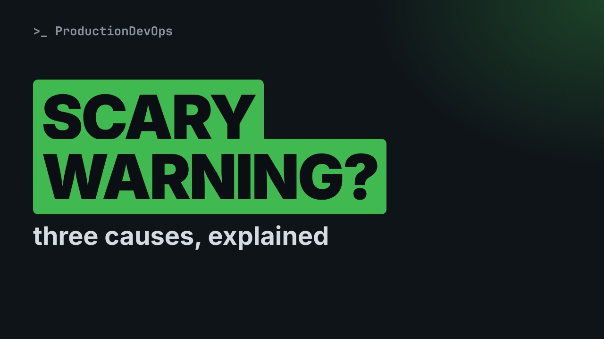
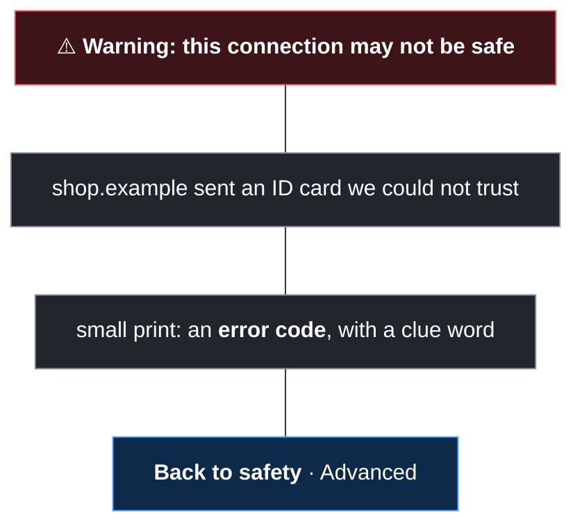
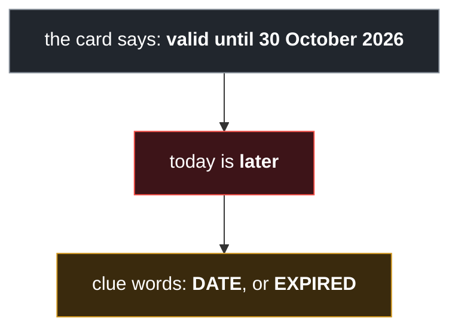
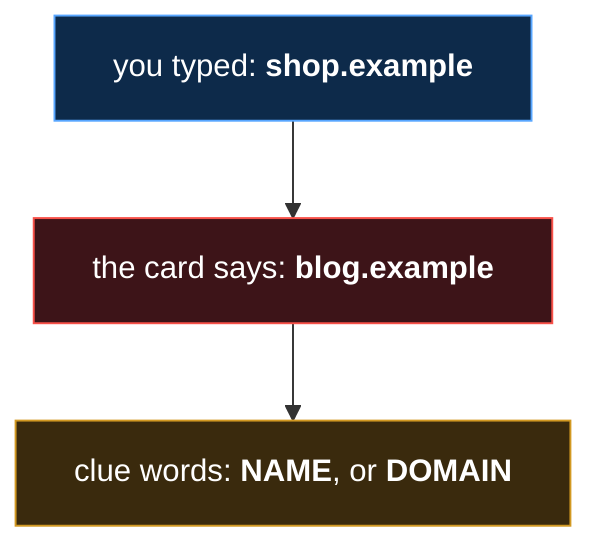
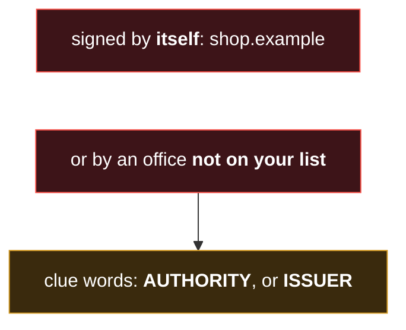

# Common Browser Errors, Explained (HTTPS and Certificates, No Experience Needed)

**Video:** coming soon on the [channel](https://www.youtube.com/@production-devops).

Sometimes your browser stops you with a full-page warning about a website's certificate. Most of these warnings come from three causes: an expired certificate, a certificate with someone else's name, or one signed by an office your browser does not trust. This lesson of HTTPS and Certificates, Simply explains each one with drawn, fictional warning pages and the postal service comparison: what the clue word in the error code means, why it happens, what you should do, and the one button you should almost never press. No terminal, nothing to install, no experience needed. The challenge and its solution are in the demos repo.

## Files in this folder

- [`challenge-solution.md`](challenge-solution.md) (solution of the challenge: try it yourself first)

## What you need

A Linux shell (a VM, WSL or a container is fine). Everything runs inside this folder.

## The lesson, step by step

The same explanations as the video, with every command. Read it, then run it yourself.

In five minutes: the three causes behind most browser certificate warnings. At the end: the one button you should almost never press.

For this lesson you need nothing. Just watch. It helps to have seen lessons three and four: the ID card, and the offices. About five minutes.

### The plan

This is lesson six of HTTPS and Certificates, Simply. First, a warning page, drawn. Then, the three common causes. Then, a label that is not an error. And what you should do.

### A warning page

**A warning page, drawn (fictional)**

Here is a warning page, drawn with fictional words. A big warning, one sentence, a small error code, and two buttons.

Why does the browser stop? One of its checks on the ID card failed. It has sent nothing yet. Your letter is still on your desk. The clue word in the small error code names the check that failed.

### Cause 1: the date

- `expired — A certificate after its 'valid until' date (like an ID card past its date)`: 
Cause one, and a new word: expired. A certificate is expired after its valid until date. Think of an ID card past its date.

**Cause 1: expired**

The card was valid until a date that has passed. The clue word is often date, or expired.

Why does it happen? The owner forgot to renew the card. Or the renewal program stopped working, and nobody noticed. Or your own computer's clock is wrong. Then many sites look expired at once.

### Cause 2: the name

**Cause 2: wrong name**

Cause two: the wrong name. You typed shop dot example, but the card says blog dot example. An ID card with someone else's name.

Why does it happen? One server hosts many sites, and it sent the wrong card. Or the card misses a name, like the one with w w w in front. Rarely, it is an impostor in the middle. The check did its job.

### So far

So far: expired means an ID card past its date. Wrong name means an ID card with someone else's name. Next: an ID card that nobody vouches for. If this is helping, subscribe: the next lesson checks three broken cards, for real.

### Cause 3: the office

- `self-signed — A certificate signed by its own owner, not by an office (like an ID card printed at home)`: 
Cause three, and a new word: self-signed. It is signed by its own owner, not by an office. Think of an ID card printed at home.

**Cause 3: untrusted**

The card is signed by itself, or by an office missing from your browser's list. The clue word is often authority, or issuer.

Why does it happen? Test servers and home devices often print their own card. Or a company uses its own office, and it is missing from your list. And rarely, an impostor in the middle.

### Not secure

Now a label that is not an error. On an H T T P address, the browser shows not secure. The page loads, but nothing is sealed. It is a postcard. So type nothing private there.

### What to do

Now the payoff. The button to almost never press: advanced, then continue anyway. If you press it, you lose both promises of the padlock. Private, and the right site. Never do it on a site with your money or your passwords. Some sites do not even allow it. The TLS course explains why.

What can you do instead? First, check your computer's date and time. Check the address for typos. Try again later, or tell the site's owner.

### Recap

Recap. Expired: the dates are wrong. The clue word is date, or expired. Wrong name: the clue word is name, or domain. Untrusted: the clue word is authority, or issuer. Your challenge: your laptop's clock says the year 2019. What warning do many sites show, and why? The answer is in the demo repo.

### Where next

Where next? Lesson seven: expired, wrong name, untrusted. What to check. Three broken cards, checked for real, with the command from lesson five.

Subscribe, and the next lesson, expired, wrong name, untrusted, finds you.

## Challenge

Your challenge: your laptop's clock says the year 2019. What warning do many sites show, and why? The answer is in the demo repo.

When you have tried: [`challenge-solution.md`](challenge-solution.md).

---

From the [ProductionDevOps](https://www.youtube.com/@production-devops) channel: real-world DevOps and SRE, explained with real commands.
