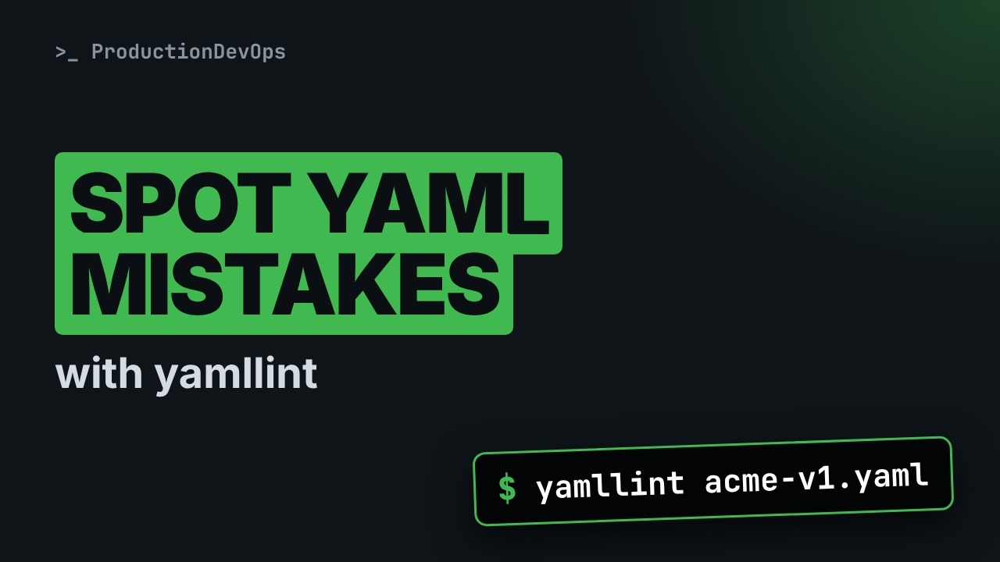
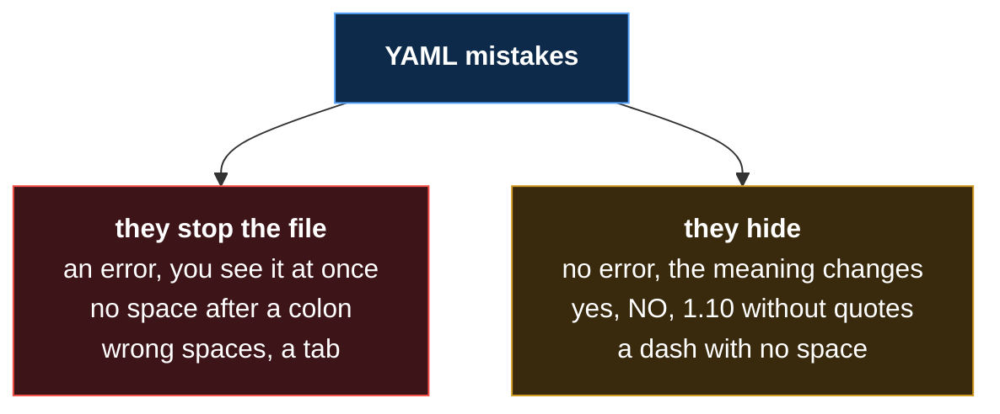
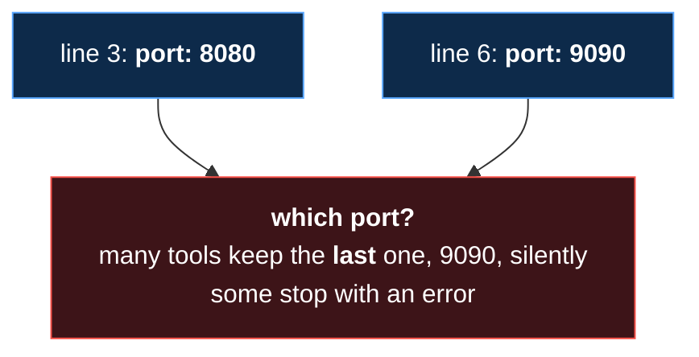

# Common YAML Mistakes, and How to Spot Them with yamllint (YAML from Zero, No Experience Needed)



**Video:** coming soon on the [channel](https://www.youtube.com/@production-devops).

Some YAML mistakes stop the file with an error. Others hide: the file loads, but the program reads something you never meant. This lesson of YAML from Zero sorts the common mistakes into those two families, then runs the one command of the course, yamllint, a proofreader for YAML files, on a small broken config file. You learn to read its report line by line, see why the error points one line too low, fix the file in three rounds, and meet one new mistake: the same key written twice. No experience needed: every new word is explained on screen. The files, the setup guide, the challenge and its solution are in the demos repo.

## Files in this folder

- [`acme-v1.yaml`](acme-v1.yaml)
- [`acme-v2.yaml`](acme-v2.yaml)
- [`acme-v3.yaml`](acme-v3.yaml)
- [`challenge.yaml`](challenge.yaml)
- [`challenge-solution.md`](challenge-solution.md) (solution of the challenge: try it yourself first)
- [`setup.md`](setup.md)

## What you need

A Linux shell (a VM, WSL or a container is fine). Everything runs inside this folder.

## The lesson, step by step

The same explanations as the video, with every command. Read it, then run it yourself.

Some YAML mistakes stop the file. Others hide, and the program reads the wrong thing. Today: a tool that finds them, and an error that points at the wrong line.

To watch this lesson, you need nothing. To follow along, you need a Linux terminal with a tool called YAML lint. How to install it, and the files, are in the demo repo.

### The plan

This is lesson seven of YAML from Zero. First, the two families of YAML mistakes. Then, a proofreader for YAML files. Then, how to read its report, line by line. And we fix the file, and run it again, until it is quiet.

### Two families

**Two families of mistakes**



You met these mistakes in earlier lessons. Some stop the file with an error. Others hide: no error, but the meaning changes.

### A proofreader

- `linter — A program that checks a file for mistakes, without running it (like a proofreader who checks your form before you hand it in)`: 
New word: linter. A linter checks a file for mistakes, without running anything. Like a proofreader who checks your form before you hand it in.

```
---
app: acme-app
port:8080
replicas: 3
debug: yes
port: 9090
```

Here is acme app's config file, version one. Three dashes, from lesson six: a document starts. This file has three mistakes. Can you spot them before the tool does?

```console
$ yamllint acme-v1.yaml
```

Here is the one new command of this course. It has two pieces.

- `yamllint`: the proofreader for YAML
YAML lint, the linter for YAML files.

- `acme-v1.yaml`: the file to check
And the file to check.

Is version one correct? We ask YAML lint.

```console
$ yamllint acme-v1.yaml
```

One line in the report: an error, on line four.

How to read it. Four colon one means line four, column one. Error means the file cannot be read. It must be fixed. Then the message: what YAML lint expected. Here, a colon. In brackets, the name of the check. Syntax means the shape of the file.

```
port:8080
replicas: 3
```

The report says line four. But line four is fine. The mistake is one line up: no space after the colon. YAML only noticed on the next line.

### So far

So far: YAML lint is a proofreader for YAML files. Its report gives the line, the column, and what is wrong. If that line looks fine, look one line up. Next: we fix it, and find the two mistakes that hid.

### Second round

```
---
app: acme-app
port: 8080
replicas: 3
debug: yes
port: 9090
```

Version two. Line three now has its space after the colon. The rest is unchanged. We run the same command on version two.

Same command, version two.

```console
$ yamllint acme-v2.yaml
```

The file can be read now. But the report has two new lines.

- `warning — Advice: the file can be read, but something looks risky (like the hotel desk asking: "are you sure?")`: 
The first one is a warning. A warning is advice: the file can be read, but something looks risky.

Line five, a warning. Yes is a risky yes or no value. Write true or false, as in lesson five. Line six, an error. The key port is written twice.

**The same key twice**



Which port is right? Many tools keep the last one, without a word, and some stop. So write each key once.

### Third round

```
---
app: acme-app
port: 8080
replicas: 3
debug: true
```

Version three. Debug is now true. And port is written only once: eight zero eight zero.

Same command, version three.

```console
$ yamllint acme-v3.yaml
```

No output at all. For YAML lint, silence means: no problems found.

### Good to know

YAML lint checks the shape of the file, not what you meant. Version one point ten passes. Only you know it should be text. Run it before you hand a file to Kubernetes or Ansible.

```
---
app: acme-app
settings:
  port: 8080
   debug: false
```

Your challenge. Run YAML lint on this file. Which line does it report, and what is wrong?

### Recap

Recap: YAML mistakes either stop the file, or hide. YAML lint reports the line, the column, and an error or a warning. If the line looks fine, look one line up. And silence means no problems. Your challenge: run YAML lint on the challenge file. What is wrong? The answer is in the demo repo.

### Where next

Where next? Lesson eight: real files, read line by line. A Kubernetes Pod, and an Ansible playbook.

Next lesson: reading real files. Subscribe so you do not miss it.

## All the commands, to copy

Run them from inside this folder, in this order (some are expected to fail: that is the point of the demo).

```bash
yamllint acme-v1.yaml
yamllint acme-v2.yaml
yamllint acme-v3.yaml
```

## Challenge

Your challenge: run YAML lint on the challenge file. What is wrong? The answer is in the demo repo.

When you have tried: [`challenge-solution.md`](challenge-solution.md).

---

From the [ProductionDevOps](https://www.youtube.com/@production-devops) channel: real-world DevOps and SRE, explained with real commands.
