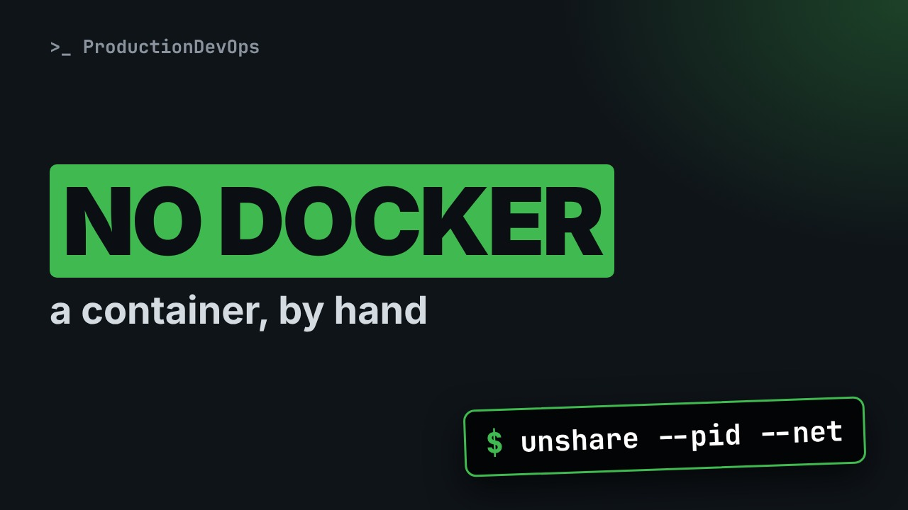
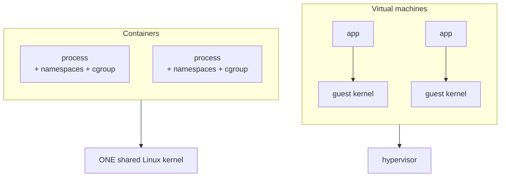

# What a Container Really Is: Namespaces and cgroups by Hand



**Video:** https://youtu.be/i7dqLhTH69c

A container is not a small virtual machine. It is a normal Linux process with its own view of the system (namespaces) and its own limits (cgroups). We build one by hand with unshare and nsenter, join an existing container's namespaces like the containers of a Kubernetes Pod do, and watch the kernel kill a process that goes over its memory limit, with exit code 137. Part 1 of the Kubernetes Path.

## Files in this folder

- [`alloc.py`](alloc.py)
- [`challenge-solution.sh`](challenge-solution.sh) (solution of the challenge: try it yourself first)

## What you need

A Kubernetes cluster you can break: a local [kind](https://kind.sigs.k8s.io/) cluster with one control plane and two workers is what the video uses, plus `kubectl`. Never run these commands against a cluster that matters.

## The lesson, step by step

The same explanations as the video, with every command. Read it, then run it yourself.

A container is not a small virtual machine. It is a normal Linux process, with a different view of the system, and a few limits. Let's build one by hand, with no Docker at all.

### The plan

This is part one of the Kubernetes Path. Here is the plan. First, the one difference between a container and a virtual machine that really matters. Then namespaces, by hand: our own processes, our own hostname, our own network. We join an existing container, exactly like the containers of a Kubernetes Pod do. And cgroups: we set a memory limit, and watch the kernel enforce it.

### Container vs VM

**One kernel, or many?**



A virtual machine runs its own kernel. A container does not: every container is a process on the same Linux kernel. Namespaces change what it can see. cgroups limit what it can use.

### PID namespace

First, how many processes can our normal shell see?

```console
$ ps -e --no-headers | wc -l
```

Now the same check in a new PID namespace. unshare runs a command in new namespaces. Dash dash pid, with fork, and mount proc so ps reads the new view.

```console
$ unshare --pid --fork --mount-proc ps -e
```

Inside, ps is process number one, and it sees nothing else. The host processes are still there. It just cannot see them.

### Hostname and network

The UTS namespace holds the hostname. In a new one, we can rename the machine.

```console
$ unshare --uts bash -c 'hostname node01; hostname'
```

Did the host change? We check without printing its real name.

```console
$ [ "$(hostname)" = node01 ] && echo changed || echo 'host name unchanged'
```

Now the network. Here are the interfaces our shell can see: name and state.

```console
$ ip -brief link | awk '{print $1, $2}'
```

And in a new network namespace?

```console
$ unshare --net ip -brief link | awk '{print $1, $2}'
```

Only the loopback, switched off. No route to anything. A container runtime now adds a virtual cable, and an address.

### Joining a namespace

Now a tiny container that keeps running: new hostname and network namespaces, renamed to box one, then a long sleep. The ampersand puts it in the background.

```console
$ unshare --uts --net bash -c 'hostname box1; exec sleep 600' &
```

nsenter enters the namespaces of a running process. Dash dash target takes its process ID. Dollar exclamation mark is the last background job.

```console
$ nsenter --target $! --uts hostname
```

And its network namespace: the same lonely loopback.

```console
$ nsenter --target $! --net ip -brief link | awk '{print $1, $2}'
```

This is how the containers of a Kubernetes Pod share one network. They join the same network namespace, so they reach each other on localhost. We stop the box.

```console
$ kill $!
```

### cgroups

Now the limits. cgroups come in two versions. The file system type of slash sys slash fs slash cgroup tells you which one you have.

```console
$ stat -fc %T /sys/fs/cgroup
```

This lab machine says tmpfs: cgroup version one, with one folder per controller. Most current distributions use version two. We show the version two commands in a moment.

```
# Allocate memory 10 MiB at a time, printing progress (used to hit a cgroup memory limit).
import sys

target = int(sys.argv[1])
chunks = []
for i in range(1, target // 10 + 1):
    chunks.append(bytearray(10 * 1024 * 1024))
    print(f"allocated {i * 10} MiB", flush=True)
print("done: no limit was reached")
```

A tiny test program. It allocates memory ten mebibytes at a time, up to the amount we pass, and keeps it. It prints its progress after each step, and a final line if it gets to the end.

A cgroup is a folder. We create one called demo, in the memory controller.

```console
$ mkdir -p /sys/fs/cgroup/memory/demo
```

The limit is a number in a file. We write fifty megabytes.

```console
$ echo 50M > /sys/fs/cgroup/memory/demo/memory.limit_in_bytes
```

The kernel stores it in bytes.

```console
$ cat /sys/fs/cgroup/memory/demo/memory.limit_in_bytes
```

A new shell writes its own process ID into the cgroup's process list, then becomes our program, asking for one hundred mebibytes.

```console
$ bash -c 'echo $$ > /sys/fs/cgroup/memory/demo/cgroup.procs; exec python3 alloc.py 100'
```

Killed, before reaching fifty. Nobody chose that. The kernel did, because the cgroup was full.

```console
$ echo $?
```

Exit code one three seven: one hundred twenty eight plus nine, and nine is the kill signal. In Kubernetes, this is exactly OOMKilled. The same program asking for thirty fits under the limit.

```console
$ bash -c 'echo $$ > /sys/fs/cgroup/memory/demo/cgroup.procs; exec python3 alloc.py 30'
```

We remove the empty cgroup.

```console
$ rmdir /sys/fs/cgroup/memory/demo
```

```
# cgroup v2: one unified tree, the memory limit file is memory.max
mkdir /sys/fs/cgroup/demo
echo 50M > /sys/fs/cgroup/demo/memory.max
echo $$ > /sys/fs/cgroup/demo/cgroup.procs
python3 alloc.py 100      # killed: exit code 137
```

On cgroup version two there is one tree. The folder is directly under slash sys slash fs slash cgroup, and the limit file is memory dot max. The rest is the same idea: put the process in the cgroup, and the kernel enforces the limit. The memory controller must be enabled for the parent, which it usually is.

### Why orchestration

So a container is a process, plus namespaces, plus cgroups. Running one is easy. Running hundreds raises new questions. Where does each container run, and on which machine? Who restarts it when it dies, or when a whole machine dies? How do containers find each other, and how do they scale? That is the job of an orchestrator. That is Kubernetes, and the rest of this path.

### Gotchas

Two facts worth remembering. All containers on a machine share one kernel. A kernel bug, or a kernel setting, affects all of them. And root inside a container is root on that kernel, unless user namespaces map it to a normal user. Run containers as non root.

### Recap

Let's recap. A container is a process, plus namespaces for its view, plus cgroups for its limits. unshare creates namespaces. nsenter joins existing ones. Over the memory limit, the kernel sends the kill signal: exit code one three seven. Your challenge: start a shell in new process and network namespaces, and prove from inside that it cannot see the host's processes or interfaces. The solution is in the demo repository.

A container is a process with its own view and its own limits. Next on the Kubernetes Path: containers and Kubernetes, explained for sysadmins. Subscribe to follow the whole path.

## All the commands, to copy

Run them from inside this folder, in this order (some are expected to fail: that is the point of the demo).

```bash
ps -e --no-headers | wc -l
unshare --pid --fork --mount-proc ps -e
unshare --uts bash -c 'hostname node01; hostname'
[ "$(hostname)" = node01 ] && echo changed || echo 'host name unchanged'
ip -brief link | awk '{print $1, $2}'
unshare --net ip -brief link | awk '{print $1, $2}'
unshare --uts --net bash -c 'hostname box1; exec sleep 600' &
nsenter --target $! --uts hostname
nsenter --target $! --net ip -brief link | awk '{print $1, $2}'
kill $!
stat -fc %T /sys/fs/cgroup
mkdir -p /sys/fs/cgroup/memory/demo
echo 50M > /sys/fs/cgroup/memory/demo/memory.limit_in_bytes
cat /sys/fs/cgroup/memory/demo/memory.limit_in_bytes
bash -c 'echo $$ > /sys/fs/cgroup/memory/demo/cgroup.procs; exec python3 alloc.py 100'
echo $?
bash -c 'echo $$ > /sys/fs/cgroup/memory/demo/cgroup.procs; exec python3 alloc.py 30'
rmdir /sys/fs/cgroup/memory/demo
```

## Challenge

Your challenge: start a shell in new process and network namespaces, and prove from inside that it cannot see the host's processes or interfaces. The solution is in the demo repository.

When you have tried: [`challenge-solution.sh`](challenge-solution.sh).

---

From the [ProductionDevOps](https://www.youtube.com/@production-devops) channel: real-world DevOps and SRE, explained with real commands.
