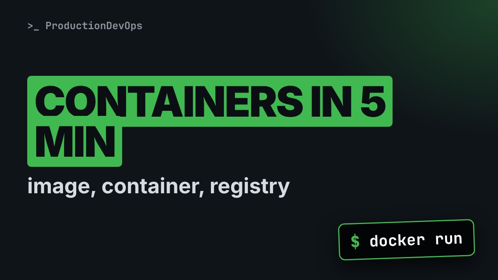
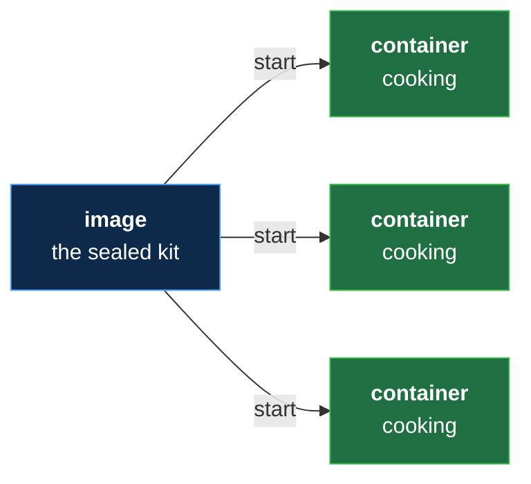
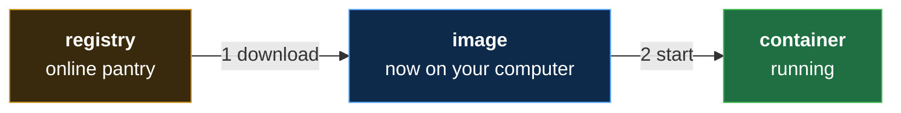
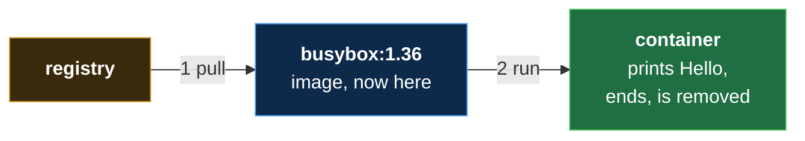

# Containers in Five Minutes: Image, Container, Registry (No Experience Needed)



**Video:** coming soon on the [channel](https://www.youtube.com/@production-devops).

Kubernetes runs containers, but what is a container, really? In five minutes, with one real command, this lesson of Kubernetes from Zero shows the three words you need: the image, the container and the registry. We start a container twice and see why the second time is different. No experience needed: every new word is explained on screen. The setup guide, the challenge and its solution are in the demos repo.

## Files in this folder

- [`challenge-solution.sh`](challenge-solution.sh) (solution of the challenge: try it yourself first)
- [`setup.md`](setup.md)

## What you need

A Linux shell (a VM, WSL or a container is fine). Everything runs inside this folder.

The outputs below were captured for real on the lab cluster. On yours, names, ages, IPs and ports will differ; everything else should match.

## The lesson, step by step

The same explanations as the video, with every command and its real output. Read it, then run it yourself.

Kubernetes runs containers. So today we run one container, for real, with one command. Watch the second run closely: something is missing.

For this lesson you need nothing. Just watch. To try it yourself, you need Docker. The setup guide is in the demo repo. About five minutes.

### The plan

This is lesson two of Kubernetes from Zero. First, the box: an image. Then the cooking: a container. Then the pantry: a registry. And finally, one real command, run twice.

### Image

- `image`: An app and everything it needs, packed and ready to start (like a sealed meal kit: the recipe and the ingredients in one box)
First word: image. An image is an app and everything it needs, packed and ready. Think of a sealed meal kit: recipe and ingredients in one box.

### Container

- `container`: An image that is running (like the meal kit being cooked: the dish on the stove)
In lesson one we met the container. Now we can say it exactly: a container is an image that is running. The meal kit, being cooked.

**One image, many containers**



From one image you can start many containers. They all cook the same dish, because they all come from the same kit.

### Registry

- `registry`: A place online that stores images, ready to download (like the pantry: the kits wait there until a kitchen asks for one)
Third word: registry. A registry stores images online, ready to download. It is the pantry: the kits wait there until a kitchen asks.

**From the pantry to the stove**



So the path is short. First, the image is downloaded from the registry to your computer. Then a container is started from it.

### So far

So far: an image is the packed app, a sealed kit. A container is an image that is running. A registry is where images are downloaded from. Next: one real command.

### One command

- `Docker`: A program that downloads images and runs containers (like the cook: takes a kit from the pantry, and cooks it)
To run a container, we use a program called Docker. It downloads images and runs containers. Docker is the cook.

```console
$ docker run --rm busybox:1.36 echo Hello from a container
```

Here is the command. We read it piece by piece.

- `docker run`: start a container
Docker run: start a new container.

- `--rm`: clean up when it ends
Dash dash r m: remove the container when it ends. The cook cleans up the plate.

- `busybox:1.36`: the image, version 1.36
The image: busybox, a tiny image of small tools. After the colon comes its version.

- `echo Hello from a container`: what it does inside
And what the container does: echo prints the words that follow. Then it ends.

### First run

Does it work? We type the command.

```console
$ docker run --rm busybox:1.36 echo Hello from a container
Unable to find image 'busybox:1.36' locally
1.36: Pulling from library/busybox
034d6572bf28: Pulling fs layer
5108bc06b83a: Download complete
034d6572bf28: Download complete
034d6572bf28: Pull complete
Digest: sha256:b167dc0c182b6aafb17bb7c945bf21ad085caadf5c063731aeac6f574223f632
Status: Downloaded newer image for busybox:1.36
Hello from a container
```

The first line says it: unable to find the image on this computer. So Docker pulls it, which means downloads it, from the registry. And the last line is the container speaking. Hello from a container.

**What just happened**



This is what happened. Docker pulled the image, started a container, and the container printed its line. Then it ended, and was removed.

### Second run

Now the same command, a second time. Look at what is missing.

```console
$ docker run --rm busybox:1.36 echo Hello from a container
Hello from a container
```

No download this time. The image was already on this computer, so the container starts right away.

### Good to know

The same image runs the same way on any computer that can run containers. Kubernetes runs exactly these images. It just runs them on many computers. Docker is one tool. Other tools can run the very same images.

### Recap

Recap: an image is a packed app. A container is an image that is running. Images are pulled from a registry, only the first time. Docker run downloads the image if needed, then starts a container. Your challenge: change the words after echo, and run it again. Is there a download? The answer is in the demo repo.

### Where next

Where next? Lesson three: a cluster, drawn step by step. We see where containers run when there are many computers. And then, a real cluster on your own computer.

Next lesson: a cluster, drawn, so you can picture where your containers run. Subscribe so you do not miss it.

## All the commands, to copy

Run them from inside this folder, in this order.

```bash
docker run --rm busybox:1.36 echo Hello from a container
```

## Challenge

Your challenge: change the words after echo, and run it again. Is there a download? The answer is in the demo repo.

When you have tried: [`challenge-solution.sh`](challenge-solution.sh).

---

From the [ProductionDevOps](https://www.youtube.com/@production-devops) channel: real-world DevOps and SRE, explained with real commands.
