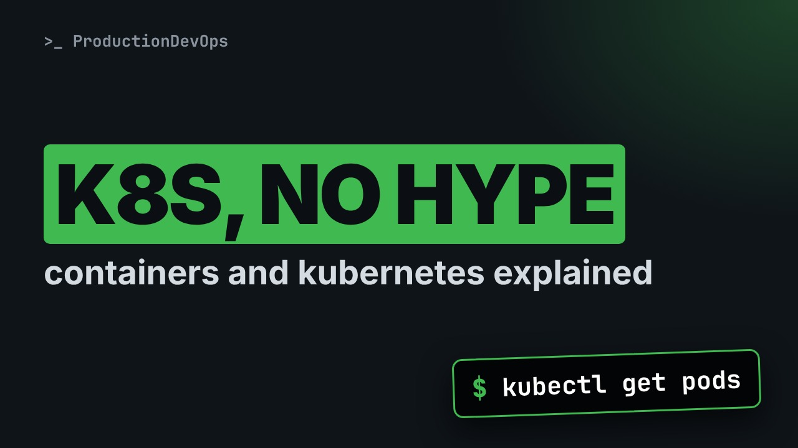
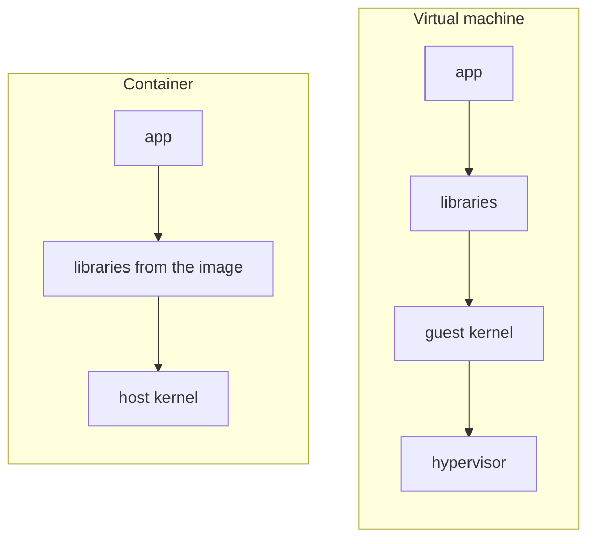
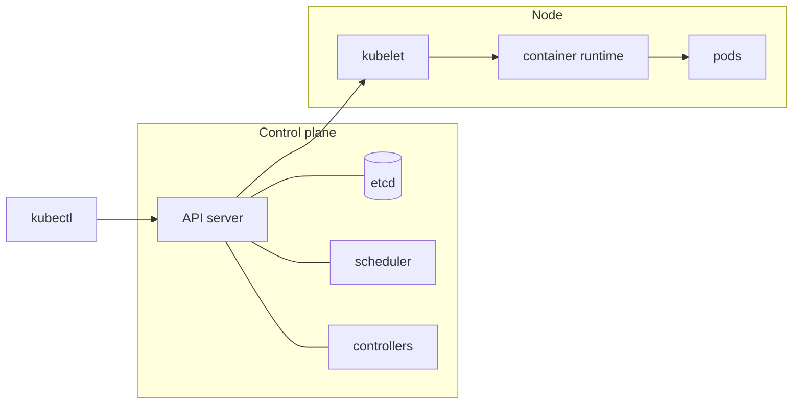

# Containers and Kubernetes Explained for Sysadmins (No Hype)



**Video:** https://youtu.be/Z7t-x6k1-VM

What a container really is, what Kubernetes adds on top, and when you do not need it at all. Explained for engineers who already run Linux servers: images, containers and registries, the cluster architecture, a first Deployment, and self-healing in action. This is part 1 of our hands-on Kubernetes series.

## What you need

A Kubernetes cluster you can break: a local [kind](https://kind.sigs.k8s.io/) cluster with one control plane and two workers is what the video uses, plus `kubectl`. Never run these commands against a cluster that matters.

The outputs below were captured for real on the lab cluster. On yours, names, ages, IPs and ports will differ; everything else should match.

## The lesson, step by step

The same explanations as the video, with every command and its real output. Read it, then run it yourself.

If you run Linux servers, you have heard containers and Kubernetes described as the answer to everything. Let's skip the hype. What are they, what problem does each one solve, and when do you not need them?

### The plan

Here is the plan. First, what a container really is. Then three words you need: image, container and registry, with real commands. Then what Kubernetes adds, and what a cluster looks like. We deploy a first app, watch it repair itself, and finish with when not to use Kubernetes at all.

### What a container is

Start with the most useful sentence of this whole topic: a container is a Linux process. It is a normal process on the server. It starts from an image: a package with the application and all the libraries it needs. Namespaces give that process its own private view of the files, the network and the users. Control groups limit how much CPU and memory it can use. There is no second operating system inside. It uses the kernel of the host. That is why it starts in a fraction of a second.

**Virtual machine vs container**



Compare it with a virtual machine. A VM brings its own complete kernel, on top of a hypervisor. A container brings only the app and its libraries, and uses the host kernel. Lighter and faster. The trade off: all containers share one kernel, so they are less isolated than VMs.

### Image, container, registry

Three words. An image is stored in a registry, a server for images. Pulling it downloads it to our machine.

```console
$ podman pull docker.io/library/alpine:3.20
Trying to pull docker.io/library/alpine:3.20...
Getting image source signatures
Copying blob 43c4264eed91 done
Copying config 91ef0af61f done
Writing manifest to image destination
```

podman images lists the images on this machine. Here is alpine, a very small Linux image.

```console
$ podman images
REPOSITORY                TAG    IMAGE ID      CREATED      SIZE
docker.io/library/alpine  3.20   91ef0af61f39  3 weeks ago  7.8 MB
```

Running an image creates a container: a process. This one only prints which operating system it sees.

```console
$ podman run --rm docker.io/library/alpine:3.20 cat /etc/os-release
NAME="Alpine Linux"
ID=alpine
VERSION_ID=3.20.3
PRETTY_NAME="Alpine Linux v3.20"
```

It sees Alpine Linux, the files from the image, not the host's files. The command finished, so the process ended, and dash dash r m removed the container. The image stays, ready for the next run.

### Why Kubernetes

One container on one server is easy. Kubernetes is for many containers, on many servers. Desired state. You describe what you want, for example three copies of this app. Kubernetes keeps working until reality matches. Scheduling. It picks which server runs each container, based on free resources. Self healing. When a container, or a whole server, dies, it starts replacements. Services. One stable name and address for a group of containers that keep moving around.

**The cluster at a glance**



A cluster has two parts. On the left, the control plane, the brain. You talk to its API server with kubectl. The desired state is saved in a database called etcd. The scheduler picks servers, and controllers keep comparing what you want with what is running. On the right, a node: a server that runs the work. Its agent, the kubelet, starts pods. A pod is the smallest unit: one container, or a few that live together.

### A first Deployment

This is what desired state looks like, in a YAML file. Let's read the important lines.

```
apiVersion: apps/v1
kind: Deployment
metadata: {name: web}
spec:
  replicas: 3
  selector: {matchLabels: {app: web}}
  template:
    metadata: {labels: {app: web}}
    spec:
      containers:
        - {name: web, image: docker.io/nginxinc/nginx-unprivileged:stable}
```

The kind is Deployment, named web. A Deployment keeps a number of identical pods running. replicas three: we want three copies. The template describes each pod: a label, app equals web, and the image to run. Notice what is missing: no server names, and no start commands. You describe the result, not the steps.

```
---
apiVersion: v1
kind: Service
metadata:
  name: web
spec:
  selector: {app: web}
  ports: [{port: 80, targetPort: 8080}]
```

In the same file, a Service, also called web. It gives the pods one stable name. It finds the pods by their label, app equals web, and forwards port eighty to port eighty eighty in the containers.

### Self-healing in action

We send the file to the API server with kubectl apply.

```console
$ kubectl apply -f web.yaml
deployment.apps/web created
service/web created
```

A few seconds later, kubectl get pods shows three pods, running.

```console
$ kubectl get pods
NAME                   READY   STATUS    RESTARTS   AGE
web-7c9d8b6f5d-4xk2p   1/1     Running   0          21s
web-7c9d8b6f5d-9wq7m   1/1     Running   0          21s
web-7c9d8b6f5d-tz5rb   1/1     Running   0          21s
```

Now we simulate a failure: we delete one pod, the first one, ending in four x k two p.

```console
$ kubectl delete pod web-7c9d8b6f5d-4xk2p
pod "web-7c9d8b6f5d-4xk2p" deleted
```

And we look again.

```console
$ kubectl get pods
NAME                   READY   STATUS    RESTARTS   AGE
web-7c9d8b6f5d-9wq7m   1/1     Running   0          58s
web-7c9d8b6f5d-q8m3n   1/1     Running   0          4s
web-7c9d8b6f5d-tz5rb   1/1     Running   0          58s
```

Three pods again. The deleted one is gone, and a new one, only four seconds old, took its place. Nobody typed a restart command. A controller saw two instead of three, and fixed it.

### Vocabulary

Let's fix the vocabulary. These five objects cover your first week. Pod: one or more containers, scheduled together. Deployment: keeps a number of identical pods running, and updates them. Service: a stable name and address for a set of pods. Namespace: like a folder, to group objects per team or per application. Node: a server that runs pods.

### When you do not need it

Kubernetes is powerful, but it has many moving parts to run and secure. Be honest about these cases. One or two services on a single server do not need a cluster. Podman with systemd already gives you automatic restarts and start at boot, with very little to learn. And a cluster needs people to upgrade it, renew its certificates, and back up etcd. If nobody owns that, it will hurt.

A container is a process from an image. Kubernetes keeps many of them in the state you described. In the next video of this series, we learn to read kubectl output like a pro. Subscribe to follow the series.

## All the commands, to copy

Run them from inside this folder, in this order.

```bash
podman pull docker.io/library/alpine:3.20
podman images
podman run --rm docker.io/library/alpine:3.20 cat /etc/os-release
kubectl apply -f web.yaml
kubectl get pods
kubectl delete pod web-7c9d8b6f5d-4xk2p
```

---

From the [ProductionDevOps](https://www.youtube.com/@production-devops) channel: real-world DevOps and SRE, explained with real commands.
