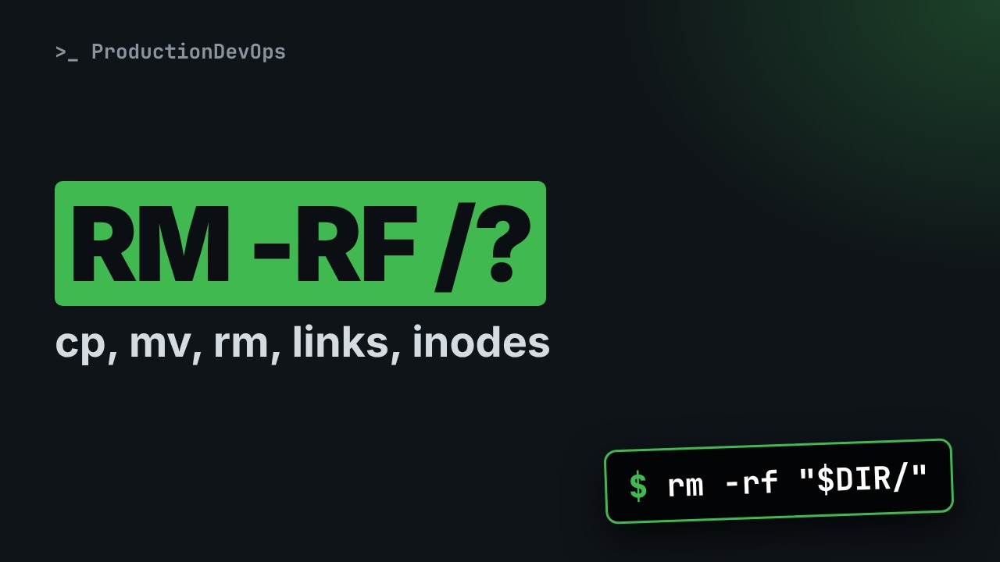
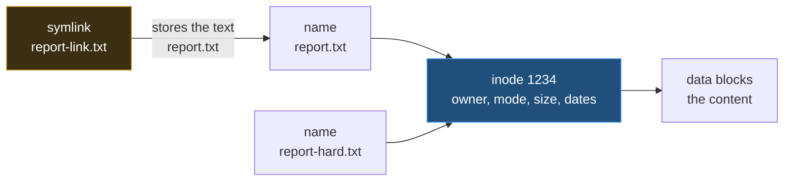

# cp, mv, rm and Links: The Traps, Hard Links vs Symlinks, and Inodes



**Video:** coming soon on the [channel](https://www.youtube.com/@production-devops).

One cp and the owner and dates of your files are gone. One mv and your file is renamed instead of moved. One rm with an empty variable and the path becomes /. In lesson 8 we prove, live and safely, the traps of cp, mv and rm (-r vs -a, running the same cp twice, the destination slash, rm -rf "$DIR/" and the :? guard), then what an inode is (ls -i, stat), hard links vs symbolic links, relative symlink targets, and what happens to each kind of link when you delete the original. Lesson 8 of Linux from User to Server Admin.

## Files in this folder

- [`acme-app/conf/app.conf`](acme-app/conf/app.conf)
- [`acme-app/logs/app.log`](acme-app/logs/app.log)
- [`links/.keep`](links/.keep)
- [`new.conf`](new.conf)
- [`old.conf`](old.conf)
- [`report.txt`](report.txt)
- [`challenge-solution.sh`](challenge-solution.sh) (solution of the challenge: try it yourself first)

## What you need

A Linux shell (a VM, WSL or a container is fine). Everything runs inside this folder.

## Before you start

The video runs these commands first, off screen:

```bash
id ops >/dev/null 2>&1 || useradd -M -s /usr/sbin/nologin ops
chown -R ops:ops acme-app; touch -d '2026-10-20 08:00' acme-app/*/* acme-app/* acme-app
```

## The lesson, step by step

The same explanations as the video, with every command. Read it, then run it yourself.

One cp, and the owner and dates of your files are gone. One rm with an empty variable, and the path starts at slash. We prove both safely, and at the end, a link that breaks the moment you create it.

### The plan

This is lesson 8 of Linux from User to Server Admin. First, three surprises from cp. Then mv, rm and the empty variable. Then inodes, hard links and symbolic links.

### cp

We copy the config to a backup.

```console
$ cp acme-app/conf/app.conf app.conf.bak
```

Which port is in the backup? grep finds the line: eight zero eight zero.

```console
$ grep port app.conf.bak
```

Now we copy another file onto the same name, and check again. No warning, and the backup is gone.

```console
$ cp new.conf app.conf.bak && grep port app.conf.bak
```

And a folder needs dash r, recursive, or cp skips it.

```console
$ cp acme-app acme-copy
```

Who owns the original, and since when? ops, since October twentieth.

```console
$ ls -l acme-app/conf/app.conf
```

A copy with dash r belongs to root, dated now. The history is lost.

```console
$ cp -r acme-app copy-r && ls -l copy-r/conf/app.conf
```

Dash a, archive, keeps owner, group, permissions and dates. Use it for backups.

```console
$ cp -a acme-app copy-a && ls -l copy-a/conf/app.conf
```

We copy conf to target. target does not exist, so it becomes the copy.

```console
$ cp -r acme-app/conf target
```

The same command again. Now target exists, so conf goes inside it.

```console
$ cp -r acme-app/conf target
```

What is in target now? ls dash capital R lists every level: the file twice.

```console
$ ls -R target
```

To copy only a folder's content, end the source with slash dot. Same result on every run.

```console
$ cp -r acme-app/conf/. inside && ls inside
```

Let's take stock. cp overwrites silently, and dash a keeps the history. If the destination folder exists, the copy goes inside. Next: mv, rm, and a link that is broken from the start.

### mv and rm

We move old dot conf into archive slash. The slash says: this must be a folder. It does not exist, so mv refuses.

```console
$ mv old.conf archive/
```

ls dash i shows the inode number, the file's ID.

```console
$ ls -i old.conf
```

Without the slash, mv renames the file to archive.

```console
$ mv old.conf archive
```

Same ID: on the same disk, mv only renames. No data is copied.

```console
$ ls -i archive
```

A script cleans BUILD_DIR slash out. What if the variable is empty, after a typo?

```console
$ BUILD_DIR=
```

echo shows the command after expansion, without running it. The path is now slash out, at the top of the disk.

```console
$ echo rm -rf "$BUILD_DIR/out"
```

The guard: dollar brace name, colon, question mark. Empty variable: the shell stops, and rm never runs.

```console
$ bash -c 'echo rm -rf "${BUILD_DIR:?}/out"'
```

### Inodes

**A name points to an inode**



The inode stores a file's facts: owner, mode, size, dates, and where the data is. A name only points to an inode, and a hard link is a second name for it. A symbolic link is a tiny file that stores a path, like a signpost.

### Links

ls dash l i: the inode number comes first. One name, so the link count is one.

```console
$ ls -li report.txt
```

ln, without options, creates a hard link: a second name.

```console
$ ln report.txt report-hard.txt
```

Same inode, and the link count is two. Neither is the original.

```console
$ ls -li report.txt report-hard.txt
```

Write through one name, read through the other: same data.

```console
$ echo "line 2" >> report-hard.txt && cat report.txt
```

ln dash s creates a symbolic link.

```console
$ ln -s report.txt report-link.txt
```

Its own inode, type l, and a size of ten bytes: the length of the text report dot txt.

```console
$ ls -li report-link.txt
```

Reading it follows the path to the file.

```console
$ cat report-link.txt
```

We delete report dot txt.

```console
$ rm report.txt
```

The hard link works: the data stays until the last name is gone.

```console
$ cat report-hard.txt
```

stat dash c prints the inode, percent i, and the link count, percent h: down to one.

```console
$ stat -c '%i %h %n' report-hard.txt
```

The symlink is dangling: the name it points to is gone.

```console
$ cat report-link.txt
```

The link from the start of the video: in the links folder, pointing to acme-app slash conf slash app dot conf.

```console
$ ln -s acme-app/conf/app.conf links/app.conf
```

It is broken already.

```console
$ cat links/app.conf
```

Why? readlink prints the stored text. A relative target starts from the link's folder, and links has no acme-app.

```console
$ readlink links/app.conf
```

Dash f replaces the link, with dot dot slash in front. Now it works.

```console
$ ln -sf ../acme-app/conf/app.conf links/app.conf && cat links/app.conf
```

When to use which. A hard link is the same inode, and survives deleting a name. It cannot cross filesystems or point to folders. A symlink stores a path, and can point anywhere. You see them everywhere: slash bin slash sh is dash on Ubuntu, bash on RHEL.

### Gotchas

Three traps to remember. One. Guard every rm on a variable, and use set dash u. Two. rm refuses slash itself, but not slash star. Three. Deleted a huge log, disk still full? A process still has it open.

### Recap

Let's recap. cp and mv overwrite silently. Dash a keeps the history. Slash on the destination, slash dot for contents, a guard before rm. A hard link is the same inode, a symlink a stored path. Your challenge: releases v1 and v2, and a symlink current to v2. Switch it to v1 with one ln command, and explain why it needs dash n. The solution is in the demo repository.

Now you can copy without losing history, and you know what a link really is. Next lesson: finding files with find, and the dash o trap almost everyone writes. Subscribe to follow the course.

## All the commands, to copy

Run them from inside this folder, in this order (some are expected to fail: that is the point of the demo).

```bash
cp acme-app/conf/app.conf app.conf.bak
grep port app.conf.bak
cp new.conf app.conf.bak && grep port app.conf.bak
cp acme-app acme-copy
ls -l acme-app/conf/app.conf
cp -r acme-app copy-r && ls -l copy-r/conf/app.conf
cp -a acme-app copy-a && ls -l copy-a/conf/app.conf
cp -r acme-app/conf target
ls -R target
cp -r acme-app/conf/. inside && ls inside
mv old.conf archive/
ls -i old.conf
mv old.conf archive
ls -i archive
BUILD_DIR=
echo rm -rf "$BUILD_DIR/out"
bash -c 'echo rm -rf "${BUILD_DIR:?}/out"'
ls -li report.txt
ln report.txt report-hard.txt
ls -li report.txt report-hard.txt
echo "line 2" >> report-hard.txt && cat report.txt
ln -s report.txt report-link.txt
ls -li report-link.txt
cat report-link.txt
rm report.txt
cat report-hard.txt
stat -c '%i %h %n' report-hard.txt
ln -s acme-app/conf/app.conf links/app.conf
cat links/app.conf
readlink links/app.conf
ln -sf ../acme-app/conf/app.conf links/app.conf && cat links/app.conf
```

## Challenge

Your challenge: releases v1 and v2, and a symlink current to v2. Switch it to v1 with one ln command, and explain why it needs dash n. The solution is in the demo repository.

When you have tried: [`challenge-solution.sh`](challenge-solution.sh).

---

From the [ProductionDevOps](https://www.youtube.com/@production-devops) channel: real-world DevOps and SRE, explained with real commands.
