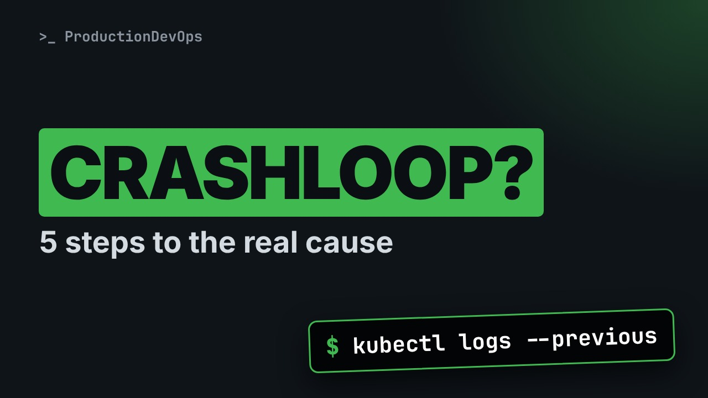
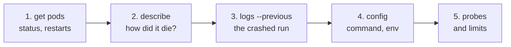

# CrashLoopBackOff: The 5-Step Routine to Find the Real Cause



**Video:** https://youtu.be/wk2GcCCF0kw

A pod in CrashLoopBackOff is a symptom, not a diagnosis, and restarting it destroys the evidence. We follow a 5-step routine on a broken Deployment: pod status, last state and exit code, logs of the previous container, configuration, and probes. Then we fix it and verify the rollout.

## What you need

A Kubernetes cluster you can break: a local [kind](https://kind.sigs.k8s.io/) cluster with one control plane and two workers is what the video uses, plus `kubectl`. Never run these commands against a cluster that matters.

The outputs below were captured for real on the lab cluster. On yours, names, ages, IPs and ports will differ; everything else should match.

## The lesson, step by step

The same explanations as the video, with every command and its real output. Read it, then run it yourself.

You get paged: a pod is in CrashLoopBackOff. The tempting move is to delete it and hope. That destroys the evidence. Here is a calm, five step routine that finds the real cause.

### The plan

Here is the plan. First, what CrashLoopBackOff means, in plain words. Then the five step routine, on a real broken app. We fix it, and verify the fix. And what to check when the logs show nothing wrong.

### What it means

The name sounds scary, but it means something simple. Crash: the container starts, and then exits. Loop: Kubernetes starts it again. It exits again. Back off: between attempts, Kubernetes waits longer and longer, up to five minutes. So it is a symptom, not a cause. The cause is in why the container exits.

### The routine

**Five steps, always in this order**



Five steps, always in this order. One: status. Two: how did it die. Three: the logs of the run that crashed. Four: the configuration it was started with. Five: probes and limits. Let's do it.

### 1. Status

Here is our patient.

```console
$ kubectl get pods -l app=api
NAME                  READY   STATUS             RESTARTS      AGE
api-7f9c6d5b8-k2x9p   0/1     CrashLoopBackOff   5 (41s ago)   3m40s
```

Five restarts in under four minutes, and never ready: zero of one. It dies right after starting. So we look at what happens at startup.

### 2. How did it die?

kubectl describe shows the full story of the pod. Here grep keeps only the part called last state: how the previous run ended.

```console
$ kubectl describe pod api-7f9c6d5b8-k2x9p | grep -A4 'Last State'
Last State:     Terminated
  Reason:       Error
  Exit Code:    1
  Started:      Tue, 20 Oct 2026 10:52:14 +0200
  Finished:     Tue, 20 Oct 2026 10:52:15 +0200
```

Exit code one, one second after it started. The app itself decided to stop. Nothing killed it from outside.

The exit code is the most useful number on that screen. Four values cover most cases. One, or another small number: the app exited by itself. The answer is in its logs. One three seven: the process was killed. Often because it used too much memory. One four three: it was asked to stop, and it stopped. One two six, or one two seven: the start command cannot run, or does not exist.

### 3. Logs of the crash

Now the logs. This is where most people look at the wrong run.

```console
$ kubectl logs api-7f9c6d5b8-k2x9p
2026-10-20T08:52:58Z INFO starting api v1.4.2
```

Only one start line. We caught a new run that just started. The run that crashed is the previous one. dash dash previous shows it.

```console
$ kubectl logs api-7f9c6d5b8-k2x9p --previous
2026-10-20T08:52:14Z INFO starting api v1.4.2
2026-10-20T08:52:14Z INFO loading configuration
2026-10-20T08:52:15Z ERROR required setting DATABASE_URL is not set
2026-10-20T08:52:15Z ERROR exiting with status 1
```

There is the reason: a required setting, DATABASE URL, is missing.

### 4. Configuration

Let's confirm it in the configuration. With jsonpath, from the previous video, we print only the environment variables of the container.

```console
$ kubectl get deploy api -o jsonpath='{.spec.template.spec.containers[0].env}'
[{"name":"LOG_LEVEL","value":"info"}]
```

Only the log level. The database setting was never added. Probably lost when the file was copied from another environment.

### The fix

The connection string already exists in a secret called api db. kubectl set env loads it into the Deployment.

```console
$ kubectl set env deployment/api --from=secret/api-db
deployment.apps/api env updated
```

Changing the Deployment starts a rollout: new pods replace the old ones. We wait for it to finish.

```console
$ kubectl rollout status deployment/api --timeout=120s
Waiting for deployment "api" rollout to finish: 1 old replicas are pending termination...
deployment "api" successfully rolled out
```

And the final check.

```console
$ kubectl get pods -l app=api
NAME                   READY   STATUS    RESTARTS   AGE
api-5c8b7f6d94-r7tqm   1/1     Running   0          38s
```

Running, ready, zero restarts. Fixed, and we know exactly why it broke.

### 5. When logs look fine

Sometimes the previous logs show nothing wrong. Then something outside stopped the container. Check these. Exit one three seven, with the reason OOMKilled: the memory limit is too low, or the app leaks memory. A liveness probe is a regular health check. If it is too strict, it kills an app that is just slow to start. Look for Unhealthy events in describe. And always: do not delete the pod first. Collect status, exit code and previous logs, then act.

### Recap

Let's recap the routine. One. Get pods: status and restarts. Two. Describe: last state and exit code. Three. Logs, with previous: the run that crashed. Four, the configuration. And five, probes and limits.

Five steps, a few minutes, and you fix the cause instead of the symptom. Subscribe for the rest of the Kubernetes in practice series.

## All the commands, to copy

Run them from inside this folder, in this order.

```bash
kubectl get pods -l app=api
kubectl describe pod api-7f9c6d5b8-k2x9p | grep -A4 'Last State'
kubectl logs api-7f9c6d5b8-k2x9p
kubectl logs api-7f9c6d5b8-k2x9p --previous
kubectl get deploy api -o jsonpath='{.spec.template.spec.containers[0].env}'
kubectl set env deployment/api --from=secret/api-db
kubectl rollout status deployment/api --timeout=120s
```

---

From the [ProductionDevOps](https://www.youtube.com/@production-devops) channel: real-world DevOps and SRE, explained with real commands.
