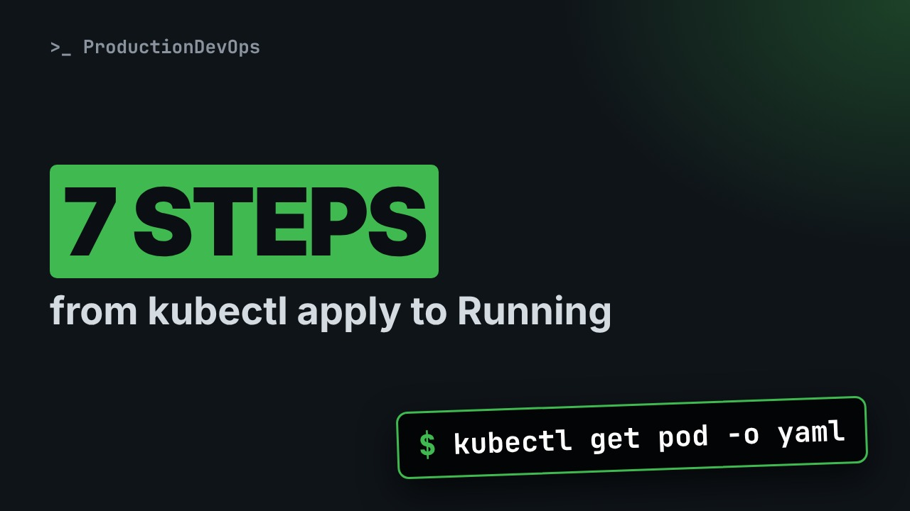
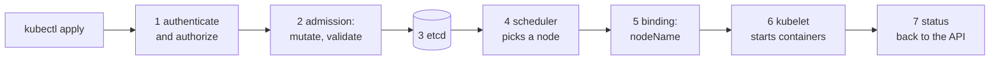

# What Happens When You Create a Pod: The Full Journey



**Video:** https://youtu.be/Oe54tngxiyk

Nine lines of YAML go in, a much longer object comes back. We follow one Pod through every step of its creation on a real cluster: authentication and authorization, validation, the defaults added by admission, the write to etcd, the scheduler's binding, the kubelet, and the status reported back. Then which Pod fields you can still change in place, which ones you cannot, and the documentation built into kubectl. Lesson 3 of Kubernetes Deep Dive.

## Files in this folder

- [`broken.yaml`](broken.yaml)
- [`web.yaml`](web.yaml)
- [`web2.yaml`](web2.yaml)
- [`challenge-solution.sh`](challenge-solution.sh) (solution of the challenge: try it yourself first)

## What you need

A Kubernetes cluster you can break: a local [kind](https://kind.sigs.k8s.io/) cluster with one control plane and two workers is what the video uses, plus `kubectl`. Never run these commands against a cluster that matters.

The outputs below were captured for real on the lab cluster. On yours, names, ages, IPs and ports will differ; everything else should match.

## The lesson, step by step

The same explanations as the video, with every command and its real output. Read it, then run it yourself.

Nine lines of YAML go in. A much longer object comes back. Between the two, seven steps change your Pod, and each one leaves a trace you can read.

### The plan

This is lesson three of Kubernetes Deep Dive. Here is the plan. First, the seven steps of one Pod creation, in order. Then what the API server refuses, and what it adds to your YAML. We watch the scheduler and the kubelet write into the Pod, live. And finally, what you can still change on a running Pod, and the documentation inside kubectl.

### The journey

**Seven steps, three writers**



In the Path we followed the events. Here we look inside the object. The API server checks, completes and stores the Pod. The scheduler writes a node. The kubelet starts the containers and writes the status.

```
apiVersion: v1
kind: Pod
metadata:
  name: web
  namespace: dive
spec:
  containers:
    - name: nginx
      image: nginx:1.27
```

A Pod called web, in a namespace called dive, created just for this lesson. One container with a fixed image tag. Nothing else. Keep this short list in mind.

### Authn and authz

First, who does the API server think we are? kubectl auth whoami asks the server itself.

```console
$ kubectl auth whoami
ATTRIBUTE                                           VALUE
Username                                            kubernetes-admin
Groups                                              [kubeadm:cluster-admins system:authenticated]
Extra: authentication.kubernetes.io/credential-id   [X509SHA256=e2fc6291d2bc32adee727d213e9be3345d524bd19e60c57cf17cab8d77b5f4fa]
```

That was authentication. Next comes authorization. May this user create Pods in the namespace dive?

```console
$ kubectl auth can-i create pods -n dive
yes
```

### Admission

This second file has a container without an image. Dash dash dry run equals server sends it through every step, but stores nothing.

```console
$ kubectl apply -f broken.yaml --dry-run=server
The Pod "broken" is invalid: spec.containers[0].image: Required value
```

Now our good file, again as a server dry run.

```console
$ kubectl apply -f web.yaml --dry-run=server
pod/web created (server dry run)
```

And yet, the namespace is still empty. A dry run never reaches etcd.

```console
$ kubectl get pods -n dive
No resources found in dive namespace.
```

Now we create the Pod for real.

```console
$ kubectl apply -f web.yaml
pod/web created
```

We read it back, and keep only a few fields of the spec. We never wrote any of them.

```console
$ kubectl get pod web -n dive -o yaml | grep -E '^  (dnsPolicy|enableServiceLinks|preemptionPolicy|priority|restartPolicy|schedulerName|serviceAccountName|terminationGracePeriodSeconds):'
  dnsPolicy: ClusterFirst
  enableServiceLinks: true
  preemptionPolicy: PreemptLowerPriority
  priority: 0
  restartPolicy: Always
  schedulerName: default-scheduler
  serviceAccountName: default
  terminationGracePeriodSeconds: 30
```

The restart policy, the scheduler to use, the service account, thirty seconds to stop gracefully. Your nine lines became a complete object.

Two tolerations we never wrote. Jsonpath prints the key, the effect and a number of seconds for each.

```console
$ kubectl get pod web -n dive -o jsonpath='{range .spec.tolerations[*]}{.key}{" "}{.effect}{" "}{.tolerationSeconds}{"\n"}{end}'
node.kubernetes.io/not-ready NoExecute 300
node.kubernetes.io/unreachable NoExecute 300
```

If the node becomes not ready, or unreachable, the Pod stays for that many seconds before it is evicted. And a volume we never asked for.

```console
$ kubectl get pod web -n dive -o jsonpath='{.spec.volumes[*].name}{"\n"}'
kube-api-access-mq56p
```

The service account plugin mounts a short lived token, the cluster certificate and the namespace name into every container.

### Stored

The API server also wrote metadata of its own.

```console
$ kubectl get pod web -n dive -o custom-columns=UID:.metadata.uid,VERSION:.metadata.resourceVersion,CREATED:.metadata.creationTimestamp
UID                                    VERSION   CREATED
d48a1ba8-6105-43ef-a3c1-287da9d6b4a7   9781      2026-10-22T14:00:10Z
```

The uid is unique forever, even if you create another Pod with the same name. The resource version changes at every write. Who wrote which fields? Dash dash show managed fields reveals the list. We keep the writers only.

```console
$ kubectl get pod web -n dive -o yaml --show-managed-fields | grep -E '^    (manager|operation|subresource):'
    manager: kubectl-client-side-apply
    operation: Update
    manager: kubelet
    operation: Update
    subresource: status
```

kubectl wrote the spec. The kubelet writes the status, through its own subresource.

### Scheduler and kubelet

Now a second Pod, watched live. Dash dash output watch events prints each change as it happens. Awk keeps four columns.

```console
$ timeout 25 kubectl get pods -n dive -l step=watch -w --output-watch-events -o wide | awk '{printf "%-9s %-5s %-18s %s\n", $1, $2, $4, $8}'
EVENT     NAME  STATUS             NODE
ADDED     web2  Pending            <none>
MODIFIED  web2  Pending            lab-worker
MODIFIED  web2  ContainerCreating  lab-worker
MODIFIED  web2  ContainerCreating  lab-worker
MODIFIED  web2  Running            lab-worker
```

First the Pod is added, without a node. Then a modification gives it a node: that is the scheduler. Then the kubelet on that node takes over: container creating, then running. The scheduler starts nothing. It writes one binding: this Pod goes to this node.

```console
$ kubectl get events -n dive --field-selector involvedObject.name=web2,reason=Scheduled -o custom-columns=FROM:.reportingComponent,MESSAGE:.message
FROM                MESSAGE
default-scheduler   Successfully assigned dive/web2 to lab-worker
```

### Status

The kubelet reports the phase and the Pod IP. The QoS class was computed by the API server from requests and limits.

```console
$ kubectl get pod web -n dive -o jsonpath='{.status.phase}{" "}{.status.podIP}{" "}{.status.qosClass}{"\n"}'
Running 192.0.2.10 BestEffort
```

No requests, no limits: best effort. Lesson six explains why that matters. The conditions are the Pod's checklist: each one has a status, and the time it last changed.

```console
$ kubectl get pod web -n dive -o jsonpath='{range .status.conditions[*]}{.type}{" "}{.status}{" "}{.lastTransitionTime}{"\n"}{end}'
PodReadyToStartContainers True 2026-10-22T14:00:11Z
Initialized True 2026-10-22T14:00:10Z
Ready True 2026-10-22T14:00:11Z
ContainersReady True 2026-10-22T14:00:11Z
PodScheduled True 2026-10-22T14:00:10Z
```

One object, several writers. Each one owns its part. You write the spec. The API server and its admission plugins add defaults, the uid and the versions. The scheduler writes only the node name, through a binding. And the kubelet writes the status.

### Changing a Pod

A running Pod accepts a few changes. The image is one of them.

```console
$ kubectl set image pod/web nginx=nginx:1.28 -n dive
pod/web image updated
```

The kubelet restarts the container with the new image. Same Pod, one restart.

```console
$ kubectl get pod web -n dive -o jsonpath='{.spec.containers[0].image}{" restarts="}{.status.containerStatuses[0].restartCount}{"\n"}'
nginx:1.28 restarts=1
```

A deadline is another one. Active deadline seconds stops the Pod after that many seconds.

```console
$ kubectl patch pod web -n dive -p '{"spec":{"activeDeadlineSeconds":3600}}'
pod/web patched
```

Now we try to add an environment variable. We print only the first line of the error, one item per line.

```console
$ kubectl patch pod web -n dive -p '{"spec":{"containers":[{"name":"nginx","env":[{"name":"MODE","value":"debug"}]}]}}' 2>&1 | head -n 1 | tr ',' '\n'
The Pod "web" is invalid: spec: Forbidden: pod updates may not change fields other than `spec.containers[*].image`
`spec.initContainers[*].image`
`spec.activeDeadlineSeconds`
`spec.tolerations` (only additions to existing tolerations)
`spec.terminationGracePeriodSeconds` (allow it to be set to 1 if it was previously negative)
```

Environment, ports, volumes, the restart policy: all fixed once the Pod exists. You replace the Pod instead. CPU and memory are a special case. Recent versions resize them in place through a separate subresource, in lesson twenty.

### Built-in docs

kubectl explain reads the schema from your own cluster, so it always matches its version.

```console
$ kubectl explain pod.spec.restartPolicy | head -n 12
KIND:       Pod
VERSION:    v1

FIELD: restartPolicy <string>
ENUM:
    Always
    Never
    OnFailure

DESCRIPTION:
    Restart policy for all containers within the pod. One of Always, OnFailure,
    Never. In some contexts, only a subset of those values may be permitted.
```

Dash dash recursive prints the whole tree of a field. Sed keeps the field list.

```console
$ kubectl explain pod.spec.containers.resources --recursive | sed -n '/^FIELDS/,$p'
FIELDS:
  claims	<[]ResourceClaim>
    name	<string> -required-
    request	<string>
  limits	<map[string]Quantity>
  requests	<map[string]Quantity>
```

We clean up: deleting the namespace deletes both Pods.

```console
$ kubectl delete namespace dive
namespace "dive" deleted
```

### Gotchas

Three traps to remember. Your YAML is not what runs. Read the object back before you debug it. A client dry run only checks the file locally. A server dry run goes through admission too. Pods are mostly immutable. Change the Deployment that owns them, and let it replace the Pod.

### Recap

Let's recap. The API server authenticates, authorizes, runs admission, and stores the Pod. The scheduler binds a node. The kubelet runs the containers and writes the status. In place you may change the image, the deadline, and add tolerations. Your challenge: give a running Pod an extra toleration, then try to remove it. Which step refuses, and what does the error say? The solution is in the demo repository.

Never trust the YAML you sent: read back what the cluster stored. Next in Kubernetes Deep Dive: ReplicaSets and Deployments, the control loop that replaces Pods for you. Subscribe to follow the course.

## All the commands, to copy

Run them from inside this folder, in this order.

```bash
kubectl auth whoami
kubectl auth can-i create pods -n dive
kubectl apply -f broken.yaml --dry-run=server
kubectl apply -f web.yaml --dry-run=server
kubectl get pods -n dive
kubectl apply -f web.yaml
kubectl get pod web -n dive -o yaml | grep -E '^  (dnsPolicy|enableServiceLinks|preemptionPolicy|priority|restartPolicy|schedulerName|serviceAccountName|terminationGracePeriodSeconds):'
kubectl get pod web -n dive -o jsonpath='{range .spec.tolerations[*]}{.key}{" "}{.effect}{" "}{.tolerationSeconds}{"\n"}{end}'
kubectl get pod web -n dive -o jsonpath='{.spec.volumes[*].name}{"\n"}'
kubectl get pod web -n dive -o custom-columns=UID:.metadata.uid,VERSION:.metadata.resourceVersion,CREATED:.metadata.creationTimestamp
kubectl get pod web -n dive -o yaml --show-managed-fields | grep -E '^    (manager|operation|subresource):'
timeout 25 kubectl get pods -n dive -l step=watch -w --output-watch-events -o wide | awk '{printf "%-9s %-5s %-18s %s\n", $1, $2, $4, $8}'
kubectl get events -n dive --field-selector involvedObject.name=web2,reason=Scheduled -o custom-columns=FROM:.reportingComponent,MESSAGE:.message
kubectl get pod web -n dive -o jsonpath='{.status.phase}{" "}{.status.podIP}{" "}{.status.qosClass}{"\n"}'
kubectl get pod web -n dive -o jsonpath='{range .status.conditions[*]}{.type}{" "}{.status}{" "}{.lastTransitionTime}{"\n"}{end}'
kubectl set image pod/web nginx=nginx:1.28 -n dive
kubectl get pod web -n dive -o jsonpath='{.spec.containers[0].image}{" restarts="}{.status.containerStatuses[0].restartCount}{"\n"}'
kubectl patch pod web -n dive -p '{"spec":{"activeDeadlineSeconds":3600}}'
kubectl patch pod web -n dive -p '{"spec":{"containers":[{"name":"nginx","env":[{"name":"MODE","value":"debug"}]}]}}' 2>&1 | head -n 1 | tr ',' '\n'
kubectl explain pod.spec.restartPolicy | head -n 12
kubectl explain pod.spec.containers.resources --recursive | sed -n '/^FIELDS/,$p'
kubectl delete namespace dive
```

## Challenge

Your challenge: give a running Pod an extra toleration, then try to remove it. Which step refuses, and what does the error say? The solution is in the demo repository.

When you have tried: [`challenge-solution.sh`](challenge-solution.sh).

---

From the [ProductionDevOps](https://www.youtube.com/@production-devops) channel: real-world DevOps and SRE, explained with real commands.
