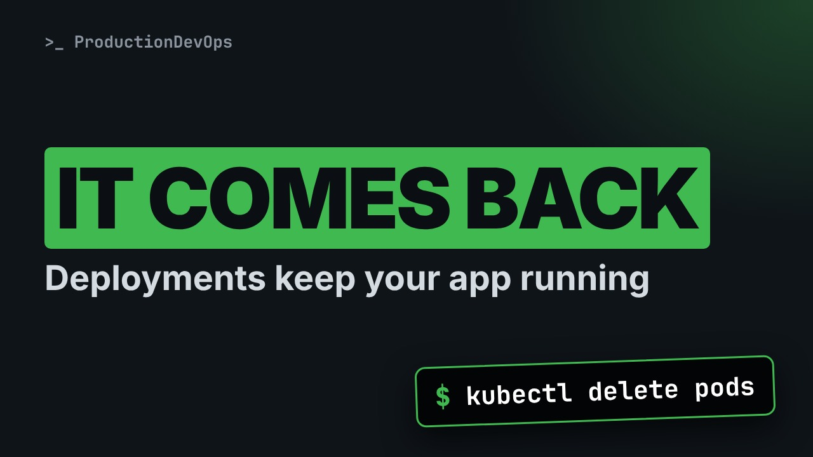
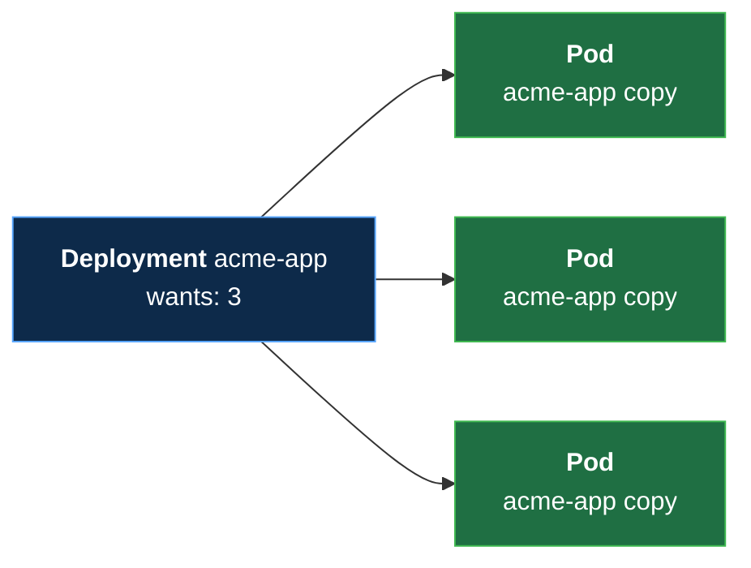
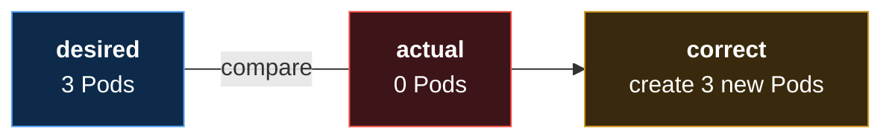

# Kubernetes Deployments: Delete Your Pods and Watch Them Come Back (No Experience Needed)



**Video:** coming soon on the [channel](https://www.youtube.com/@production-devops).

A single Pod that stops stays stopped. This lesson of Kubernetes from Zero shows the Deployment, the standing order that keeps three copies of your app running, always. We read its YAML file line by line, delete all the Pods on purpose and watch new ones appear, then change one number in the file to get more copies. No experience needed: every new word is explained on screen. The file, the challenge and its solution are in the demos repo.

## Files in this folder

- [`acme-app.yaml`](acme-app.yaml)
- [`challenge-solution.sh`](challenge-solution.sh) (solution of the challenge: try it yourself first)
- [`cleanup.sh`](cleanup.sh)

## What you need

A Linux shell (a VM, WSL or a container is fine). Everything runs inside this folder.

The outputs below were captured for real on the lab cluster. On yours, names, ages, IPs and ports will differ; everything else should match.

## The lesson, step by step

The same explanations as the video, with every command and its real output. Read it, then run it yourself.

A single Pod is fragile. If it stops, it stays stopped. Today we delete our app on purpose, and watch it come back by itself.

You need nothing. You can just watch. To follow along, use the practice cluster from lesson four. You already know two commands: kubectl get, and kubectl apply dash f.

### The plan

This is lesson six of Kubernetes from Zero. First, a standing order, called a Deployment. Then its file, line by line. Then we delete the Pods, and watch them come back. And we get more copies by changing one number.

### The Deployment

- `Deployment`: An order to keep a number of identical Pods running, always (like a standing order: three trays of acme-app, every day)
New word: Deployment. A Deployment keeps a number of identical Pods running, always. It is a standing order: three trays, every day.

**One order, three Pods**



The Deployment is the order on the board, from lesson three. It wants three Pods, and the control loop keeps three running.

### The file

Here is the whole file, in four parts.

```
apiVersion: apps/v1
kind: Deployment
metadata:
  name: acme-app
spec:
  replicas: 3
  selector:
    matchLabels:
      app: acme-app
  template:
    metadata:
      labels:
        app: acme-app
    spec:
      containers:
        - name: web
          image: nginx:1.27-alpine
```

What it is, and its name. How many copies. Which Pods are its own. And the Pod to copy.

```
apiVersion: apps/v1
kind: Deployment
metadata:
  name: acme-app
spec:
  replicas: 3
```

Kind Deployment. Deployments use the form apps slash v one. Its name is acme app, like our Pod in lesson five. Replicas is the number of copies we want: three.

- `label`: A name tag on a Pod, such as app: acme-app (like a sticker on each tray: this one is acme-app)
To know which Pods are its own, the Deployment uses labels. A label is a name tag, like a sticker on each tray.

```
  selector:
    matchLabels:
      app: acme-app
```

The selector says which Pods belong to this Deployment: those whose labels match. Here: every Pod with the label app, equals acme app.

```
  template:
    metadata:
      labels:
        app: acme-app
    spec:
      containers:
        - name: web
          image: nginx:1.27-alpine
```

Template: the Pod that the Deployment copies, three times. Each copy gets the label app, equals acme app. The same sticker the selector looks for. And this part is the Pod from lesson five: one container, web, running nginx.

All together: keep three copies of this Pod, and find them by their label. Now we apply it.

```
apiVersion: apps/v1
kind: Deployment
metadata:
  name: acme-app
spec:
  replicas: 3
  selector:
    matchLabels:
      app: acme-app
  template:
    metadata:
      labels:
        app: acme-app
    spec:
      containers:
        - name: web
          image: nginx:1.27-alpine
```

### Three copies

We apply the file, like in lesson five.

```console
$ kubectl apply -f acme-app.yaml
deployment.apps/acme-app created
```

And we look at the Pods.

```console
$ kubectl get pods
NAME                        READY   STATUS    RESTARTS   AGE
acme-app-7747ffb7d6-7j8d5   1/1     Running   0          30s
acme-app-7747ffb7d6-9frqw   1/1     Running   0          30s
acme-app-7747ffb7d6-bvdgx   1/1     Running   0          30s
```

Each name starts with acme app, then two random parts. The Deployment made them.

### Delete them

```console
$ kubectl delete pods -l app=acme-app
```

Now the one new command of this lesson.

- `kubectl delete`: remove something
Kubectl delete: remove something from the cluster.

- `pods`: what: Pods
Pods: what we remove.

- `-l app=acme-app`: only Pods with this label
Dash l, for label: only the Pods with the sticker app, equals acme app.

We delete all three Pods. Will the app be gone?

```console
$ kubectl delete pods -l app=acme-app
pod "acme-app-7747ffb7d6-7j8d5" deleted from default namespace
pod "acme-app-7747ffb7d6-9frqw" deleted from default namespace
pod "acme-app-7747ffb7d6-bvdgx" deleted from default namespace
```

A few seconds later, we look again.

```console
$ kubectl get pods
NAME                        READY   STATUS    RESTARTS   AGE
acme-app-7747ffb7d6-fx9k2   1/1     Running   0          6s
acme-app-7747ffb7d6-hlnmz   1/1     Running   0          6s
acme-app-7747ffb7d6-vsgr6   1/1     Running   0          6s
```

Look at the names and the age: these are new Pods, a few seconds old.

**The loop, at work**



This is the control loop from lesson three. Three wanted, none running, so three new Pods were created.

### So far

So far: a Deployment keeps a number of Pods running. Delete its Pods, and new ones take their place. Next: more copies, by changing one number in the file.

### More copies

```
spec:
  replicas: 5
```

In the file, we change replicas from three to five. Nothing else.

We apply the changed file.

```console
$ kubectl apply -f acme-app.yaml
deployment.apps/acme-app configured
```

And we look at the Pods.

```console
$ kubectl get pods
NAME                        READY   STATUS    RESTARTS   AGE
acme-app-7747ffb7d6-9f62l   1/1     Running   0          4s
acme-app-7747ffb7d6-fx9k2   1/1     Running   0          11s
acme-app-7747ffb7d6-hlnmz   1/1     Running   0          11s
acme-app-7747ffb7d6-tczvq   1/1     Running   0          4s
acme-app-7747ffb7d6-vsgr6   1/1     Running   0          11s
```

### Delete the order

Last, we delete the Deployment itself, with the same command.

```console
$ kubectl delete deployment acme-app
deployment.apps "acme-app" deleted from default namespace
```

Now the Pods go, and nobody brings them back.

```console
$ kubectl get pods
No resources found in default namespace.
```

### Recap

Recap: a Deployment is a standing order for identical Pods. Replicas says how many. Labels say which Pods are its own. Delete its Pods, and they come back. Delete the Deployment, and they are gone. Your challenge: set replicas to one, and apply. What does the loop do? The solution is in the demo repo.

### Where next

Where next? Lesson seven: one address for all the copies. It is called a Service.

Next lesson: Services, one stable address. Subscribe so you do not miss it.

## All the commands, to copy

Run them from inside this folder, in this order.

```bash
kubectl apply -f acme-app.yaml
kubectl get pods
kubectl delete pods -l app=acme-app
kubectl delete deployment acme-app
```

## Challenge

Your challenge: set replicas to one, and apply. What does the loop do? The solution is in the demo repo.

When you have tried: [`challenge-solution.sh`](challenge-solution.sh).

---

From the [ProductionDevOps](https://www.youtube.com/@production-devops) channel: real-world DevOps and SRE, explained with real commands.
