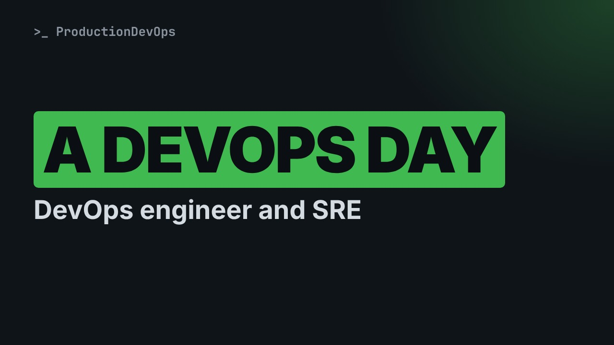
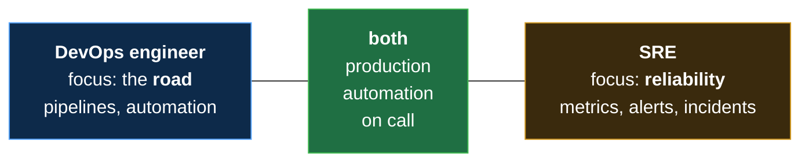
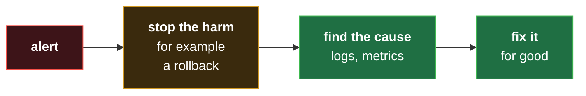

# What a DevOps or SRE Engineer Does All Day (DevOps from Zero, No Experience Needed)

**Video:** https://youtu.be/sFWueWjE9UA

Job ads say DevOps engineer and SRE. But what do these people actually do from morning to evening? This lesson of DevOps from Zero walks through an example day, with pictures and a restaurant comparison: what the two roles have in common and where they differ, what happens during an incident, why teams write a blameless review afterwards, and the skills the job really needs. At the end: the part of the job that job ads rarely mention. No terminal, nothing to install, no experience needed. Every new word is explained on screen. The challenge and its solution are in the demos repo.

## Files in this folder

- [`challenge-solution.md`](challenge-solution.md) (solution of the challenge: try it yourself first)

## What you need

A Linux shell (a VM, WSL or a container is fine). Everything runs inside this folder.

## The lesson, step by step

The same explanations as the video, with every command. Read it, then run it yourself.

Job ads say DevOps engineer, or SRE. What do these people do all day? At the end: the part job ads rarely mention.

For this lesson you need nothing. Just watch. No terminal and no code. Only pictures. About five minutes.

### The plan

This is lesson seven of DevOps from Zero. First, two job titles, explained. Then an example day. Then what happens when things break. And the skills the job really needs.

### Two titles

- `DevOps engineer — Builds the road from code to users, and keeps it working (like the person who designs and runs the kitchen line)`: 
First title: DevOps engineer. This person builds the road from code to users, and keeps it working. Like the person who runs the kitchen line.

- `SRE — Site reliability engineer: keeps a service reliable, using software (like the manager who makes every dinner service run smoothly)`: 
Second title: SRE, short for site reliability engineer. This person keeps a service reliable, and uses software to do it.

**Two titles, a lot in common**

The two titles share a lot: production, automation, and being on call. The DevOps engineer leans toward the road. The SRE leans toward reliability.

### A day

Here is an example day. Every team is different. In the morning, look at the dashboards, and at any night alerts. Then, improve the pipeline, to make it faster or safer. Review a colleague's change, before it is merged. In the afternoon, automate a boring job. And write down what you learned.

### Incidents

- `incident — Something is broken for users, right now (like the oven dies in the middle of dinner service)`: 
Some days are not calm. An incident means something is broken for users, right now. Like an oven dying during dinner service.

**During an incident**

During an incident, the order matters. First, stop the harm, for example with a rollback. Then find the cause, and fix it for good.

- `postmortem — A written review after an incident: what happened, how to prevent it (like the team talk after a bad night: no blame, better habits)`: 
After the incident comes the postmortem. It is a written review: what happened, and how to prevent it. With no blame.

### So far

So far: the DevOps engineer cares for the road, and the SRE for reliability. On calm days, they improve, review, and automate. During incidents, they stop the harm, find the cause, and write it down. Next: the skills, and the part job ads rarely mention.

### Skills

What skills does the job need? Linux and the terminal, first. Automation: scripts, and tools like Ansible. Containers and Kubernetes. Networks, version control, logs and metrics. Nobody knows everything. You learn one piece at a time.

### The hidden part

Now, the part job ads rarely mention: writing. Clear notes that others can follow. Asking: a good question saves hours. And explaining, to colleagues who are not engineers.

- `runbook — Written steps for a known problem, so anyone can fix it (like the card on the kitchen wall: what to do if the oven fails)`: 
One example of that writing: a runbook. It holds written steps for a known problem, so anyone can fix it. Even at night.

### Good to know

Good to know: every company uses these titles a bit differently. So read what the job ad asks, not only the title. Many people start in support or in development, and move later.

### Recap

Recap: both titles share production, automation, and being on call. In an incident, stop the harm first. Then write a postmortem, with no blame. Writing and explaining are part of the job. Your challenge: match each line of a job ad to a lesson of this course. The ad and the answer are in the demo repo.

### Where next

Where next? Lesson eight, the last one: your learning map. Which course to start with, and in which order.

Next lesson: your learning map, where to go next. Subscribe so you do not miss it.

## Challenge

Your challenge: match each line of a job ad to a lesson of this course. The ad and the answer are in the demo repo.

When you have tried: [`challenge-solution.md`](challenge-solution.md).

---

From the [ProductionDevOps](https://www.youtube.com/@production-devops) channel: real-world DevOps and SRE, explained with real commands.
