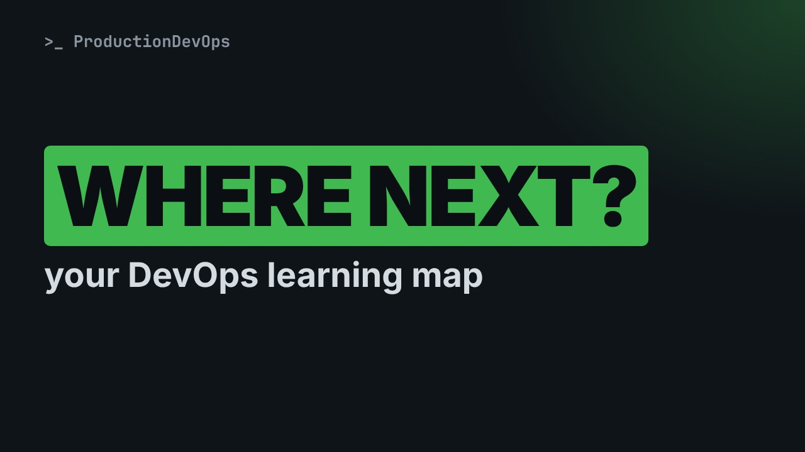
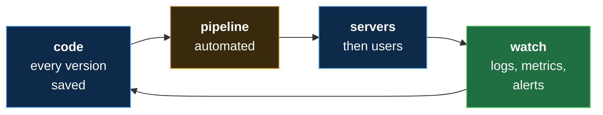
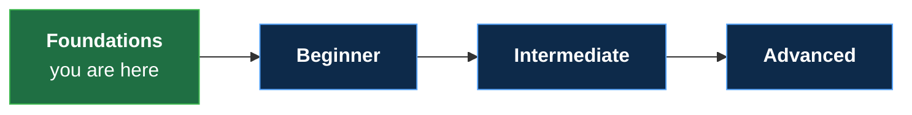
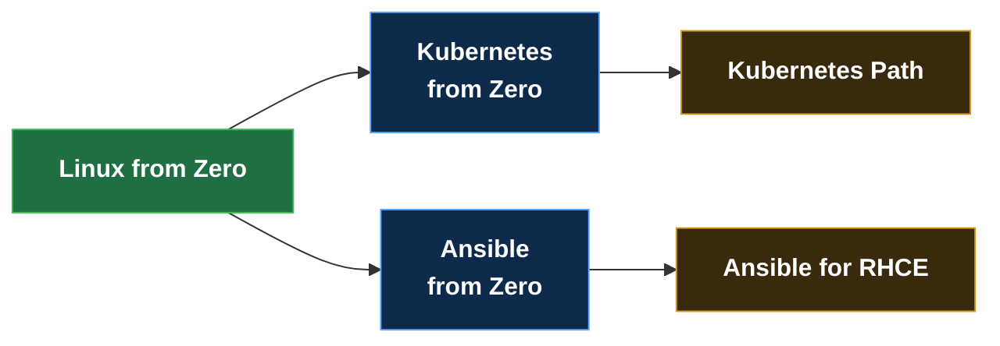

# Your DevOps Learning Map: Where to Go Next (DevOps from Zero, No Experience Needed)

**Video:** https://youtu.be/Mce83mdFlW8

Seven lessons ago, DevOps was just a word. This last lesson of DevOps from Zero puts the whole course in one picture, from code to users and back, and then opens the map of the channel: the entry courses you can start today, Linux from Zero, Kubernetes from Zero and Ansible from Zero, the order that works, and the courses planned next. At the end: the one course to take first, if you only pick one. No terminal, nothing to install, no experience needed. The final challenge and its solution are in the demos repo.

## Files in this folder

- [`challenge-solution.md`](challenge-solution.md) (solution of the challenge: try it yourself first)

## What you need

A Linux shell (a VM, WSL or a container is fine). Everything runs inside this folder.

## The lesson, step by step

The same explanations as the video, with every command. Read it, then run it yourself.

Seven lessons ago, DevOps was just a word. Today, the map of what to learn next. At the end: the one course to take first.

For this lesson you need nothing. Just watch. No terminal and no code. Only pictures. About five minutes.

### The plan

This is lesson eight, the last one of DevOps from Zero. First, the whole course, in one picture. Then the levels of the channel. Then three courses you can start today. And the order that works.

### One picture

**The whole course, in one picture**

Here is the whole course. Code, saved in every version, goes through a pipeline to the servers. Users get it, and we watch and learn.

Words you know now. DevOps: one team builds the app, and runs it. Pipeline, deploy, and rollback. Server, data center, and cloud. Automation, commit, and branch. Log, metric, alert, and incident.

### Levels

- `Foundations — The channel's first level: no experience needed (like the first cooking class: how to hold the knife)`: 
Every course on the channel has a level. Foundations is the first one: no experience needed. Like a first cooking class.

**Four levels**

After Foundations come Beginner, Intermediate and Advanced. Each video description says its level, and what to watch before.

### Start today

First course you can start today: Linux from Zero, your first terminal. It is for people who never opened a terminal. One command per lesson, shown twice. After it comes Linux from User to Server Admin.

Second: Kubernetes from Zero. Containers, clusters, and your first Pod. You see apps that restart themselves. After it comes the Kubernetes Path.

Third: Ansible from Zero. It turns lesson four of this course into real practice. Two practice servers, and your first playbook. You need a terminal, so Linux from Zero first helps. After it comes Ansible for RHCE.

### So far

So far: the whole course, from code to users, and back. Three entry courses you can start today: Linux, Kubernetes and Ansible. Next: the order. And the one course to take first.

### The order

**Two paths that work**

Here are two paths that work. Containers and clusters: Linux, then Kubernetes from Zero. Automation: Linux, then Ansible from Zero.

And if you take only one course? Linux from Zero. Almost every course uses the terminal. The Kubernetes Path and Ansible for RHCE list it as before you start. And servers very often run Linux, as we saw in lesson three.

More Foundations courses are planned on the channel. How the Internet Works, Simply. YAML and Config Files from Zero. Containers from Zero. Git and GitHub from Zero. And HTTPS and Certificates, Simply.

### Learn well

How to learn well? One lesson at a time, then a pause. Do the challenges. The answers are in the demo repo. Not clear the first time? That is normal. Watch it again.

### Recap

Recap: DevOps takes code to users, automated and watched. You can start today with Linux, Kubernetes or Ansible from Zero. Your final challenge: from memory, draw the journey from code to users, and who watches it. The solution is in the demo repo.

### Where next

Where next? Linux from Zero, lesson one: your first terminal. You find it in the channel's playlists.

Thank you for following DevOps from Zero. Next, Linux from Zero. Subscribe so you do not miss a lesson.

## Challenge

Do the challenges. The answers are in the demo repo.

When you have tried: [`challenge-solution.md`](challenge-solution.md).

---

From the [ProductionDevOps](https://www.youtube.com/@production-devops) channel: real-world DevOps and SRE, explained with real commands.
