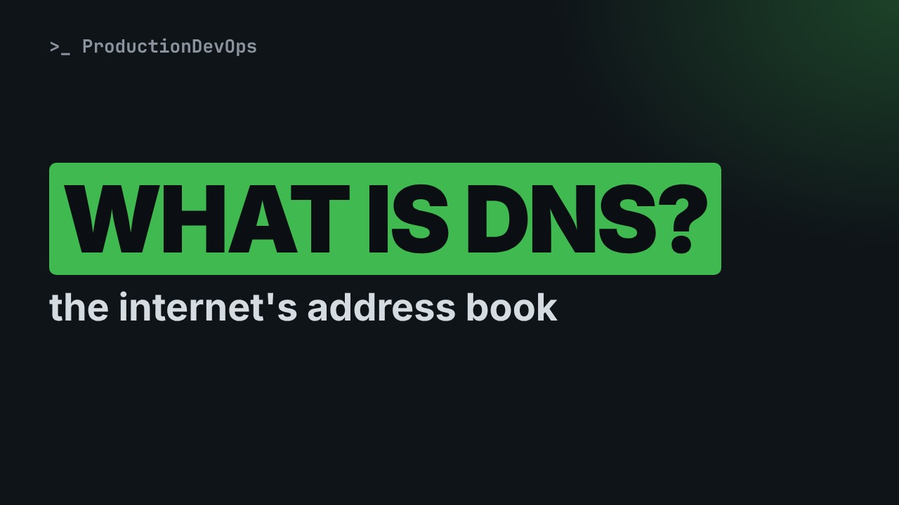
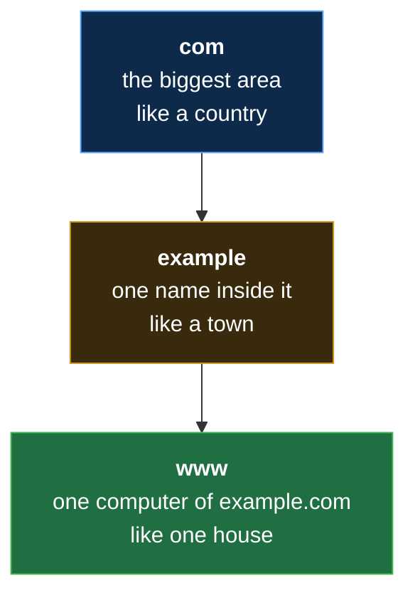
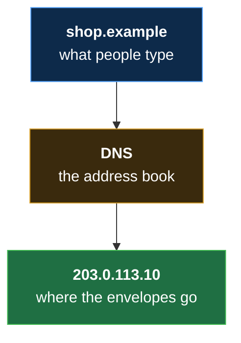
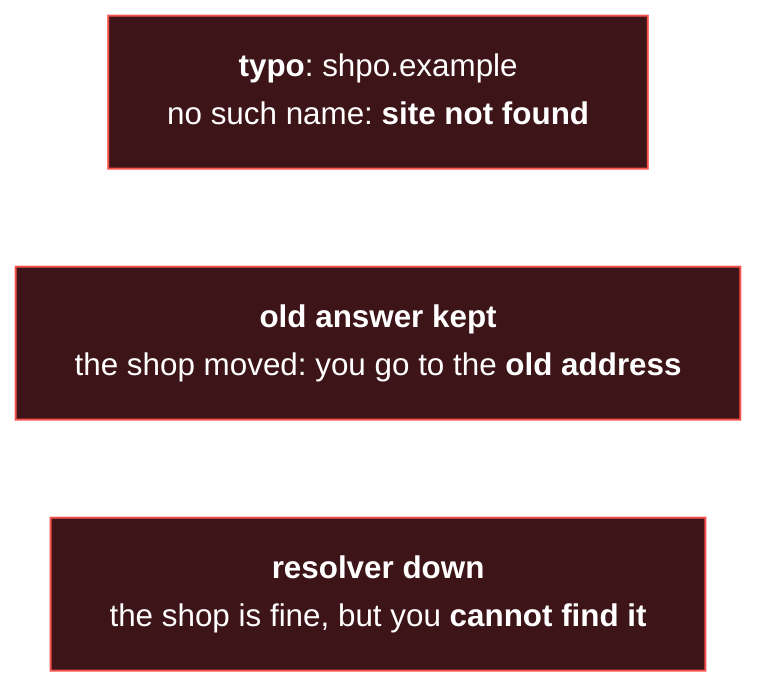

# Names for People: DNS (How the Internet Works, No Experience Needed)

**Video:** coming soon on the [channel](https://www.youtube.com/@production-devops).

You never type four numbers to visit a shop: you type a name. Who turns that name into an address? This lesson of How the Internet Works, Simply explains DNS, the address book of the internet, with the postal service: domain names read from the right, the resolver that looks names up for you, the saved answers that make it fast, and what you see when the address book is wrong or out of date. No terminal, nothing to install, no experience needed. Every new word is explained on screen. The challenge and its solution are in the demos repo.

## Files in this folder

- [`challenge-solution.md`](challenge-solution.md) (solution of the challenge: try it yourself first)

## What you need

A Linux shell (a VM, WSL or a container is fine). Everything runs inside this folder.

## The lesson, step by step

The same explanations as the video, with every command. Read it, then run it yourself.

You never type four numbers to visit a shop. You type a name. At the end: what you see when the address book is wrong.

For this lesson you need nothing. Just watch. No terminal and no code. Only pictures. About five minutes.

### The plan

This is lesson three of How the Internet Works, Simply. First, names, and how to read them. Then DNS, the address book. Then one lookup, step by step. And what happens when the address book is wrong.

### Names

- `domain name — A name for a computer on the internet, easy for people (like a person's name in your address book)`: 
New word: domain name. It is a name for a computer on the internet, easy for people to remember. Like a name in your address book.

**Read a name from the right**

Take www dot example dot com, and read it from the right. Com is the biggest area, example is one name inside it. W W W is one computer.

The rules: parts are separated by dots, and the biggest is on the right. Capital letters do not matter. Our shop, shop dot example, uses a name reserved for examples.

### DNS

- `DNS — Domain Name System: it turns names into IP addresses (like the address book of the whole internet)`: 
New word: D N S, the domain name system. It turns names into IP addresses. Think of the address book of the whole internet.

**One name, one address**

People type the name. DNS looks it up. Out comes the IP address, the one the envelopes need.

Is DNS one huge book? No. No single computer knows every name. The owner of each name keeps its own page. Computers called name servers hold those pages.

### One lookup

- `resolver — The DNS server that looks names up for you (like the post office clerk who finds an address for you)`: 
New word: resolver. It is the DNS server that looks names up for you. Like a post office clerk who finds an address for you.

Time flows down. Each arrow is one message.

- `your computer → resolver`: where is shop.example?
Your computer asks its resolver: where is shop dot example?

- `resolver → name servers`: where is shop.example?
The resolver does not know yet. So it asks the name servers, one after another.

- `name servers → resolver`: 203.0.113.10
The name server of example finds the page, and answers.

- `resolver → your computer`: 203.0.113.10
The resolver passes the address back. Now the browser can send its request.

### So far

So far: a name is for people, an address is for envelopes. DNS turns one into the other, and the resolver asks for you. Next: why it is fast, and what happens when it goes wrong.

### Fast

- `cache — A saved copy of a recent answer, kept for a while (like a sticky note with an address you looked up yesterday)`: 
New word: cache. A cache is a saved copy of a recent answer, kept for a while. Like a sticky note with yesterday's address.

The resolver keeps the answer for a while. Your computer and your browser keep a copy too. On the next visit, nobody asks around. The answer is instant. Each answer says how long it may be kept.

### When it goes wrong

**When the address book is wrong**

It can go wrong in three ways. A typo: no such name. Then an old saved answer, or a resolver that is down.

Remember this for later. The site is down can really mean: the name lookup fails. And the server can be perfectly fine at the same time. That is why engineers often check the name first.

### Good to know

Good to know: your computer also has a tiny address book of its own. In it, localhost always means this same computer. You will use it in lesson eight. And one name can have several addresses, for busy sites.

### Recap

Recap: a domain name is read from the right. DNS is the address book, and the resolver looks names up for you. Answers are kept for a while: fast, but sometimes out of date. Your challenge: in the name on screen, which part is the biggest area? Which is one computer? The answer is in the demo repo.

### Where next

Where next? Lesson four: ports, which program answers. Then lesson five: packets, data in small envelopes.

Next lesson: ports, which program answers. Subscribe so you do not miss it.

## Challenge

Your challenge: in the name on screen, which part is the biggest area? Which is one computer? The answer is in the demo repo.

When you have tried: [`challenge-solution.md`](challenge-solution.md).

---

From the [ProductionDevOps](https://www.youtube.com/@production-devops) channel: real-world DevOps and SRE, explained with real commands.
