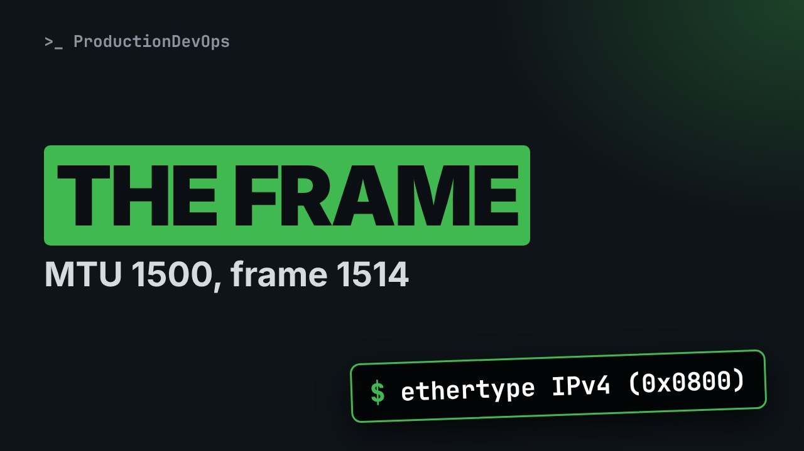
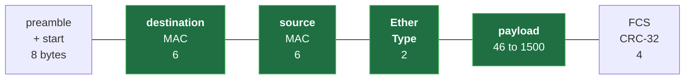
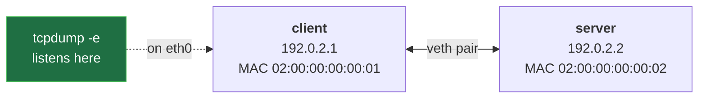
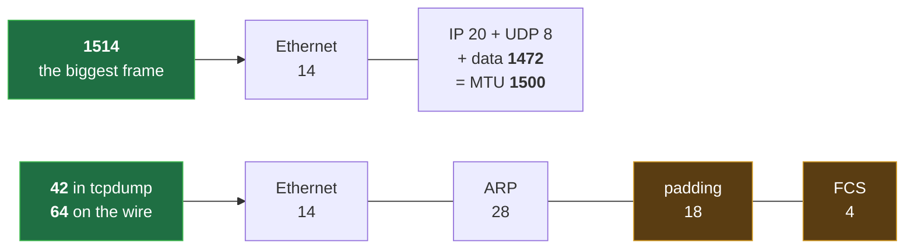

# Ethernet Frames and MAC Addresses, Field by Field (EtherType, MTU, tcpdump -e)



**Video:** https://youtu.be/QkC51XTzi4U

The card says MTU 1500, tcpdump shows a 1514-byte frame, and an ARP frame is only 42 bytes when the minimum is 64: who is right? We capture real frames between two Linux network namespaces with tcpdump -e and read the Ethernet header field by field: destination and source MAC, EtherType, payload, plus the preamble and the FCS that tcpdump never shows. MAC address bits (unicast, group, locally administered), MTU, full duplex and autonegotiation in brief. Lab script, capture script and challenge solution in the demos repo.

## Files in this folder

- [`frames.sh`](frames.sh)
- [`lab/net.sh`](lab/net.sh)
- [`challenge-solution.sh`](challenge-solution.sh) (solution of the challenge: try it yourself first)

## What you need

A Linux shell (a VM, WSL or a container is fine). Everything runs inside this folder.

## Before you start

The video runs these commands first, off screen:

```bash
bash lab/net.sh up pair >/dev/null 2>&1
```

## The lesson, step by step

The same explanations as the video, with every command. Read it, then run it yourself.

The card says MTU 1500, but tcpdump shows a frame of 1514 bytes. And the smallest legal frame is 64 bytes, yet our ARP frame has 42. Nobody is lying: by the end, you will see why.

### The plan

This is lesson 4 of Networking Fundamentals. The 802 family, in one slide. The Ethernet frame, field by field, from a real capture. MAC addresses, bit by bit. EtherType, MTU, and duplex.

### 802

IEEE 802 is the family of local network standards. 802.3 is Ethernet. 802.11 is Wi-Fi: a different frame, bridged to Ethernet at the access point. 802.1 covers bridges, next lesson, and VLANs, the one after. They share one idea: 48-bit MAC addresses.

### The frame

**An Ethernet frame on the wire**



A preamble syncs the receiver. Then a 14-byte header, two MACs and an EtherType, the payload, and a checksum, the FCS. tcpdump sees only the green part.

### The lab

**Our lab: where we capture**



Our pair from lesson 1. net dot sh gives each card a fixed MAC, so every run shows the same values.

### The script

The experiment script: lesson 1's hello, plus one big message.

```
#!/usr/bin/env bash
# Two UDP messages from client to server: a small one, and the largest that fits in one frame
bash lab/net.sh reset pair
ip netns exec client tcpdump -n -i eth0 -w frames.pcap -Z root 2>/dev/null &
ip netns exec server nc -u -l 9000 >/dev/null &
sleep 1
echo hello | ip netns exec client nc -u -w 1 -p 40000 192.0.2.2 9000
head -c 1472 /dev/zero | ip netns exec client nc -u -w 1 -p 40000 192.0.2.2 9000
kill %1 %2
wait
echo "capture saved: frames.pcap"
```

A clean lab. Capture and server. Two messages. Cleanup.

```
#!/usr/bin/env bash
# Two UDP messages from client to server: a small one, and the largest that fits in one frame
bash lab/net.sh reset pair
```

Run with bash; the comment says what it does. Fresh hosts, with their fixed MACs.

```
ip netns exec client tcpdump -n -i eth0 -w frames.pcap -Z root 2>/dev/null &
ip netns exec server nc -u -l 9000 >/dev/null &
sleep 1
```

The capture, as in lesson 1: every packet on the client's card, into a file, in the background. The server listens for UDP on port nine thousand. Its output is hidden. Job two. One second for both to start.

```console
$ ip netns exec client tcpdump -n -i eth0 -w frames.pcap -Z root 2>/dev/null &
```

- `ip netns exec client`: run inside the client
Inside the client,

- `-n`: numbers, no name lookups
dash n: numbers only,

- `-i eth0`: listen on eth0
dash i: on eth0,

- `-w frames.pcap`: write the packets to a file
dash w: into a file.

- `-Z root`: stay root: may write the file
Dash capital Z root: stay root, to write it.

- `2>/dev/null &`: hide messages; background
Hide the messages, and run in the background.

```
echo hello | ip netns exec client nc -u -w 1 -p 40000 192.0.2.2 9000
head -c 1472 /dev/zero | ip netns exec client nc -u -w 1 -p 40000 192.0.2.2 9000
```

First, lesson 1's message: hello, six bytes, piped into netcat, sent as UDP from port 40000. Then 1472 bytes of zeros: the largest UDP message that fits one frame. Why 1472? Soon.

```console
$ head -c 1472 /dev/zero | ip netns exec client nc -u -w 1 -p 40000 192.0.2.2 9000
```

- `head -c 1472 /dev/zero`: 1472 bytes of zeros
head dash c takes the first 1472 bytes of slash dev slash zero, an endless source of zero bytes.

- `|`: they become nc's input
The pipe makes them netcat's input.

- `nc -u -w 1`: UDP; then wait 1 s, quit
Dash u: UDP. Dash w one: wait a second, then quit.

- `-p 40000 192.0.2.2 9000`: from port 40000, to the server
From port 40000, to the server's port nine thousand.

```
kill %1 %2
wait
echo "capture saved: frames.pcap"
```

Stop both jobs, and wait for them. And say where the frames are.

The whole script, before we run it.

```
#!/usr/bin/env bash
# Two UDP messages from client to server: a small one, and the largest that fits in one frame
bash lab/net.sh reset pair
ip netns exec client tcpdump -n -i eth0 -w frames.pcap -Z root 2>/dev/null &
ip netns exec server nc -u -l 9000 >/dev/null &
sleep 1
echo hello | ip netns exec client nc -u -w 1 -p 40000 192.0.2.2 9000
head -c 1472 /dev/zero | ip netns exec client nc -u -w 1 -p 40000 192.0.2.2 9000
kill %1 %2
wait
echo "capture saved: frames.pcap"
```

```console
$ tcpdump -n -t -e -r frames.pcap
```

- `-t`: no timestamps
To read it: dash t, no timestamps.

- `-e`: print the Ethernet header
Dash e: print the Ethernet header. Today, that is the point.

- `-r frames.pcap`: read the saved file
Dash r: read the file.

### Run it

We run the script.

```console
$ bash frames.sh
```

And read every frame, with its Ethernet header.

```console
$ tcpdump -n -t -e -r frames.pcap
```

Line one goes to ff, ff, ff: broadcast, every card on the link. That is ARP, lesson 7. Look at the lengths: 42, 42, 48, and 1514.

### Field by field

Line three, the hello frame, drawn as a header.

- `destination MAC, bytes 1-4`: 02:00:00:00:00:02
First the destination, the server's MAC: a card reads it first, to decide if the frame is for it.

- `source MAC, bytes 1-2`: 02:00:00:00:00:01
Then the source: the client's MAC.

- `EtherType`: 0x0800 = IPv4
Then two bytes of EtherType: 0 x 0 8 0 0 means an IPv4 packet follows.

- `payload: the IP packet`: 34 bytes: IP + UDP + hello
Then the payload: 20 bytes of IP, 8 of UDP, 6 of data. 34, plus 14 of header: 48.

### MAC bits

A MAC is 48 bits. Usually the first three bytes name the maker, the last three the card. In the first byte, the bit worth one says: one card, or a group. The bit worth two says: assigned locally, not by a maker. So 02 means one card, set locally. Our lab MACs can never clash with a real card.

Where does the card keep its MAC? ip link show prints it, with the broadcast address.

```console
$ ip -n client link show eth0
```

On the first line: mtu 1500. Remember the 1514.

### So far

So far: a 14-byte header, destination first. And MAC bits that tell group or card, local or maker. Next: EtherType, then our two puzzles: 1514, and 42.

### EtherType

EtherType names the payload: IPv4, ARP, IPv6, or a VLAN tag, in lesson 6. Every type is at least 1536. Old 802.3 frames used those two bytes as a length, up to 1500, so the two never overlap.

### The answer

**Why 1514, and why 42**



The MTU counts only the payload: 1500 bytes. Add the 14-byte header: 1514. And 1472 is 1500 minus 20 of IP and 8 of UDP.

The minimum frame is 64 bytes, FCS included. So the payload is at least 46. ARP has only 28: the card adds 18 bytes of padding. Padding and FCS are added after tcpdump sees the frame. So 42: nobody lied.

### Duplex

Old Ethernet shared one cable: hosts collided, and retried. Today, each host has its own switch port, and sends and receives at once: full duplex. Autonegotiation lets both ends agree on speed and duplex.

### Gotchas

A duplex mismatch gives a slow link with errors, that looks fine. The MTU counts the IP packet, never the Ethernet header. And tcpdump on the sender shows no FCS, no padding.

### Recap

Recap: destination, source, EtherType, payload, FCS. In the MAC, two bits: group, and local. 1514 is 14 plus the MTU; 42 grows to 64 on the wire. Challenge: send 1473 bytes. How many frames now? Solution in the demo repo.

Next lesson: switches and bridges. Subscribe so you do not miss it.

## All the commands, to copy

Run them from inside this folder, in this order (some are expected to fail: that is the point of the demo).

```bash
ip netns exec client tcpdump -n -i eth0 -w frames.pcap -Z root 2>/dev/null &
head -c 1472 /dev/zero | ip netns exec client nc -u -w 1 -p 40000 192.0.2.2 9000
tcpdump -n -t -e -r frames.pcap
bash frames.sh
ip -n client link show eth0
```

## Challenge

Challenge: send 1473 bytes. How many frames now? Solution in the demo repo.

When you have tried: [`challenge-solution.sh`](challenge-solution.sh).

---

From the [ProductionDevOps](https://www.youtube.com/@production-devops) channel: real-world DevOps and SRE, explained with real commands.
