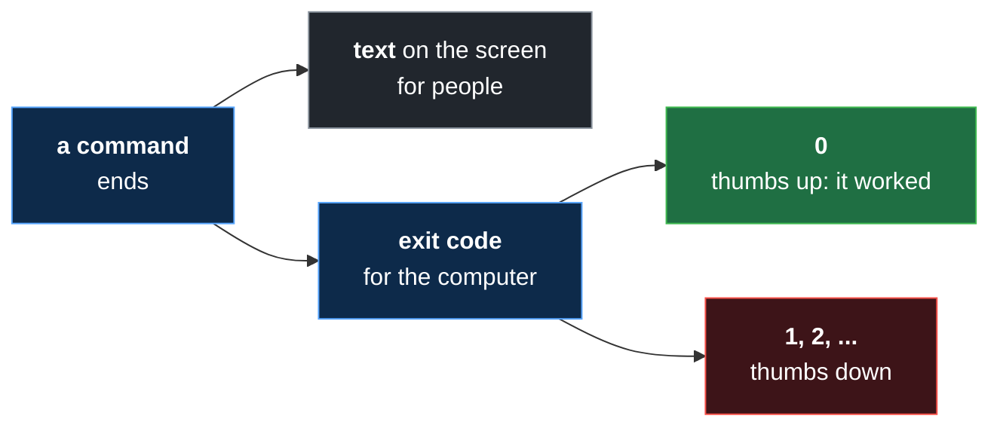
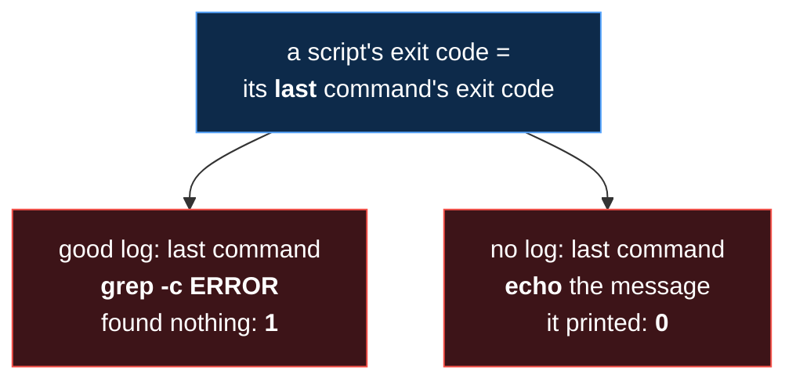

# Exit Codes: Did It Work? (Shell Scripting from Zero)


**Video:** coming soon on the [channel](https://www.youtube.com/@production-devops).

Your script did its job, yet the computer is told it failed; it missed the log, yet the computer is told all is well. In this lesson of Shell Scripting from Zero we meet the exit code, the thumbs up or thumbs down every command leaves when it ends: 0 means it worked. We read it with $?, find out why our acme-app script gave the wrong answer twice, and fix it with exit 1 and exit 0. Every new word is explained on screen and every command runs for real. The challenge and its solution are in the demos repo.

## Files in this folder

- [`.lab/after.sh`](.lab/after.sh)
- [`.lab/before.sh`](.lab/before.sh)
- [`acme-app/config.txt`](acme-app/config.txt)
- [`acme-app/logs/app.log`](acme-app/logs/app.log)
- [`acme-app/logs/old.log`](acme-app/logs/old.log)
- [`check-app.sh`](check-app.sh)
- [`notes/ideas.txt`](notes/ideas.txt)
- [`notes/todo.txt`](notes/todo.txt)
- [`readme.txt`](readme.txt)
- [`challenge-solution.sh`](challenge-solution.sh) (solution of the challenge: try it yourself first)

## What you need

A Linux shell (a VM, WSL or a container is fine). Everything runs inside this folder.

## Before you start

The video runs these commands first, off screen:

```bash
mkdir -p /lab && ln -sfn "$PWD" /lab/sre && cd /lab/sre && export HOME=/lab/sre
alias ls='ls --color=auto'
PROMPT_COMMAND='PS1="\[\e[1;32m\]sre@lab\[\e[0m\]:\[\e[1;34m\]\w\[\e[0m\]$ "'
tt_n=$(( $(cat .tt-scene 2>/dev/null || echo 0) + 1 )); echo "$tt_n" > .tt-scene; if [ "$tt_n" -lt 3 ]; then cp .lab/before.sh check-app.sh; else cp .lab/after.sh check-app.sh; fi; unset tt_n
```

## The lesson, step by step

The same explanations as the video, with every command. Read it, then run it yourself.

Our script counts log lines. But ask the computer if it worked, and it gets the wrong answer, twice. Today we find out why, and fix it.

You will need a terminal with bash. And check app dot s h from lesson seven, with its loop. Or just watch. Every step is on screen.

### The plan

This is lesson eight of Shell Scripting from Zero. First, thumbs up and thumbs down: the exit code. We read it, with dollar question mark. We ask our script, and get the wrong answers. And we fix them, with exit.

### Exit codes

- `exit code — A number every command leaves when it ends. 0 means it worked (like a thumbs up or a thumbs down, at the end)`: 
New word: exit code. A number every command leaves when it ends, and zero means it worked. Think of a thumbs up, or a thumbs down.

**Two answers from every command**



Every command gives two answers. Text on the screen, for people. And a number, for the computer: zero is thumbs up, anything else is thumbs down.

Dollar question mark is a jar. Bash fills it with the last exit code. Echo dollar question mark prints it. Read it right away. The next command replaces it.

### By hand

A command that works: list the acme app folder.

```console
$ ls acme-app
```

And its exit code? Zero.

```console
$ echo $?
```

Now a folder that does not exist.

```console
$ ls nothing
```

Two. Not zero, so thumbs down. Different numbers can mean different problems.

```console
$ echo $?
```

One more. Grep counts the error lines in app dot log.

```console
$ grep -c "ERROR" acme-app/logs/app.log
```

One. For grep, thumbs down means: I found nothing. Remember this.

```console
$ echo $?
```

### So far

So far: every command ends with an exit code. Zero means it worked. Anything else is thumbs down. Next: we ask our script.

### Our script

Lesson seven's script, on a good log.

```console
$ ./check-app.sh acme-app/logs/app.log
```

It worked. So, thumbs up?

```console
$ echo $?
```

Now a log that is not there.

```console
$ ./check-app.sh nope.log
```

No log, yet thumbs up. Two wrong answers.

```console
$ echo $?
```

**Why: the last command speaks**



A script ends with the exit code of its last command. With a good log, that is grep, which found no errors: one. With no log, it is echo, which worked: zero.

### The fix

- `exit — Stops the script right here, with the exit code you choose (like giving the thumbs up or down yourself)`: 
New word: exit. It stops the script right here, with the exit code you choose. You give the thumbs up or down yourself.

We open the script in the editor, and add two lines. Everything else stays.

```
#!/bin/bash
# check-app.sh: a quick look at acme-app

app="acme-app"
log="$1"

echo "Checking $app"

if [ -f "$log" ]; then
  echo "Log found: $log"
  for level in INFO WARN ERROR; do
    echo -n "$level lines: "
    grep -c "$level" "$log"
  done
else
  echo "No log file at: $log"
  exit 1
fi
exit 0
```

The shebang, the jars, the fork and the loop: as before. Two new lines, both with exit.

```
else
  echo "No log file at: $log"
  exit 1
fi
exit 0
```

The no road, as before: the message. Then exit one. The script stops here, with thumbs down. The last line: exit zero. We got to the end, so thumbs up, on purpose.

All together. No log: stop with one; got to the end: zero. The script now says what really happened.

```
#!/bin/bash
# check-app.sh: a quick look at acme-app

app="acme-app"
log="$1"

echo "Checking $app"

if [ -f "$log" ]; then
  echo "Log found: $log"
  for level in INFO WARN ERROR; do
    echo -n "$level lines: "
    grep -c "$level" "$log"
  done
else
  echo "No log file at: $log"
  exit 1
fi
exit 0
```

### Ask again

The missing log first.

```console
$ ./check-app.sh nope.log
```

One: thumbs down. Right.

```console
$ echo $?
```

And the good log.

```console
$ ./check-app.sh acme-app/logs/app.log
```

Zero: thumbs up. Two right answers.

```console
$ echo $?
```

### Good to know

Zero means success for every command, everywhere on Linux. Other tools read it: other scripts, and monitoring that wakes people up. Exit stops the whole script. The lines after it never run. And dollar question mark changes after every command, even echo.

### Recap

Recap: the exit code. Zero is thumbs up, anything else is thumbs down. Echo dollar question mark reads it. Exit, then a number, sets it. Your challenge: is folder dot s h, from lesson six. Exit zero for a folder, exit one if not. Check it with dollar question mark. The solution is in the demo repo.

### Where next

Where next? Lesson nine: the whole script, line by line. Everything you learned, in one small real script.

Next lesson: a small real script, line by line. Subscribe so you do not miss it.

## All the commands, to copy

Run them from inside this folder, in this order (some are expected to fail: that is the point of the demo).

```bash
ls acme-app
echo $?
ls nothing
grep -c "ERROR" acme-app/logs/app.log
./check-app.sh acme-app/logs/app.log
./check-app.sh nope.log
```

## Challenge

Your challenge: is folder dot s h, from lesson six.

When you have tried: [`challenge-solution.sh`](challenge-solution.sh).

---

From the [ProductionDevOps](https://www.youtube.com/@production-devops) channel: real-world DevOps and SRE, explained with real commands.
