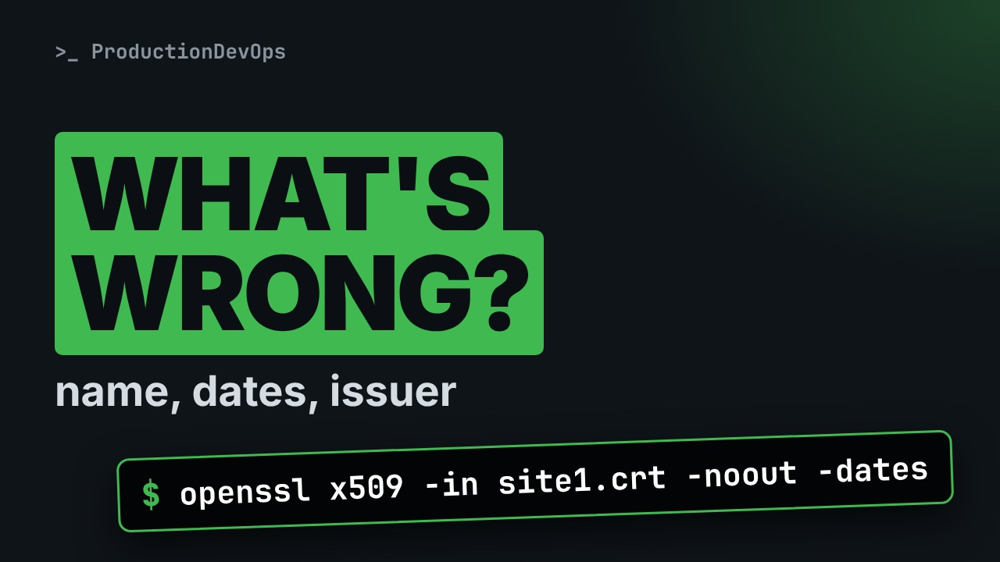
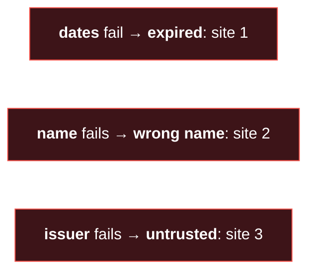

# Expired, Wrong Name, Untrusted: What to Check (HTTPS and Certificates, No Experience Needed)



**Video:** coming soon on the [channel](https://www.youtube.com/@production-devops).

Three sites, three certificate warnings: which check failed for each? This lesson of HTTPS and Certificates, Simply reads three broken test certificates in a terminal with the one command from lesson five, openssl x509 with -subject, -issuer and -dates, and finds the cause of each: an expired card, a card with someone else's name, and a card that signed itself. For each one: what to fix. You need a terminal (Linux, macOS or WSL on Windows), or just watch. The script that makes the test certificates, a fourth card to check, and the solution are in the demos repo.

## Files in this folder

- [`make-certs.sh`](make-certs.sh)
- [`challenge-solution.md`](challenge-solution.md) (solution of the challenge: try it yourself first)

## What you need

A Linux shell (a VM, WSL or a container is fine). Everything runs inside this folder.

## Before you start

The video runs these commands first, off screen:

```bash
if [ ! -e .tt-lab ]; then rm -rf /lab/https7 && bash make-certs.sh /lab/https7 >/dev/null 2>&1 && touch .tt-lab; fi
export HOME=/lab/https7 && cd /lab/https7
PROMPT_COMMAND='HOME=/lab/https7; PS1="\[\e[1;32m\]sre@lab\[\e[0m\]:\[\e[1;34m\]\w\[\e[0m\]$ "'
```

## The lesson, step by step

The same explanations as the video, with every command. Read it, then run it yourself.

In five minutes: three broken certificates, and the three checks that find what is wrong. One command, from lesson five.

To follow along, you need a terminal. Linux, macOS, or WSL on Windows. It helps to have seen lesson five. We reuse its command. Or just watch. Every step is on screen.

### The plan

This is lesson seven of HTTPS and Certificates, Simply. First, three checks for every card. Then, three broken cards, one at a time. For each one: what is wrong, and what to fix. And a fourth card, for you to check.

### Three checks

Every card gets three checks. The name: is it the address you typed? The dates: is today between from and until? The issuer: is it an office your browser trusts?

Our lab. We typed shop dot example, four times, and saved the four cards we got. In this lab, our trusted office is Example Test CA, from lesson five. And our today is November eighteenth, 2026. The day we recorded this.

```console
$ openssl x509 -in site1.crt -noout -subject -issuer -dates
```

Here is the command from lesson five, all together.

- `openssl x509`: read a certificate
Open S S L x five oh nine reads a certificate.

- `-in site1.crt`: which file: site 1
Dash in: the file. Site one, first.

- `-noout`: skip the coded block
Dash no out skips the coded text.

- `-subject`: the name: check 1
Dash subject shows the name. Check one.

- `-issuer`: the office: check 3
Dash issuer shows the office. Check three.

- `-dates`: from and until: check 2
And dash dates shows from and until. Check two.

### Site 1

Site one. What is wrong with its card? We run the command.

```console
$ openssl x509 -in site1.crt -noout -subject -issuer -dates
```

Subject: shop dot example, the name we typed. Issuer: Example Test CA, our trusted office. Now the dates. Not after: October thirtieth, 2026. That is before our today.

What just happened? The dates check failed. Site one's card is expired. The fix: renew the card. Then ask why the renewal stopped, so it does not happen again.

### Site 2

Site two. Same command, new file.

```console
$ openssl x509 -in site2.crt -noout -subject -issuer -dates
```

Issuer: our trusted office. Dates: from November 2026 to October 2027. Today is inside. But the subject says blog dot example. We typed shop dot example.

### So far

So far: site one failed the dates check. It is expired. Site two failed the name check. Its card belongs to another site. The fix for site two: install the card for shop dot example, or add that name. If this is helping, subscribe: the next lesson puts the whole course in one picture.

### Site 3

Site three. Same command, one more time.

```console
$ openssl x509 -in site3.crt -noout -subject -issuer -dates
```

Subject: shop dot example, the right name. The dates include our today. Now the issuer: shop dot example. The same as the subject. The card signed itself.

The issuer check failed. Site three's card is self-signed, an ID printed at home. The fix: get a card from a trusted office. Inside a company, the fix can be its own office, on its own list. The TLS course shows it.

### Three checks

**Three checks, three errors**



Three checks, three errors: dates fail, expired; name fails, wrong name; issuer fails, untrusted.

### Good to know

Good to know: if every site looks expired, check your own clock first. Browsers also check a second list of names inside the card. The TLS course shows it. And a full check also walks the whole chain of offices, like in lesson four.

### Recap

Recap: three checks for every card. Name, dates, and issuer. One command shows all three: dash subject, dash issuer, dash dates. The fixes: renew the card, install the right card, or use a trusted office. Your challenge: run the same command on site four. Which check fails, and what is the surprise? The answer is in the demo repo.

### Where next

Where next? Lesson eight, the last one: the whole course in one picture. And the next course: real TLS troubleshooting.

Subscribe, and the next lesson, where next, finds you.

## All the commands, to copy

Run them from inside this folder, in this order (some are expected to fail: that is the point of the demo).

```bash
openssl x509 -in site1.crt -noout -subject -issuer -dates
openssl x509 -in site2.crt -noout -subject -issuer -dates
openssl x509 -in site3.crt -noout -subject -issuer -dates
```

## Challenge

Your challenge: run the same command on site four. Which check fails, and what is the surprise? The answer is in the demo repo.

When you have tried: [`challenge-solution.md`](challenge-solution.md).

---

From the [ProductionDevOps](https://www.youtube.com/@production-devops) channel: real-world DevOps and SRE, explained with real commands.
