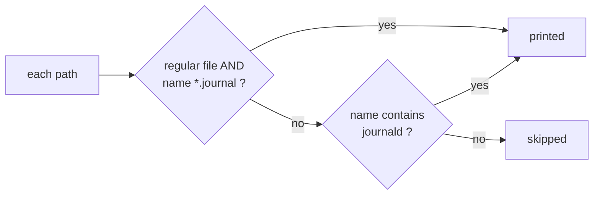

# The find -o Bug Almost Everyone Writes (and the One-Character Fix)


**Video:** https://youtu.be/CeFtExfmAZM

find . -type f -name A -o -name B looks like it searches for files named A or B. It does not. Step by step, we reproduce the bug on a real folder, see the invisible AND that find adds, fix it with parentheses, and look at the second trap: actions like -print that only apply to the last branch.

## Files in this folder

- [`conf/journald.conf`](conf/journald.conf)
- [`conf/journald.conf.d/README`](conf/journald.conf.d/README)
- [`conf/notes.txt`](conf/notes.txt)
- [`logs/system.journal`](logs/system.journal)
- [`logs/user-1000.journal`](logs/user-1000.journal)

## What you need

A Linux shell (a VM, WSL or a container is fine). Everything runs inside this folder.

## The lesson, step by step

The same explanations as the video, with every command. Read it, then run it yourself.

This find command looks like it searches for files with one name or another. It actually does something different, and in a script it can pass the wrong paths to the next command. Let's see it happen, step by step.

### The plan

Here is the plan. First, we look at a small test folder. We run the command, and spot the wrong result. We see why it happens: an invisible AND that find adds for you. We fix it with parentheses, and look at a second trap with dash print.

### The test folder

This is everything in our folder. find with only a dot lists every path.

```console
$ find . | sort
```

Look at the paths. Two journal files under logs. Under conf, a file called journald dot conf, and a folder called journald dot conf dot d. Remember that folder.

### The bug

Our goal: find every regular file, whose name ends in dot journal, or contains the word journald. Dash type f means regular files only. Dash o means OR.

```console
$ find . -type f -name '*.journal' -o -name '*journald*'
```

Four results. But look at the third one: journald dot conf dot d. That is the folder. Let's make sure.

```console
$ ls -ld conf/journald.conf.d
```

The d at the very start of the line means directory. We asked for files only, and still got a folder. Why?

### The invisible AND

```
What you type:
  -type f        -name '*.journal'   -o   -name '*journald*'

What find reads:
  -type f   -a   -name '*.journal'   -o   -name '*journald*'

How find groups it:
( -type f -a -name '*.journal' )   -o   ( -name '*journald*' )
```

This is what we typed: two tests, then dash o, then one more test. Between two tests with nothing in between, find adds an invisible dash a. Dash a means AND. And AND is stronger than OR. Just like in math, where you multiply before you add. So find makes two groups. On the left: a regular file AND a journal name. On the right: only the name test.

**So each path takes this route**



So each path takes this route. If it is a regular journal file, it is printed. If not, find tries the right side, which only checks the name. Our folder has journald in its name, so it is printed, even though it is a folder. The type check only lives on the left side.

### The fix

The fix: put the two name tests inside parentheses, so dash type f applies to both. The parentheses need a backslash in front, so the shell passes them to find, instead of using them itself.

```console
$ find . -type f \( -name '*.journal' -o -name '*journald*' \)
```

Three results, all regular files. The folder is gone. This is what we meant from the start.

### The second trap

Same rule, second trap. Now we add dash print at the end. We expect the journal files and the conf files.

```console
$ find . -name '*.journal' -o -name '*.conf' -print
```

Only one line. Dash print is an action, and it was glued with an invisible AND to the last test only. The journal files matched the left side, but nothing told find to print them. Same fix: parentheses around the OR, then the action after them.

```console
$ find . \( -name '*.journal' -o -name '*.conf' \) -print
```

### Recap

Let's recap with three rules. One. Every time you write dash o, wrap the alternatives in escaped parentheses. Two. Actions like print, exec or delete go after the closing parenthesis. Three. Before you delete anything with find, run the same expression with print, and read the list.

Two escaped parentheses are the difference between the files you meant and the paths you got. Check the find commands in your own scripts today. Subscribe for more commands, explained piece by piece.

## All the commands, to copy

Run them from inside this folder, in this order (some are expected to fail: that is the point of the demo).

```bash
find . | sort
find . -type f -name '*.journal' -o -name '*journald*'
ls -ld conf/journald.conf.d
find . -type f \( -name '*.journal' -o -name '*journald*' \)
find . -name '*.journal' -o -name '*.conf' -print
find . \( -name '*.journal' -o -name '*.conf' \) -print
```

---

From the [ProductionDevOps](https://www.youtube.com/@production-devops) channel: real-world DevOps and SRE, explained with real commands.
