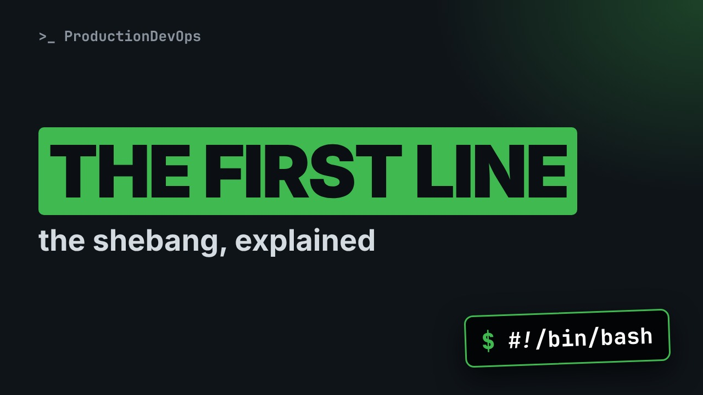
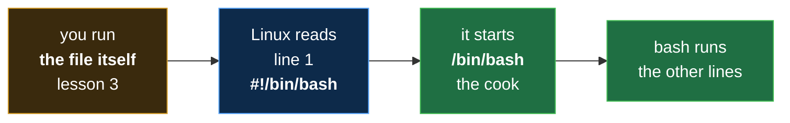

# Your First Script and the Shebang (Shell Scripting from Zero)



**Video:** coming soon on the [channel](https://www.youtube.com/@production-devops).

Almost every script you will ever read starts with the same strange line: #!/bin/bash. In this lesson of Shell Scripting from Zero we write our script properly: a text editor, the shebang line that says which program reads the file, and comments, the notes for people that bash skips. Then we find bash on the disk and run the script again. Every new word is explained on screen and every command runs for real. The challenge and its solution are in the demos repo.

## Files in this folder

- [`acme-app/config.txt`](acme-app/config.txt)
- [`acme-app/logs/app.log`](acme-app/logs/app.log)
- [`acme-app/logs/old.log`](acme-app/logs/old.log)
- [`check-app.sh`](check-app.sh)
- [`notes/ideas.txt`](notes/ideas.txt)
- [`notes/todo.txt`](notes/todo.txt)
- [`readme.txt`](readme.txt)
- [`challenge-solution.sh`](challenge-solution.sh) (solution of the challenge: try it yourself first)

## What you need

A Linux shell (a VM, WSL or a container is fine). Everything runs inside this folder.

## Before you start

The video runs these commands first, off screen:

```bash
mkdir -p /lab && ln -sfn "$PWD" /lab/sre && cd /lab/sre && export HOME=/lab/sre
alias ls='ls --color=auto'
PROMPT_COMMAND='PS1="\[\e[1;32m\]sre@lab\[\e[0m\]:\[\e[1;34m\]\w\[\e[0m\]$ "'
[ -e .tt-fresh ] || { chmod 644 check-app.sh; touch .tt-fresh; }
```

## The lesson, step by step

The same explanations as the video, with every command. Read it, then run it yourself.

Almost every script starts with the same strange line. Bash skips it, and yet it matters. At the end, you will know why.

You will need a terminal with bash, and lesson one of this course. And a text editor: nano, or any plain one. Or just watch. Every step is on screen.

### The plan

This is lesson two of Shell Scripting from Zero. First, we write the file, with an editor. Then the shebang: who reads the card. Then comments, notes for people. And we run it, and find the cook.

### Write it

- `text editor — A program to write and change plain text files (like the pen and notepad for your recipe cards)`: 
New word: text editor. A program to write and change plain text files. Think of the pen and notepad for your recipe cards.

Nano is an editor inside the terminal. Nano, then a name, opens that file, or a new one. Type the lines, like in any notepad. Control O, then Enter, saves it. Control X leaves. Or copy the file from the demos repo. Every file of this course is there.

### The file

Here is our script from lesson one, with two new lines at the top.

```
#!/bin/bash
# check-app.sh: a quick look at acme-app

echo "Checking acme-app"
ls acme-app/logs
cat acme-app/logs/app.log
```

Line one is new. It starts with a hash and an exclamation mark. Line two is new too. It starts with a hash only. Then a blank line, and the three commands from lesson one. They do not change.

### The shebang

- `shebang — The first line: #!, then the program that reads the file (like a note on top of the card: which cook reads it)`: 
New word: shebang. The first line: hash, exclamation mark, then the program that reads the file. Like a note on top of the card, naming the cook.

Hash, and the exclamation mark, called bang. Together: shebang. Then slash bin slash bash. That is a path, like the ones in Linux from Zero. It leads to the program bash. The cook. It must be the very first line, from the very first character.

**Who reads the first line?**



When you run the file itself, in lesson three, Linux reads line one first. It starts the program written there, bash. Then bash runs the other lines.

### So far

So far: a text editor writes the script. Hash bang slash bin slash bash says which cook reads the card. Next: line two, a comment. Then we run it.

### Comments

- `comment — A line that starts with #: a note for people, bash skips it (like a note in the margin of the card)`: 
New word: comment. A line that starts with a hash: a note for people, and bash skips it. Like a note in the margin.

```
#!/bin/bash
# check-app.sh: a quick look at acme-app
```

Our comment says the name of the file, and what it does. Write it for the next person. And the shebang? To bash, it also starts with a hash. So bash skips it too.

### Run it

First, our new file. The two new lines are at the top.

```console
$ cat check-app.sh
```

Is the cook really there? We list the path from the shebang.

```console
$ ls /bin/bash
```

Now we run the script with bash, as in lesson one.

```console
$ bash check-app.sh
```

The same output as lesson one. The two hash lines printed nothing.

One more time, to be sure. Same card, same result.

```console
$ bash check-app.sh
```

Here we chose the cook ourselves, by typing bash. Next lesson, the shebang chooses.

### Good to know

There are other cooks. Hash bang slash bin slash s h, or a Python program. You will also see hash bang, user bin env bash. Same cook. The program env finds bash for you, wherever it lives. And use a plain editor, not a word processor. It adds hidden formatting.

### Recap

Recap: line one is the shebang. Hash bang, then the path of the cook. A hash starts a comment: a note for people. Bash skips it. Your challenge: add a shebang and a comment to where dot s h, from lesson one. Run it with bash. Does the output change? The solution is in the demo repo.

### Where next

Where next? Lesson three: we run the file itself. First, we meet a real error: permission denied.

Next lesson: running it, with c h mod plus x. Subscribe so you do not miss it.

## All the commands, to copy

Run them from inside this folder, in this order (some are expected to fail: that is the point of the demo).

```bash
cat check-app.sh
ls /bin/bash
bash check-app.sh
```

## Challenge

Your challenge: add a shebang and a comment to where dot s h, from lesson one.

When you have tried: [`challenge-solution.sh`](challenge-solution.sh).

---

From the [ProductionDevOps](https://www.youtube.com/@production-devops) channel: real-world DevOps and SRE, explained with real commands.
