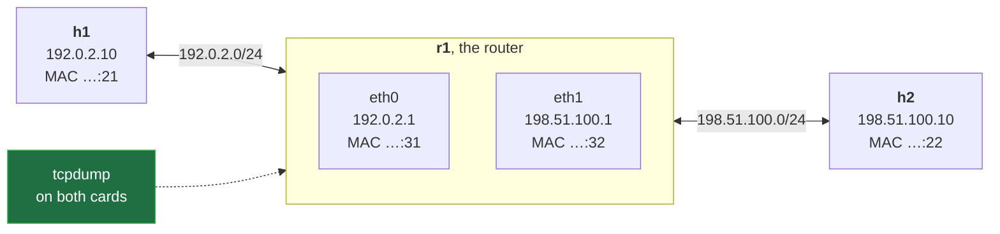
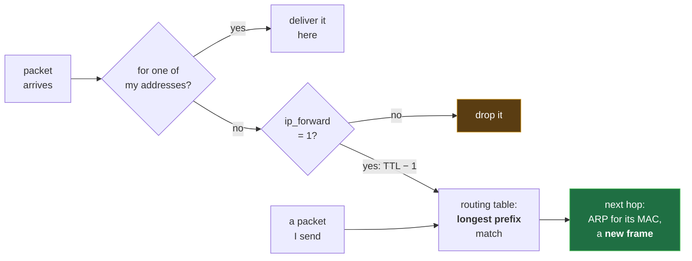
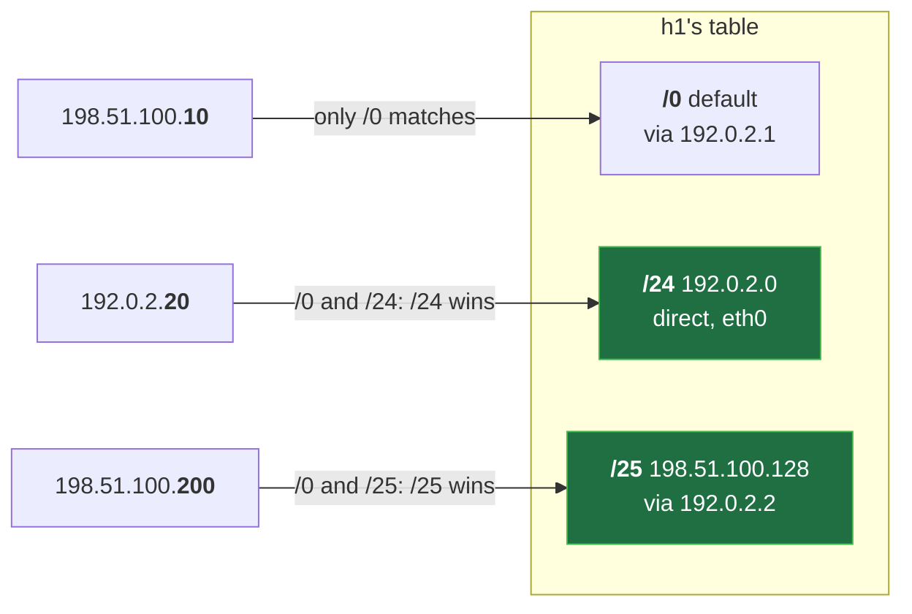

# Forwarding and Routing Tables: Default Route, Longest Prefix Match and ip_forward, on a Real Router


**Video:** coming soon on the [channel](https://www.youtube.com/@production-devops).

A ping across one Linux router fails three times, for three different reasons, before it works: no route, forwarding off, no route back. We build the router with network namespaces, read the routing table with ip route, add a default route, turn on net.ipv4.ip_forward, and prove longest prefix match with ip route get. Then we capture both sides of the router to see what forwarding really changes: a new frame with new MAC addresses, the same IP addresses, and a TTL one lower. Source address selection included. Lab script, capture script and challenge solution in the demos repo.

## Files in this folder

- [`forward.sh`](forward.sh)
- [`lab/net.sh`](lab/net.sh)
- [`challenge-solution.sh`](challenge-solution.sh) (solution of the challenge: try it yourself first)

## What you need

A Linux shell (a VM, WSL or a container is fine). Everything runs inside this folder.

## Before you start

The video runs these commands first, off screen:

```bash
bash lab/net.sh up routed >/dev/null 2>&1
```

## The lesson, step by step

The same explanations as the video, with every command. Read it, then run it yourself.

h1 pings h2, one router away. It fails three times, for three different reasons, before it works. Then we catch the router at work.

### The plan

This is lesson 9 of Networking Fundamentals. Hosts and routers. The routing table. Three failures, three fixes. Which route wins, and the router at work.

### The lab

**Our lab: two subnets, one router**



A new topology in our lab script, routed: h1 and h2 in two subnets, and r1 between them, with one card in each. Fixed MACs again: 21 and 22 for the hosts, 31 and 32 for the router.

### The idea

**Host or router: what happens to a packet**



Not for me? A host drops it. A router, with ip forward on, looks up its routing table, lowers the TTL, and sends a new frame to the next hop.

### Failure 1

A fresh lab: three hosts, two subnets, no routes added.

```console
$ bash lab/net.sh reset routed
```

What does h1 know? ip route prints its routing table.

```console
$ ip -n h1 route
```

h1 pings h2.

```console
$ ip netns exec h1 ping -c 1 198.51.100.10
```

No route matches, so nothing is sent.

192.0.2 slash 24 is on eth0: deliver directly. With this source address. The fix: a default route. Everything else goes to r1.

### Failure 2

We add a default route via r1. Default means slash zero: every address.

```console
$ ip -n h1 route add default via 192.0.2.1
```

The table now has two routes.

```console
$ ip -n h1 route
```

Ping again. Dash capital W one: wait one second for a reply.

```console
$ ip netns exec h1 ping -c 1 -W 1 198.51.100.10
```

Is r1 forwarding? sysctl prints the setting: zero. r1 is just a host.

```console
$ ip netns exec r1 sysctl net.ipv4.ip_forward
```

### Failure 3

sysctl dash w writes it: one. r1 is a router now.

```console
$ ip netns exec r1 sysctl -w net.ipv4.ip_forward=1
```

Ping again.

```console
$ ip netns exec h1 ping -c 1 -W 1 198.51.100.10
```

The request reaches h2. But h2's table has only its own subnet.

```console
$ ip -n h2 route
```

So h2 gets a default route too, via r1.

```console
$ ip -n h2 route add default via 198.51.100.1
```

It works. ttl 63: the reply crossed one router.

```console
$ ip netns exec h1 ping -c 1 -W 1 198.51.100.10
```

### So far

So far: a routed ping needs a route there, forwarding on the router, and a route back. Next: when two routes match, which one wins?

### Longest prefix

**Longest prefix match: the most specific route wins**



Every matching route is a candidate; the longest prefix, the most specific, wins. 200 is in the upper half, so the slash 25 beats the default.

We add the slash 25, via a second router. It need not exist: we only ask.

```console
$ ip -n h1 route add 198.51.100.128/25 via 192.0.2.2
```

ip route get asks the table. For 198.51.100.10, only the default matches.

```console
$ ip -n h1 route get 198.51.100.10
```

For 200: the slash 25 wins.

```console
$ ip -n h1 route get 198.51.100.200
```

A neighbour on h1's subnet: no via, direct.

```console
$ ip -n h1 route get 192.0.2.20
```

### The router at work

What does r1 change? This script listens on both its cards.

```
#!/usr/bin/env bash
# One ping from h1 to h2, captured on both cards of the router r1 (run it once the ping works)
ip netns exec r1 tcpdump -n -i eth0 -w in.pcap -Z root icmp 2>/dev/null &
ip netns exec r1 tcpdump -n -i eth1 -w out.pcap -Z root icmp 2>/dev/null &
sleep 1
ip netns exec h1 ping -c 1 198.51.100.10 >/dev/null
sleep 1
kill %1 %2
wait
echo "captures saved: in.pcap out.pcap"
```

Two captures. One ping, and cleanup.

```
#!/usr/bin/env bash
# One ping from h1 to h2, captured on both cards of the router r1 (run it once the ping works)
ip netns exec r1 tcpdump -n -i eth0 -w in.pcap -Z root icmp 2>/dev/null &
ip netns exec r1 tcpdump -n -i eth1 -w out.pcap -Z root icmp 2>/dev/null &
sleep 1
```

Run with bash. No reset here: it keeps the routes we just added. On r1's eth0, the side facing h1: into in dot pcap. On eth1, h2's side: into out dot pcap. A second for both to start.

```console
$ ip netns exec r1 tcpdump -n -i eth0 -w in.pcap -Z root icmp 2>/dev/null &
```

- `ip netns exec r1`: on the router
On the router,

- `-n -i eth0`: numbers only; card eth0
numbers only, on eth0,

- `-w in.pcap -Z root`: into a file, as root
into a file, as root.

- `icmp`: filter: ping packets only
The filter icmp keeps only the ping packets.

- `2>/dev/null &`: quiet, in the background
Quietly, in the background.

```
ip netns exec h1 ping -c 1 198.51.100.10 >/dev/null
sleep 1
kill %1 %2
wait
echo "captures saved: in.pcap out.pcap"
```

One ping, its output hidden: the captures tell the story. A second for the last packets, then stop both captures. Wait for them, and name the files.

The whole script. Same packet on both sides: what will differ?

```
#!/usr/bin/env bash
# One ping from h1 to h2, captured on both cards of the router r1 (run it once the ping works)
ip netns exec r1 tcpdump -n -i eth0 -w in.pcap -Z root icmp 2>/dev/null &
ip netns exec r1 tcpdump -n -i eth1 -w out.pcap -Z root icmp 2>/dev/null &
sleep 1
ip netns exec h1 ping -c 1 198.51.100.10 >/dev/null
sleep 1
kill %1 %2
wait
echo "captures saved: in.pcap out.pcap"
```

```console
$ tcpdump -n -t -e -r in.pcap
```

- `-t`: no timestamps
To read: dash t, no timestamps,

- `-e`: show the MACs (lesson 4)
dash e, the MAC addresses,

- `-r in.pcap`: read the saved file
dash r, read the file.

We run it.

```console
$ bash forward.sh
```

h1's side: MACs 21 and 31.

```console
$ tcpdump -n -t -e -r in.pcap
```

h2's side: the same IPs, new MACs, 32 and 22.

```console
$ tcpdump -n -t -e -r out.pcap
```

And the request's TTL on h2's side, with dash v: 63.

```console
$ tcpdump -n -t -v -r out.pcap -c 1
```

- `h1 → r1`: to …:31, ttl 64
h1 sends to its default router: the frame goes to r1's MAC, the packet to h2.

- `r1 → h2`: …:32 → …:22, ttl 63
r1 lowers the TTL and builds a new frame, from its eth1 to h2.

- `h2 → r1`: reply to …:32
h2 replies through its default route: to r1.

- `r1 → h1`: …:31 → …:21
And r1 forwards the reply, in one more new frame.

### Source address

r1 has two addresses. Which source does it use? Toward h1:

```console
$ ip -n r1 route get 192.0.2.10
```

And for h2.

```console
$ ip -n r1 route get 198.51.100.10
```

The route picks the card; the card's address is the source.

### Gotchas

The most forgotten route is the route back. sysctl dash w is lost at reboot: put it in slash etc slash sysctl dot d. Replies on another path? Reverse path filtering may drop them.

### Recap

Recap: a router is a host that forwards. The most specific route wins; the default is the last resort. Each hop: a new frame, the same IPs, one less TTL. Challenge: turn forwarding off, and ping r1's far address from h1. Does it answer, and why? Solution in the demo repo.

Next lesson: the IPv6 header. Subscribe so you do not miss it.

## All the commands, to copy

Run them from inside this folder, in this order (some are expected to fail: that is the point of the demo).

```bash
bash lab/net.sh reset routed
ip -n h1 route
ip netns exec h1 ping -c 1 198.51.100.10
ip -n h1 route add default via 192.0.2.1
ip netns exec h1 ping -c 1 -W 1 198.51.100.10
ip netns exec r1 sysctl net.ipv4.ip_forward
ip netns exec r1 sysctl -w net.ipv4.ip_forward=1
ip -n h2 route
ip -n h2 route add default via 198.51.100.1
ip -n h1 route add 198.51.100.128/25 via 192.0.2.2
ip -n h1 route get 198.51.100.10
ip -n h1 route get 198.51.100.200
ip -n h1 route get 192.0.2.20
ip netns exec r1 tcpdump -n -i eth0 -w in.pcap -Z root icmp 2>/dev/null &
tcpdump -n -t -e -r in.pcap
bash forward.sh
tcpdump -n -t -e -r out.pcap
tcpdump -n -t -v -r out.pcap -c 1
ip -n r1 route get 192.0.2.10
ip -n r1 route get 198.51.100.10
```

## Challenge

Challenge: turn forwarding off, and ping r1's far address from h1. Does it answer, and why? Solution in the demo repo.

When you have tried: [`challenge-solution.sh`](challenge-solution.sh).

---

From the [ProductionDevOps](https://www.youtube.com/@production-devops) channel: real-world DevOps and SRE, explained with real commands.
