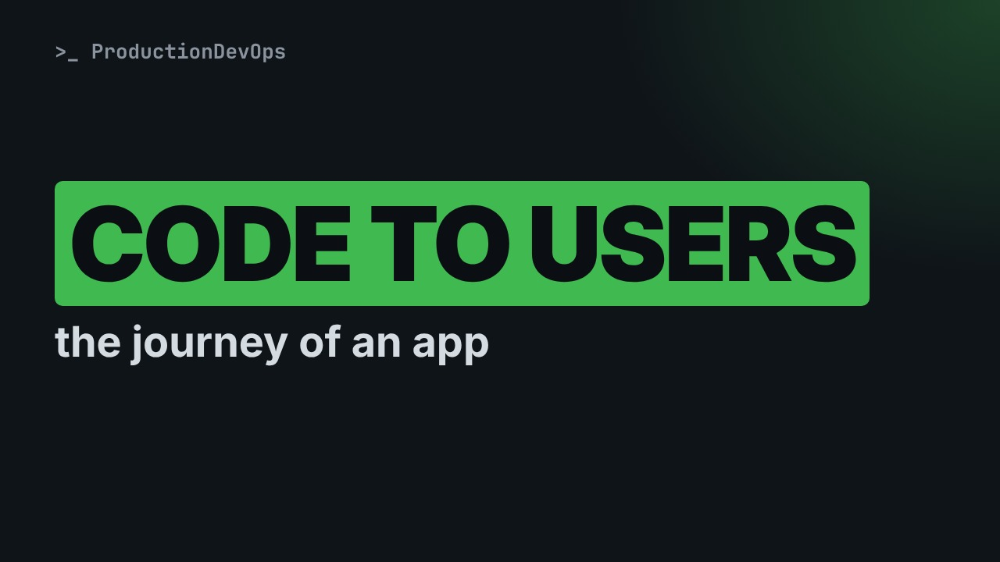
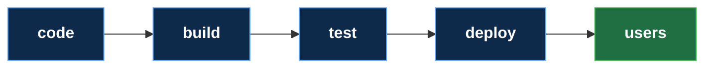
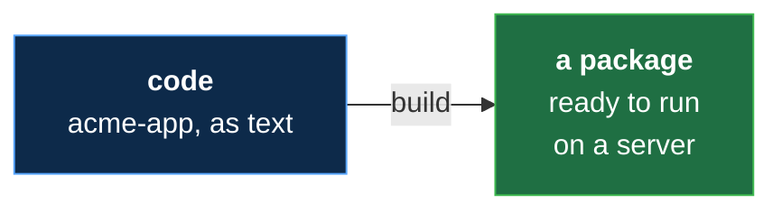
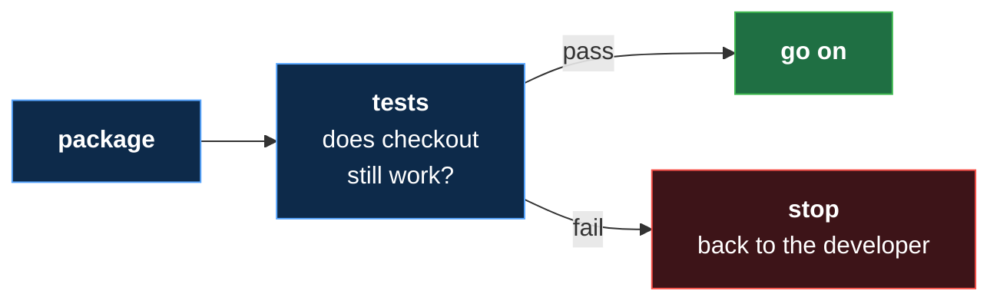
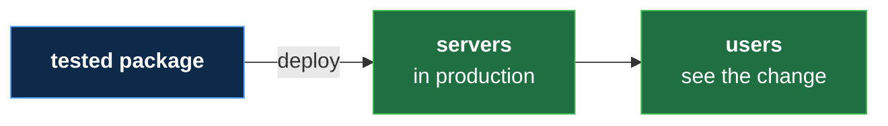
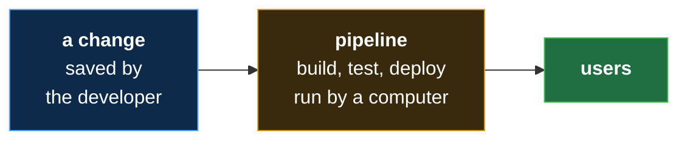
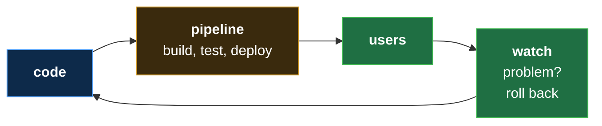

# From Code to Users: the Journey of an App (DevOps from Zero, No Experience Needed)

**Video:** https://youtu.be/7AdM3nJM8ic

A developer changes one line on Monday. How does that change reach every customer of the app? This lesson of DevOps from Zero follows it station by station, with pictures and a restaurant comparison: code, build, test, deploy, and the pipeline that runs these steps the same way every time. Then the step most beginners forget, after the customers get the change, and what CI and CD mean. No terminal, nothing to install, no experience needed. Every new word is explained on screen. The challenge and its solution are in the demos repo.

## Files in this folder

- [`challenge-solution.md`](challenge-solution.md) (solution of the challenge: try it yourself first)

## What you need

A Linux shell (a VM, WSL or a container is fine). Everything runs inside this folder.

## The lesson, step by step

The same explanations as the video, with every command. Read it, then run it yourself.

A developer changes one line on Monday. How does it reach every customer? We follow it, and find the step most beginners forget.

For this lesson you need nothing. Just watch. No terminal and no code. Only pictures. About five minutes.

### The plan

This is lesson two of DevOps from Zero. First, the whole journey, in one picture. Then each station, one at a time. Then the pipeline that runs them all. And the step people forget.

### The journey

- `code — Instructions for a computer, written by people as text (like a recipe: steps written down for the kitchen)`: 
First word: code. Code is instructions for a computer, written by people as text. Think of a recipe.

**The journey, in one picture**

Here is the whole journey. Code, build, test, deploy, and then the users. Let's visit each station.

### Build

- `build — Turning code into a program that is ready to run (like cooking the dish from the recipe)`: 
Station one: build. A build turns code into a program that is ready to run. Like cooking the dish from the recipe.

**Build: from text to a package**

The code of acme app goes in. A package comes out, ready to run on a server. Same code, same package, every time.

### Test

- `test — An automatic check that the program does what it should (like tasting the dish before it leaves the kitchen)`: 
Station two: test. A test is an automatic check that the program does what it should. Like tasting the dish before it leaves the kitchen.

**Test: pass or stop**

For example: does checkout still work? If the tests pass, the package goes on. If one fails, everything stops: back to the developer.

### So far

So far: the build turns the code into a package. The tests check it. A failing check stops the journey. Next: we reach the users. And then, the step people forget.

### Deploy

- `deploy — Putting a new version on the servers that users reach (like carrying the dish from the kitchen to the table)`: 
Station three: deploy. To deploy means to put a new version on the servers that users reach. Like carrying the dish to the table.

**Deploy: into production**

The tested package goes to the servers in production. From that moment, users see the change.

### The pipeline

- `pipeline — The fixed list of steps every change goes through, run by a computer (like the kitchen line: same stations, same order, every dish)`: 
Who carries the change from station to station? A pipeline: a fixed list of steps, run by a computer. Like a kitchen line.

**One pipeline, every change**

The developer saves a change, and the pipeline starts by itself. Build, test, deploy. No person has to remember the order.

Why a pipeline? The same steps, in the same order, every time. Nobody can skip the tests, not even in a hurry. It takes minutes, not days. And it keeps a record of every run: what, when, and pass or fail.

### The forgotten step

Now, the forgotten step. Deployed is not the end. After every deploy, you watch production. Are there errors? Are pages slow? If all is good, the change stays. If something is wrong, you go back.

- `rollback — Going back to the previous version that worked (like serving yesterday's recipe while the cook fixes the new one)`: 
Going back has a name: rollback. You put back the previous version that worked. Like serving yesterday's recipe while the cook fixes the new one.

**The full journey**

So the journey is really a loop. Code, pipeline, users, watch. If there is a problem, roll back, then fix the code.

### Good to know

Two letters you will hear. CI: every change is built and tested, automatically. CD: tested changes reach the users, automatically too. Some teams still keep a person, to press the last button. That is fine.

### Recap

Recap: build, test and deploy turn code into a running app. A pipeline runs these steps, the same way every time. Then you watch production. If needed, you roll back. Your challenge: put these in order. Test, users, code, deploy, build. The answer is in the demo repo.

### Where next

Where next? Lesson three: what a server really is, and where the cloud is. Lesson four: automation, letting the computer repeat the work. And in lesson six, how we watch production.

Next lesson: servers, clouds and data centers. Subscribe so you do not miss it.

## Challenge

Your challenge: put these in order. Test, users, code, deploy, build. The answer is in the demo repo.

When you have tried: [`challenge-solution.md`](challenge-solution.md).

---

From the [ProductionDevOps](https://www.youtube.com/@production-devops) channel: real-world DevOps and SRE, explained with real commands.
